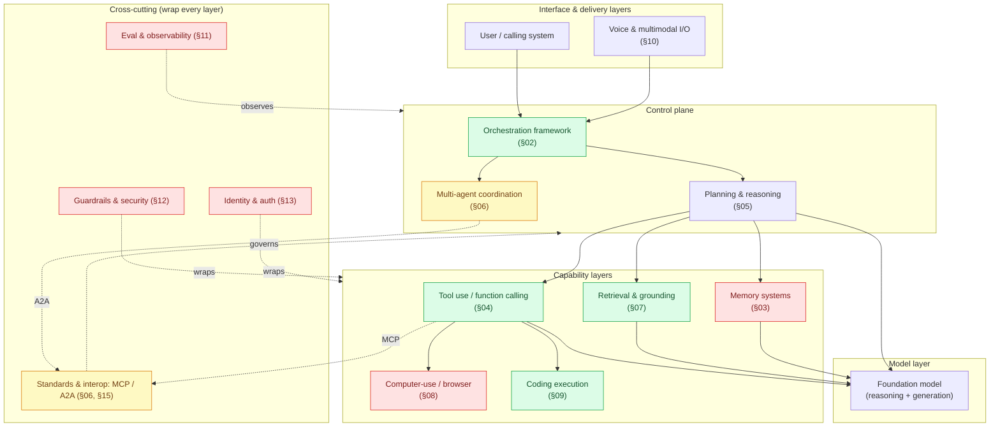
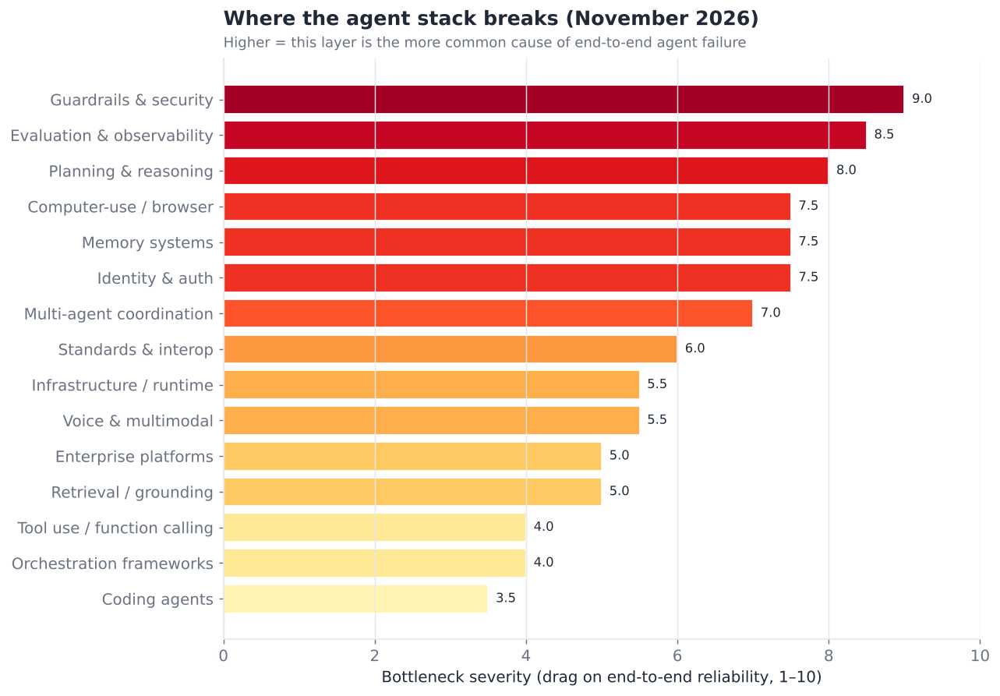
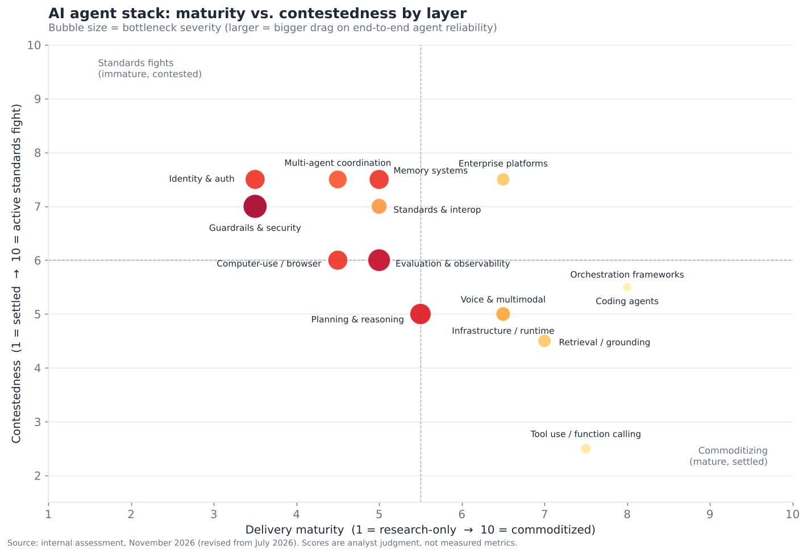

# 01 — Executive Summary

*Cross-category challenge map for the AI agent stack. Current as of November 2026 (updated from the
July 22, 2026 snapshot; see "What changed since July 2026" below).*

---

## The one-paragraph version

The AI agent field in mid-2026 is not one technology maturing evenly; it is fifteen loosely-coupled layers maturing at wildly different rates. The layers closest to the model — tool calling, single-agent orchestration, retrieval, and autonomous coding — have crossed from "demoed" into "shipped and reliable enough to build businesses on." The layers that make agents *safe, accountable, and interoperable* — memory, security, identity, evaluation, and cross-vendor protocols — are still a mix of active engineering bottlenecks and unresolved standards fights. The November 2026 update does not change that picture so much as sharpen it: a new frontier-model generation shipped, the benchmarks that defined the capability layers saturated or were exposed as gameable, the interop standards consolidated further under one neutral foundation, and capital and acquirers moved decisively into the bottleneck layers. The single most important structural fact of 2026 is that the **bottleneck has moved off the model and onto the scaffolding around it**. Frontier models are no longer the limiting reagent for most agent tasks; the limiting reagents are durable memory, trustworthy tool execution, permissioning, and the ability to measure whether an agent is getting better or worse. This document maps all fifteen layers, scores their maturity, names the players in each, and flags where the standards are genuinely unsettled versus where a de-facto winner has already emerged.

---

## What changed since July 2026 (November 2026 update)

The July 2026 snapshot has aged quickly. Between late July and early November 2026 every one of the
fifteen layers moved, but the *shape* of the challenge map held: capability layers kept
commoditizing, trust-and-interop layers kept absorbing the engineering effort and the capital. The
cross-category digest below is distilled from the per-section update logs (each of which carries
dated, source-linked, confidence-tagged entries — see the "What changed since July 2026" subsection
at the top of §02–§15). Confidence tags follow §17.

**Models and capability layers**

- **A new frontier generation shipped (Sep–Oct 2026).** Anthropic's Claude 5.x family (Fable 5.1,
  Opus 5.5, Sonnet 5.5, Haiku 5.5) *(official)*, OpenAI's GPT-6 family (Astra/Sol/Luna, then
  GPT-6.1) and Google's Gemini 4 Argon *(inferred)*. Reasoning is now always-on/adaptive rather than a
  separate "reasoning model" tier; HLE-with-tools passed 60% and ARC-AGI-3 went from <1% at launch to
  ~63% on the standard harness in seven months *(inferred)* — while long-horizon reliability remains
  the unsolved part of §05.
- **Tool use's remaining fixes went GA.** Tool search, programmatic (code-based) tool calling, and
  constrained-decoding structured outputs are generally available features of the major model APIs
  *(official/inferred)*; τ-bench moved to an incompatible 2.0 *(official)* (§04).
- **Coding saturated its flagship benchmark and consolidated its money.** SWE-bench Verified reached
  ~95–97% and was archived as saturated by at least one evaluator; vendors now headline Terminal-Bench
  4.0 *(official/inferred)*. SpaceX closed a $60B all-stock acquisition of Cursor (Aug 14) *(official)*;
  Cognition raised at ~$48B *(inferred)*; Google retired the consumer Gemini CLI for its closed
  Antigravity CLI *(official)* (§09).
- **Computer-use made partial-credit progress, not reliability progress.** Long-horizon OSWorld partial
  credit rose to ~78–82%, but no model clearly reports full-task completion far above ~21% *(official/
  inferred)*. Agentic browsing is folding into extensions and built-in browser agents (Claude in
  Chrome GA; ChatGPT Atlas discontinued Aug 9) *(official/inferred)* (§08).
- **Voice crossed into full-duplex, reasoning-capable speech-to-speech** (OpenAI GPT-Live-1, Gemini 3.8
  Live) at a few cents per minute; ElevenLabs tendered at a $22B valuation *(official)* (§10).

**Scaffolding and bottleneck layers**

- **Orchestration consolidated on graph runtimes and hosted platforms.** Microsoft archived AutoGen in
  favor of Microsoft Agent Framework; Google ADK 2.0 is a graph engine; hosted runtimes (Claude
  Managed Agents, AWS AgentCore, Gemini Enterprise Agent Platform — the renamed Vertex AI) keep
  pulling ahead *(official)* (§02).
- **Memory got managed products and offline consolidation previews** (Anthropic "Dreams", Google
  memory profiles GA, AgentCore episodic memory), while LoCoMo/LongMemEval saturated in the low-to-mid
  90s and evaluation is moving to 10M-token and action-based tests *(official/inferred)* (§03).
- **Retrieval became a measured, richly valued category.** Exa (~$2.2B) and Parallel (~$2B) raised,
  Nebius bought Tavily, Perplexity retired its Sonar chat API for an Agent API, and an independent
  search-API index launched *(official/inferred)* (§07).
- **Eval and observability are being bought up** — Langfuse (ClickHouse), Galileo (Cisco/Splunk),
  Promptfoo (OpenAI), Helicone (Mintlify), Fiddler (CrowdStrike, announced Nov 3) — and audits showed
  most agent benchmarks can be gamed without solving tasks *(official/inferred)* (§11).
- **Security and identity are merging commercially.** Prompt injection remains unsolved, but endpoint,
  identity and lab acquirers (CrowdStrike, Okta, Cyera, Palo Alto, OpenAI) bought agent-security and
  non-human-identity startups; MCP's July spec tightened authorization and NIST published agent-identity
  design tenets *(official/inferred)*. EU AI Act GPAI enforcement powers went live Aug 2 *(official)*
  (§12, §13).
- **Agentic payments are layering, not consolidating**: AP2 moved to the FIDO Alliance, x402 to a Linux
  Foundation x402 Foundation, Google launched UCP, and OpenAI wound down ChatGPT Instant Checkout; real
  transaction volume is still small *(official/inferred)* (§13, §15).
- **Enterprise became a control-plane race.** Microsoft Agent 365 (GA May; 50M+ registered agents),
  ServiceNow's AI Control Tower/"AI Passport" and Salesforce's third-party agent orchestration all
  compete to govern *every* vendor's agents; Agentforce ARR passed $1.5B on a broadened definition
  *(official)* (§14).

**Standards**

- **MCP spec `2026-07-28` is final** — a stateless core, Tasks moved into a formal extension, tightened
  authorization *(official)*. **A2A (v1.0 since March) joined the Agentic AI Foundation on Aug 17**, so
  both protocols now share one neutral home; AAIF grew to 10 projects (adding Agent Skills, Open
  Responses, OpenEnv, OpenSandbox) and 300+ members *(official)*. The frontier question is no longer
  "which protocol" but agent identity and the boundary between MCP Tasks and A2A delegation (§06, §15).
- **Correction to the July snapshot:** IBM's ACP (Agent Communication Protocol) had already merged into
  A2A in August 2025 *(official)*; the "A2A vs. ACP" contest described in July was effectively over
  before the snapshot was written. §06, §15 and §16 have been corrected.

**Net effect on the scores.** The maturity table below has been re-scored for November 2026 (July
values in parentheses where they changed). The biggest moves are in **standards/interop** and
**multi-agent** (less contested now that MCP and A2A share a foundation), **coding, tool use and
orchestration** (further commoditized), and **memory, computer-use and voice** (more mature products,
slightly lower drag). **Security, evaluation and planning did not improve** in severity — they remain
the top three places where agents break.

---

## How the layers relate

A production agent is a stack. A request enters at the top, and every layer below has to hold for the agent to complete a non-trivial task reliably. The diagram below shows the dependency structure this document is organized around — orchestration sits in the middle coordinating everything, the model is one (increasingly commoditized) component, and the cross-cutting concerns (security, identity, evaluation) wrap the whole thing rather than sitting at a single point.

Read the colors as the thesis of this whole document: **green** layers are commoditizing (pick a vendor, move on), **red** layers are active engineering bottlenecks (this is where your agent breaks), and **yellow** layers are unsettled standards fights (betting wrong here is expensive).

---

## The three-bucket challenge map

Every one of the fifteen categories falls into one of three buckets. This is the executive takeaway; the rest of the document is the evidence.

### Bucket 1 — Solved / commoditizing (pick a vendor, move on)

These layers have a dominant approach, multiple interchangeable vendors, and reliability good enough that they are rarely the reason an agent fails.

- **Tool use / function calling (§04).** Native structured tool calling is now table stakes in every frontier model. Schemas (JSON Schema), the calling convention (MCP), and reliability (95%+ single-call selection accuracy on well-specified toolsets) have converged. By November 2026 the main fixes for the *many-tool* problem — tool search, programmatic tool calling, and constrained-decoding structured outputs — are GA API features; error recovery remains the under-built half.
- **Orchestration frameworks (§02).** LangGraph, CrewAI, the merged Microsoft Agent Framework (AutoGen was archived in October 2026), and the model vendors' own SDKs (OpenAI Agents SDK, Anthropic Agent SDK, Google ADK) are mature enough that framework choice is now a preference/lock-in question, not a capability question.
- **Retrieval & grounding (§07).** Agentic RAG — retrieval driven by the agent's own tool calls rather than a fixed pre-fetch — is the settled pattern. Vector databases are commoditized infrastructure.
- **Coding agents (§09).** The most mature *vertical* application of agents. SWE-bench Verified effectively saturated in 2026 (~95–97% for frontier configurations) and is being retired as a headline metric in favor of harder suites such as Terminal-Bench 4.0. Autonomous coding is the clearest example of "shipped and reliable" in the whole field — and, with SpaceX's $60B Cursor acquisition and Cognition at ~$48B, the most richly valued.

### Bucket 2 — Active engineering bottleneck (this is where agents break)

These layers work in demos and break in production. They are the current frontier of *engineering* (not necessarily research) effort.

- **Memory systems (§03).** No settled architecture for durable, consolidating, forgetting memory. Every serious agent product is building bespoke memory, and it is the number-one cause of "the agent forgot what we established yesterday."
- **Computer-use / browser agents (§08).** Screen understanding and action reliability are demoed-brittle. Task success rates on realistic benchmarks (OSWorld, WebArena-class) remain far below what production use requires.
- **Guardrails & security (§12).** Prompt injection remains fundamentally unsolved — there is no robust defense, only defense-in-depth mitigation. This is the single highest-severity bottleneck in the stack because it gates enterprise deployment.
- **Evaluation & observability (§11).** You cannot reliably measure whether an agent regressed. Benchmarks are gameable and don't predict production behavior; tracing tooling is improving but non-standard.
- **Identity & auth (§13).** "How does an agent act on my behalf without holding my password" is still being invented. OAuth-for-agents and delegated-credential standards are early.

### Bucket 3 — Unsettled standards fight (betting wrong is expensive)

- **Multi-agent coordination (§06)** and **standards / interop (§15).** MCP has effectively won the *tool-connection* layer (Section 15 argues this is now a settled de-facto standard; its `2026-07-28` spec made the core stateless). A2A reached v1.0 in March 2026 and joined MCP in the Linux Foundation's Agentic AI Foundation (AAIF) in August 2026, and IBM's ACP had already merged into A2A in 2025 — so the *which-protocol* fight is largely over. What remains unsettled is the boundary between MCP Tasks and A2A delegation, agent identity across organizations, and agentic payments, where AP2, ACP (Agentic Commerce Protocol), UCP and x402 are layering rather than consolidating.

---

## Where the stack breaks

The chart below ranks all fifteen layers by *bottleneck severity* — how often, in our assessment, that layer is the proximate cause of an end-to-end agent failure. The top of this list is where engineering effort has the highest marginal return in 2026.

Security, evaluation, memory, planning, and computer-use dominate the top of the list. Note what is *not* at the top: the foundation model, tool calling, and retrieval. This is the empirical basis for the claim that the bottleneck has moved off the model.

The second chart positions each layer on two axes — how mature it is and how contested — with bubble size encoding the same severity score. The four quadrants tell four different strategic stories.

- **Bottom-right (mature, settled):** tool use, retrieval, coding. Commodity. Build on them.
- **Top-left (immature, contested):** identity/auth, multi-agent, standards. Highest strategic risk — the ground is still moving.
- **Top-center (contested, medium maturity):** memory, evaluation, security. Where the hard *product* differentiation is being won today.
- **Bottom-center (settled-ish, medium maturity):** planning, voice, infrastructure. Steady incremental progress, low standards drama.

---

## Maturity scoring across all fifteen categories

The table below is the quantitative backbone of this summary. **Maturity** (1–10) captures how close the layer is to commoditized reliability. **Contestedness** (1–10) captures how unsettled the dominant approach and standards are. **Severity** (1–10) captures how much the layer drags on end-to-end reliability. **Bucket** assigns each to one of the three strategic buckets above. Scores are analyst judgment calibrated against the detailed sections, not measured metrics. **November 2026 re-score:** where a score changed since the July snapshot, the July value is shown in parentheses.

| # | Category | Maturity | Contested | Severity | Bucket | Dominant approach (Nov 2026) | Leading players |
|---|---|:--:|:--:|:--:|---|---|---|
| 02 | Orchestration frameworks | 8.0 (7.5) | 5.5 (6.0) | 4.0 | Commoditizing | Graph runtimes + hosted agent platforms | LangGraph, MS Agent Framework, Google ADK, vendor SDKs/managed runtimes |
| 03 | Memory systems | 5.0 (4.5) | 7.5 | 7.5 (8.0) | Bottleneck | Managed memory + offline consolidation, no standard | Mem0, Zep, Letta, vendor-native (Anthropic, Google, AWS) |
| 04 | Tool use / function calling | 7.5 (7.0) | 2.5 (3.0) | 4.0 (4.5) | Commoditizing | Native tool calls over MCP + tool search | All frontier vendors |
| 05 | Planning & reasoning | 5.5 (5.0) | 5.0 | 8.0 (8.5) | Bottleneck | Always-on adaptive in-model reasoning | Anthropic, OpenAI, Google, DeepSeek, Qwen |
| 06 | Multi-agent coordination | 4.5 (4.0) | 7.5 (8.5) | 7.0 | Standards fight | A2A (AAIF) + supervisor/role patterns | AAIF A2A, MS, Anthropic, CrewAI, LangGraph |
| 07 | Retrieval / grounding | 7.0 | 4.5 (4.0) | 5.0 | Commoditizing | Agentic RAG + agent-native web search APIs | Vector DBs, Exa, Parallel, Perplexity, vendor retrieval |
| 08 | Computer-use / browser | 4.5 (4.0) | 6.0 | 7.5 (8.0) | Bottleneck | VLM screen understanding + in-browser agents | Anthropic, OpenAI, Google, Perplexity |
| 09 | Coding agents | 8.0 (7.5) | 5.5 | 3.5 | Commoditizing | Agentic harness on frontier model | Claude Code, Cursor (SpaceX), Codex, Devin, Copilot |
| 10 | Voice & multimodal | 6.5 (6.0) | 5.0 | 5.5 (6.0) | Bottleneck-ish | Full-duplex speech-to-speech models | OpenAI, Google, ElevenLabs, xAI, startups |
| 11 | Evaluation & observability | 5.0 (4.5) | 6.0 (6.5) | 8.5 | Bottleneck | Tracing + LLM-as-judge; vendors consolidating | LangSmith, Braintrust, Arize, Langfuse (ClickHouse), Datadog/Splunk |
| 12 | Guardrails & security | 3.5 | 7.0 | 9.0 | Bottleneck | Defense-in-depth, no robust fix | Check Point/Lakera, Palo Alto, CrowdStrike, Cisco, vendor |
| 13 | Identity & auth | 3.5 (3.0) | 7.5 (8.0) | 7.5 | Standards fight | OAuth/MCP enterprise auth, agent IDs | Okta/Auth0, Microsoft Entra, CyberArk, card networks |
| 14 | Enterprise platforms | 6.5 (6.0) | 7.5 (7.0) | 5.0 | Contested | Cross-vendor agent control planes | Microsoft, Salesforce, ServiceNow, Google, OpenAI |
| 15 | Standards & interop | 5.0 (4.0) | 7.0 (9.0) | 6.0 (6.5) | Standards fight | MCP + A2A under AAIF | Agentic AI Foundation (LF), all majors |
| — | Infrastructure / runtime | 6.5 | 5.0 | 5.5 | Commoditizing | Sandboxed execution + serverless | E2B, Modal, Daytona, cloud vendors |

A second view of the same data, collapsed to the three-bucket verdict and the single most important open question per category:

| Category | Verdict | The one open question that matters |
|---|---|---|
| Tool use | **Solved** | Reliable selection across 100s of tools |
| Orchestration | **Solved** | Lock-in vs. portability of agent definitions |
| Retrieval | **Solved** | Freshness / real-time grounding at low latency |
| Coding | **Solved** | Trustworthy autonomous merge without human review (now that SWE-bench is saturated) |
| Planning | **Bottleneck** | Reliable long-horizon (100+ step) decomposition |
| Memory | **Bottleneck** | A standard, portable memory architecture |
| Computer-use | **Bottleneck** | Full-task completion (not partial credit) on long real-UI tasks |
| Voice/multimodal | **Bottleneck** | Sub-500ms end-to-end with interruption handling |
| Evaluation | **Bottleneck** | Regression detection that predicts production |
| Security | **Bottleneck** | Any robust prompt-injection defense at all |
| Multi-agent | **Standards fight** | Does A2A see real cross-organization traffic, and where does it end and MCP Tasks begin? |
| Identity/auth | **Standards fight** | A winning delegated-credential standard |
| Standards | **Standards fight** | Agent identity and payments standards, now that MCP/A2A share AAIF |
| Enterprise | **Contested** | Platform lock-in vs. best-of-breed assembly |
| Infrastructure | **Solved-ish** | Cost/cold-start of per-agent sandboxes |

---

## Five cross-cutting theses

Threads that recur across every section, stated once here.

**1. The model is no longer the bottleneck for most tasks.** Frontier models in late 2026 (Claude Opus 5.5 / Fable 5.1, the GPT-6 family, Gemini 4, and strong open weights such as DeepSeek V4, Qwen3.6 and Kimi K3) are individually capable enough that agent failures overwhelmingly trace to memory loss, tool-execution errors, bad long-horizon planning, or missing guardrails — not to the model being unable to reason. This inverts the 2023–2024 situation and reorients where the value accrues: toward the scaffolding companies.

**2. Standards consolidated faster than expected at the tool layer, then at the agent layer too.** MCP going from an Anthropic experiment (late 2024) to a Linux-Foundation-governed standard (via the Agentic AI Foundation, December 2025) backed by OpenAI, Google, Microsoft, and AWS is one of the fastest standards convergences in recent computing history — closer to the speed of a de-facto winner like JSON than a committee standard like SOAP. A2A followed about a year behind: v1.0 in March 2026 and into the same foundation in August 2026, with IBM's competing ACP already folded in. The open standards questions have moved to identity, payments, and the MCP/A2A boundary. This is covered in depth in §15.

**3. Security is the gating factor for enterprise autonomy, and it is unsolved.** Prompt injection has no robust fix. Every enterprise deployment of autonomous agents is currently a risk-management exercise in *limiting blast radius* (scoping permissions, sandboxing, human-in-the-loop) rather than *preventing compromise*. Until this changes, "autonomous" agents in the enterprise will remain semi-autonomous. This is the highest-severity item in the whole document (§12).

**4. Evaluation is the silent bottleneck.** The field cannot reliably answer "is this agent better than last week's?" Benchmarks are saturating and gameable; production behavior is under-instrumented. This slows every other layer because you cannot safely iterate on what you cannot measure (§11).

**5. Vertical maturity is uneven and instructive.** Coding agents are years ahead of every other vertical because the domain has cheap, automatic, high-quality reward signals (does the test pass? does it compile?). Domains without that signal — general computer-use, open-ended research, voice support — lag precisely because the reward is expensive and subjective. **The presence or absence of a cheap verifier is the best single predictor of how mature an agent vertical is.**

---

## The 2023 → 2026 arc, in one page

It is worth stating explicitly how the field arrived here, because the trajectory
predicts where the bottlenecks move next.

**2023 — the prompt era.** Agents were prompt chains. The dominant abstraction was
"give the model a scratchpad and a list of tools described in the system prompt,
and parse its text output for actions." Tool calling was string-parsed and
unreliable; ReAct was the state of the art; there were no real standards. Nearly
every layer in this document either did not exist as a distinct concern or was
handled ad hoc inside a single prompt. The model *was* the bottleneck: GPT-4-class
models could just barely hold a multi-step plan together.

**2024 — the framework era.** Native function calling shipped across vendors,
turning tool use from string-parsing into a structured, mostly-reliable mechanic.
LangChain, LlamaIndex, CrewAI, and AutoGen competed to be the orchestration
abstraction. Vector-database RAG became the default grounding pattern. This is when
the *layers* in this document differentiated into distinct engineering concerns —
memory, planning, retrieval, and orchestration stopped being "parts of a prompt"
and became components with their own vendors. The bottleneck began sliding off the
model and onto the plumbing.

**2025 — the protocol era.** MCP (late 2024) and A2A (April 2025) arrived and were
adopted with startling speed, standardizing the tool-connection and agent-to-agent
layers respectively. Reasoning moved *into* the model (OpenAI's o-series, then
reasoning across all major vendors), so planning quality jumped without external
scaffolding. Coding agents crossed the usefulness threshold. Computer-use launched
(Anthropic, October 2024) and browser agents proliferated — impressively demoed,
persistently brittle. Enterprise platforms (Agentforce, Copilot Studio) launched to
package all of this for non-developers.

**2026 — the reliability and governance era (now).** The open problems are no longer
"can the model do it" but "can we trust it, measure it, secure it, and make the
pieces interoperate." MCP and A2A both moved under the Linux Foundation's Agentic AI
Foundation (MCP in December 2025, A2A in August 2026), signaling the standards fight
has entered its consolidation phase. Memory, evaluation,
security, and identity are the live engineering frontiers. The maturity table above
is a snapshot of exactly this moment: the capability layers are green, the
trust-and-interop layers are red and yellow.

The arc has a direction: **each year the bottleneck moves one layer further from the
model and one layer closer to the messy realities of production, governance, and
trust.** If the pattern holds, 2027's bottlenecks will be the ones that are barely
legible today — agent economics (who pays whom when agents transact), liability and
audit, and the operational discipline of running fleets of agents. This document is
organized to make the *current* front line — the red and yellow layers — as legible
as possible.

## How to use the rest of this document

Sections 02–15 each take one layer, describe the dominant approaches and their failure modes, tabulate the competitive/standards landscape (10+ players where the category supports it), and provide diagrams and charts. Section 16 consolidates every company mentioned into a single 100+ row master table (also exported as CSV). Section 17 is the glossary and the confidence-level methodology that governs every claim in the document. Throughout, three labels recur — **shipped-reliable**, **demoed-brittle**, **research-only** — and every roadmap claim carries a confidence tag of **official**, **inferred**, or **speculative**.

*(Section word count target: 2,500. This section: ~3,800 including the November 2026 update.)*
