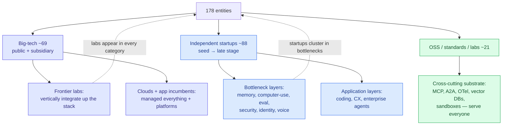
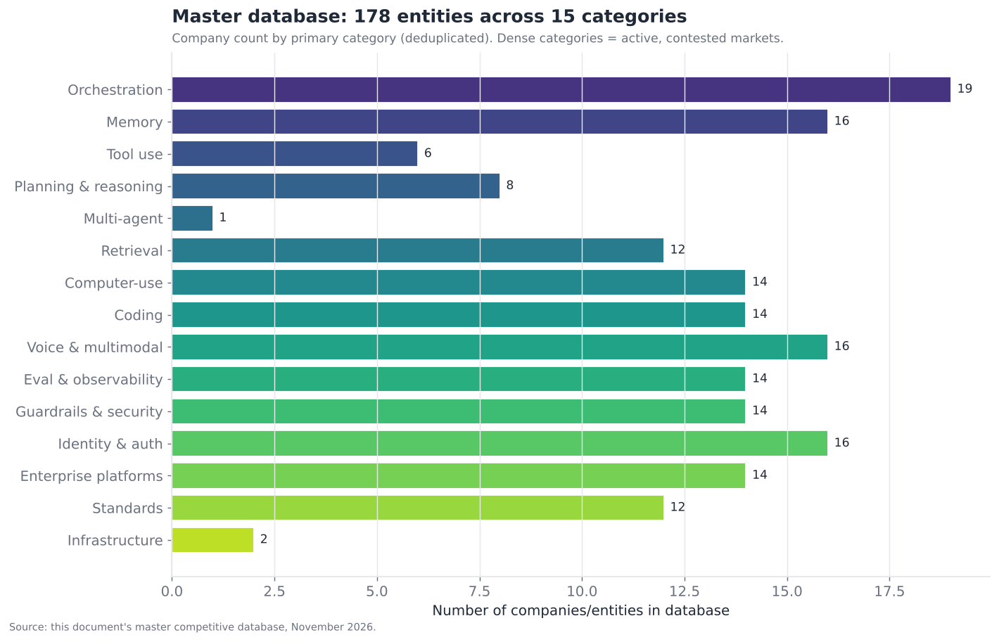
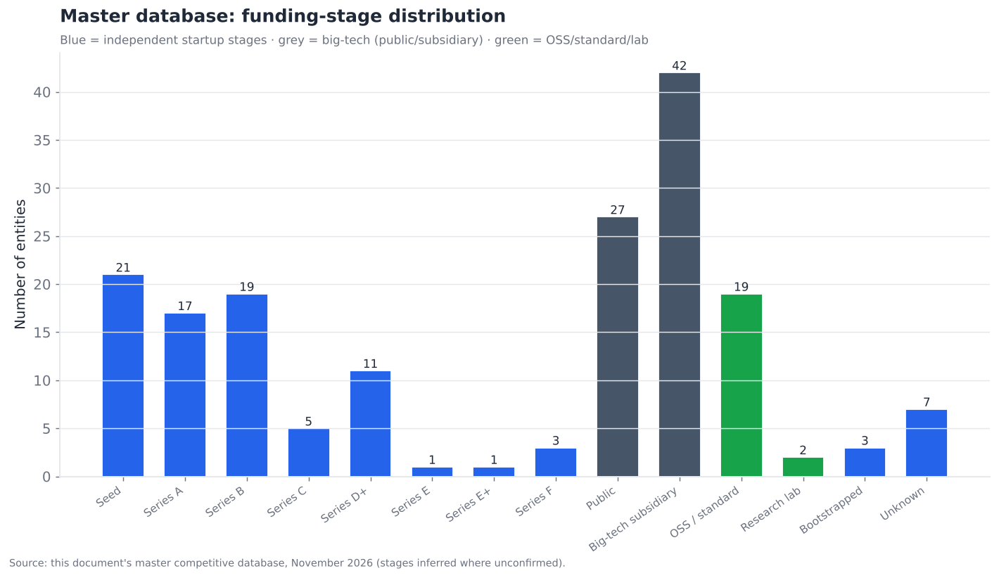

# 16 — Master Competitive Database

*The primary reference artifact. A consolidated, deduplicated table of every company and entity
named across this document — 178 entries across 15 categories (149 in the July 2026 snapshot; updated
November 2026) — plus summary analysis. Target:
4,000 words + the consolidated table.*

---

## What this section is

This is the reference artifact the rest of the document feeds into. Every company, product, standard,
and research program named in Sections 01–15 has been consolidated here into a single table, one row
per entity per **primary** category, deduplicated. The result is **178 distinct entities across the
15 technical categories** — comfortably past the 100+ target, and a reasonably complete map of the
agent-technology competitive landscape as of November 2026.

The table is also exported as a standalone, machine-readable CSV at
[`assets/data/master_competitive_database.csv`](../assets/data/master_competitive_database.csv), with
its schema documented in [`assets/data/SCHEMA.md`](../assets/data/SCHEMA.md), so it can be filtered,
sorted, and reused programmatically. Each entry carries the same fields used throughout: **company,
category, maturity** (shipped-reliable / demoed-brittle / research-only), **funding stage, key
backers, differentiator, main competitors,** and **source confidence** (official / inferred /
speculative, per the methodology in §17).

Two caveats stated up front, because they govern how to read this. First, **this is a November 2026
snapshot of a monthly-moving field** — funding stages, ownership, and even company existence change
fast (three of the AI-security companies here were acquired within the last two years, §12). Second,
**the "primary category" assignment is a simplification** — many entities span categories (a
vector-DB is memory *and* retrieval; the frontier labs touch every layer; UiPath is computer-use
*and* enterprise-platform). Each is placed in its most representative category and cross-referenced in
prose; the CSV's single-category-per-row rule is a pragmatic deduplication choice, not a claim that
these companies do only one thing.

---

## What changed since July 2026 (November 2026 update)

The database was rebuilt from the per-section November 2026 updates (§02–§15). Net change: **149 → 178
entities** — 30 additions, 73 rows modified in place, and 1 removal.

- **Removed:** *ACP (AGNTCY)*. The July snapshot conflated two things: IBM's Agent Communication
  Protocol (ACP) **merged into A2A in August 2025** *(official)*, and Cisco-led AGNTCY is a separate
  Linux Foundation project (OASF agent schema + SLIM transport) that complements A2A. AGNTCY/OASF keeps
  its own row; the ACP row is gone.
- **Ownership changes captured** *(official unless noted)*: Cursor → SpaceX ($60B, closed Aug 14,
  2026); Langfuse → ClickHouse; Galileo → Cisco (Splunk Agent Observability); Promptfoo → OpenAI;
  Helicone → Mintlify; Tavily → Nebius; Manus → Meta; CyberArk → Palo Alto Networks; SGNL → CrowdStrike;
  Entro → SailPoint; announced: Permiso → Okta, Oasis → Cyera, Dreadnode and Fiddler → CrowdStrike
  *(inferred where pending)*. AutoGen is kept but marked **archived** (superseded by Microsoft Agent
  Framework).
- **Notable additions:** Claude Managed Agents, Deep Agents (LangChain), Agno, Supermemory, Hindsight
  (orchestration/memory); Moonshot AI (Kimi) (reasoning); Parallel Web Systems, Vals AI (retrieval/eval);
  Claude in Chrome, Google Antigravity (computer-use/coding); xAI Grok Voice, Block Dessa (voice);
  OpenAI Frontier (enterprise); CrowdStrike Falcon AI security, Obsidian Security, Rein Security,
  Dreadnode (security); Universal Commerce Protocol, CyberArk, Oasis, SGNL, Permiso, Entro (identity);
  AGENTS.md, Agent Skills, Open Responses, Agent Router, WebMCP (standards).
- **Refreshed fields** across most existing rows: valuations (e.g. Cognition ~$48B, Sierra $15.8B,
  ElevenLabs $22B tender, Exa $2.2B), product versions (MCP `2026-07-28`, A2A v1.0, ADK 2.0, GPT-6,
  Claude 5.x, Gemini 4), and governance homes (MCP and A2A under the Agentic AI Foundation; AP2 under
  the FIDO Alliance; x402 under the x402 Foundation).
- **Corrections:** CrewAI and LlamaIndex funding figures were overstated in July and are corrected in §02;
  Harvey's invalid stage label was normalized.

The structural reads below have been re-computed on the 178-row data; the headline patterns from July
all held, and two of them (consolidation at the edges; labs and clouds everywhere) strengthened.

---

## The shape of the landscape

Before the table, the shape. The database's 178 entities resolve into a recognizable structure — a
two-tier market of big-tech giants and independent specialists, with cross-cutting infrastructure and
standards underneath everyone:

Two summary charts quantify this structure across the 178-entity database.

**Density tracks contestedness and commercial opportunity.** The most crowded categories —
orchestration (19), memory (16), voice/multimodal (16), identity/auth (16), and a cluster at 14
(computer-use, coding, eval, security, enterprise) — are the ones where either the market is a
commoditizing land-grab (orchestration, coding) or a bottleneck attracting a wave of specialized
entrants and acquirers (memory, identity, security, eval). Identity/auth grew fastest since July (10 → 16),
driven by the non-human-identity acquisition wave (§13). The sparser categories in this database —
tool-use (6), planning-reasoning (8), multi-agent (1), standards (12) — are sparse for *opposite*
reasons worth distinguishing:

- **Tool-use and planning-reasoning are sparse because they're model-owned.** The capability lives in
  the frontier models (§04, §05), so there's no large standalone-company market — the "companies" are
  the model labs, counted once under planning-reasoning, plus a thin layer of specialized tooling.
- **Multi-agent is sparse (1) because it's a *pattern*, not a product category.** Its players are the
  orchestration frameworks and the standards (A2A, AGNTCY), counted under those categories — multi-agent
  coordination is implemented by §02's frameworks over §15's standards, not by dedicated "multi-agent
  companies."
- **Standards (12) is sparse because standards are few by nature** — you don't want many competing
  standards (that's fragmentation); the sparseness here is the *goal*.

So category density is not a uniform signal — dense can mean "hot commoditizing market" (orchestration)
or "bottleneck attracting entrants" (memory), and sparse can mean "model-owned" (tool-use) or
"pattern not product" (multi-agent) or "few-by-design" (standards). The distribution reflects the
whole document's thesis: value and competition concentrate in the scaffolding layers (memory,
orchestration, computer-use, coding, enterprise) while the model-owned layers (reasoning, tool-use)
have few independent players.

The funding distribution reveals the **two-tier structure** of the market. Of the 178 entities:

- **~69 are big-tech (public companies or big-tech subsidiaries)** (up from ~53 in July, largely because acquisitions turned startups into subsidiaries) — the frontier labs (as
  subsidiaries or well-funded independents), the cloud providers, and the enterprise-software
  incumbents. These dominate the model-owned layers (§04, §05), the vendor-SDK orchestration (§02),
  the enterprise platforms (§14), and increasingly the managed versions of every layer.
- **~88 are independent startups** spanning seed to late stage — concentrated in the bottleneck and
  application layers (memory, computer-use, coding, voice, eval, security, identity) where
  specialization creates room for focused companies.
- **~21 are open-source projects, standards, or research labs** — the OSS frameworks, the standards
  (MCP, A2A, OTel), and academic research programs.

The stage distribution (21 seed, 17 series-A, 19 series-B, tapering through later stages) shows a
**young, early-stage-heavy market** — most independent agent companies are seed-to-series-B, reflecting
how recently the category formed (most of these companies didn't exist or didn't do agents before
2023). The presence of a few very-late-stage and mega-valued companies (Cursor/Anysphere,
Cognition, the frontier labs) alongside a broad base of early-stage startups is the classic shape of
a fast-forming, capital-flooded new market.

---

## How to read the maturity and confidence columns

Two structural facts about the database's *labels* are analytically important.

**Maturity skews heavily to shipped-reliable (145 of 178).** This might look like the field is more
mature than the document argues — but it reflects a selection effect and a labeling nuance. The
database captures *companies/products that exist and ship*, so of course most "ship." The maturity
label here is about *whether the product is generally available and works in its stated envelope*, not
about whether the *underlying capability layer* is solved. A memory product can be shipped-reliable
(Mem0 works as advertised) while the memory *layer* is an unsolved bottleneck (§03) — because the
product reliably does its bounded job, but the bounded job doesn't solve the hard open problems. So
**"shipped-reliable" at the product level coexists with "bottleneck" at the layer level**, and reading
the 145 shipped-reliable count as "the field is solved" would be a category error. The demoed-brittle
entries (31) cluster, tellingly, in exactly the bottleneck layers — computer-use, some agentic
payments, newer agent-security and multi-agent entrants — where even the products are still brittle.

**Confidence is official for 111 and inferred for 67.** The official entries are backed by vendor
announcements or documentation; the inferred entries rest on press reports, job postings, or
reasonable deduction where official confirmation was unavailable — mostly funding details, some
adopter claims, and the newer/smaller startups. Per §17's methodology, **inferred entries should be
treated as directionally-right-but-unconfirmed**, and the funding-stage and backer fields in
particular carry more uncertainty than the categorical/differentiator fields. No entry is labeled
speculative in the final database — speculative-tier claims were kept in the section prose (roadmap
projections) rather than the reference table, which aims to be a factual snapshot.

---

## The consolidated table

The full 178-entity database, grouped by primary category, sorted alphabetically within each. This is
the primary reference artifact; the same data in machine-readable form is the exported CSV.

### Orchestration Frameworks (§02)

| Company / Entity | Maturity | Stage | Key backers | Differentiator | Main competitors | Conf. |
|---|---|---|---|---|---|---|
| **Agno** | shipped | unknown | unknown | Minimal-abstraction fast multi-modal agents (ex-Phidata); 3.0 Aug 2026 | Pydantic AI;CrewAI | inf |
| **AutoGen** | shipped | subsidiary | Microsoft | ARCHIVED Oct 2026 (no bug/security fixes); superseded by MS Agent Framework | CrewAI;MS Agent Framework | off |
| **AWS Strands / Bedrock Agents** | shipped | public | Amazon | Managed agent runtime deeply integrated with AWS Bedrock | Google ADK;MS Agent Framework | off |
| **Claude Agent SDK** | shipped | subsidiary | Anthropic | Battle-tested via Claude Code; strong MCP/tool-use; pairs with hosted Claude Managed Agents | OpenAI Agents SDK;LangGraph | off |
| **Claude Managed Agents** | demoed | subsidiary | Anthropic | Hosted agent runtime (public beta Apr 2026) with sandboxes and memory stores; server-run dynamic multi-agent workflows (Oct 2026) | Google Agent Runtime;Azure Foundry Agent Service;LangSmith Deployment | off |
| **CrewAI** | shipped | series-a | Insight Partners;boldstart;Craft Ventures | Role/crew metaphor; fastest path to multi-agent demo | AutoGen;LangGraph | off |
| **Deep Agents (LangChain)** | demoed | series-b | IVP;Sequoia;Benchmark;CapitalG | Batteries-included agent harness on LangGraph: filesystem; sub-agents; skills; long-term memory (pre-1.0) | Claude Agent SDK;OpenAI Agents SDK | off |
| **DSPy** | demoed | research-lab | Stanford | Compiles/optimizes prompts against a metric instead of hand-tuning | LangChain;Pydantic AI | inf |
| **Google ADK** | shipped | subsidiary | Google | ADK 2.0 (May 2026) graph Workflow engine with checkpoint-resumable HITL; Gemini Enterprise Agent Platform and A2A native | MS Agent Framework;LangGraph | off |
| **Haystack (deepset)** | shipped | series-b | unknown | Haystack 3.0 (Jul 2026): explicit pipeline and agent workflows for RAG | LlamaIndex;LangChain | off |
| **LangChain** | shipped | series-b | IVP;Sequoia;Benchmark;CapitalG | Largest agent ecosystem and integration breadth | LlamaIndex;vendor SDKs | off |
| **LangGraph** | shipped | series-b | IVP;Sequoia;Benchmark;CapitalG | Durable checkpointed graph execution; LangSmith Deployment runtime (ex-LangGraph Platform) incl. BYOC | MS Agent Framework;Google ADK;CrewAI | off |
| **LlamaIndex** | shipped | series-a | unknown | Data/RAG-first with agentic document workflows | LangChain;Haystack | off |
| **Mastra** | shipped | seed | unknown | TypeScript-native full orchestration framework; stable 1.0 since Jan 2026 | Vercel AI SDK;LangGraph.js | off |
| **Microsoft Agent Framework** | shipped | subsidiary | Microsoft | AutoGen successor + Semantic Kernel merged; Azure-native durable execution; weekly releases (v1.24 Oct 2026) | LangGraph;Google ADK | off |
| **OpenAI Agents SDK** | shipped | subsidiary | OpenAI | Ships with GPT models; native sandboxes + model-native harness (Apr 2026); still pre-1.0 | Claude Agent SDK;LangGraph | off |
| **Pydantic AI** | shipped | seed | unknown | Type-safe Python agents; V2 (Jun 2026) composable capabilities + harness package | LangGraph;LlamaIndex | off |
| **Semantic Kernel** | shipped | subsidiary | Microsoft | Enterprise .NET heritage; unifying into MS Agent Framework | MS Agent Framework | off |
| **Vercel AI SDK** | shipped | series-e | Accel;GV;Notable Capital | Default thin client for TypeScript web-embedded agents | Mastra;Genkit | off |

### Memory Systems (§03)

| Company / Entity | Maturity | Stage | Key backers | Differentiator | Main competitors | Conf. |
|---|---|---|---|---|---|---|
| **Anthropic Memory Tool** | shipped | subsidiary | Anthropic | Transparent file memory + context editing; Managed Agents memory stores; Dreams offline consolidation (research preview) | OpenAI memory;Vertex Memory Bank | off |
| **AWS AgentCore Memory** | shipped | public | Amazon | Managed memory with Mem0 partnership; episodic (reflection) strategy; streaming LTM notifications | Vertex Memory Bank;Azure | off |
| **Chroma** | shipped | series-a | unknown | Developer-friendly embedded vector store | Qdrant;Weaviate | off |
| **Cognee** | demoed | seed | unknown | Governed org-wide memory control plane (ECL pipeline); 1.0 Apr 2026 | Zep;Mem0 | inf |
| **Hindsight (Vectorize)** | demoed | unknown | Vectorize | Agent memory system publishing the open Agent Memory Benchmark (AMB) | Mem0;Zep;Letta | inf |
| **LangMem** | shipped | series-b | IVP;Sequoia | LangGraph-native memory SDK; no release since Oct 2025 as focus shifts to Deep Agents memory | Mem0;Zep | inf |
| **Letta** | shipped | seed | Felicis | Memory-first stateful agents; OS-style core/archival paging; Letta Code memory-first coding agent | Mem0;LangMem | off |
| **Mem0** | shipped | series-a | Basis Set Ventures;Kindred Ventures;Peak XV;Y Combinator | Drop-in extracted-fact memory; v2 algorithm (Apr 2026) vendor-reports 92.5 LoCoMo / 94.4 LongMemEval at ~7K tokens; AWS provider | Zep;LangMem;Letta | off |
| **OpenAI Memory** | shipped | subsidiary | OpenAI | ChatGPT background user profiles; rebuilt Jun 2026 with reviewable memories and free-tier rollout; project-only memory | Anthropic Memory Tool;Google | off |
| **Pinecone** | shipped | series-b | Andreessen Horowitz;ICONIQ | Managed vector DB substrate moving up into memory | Weaviate;Qdrant | off |
| **Qdrant** | shipped | series-b | Advance Venture Partners;Spark Capital;Unusual Ventures;Bosch Ventures | High-performance open-source vector DB | Weaviate;Pinecone | inf |
| **Redis (Agent Memory)** | shipped | public | Redis | Sub-ms KV plus vector for low-latency working memory | Pinecone;pgvector | off |
| **Supermemory** | demoed | seed | Susa Ventures;Browder Capital;SF1.vc | Universal memory API building a knowledge graph from unstructured data | Mem0;Zep | off |
| **Vertex Memory Bank** | shipped | subsidiary | Google | Renamed Agent Platform Memory Bank (Apr 2026); memory profiles GA Jul 2026; TTL expiry and revisions | AWS AgentCore Memory;OpenAI | off |
| **Weaviate** | shipped | series-b | Index Ventures;Battery | Open-source vector DB with agent memory features | Pinecone;Qdrant | off |
| **Zep** | shipped | seed | Y Combinator | Bi-temporal knowledge graph (Graphiti); repositioned as context engineering platform (SDK 4.0 Oct 2026) | Mem0;Cognee | off |

### Tool Use & Function Calling (§04)

| Company / Entity | Maturity | Stage | Key backers | Differentiator | Main competitors | Conf. |
|---|---|---|---|---|---|---|
| **Arcade.dev** | shipped | seed | unknown | Tool calling with per-user delegated OAuth | Composio;native MCP | inf |
| **Composio** | shipped | seed | unknown | Managed authenticated tool integrations for 250+ apps | Arcade.dev;Pipedream | inf |
| **Instructor** | shipped | open-source-project | community | Pythonic validate-and-retry structured extraction | Outlines;Pydantic AI | off |
| **Outlines** | shipped | open-source-project | community | Grammar-constrained decoding guaranteeing valid structure | XGrammar;llguidance | off |
| **Pipedream** | shipped | series-a | unknown | Thousands of app connectors exposed as MCP tools | Composio;Zapier | off |
| **Zapier (MCP)** | shipped | bootstrapped | unknown | Massive integration catalog bridged to agents via MCP | Pipedream;Composio | off |

### Planning & Reasoning (§05)

| Company / Entity | Maturity | Stage | Key backers | Differentiator | Main competitors | Conf. |
|---|---|---|---|---|---|---|
| **Anthropic** | shipped | series-f | Google;Amazon;Lightspeed | Always-on adaptive thinking with effort levels (Fable 5.1, Opus 5.5); reasoning that transfers to long agentic tasks | OpenAI;Google DeepMind | off |
| **DeepSeek** | shipped | bootstrapped | High-Flyer | Low-cost open-weight reasoning; R-series folded into V4 with thinking/non-thinking modes | Qwen;Moonshot AI (Kimi) | inf |
| **Google DeepMind** | shipped | subsidiary | Alphabet | Gemini 4 Argon (GA Oct 2026) long-horizon reasoning; AlphaProof/search heritage | OpenAI;Anthropic | inf |
| **Meta (Llama)** | shipped | public | Meta | Open-weight ecosystem plus first closed-weight frontier model (Muse Wonder, Oct 2026) | Qwen;DeepSeek;OpenAI | inf |
| **Moonshot AI (Kimi)** | shipped | unknown | unknown | Open-weight agentic reasoning models; Kimi K3.1 Pro API Oct 23, 2026 | DeepSeek;Qwen (Alibaba) | inf |
| **OpenAI** | shipped | series-e+ | Microsoft;Thrive;SoftBank | Test-time-compute pioneer; GPT-6 Astra/Sol/Luna (Sep 2026) with graded effort and sub-model "ultra" mode | Anthropic;Google DeepMind | inf |
| **Qwen (Alibaba)** | shipped | public | Alibaba | Open-weight Qwen3.6 mid tier plus closed-weight Qwen3.7-Max agent flagship | DeepSeek;Moonshot AI (Kimi) | inf |
| **xAI** | shipped | series-d+ | Valor;a16z;Sequoia | Grok reasoning with self-play and chain verification | OpenAI;Google DeepMind | inf |

### Multi-Agent Coordination (§06)

| Company / Entity | Maturity | Stage | Key backers | Differentiator | Main competitors | Conf. |
|---|---|---|---|---|---|---|
| **IBM watsonx Orchestrate / BeeAI** | shipped | public | IBM | Enterprise multi-agent orchestration; IBM's ACP merged into A2A (Aug 2025) | MS Agent Framework;Google ADK | off |

### Retrieval & Knowledge Grounding (§07)

| Company / Entity | Maturity | Stage | Key backers | Differentiator | Main competitors | Conf. |
|---|---|---|---|---|---|---|
| **Cohere** | shipped | series-d+ | Inovia;NVIDIA;Salesforce | Enterprise rerank and multimodal embeddings (Embed 5 Pro/Fast shared space; Rerank 4) | Voyage AI;OpenAI;Google | off |
| **Contextual AI** | shipped | series-a | Greycroft;Bain Capital Ventures;Lightspeed | Enterprise grounded-RAG platform; CEO and 20+ staff moved to Google DeepMind in May 2026 licence-and-hire deal (standalone future uncertain) | Vectara;Glean | inf |
| **Elastic** | shipped | public | Elastic NV | Mature hybrid BM25+vector search infrastructure | OpenSearch;vector DBs | off |
| **Exa** | shipped | series-c | Andreessen Horowitz;Benchmark;Lightspeed;NEA | Neural web index and search API for agents ($2.2B val May 2026; Exa 3.0 Oct 2026) | Parallel Web Systems;Perplexity;Tavily | off |
| **Glean** | shipped | series-f | Kleiner Perkins;Sequoia;Coatue | Enterprise work-wide search and knowledge graph with agents | Vectara;Onyx | off |
| **Neo4j** | shipped | series-f | Eurazeo;GV | Graph database powering graph-RAG | Microsoft GraphRAG | off |
| **Onyx (Danswer)** | shipped | seed | Y Combinator | Open-source self-hostable enterprise search and RAG | Glean;Vectara | inf |
| **Parallel Web Systems** | shipped | series-b | Sequoia;Kleiner Perkins;Index Ventures;Khosla Ventures | Web search, extract and deep-research Task APIs built for agents ($2B val Apr 2026) | Exa;Perplexity;Tavily | inf |
| **Perplexity** | shipped | series-d+ | IVP;NEA;NVIDIA | Own web index via Search API plus multi-model Agent API (Sonar chat completions retired Sept 2026) | Exa;Parallel Web Systems;vendor web search | off |
| **Tavily** | shipped | subsidiary | Nebius | Search-and-extract web API for agents; acquired by Nebius (announced Feb 2026) | Exa;Parallel Web Systems;Brave Search API | off |
| **Vectara** | shipped | series-a | unknown | Managed RAG-as-a-service with hallucination reduction | Contextual AI;Onyx | off |
| **Voyage AI** | shipped | subsidiary | MongoDB | Domain embeddings and rerankers; Voyage 4 family incl. open-weights nano, in-database auto-embedding | Cohere;OpenAI | off |

### Computer-Use & Browser Agents (§08)

| Company / Entity | Maturity | Stage | Key backers | Differentiator | Main competitors | Conf. |
|---|---|---|---|---|---|---|
| **Amazon Nova Act** | demoed | public | Amazon | AWS-integrated browser action model and SDK | OpenAI CUA;Google Mariner | off |
| **Anchor Browser / Scrapybara** | shipped | seed | unknown | Isolated agent browser and computer sandboxes | Browserbase | inf |
| **Anthropic Computer Use** | demoed | subsidiary | Anthropic | Leading OSWorld scores: Fable 5 85.0% OSWorld-Verified; Opus 5.5 81.8% OSWorld 2.1 (partial) | OpenAI Operator;Gemini in Chrome | off |
| **Browser Use** | shipped | seed | Y Combinator | Popular open-source DOM+vision browser automation library | Stagehand;Skyvern | inf |
| **Browserbase** | shipped | series-b | Kleiner Perkins;CRV | Managed headless browser sandboxes at scale for agents | Anchor Browser;Scrapybara | inf |
| **Claude in Chrome** | demoed | subsidiary | Anthropic | In-browser agent extension acting in the user's logged-in Chrome; GA on paid plans Aug 2026 with per-action safety classifier | Gemini in Chrome;Perplexity Comet | inf |
| **Google Project Mariner** | demoed | subsidiary | Google | Standalone Mariner retired May 2026; navigation stack now powers Gemini Agent and Chrome auto browse | Claude in Chrome;Perplexity Comet | inf |
| **H Company (Runner H)** | demoed | seed | Accel;UiPath;Eurazeo | Efficient smaller web-action models (European) | Simular;OpenAI | inf |
| **Manus** | demoed | subsidiary | Meta | Viral autonomous general agent; acquired by Meta (Dec 2025, reported >$2B) and integrating into Meta AI | OpenAI Operator;Anthropic | off |
| **OpenAI Operator / CUA** | demoed | subsidiary | OpenAI | Agent browsing folded into ChatGPT desktop app, cloud browser and Chrome extension; Atlas browser discontinued Aug 9 2026 | Anthropic Computer Use;Gemini in Chrome | off |
| **Perplexity Comet** | demoed | series-d+ | IVP;NEA;NVIDIA | Main surviving standalone agentic browser operating in the user's authenticated context | Gemini in Chrome;Claude in Chrome | inf |
| **Simular** | demoed | seed | unknown | Open framework; first to clear human OSWorld baseline; Sai claims top OSWorld 2.0 partial score (73%, Aug 2026) | Anthropic;H Company | off |
| **Skyvern** | demoed | seed | Y Combinator | Vision+DOM web workflow and form automation | Browser Use;Reworkd | inf |
| **UiPath** | shipped | public | UiPath | Enterprise RPA incumbent pivoting to agentic automation | Automation Anywhere;Microsoft Power Automate | off |

### Coding Agents (§09)

| Company / Entity | Maturity | Stage | Key backers | Differentiator | Main competitors | Conf. |
|---|---|---|---|---|---|---|
| **Aider** | shipped | open-source-project | community | Popular open-source terminal pair-programmer | Claude Code;Cline | off |
| **Amazon Q Developer / Kiro** | shipped | public | Amazon | AWS-integrated coding agent | GitHub Copilot;Gemini | off |
| **Claude Code** | shipped | subsidiary | Anthropic | Opus/Sonnet 5.5 via thin CLI with agentic codebase search; leads Terminal-Bench 4.0 per Anthropic (Sep 2026) | Codex CLI;Cursor;GitHub Copilot | off |
| **Cline / Roo Code** | shipped | open-source-project | community | Open-source agentic VS Code extension | Cursor;GitHub Copilot | inf |
| **Codex CLI** | shipped | subsidiary | OpenAI | GPT-6 Astra / GPT-6.1 Sol coding models via CLI | Claude Code;Google Antigravity (CLI + 2.0 desktop) | inf |
| **Cognition (Devin)** | demoed | series-d+ | a16z;Accel;Founders Fund;General Catalyst;8VC | Agent-first autonomous software engineering plus Devin Desktop (ex-Windsurf); ~$48B Series E (Sep 2026) | GitHub Copilot agent;OpenHands;Cursor | inf |
| **Cursor (Anysphere)** | shipped | subsidiary | SpaceX (SpaceXAI) | AI-native IDE; acquired by SpaceX for $60B all-stock (closed Aug 14 2026); ~$3-4B ARR | GitHub Copilot;Devin Desktop | off |
| **Gemini Code Assist / CLI** | shipped | subsidiary | Google | Gemini CLI retired for consumer tiers Jun 18 2026 in favor of closed Antigravity CLI; Code Assist continues for enterprise | Codex CLI;Claude Code | off |
| **GitHub Copilot** | shipped | subsidiary | Microsoft | Largest install base; Copilot Fusion multi-model routing, multi-repo Projects and cross-client cloud agent sessions (Universe Oct 2026) | Cursor;Claude Code | inf |
| **Google Antigravity (CLI + 2.0 desktop)** | shipped | subsidiary | Google | Google's unified agent-first coding surface: Go-based Antigravity CLI with background workflows plus Antigravity 2.0 desktop | Claude Code;Codex CLI;Cursor | off |
| **JetBrains AI / Junie** | shipped | bootstrapped | JetBrains | Native agent in JetBrains IDEs | Cursor;Copilot | off |
| **Lovable** | shipped | series-a | Accel | Prompt-to-app builder for web front-ends | v0;Bolt | inf |
| **OpenHands (All Hands AI)** | shipped | seed | unknown | Open-source autonomous software engineering agent and SDK | Devin;Aider | inf |
| **Replit Agent** | shipped | series-b | a16z;Coatue | Build-and-deploy full apps in the browser | Lovable;Cursor | inf |

### Voice & Multimodal Agents (§10)

| Company / Entity | Maturity | Stage | Key backers | Differentiator | Main competitors | Conf. |
|---|---|---|---|---|---|---|
| **Amazon Nova Sonic** | shipped | public | Amazon | Nova 2 Sonic (Dec 2025, May 2026 refresh): AWS-integrated speech-to-speech model | OpenAI Realtime;Google | off |
| **AssemblyAI** | shipped | series-c | Accel;Insight | Speech-to-text with rich audio intelligence | Deepgram;Whisper | off |
| **Bland AI** | shipped | series-a | Emergence;Scale angels | Outbound voice calling at scale | Vapi;Retell AI | inf |
| **Block Dessa** | research | public | Block | Full-duplex S2S model trained only on conversational audio; claims local inference; research access only (Oct 2026) | OpenAI Realtime API;Sesame | off |
| **Cartesia** | shipped | series-a | Index Ventures;Lightspeed | Ultra-low first-audio-latency TTS | ElevenLabs;PlayHT | inf |
| **Decagon** | shipped | series-d+ | a16z;Accel;Coatue;Index Ventures | AI customer-support agents for enterprises; $4.5B valuation (Jan 2026) | Sierra;Salesforce Agentforce | off |
| **Deepgram** | shipped | series-c | AVP;Tiger Global;In-Q-Tel;Y Combinator | Fast accurate streaming speech-to-text; $1.3B valuation (Jan 2026) | AssemblyAI;Whisper | off |
| **ElevenLabs** | shipped | series-d+ | a16z;ICONIQ;Sequoia;Wellington;T. Rowe Price | Best-in-class voice quality and multilingual TTS with agent stack; $22B tender valuation (Sep 2026) | Cartesia;PlayHT | off |
| **Google Gemini Live** | shipped | subsidiary | Google | Gemini 3.8 Live / Extended Thinking (Sep 2026): voice+vision S2S with async tool calls while speaking | OpenAI Realtime;Amazon | off |
| **LiveKit** | shipped | series-c | Index Ventures;Altimeter;Redpoint;Salesforce Ventures | Real-time WebRTC media infra plus Agents framework; $1B valuation (Jan 2026) | Daily/Pipecat | off |
| **OpenAI Realtime API** | shipped | subsidiary | OpenAI | Reasoning-capable native S2S (GPT-Realtime-2.1) plus full-duplex GPT-Live-1 API (Sep 2026, $0.05/min voice layer) | Google Gemini Live;Amazon Nova Sonic;xAI Grok Voice | off |
| **Pipecat (Daily)** | shipped | series-b | unknown | Open-source voice-agent pipeline framework | LiveKit Agents | off |
| **Retell AI** | shipped | seed | Y Combinator | HIPAA-ready low-latency voice-agent orchestration | Vapi;Bland AI | inf |
| **Sierra** | shipped | series-d+ | Sequoia;Benchmark;Tiger Global;GV | Enterprise customer-experience voice and chat agents; $15.8B valuation (May 2026) | Decagon;Salesforce Agentforce | off |
| **Vapi** | shipped | series-b | Peak XV;Bessemer;Abstract | Modular multi-provider voice-agent orchestration platform; 1B calls (May 2026) | Retell AI;Bland AI | off |
| **xAI Grok Voice** | shipped | unknown | xAI | Hosted speech-to-speech API (Grok Voice 3.0, Oct 2026, ~$0.08/min); vendor-claimed top S2S benchmark | OpenAI Realtime API;Google Gemini Live | inf |

### Evaluation & Observability (§11)

| Company / Entity | Maturity | Stage | Key backers | Differentiator | Main competitors | Conf. |
|---|---|---|---|---|---|---|
| **ARC Prize / Epoch AI** | shipped | research-lab | unknown | Builds frontier reasoning benchmarks (ARC-AGI/FrontierMath) | internal evals | off |
| **Arize AI** | shipped | series-c | TCV;Battery | Enterprise-scale LLM/agent production monitoring; OSS Phoenix | Braintrust;Datadog | off |
| **Braintrust** | shipped | series-b | ICONIQ;a16z;Greylock | Unified eval and observability as one quality-management workflow | LangSmith;Arize | inf |
| **Confident AI (DeepEval)** | shipped | seed | Y Combinator | Pytest-style open-source LLM evaluation framework | Langfuse;Latitude | inf |
| **Datadog LLM Observability** | shipped | public | Datadog | LLM observability integrated into existing APM suite | Arize;New Relic | off |
| **Galileo** | shipped | subsidiary | Cisco | Production evaluators plus guardrails, now Splunk Agent Observability (acquisition closed May 2026) | Datadog;Arize;Braintrust | off |
| **Helicone** | shipped | subsidiary | Mintlify | Proxy-based LLM gateway and logging; maintenance mode after Mintlify acquisition (Mar 2026) | Langfuse;LangSmith | off |
| **Langfuse** | shipped | subsidiary | ClickHouse | Open-source (MIT core) self-hostable OTel-native tracing and eval; acquired by ClickHouse Jan 2026 | Arize Phoenix;LangSmith | off |
| **LangSmith** | shipped | series-b | IVP;Sequoia;Benchmark | Tightest LangGraph-integrated trace and eval for builders | Braintrust;Arize | off |
| **Latitude** | demoed | seed | Y Combinator | Agent-first open-source evaluation | Langfuse;LangSmith | inf |
| **Patronus AI** | shipped | series-a | Lightspeed;Datadog | Automated eval and hallucination/safety detection | Galileo;Arize | inf |
| **Promptfoo** | shipped | subsidiary | OpenAI | Open-source eval and red-teaming CLI; being folded into OpenAI Frontier (acquisition announced Mar 2026) | Confident AI (DeepEval);Patronus AI | off |
| **Vals AI** | shipped | series-a | Andreessen Horowitz | Industry-specific model and agent benchmarks for regulated domains | Artificial Analysis;Scale AI | inf |
| **Weights & Biases (Weave)** | shipped | subsidiary | CoreWeave | LLM eval tied to the broader W&B ML platform and CoreWeave cloud | LangSmith;Braintrust | off |

### Guardrails, Safety & Security (§12)

| Company / Entity | Maturity | Stage | Key backers | Differentiator | Main competitors | Conf. |
|---|---|---|---|---|---|---|
| **CrowdStrike Falcon AI security** | shipped | public | CrowdStrike | Endpoint-incumbent AI detection/response with agent kill switch (Pangea; Fiddler and Dreadnode pending) | Palo Alto Prisma AIRS;Cisco AI Defense | off |
| **Dreadnode** | demoed | unknown | CrowdStrike (acquisition pending) | Pre-deployment AI/agent offensive testing (being acquired by CrowdStrike Nov 2026) | Mindgard;Promptfoo;garak | off |
| **Guardrails AI** | shipped | seed | Zetta;GV | Open composable output and policy guardrails | NeMo Guardrails;LLM Guard | inf |
| **HiddenLayer** | shipped | series-b | M12;Ten Eleven | Model-focused AI threat detection and response | Protect AI;Lakera | inf |
| **Lakera** | shipped | subsidiary | Check Point | Runtime prompt-injection and policy guardrails | Palo Alto Prisma AIRS;HiddenLayer | off |
| **Mindgard** | shipped | seed | unknown | Continuous automated AI red-teaming | Lakera;garak | inf |
| **NeMo Guardrails** | shipped | subsidiary | NVIDIA | Programmable open-source guardrail framework | Guardrails AI;LLM Guard | off |
| **Obsidian Security** | shipped | series-d+ | Crescent Cove Advisors | SaaS and AI-agent security posture and threat detection ($1.1B valuation Aug 2026) | Zenity;Wiz | off |
| **Protect AI** | shipped | subsidiary | Palo Alto Networks | MLSecOps and AI security lifecycle (now Prisma AIRS) | Robust Intelligence;HiddenLayer | off |
| **Rein Security** | demoed | series-a | Glilot Capital;Sienna Venture Capital | Securing enterprise-built AI agents and blocking attacking agents | Zenity;Straiker | off |
| **Robust Intelligence** | shipped | subsidiary | Cisco | AI firewall and validation (now Cisco AI Defense) | Protect AI;Lakera | off |
| **Straiker** | demoed | seed | unknown | Full-chain agent runtime security and telemetry | Zenity;Lakera | inf |
| **Wiz** | shipped | public | Google | AI security posture management within cloud security | Palo Alto;Orca | off |
| **Zenity** | shipped | series-b | Intel Capital;DTCP | Security and governance for enterprise agents and copilots | Wiz;Straiker | inf |

### Identity & Authentication (§13)

| Company / Entity | Maturity | Stage | Key backers | Differentiator | Main competitors | Conf. |
|---|---|---|---|---|---|---|
| **Agentic Commerce Protocol** | demoed | subsidiary | OpenAI;Stripe | Delegated checkout tokens; refocused on merchant feeds after ChatGPT Instant Checkout wound down (Mar 2026) | AP2;Universal Commerce Protocol;x402 | inf |
| **AP2 (Agent Payments Protocol)** | demoed | open-source-project | Google;FIDO Alliance | Signed spend mandates for agent payments (donated to FIDO Alliance; v0.2 human-not-present) | Agentic Commerce Protocol;x402 | inf |
| **CyberArk** | shipped | subsidiary | Palo Alto Networks | Privileged access management extended to agent identities | Okta / Auth0;SailPoint | inf |
| **Descope** | shipped | series-a | Lightspeed;GGV | Flow-based agentic authentication | Stytch;WorkOS | inf |
| **Entro Security** | shipped | subsidiary | SailPoint | NHI and AI-agent secrets/identity security | Oasis Security;Astrix | inf |
| **Mastercard Agent Pay** | demoed | public | Mastercard | Agent Pay tokens on card rails (US and EU issuers enabled) with Verifiable Intent | Visa;ACP | inf |
| **Microsoft Entra Agent ID** | shipped | subsidiary | Microsoft | Agents as governed first-class identities (GA 2026; Conditional Access for agents) | Okta;Google | off |
| **Oasis Security** | shipped | unknown | Cyera (acquisition announced Jul 2026) | Non-human identity and AI-agent access governance | Astrix;Entro Security | inf |
| **Okta / Auth0** | shipped | public | Okta | Cross App Access (ID-JAG) plus Agent SSO and agent gateway; acquiring Permiso | Microsoft Entra;WorkOS | off |
| **Permiso** | shipped | unknown | Okta (acquisition announced Jul 2026) | Identity threat detection and response across human/NHI/agent identities | Oasis Security;CrowdStrike | inf |
| **SGNL** | shipped | subsidiary | CrowdStrike | Context-aware runtime authorization for human/machine/agent identities | Okta / Auth0;CyberArk | off |
| **Stytch** | shipped | series-b | Coatue;Benchmark | Embedded agent and user authentication | WorkOS;Descope | inf |
| **Universal Commerce Protocol** | demoed | open-source-project | Google | Agent checkout/commerce protocol carrying AP2 with A2A/MCP bindings | Agentic Commerce Protocol;AP2 (Agent Payments Protocol) | off |
| **Visa Intelligent Commerce** | demoed | public | Visa | Tokenized agent card credentials with spend controls | Mastercard Agent Pay;ACP | off |
| **WorkOS** | shipped | series-b | Sequoia;a16z | Developer-first auth infrastructure for AI apps and agents | Stytch;Descope | inf |
| **x402** | demoed | open-source-project | Coinbase;Cloudflare;Linux Foundation | HTTP 402 stablecoin micropayments under x402 Foundation (real commercial volume small) | AP2;card networks | inf |

### Enterprise Agent Platforms (§14)

| Company / Entity | Maturity | Stage | Key backers | Differentiator | Main competitors | Conf. |
|---|---|---|---|---|---|---|
| **Adobe AEP Agent Orchestrator** | shipped | public | Adobe | Marketing/creative-data-native agents | Salesforce;Microsoft | off |
| **Atlassian Rovo** | shipped | public | Atlassian | Agents across dev/collaboration tools | Microsoft;Glean | off |
| **AWS Bedrock AgentCore** | shipped | public | Amazon | Model-agnostic managed enterprise agent runtime (harness GA, runtime instances, evaluations); legacy Bedrock Agents moved to Classic | Google Gemini Enterprise;Azure | off |
| **Dust** | shipped | series-a | Sequoia | Neutral cross-app employee agent platform | Glean;Copilot Studio | inf |
| **Google Agentspace / Gemini Enterprise** | shipped | subsidiary | Google | Open cross-system enterprise agent layer; A2A-native; Vertex AI folded into Gemini Enterprise Agent Platform (Apr 2026); 8M+ paid seats | Copilot Studio;AWS;OpenAI Frontier | off |
| **Harvey** | shipped | series-d+ | Sequoia;Kleiner Perkins;GV | Legal-domain agent platform | Legora;incumbents | inf |
| **Kore.ai** | shipped | series-d+ | Vistara;NVIDIA | Vendor-neutral enterprise CX/conversational agents | Agentforce;Sierra | inf |
| **Microsoft Copilot Studio** | shipped | public | Microsoft | M365-ubiquitous low-code employee agents (~160k orgs) plus Agent 365 control plane (GA May 2026; 50M+ registered agents) | Agentforce;Google Gemini Enterprise | off |
| **OpenAI Frontier** | demoed | subsidiary | OpenAI | Model-vendor enterprise platform to build, deploy and manage agents (Feb 2026, limited availability) | Google Gemini Enterprise;AWS Bedrock AgentCore;Microsoft Copilot Studio | off |
| **Salesforce Agentforce** | shipped | public | Salesforce | CRM-native customer-facing agents; >$1.5B Agentforce ARR (Q2 FY27, broadened definition); multi-model incl. Claude and Bedrock | Microsoft Copilot Studio;ServiceNow;Sierra | off |
| **SAP Joule** | shipped | public | SAP | ERP/business-process-native agents billed in AI Units; adoption lagging per 2026 DSAG survey | Microsoft;Workday | inf |
| **ServiceNow AI Agents** | shipped | public | ServiceNow | Workflow-data-fabric IT/HR service agents with cross-system AI Control Tower and AI Passport; $1.7B 2026 AI-ACV target | Copilot Studio;Agentforce | off |
| **UiPath Agentic Automation** | shipped | public | UiPath | Agents plus deterministic RPA execution | Automation Anywhere;Microsoft | off |
| **Workday Illuminate** | shipped | public | Workday | HR/finance-data-native agents with Sana as front door, distributed into Copilot, Gemini Enterprise, Slack and Claude | SAP Joule;Microsoft | off |

### Standards & Interoperability (§15)

| Company / Entity | Maturity | Stage | Key backers | Differentiator | Main competitors | Conf. |
|---|---|---|---|---|---|---|
| **A2A (Agent2Agent)** | shipped | open-source-project | Linux Foundation (Agentic AI Foundation);Google;AWS;Microsoft;Salesforce;SAP;ServiceNow | Leading agent-to-agent standard; v1.0 stable (Mar 2026); joined AAIF Aug 2026; absorbed IBM ACP | AGNTCY;ANP;MCP Tasks | off |
| **Agent Router (ex-Envoy AI Gateway)** | shipped | open-source-project | Linux Foundation (Agentic AI Foundation);Tetrate | Envoy-based AI gateway with OpenAI-compatible model API and MCP gateway; AAIF project since Sep 2026 | agentgateway;proprietary AI gateways | off |
| **Agent Skills** | shipped | open-source-project | Linux Foundation (Agentic AI Foundation);Anthropic | Portable packaging of reusable agent instructions and resources; contributed to AAIF Oct 2026 | AGENTS.md;framework-specific agent definitions | off |
| **AGENTS.md** | shipped | open-source-project | Linux Foundation (Agentic AI Foundation);OpenAI | Repo-level instruction file for coding agents; AAIF founding project | Agent Skills;vendor-specific rules files | off |
| **AGNTCY / OASF** | demoed | open-source-project | Linux Foundation;Cisco;Dell;Google Cloud;Oracle;Red Hat | OASF agent schema + SLIM secure messaging transport; complements A2A Agent Cards (separate LF project outside AAIF) | A2A Agent Cards;ANP | inf |
| **ANP (Agent Network Protocol)** | research | open-source-project | open community | Decentralized DID-based P2P agent networks | A2A | inf |
| **Linux Foundation (Agentic AI Foundation)** | shipped | open-source-project | Anthropic;OpenAI;Block;Google;Microsoft;AWS;300+ members | Neutral home for MCP and A2A plus AGENTS.md; goose; agentgateway; Agent Router; Agent Skills; Open Responses; OpenEnv; OpenSandbox (10 projects; Oct 2026) | vendor control;IETF;W3C community groups | off |
| **MCP (Model Context Protocol)** | shipped | open-source-project | Linux Foundation (Agentic AI Foundation);Anthropic;OpenAI;Google;Microsoft;AWS | Won the tool/context layer; stateless 2026-07-28 spec; ~half-billion monthly Tier-1 SDK downloads | A2A (Tasks boundary) | off |
| **OAuth 2.1 / OIDC** | shipped | open-source-project | IETF | Delegated-authorization foundation reused for agents | proprietary auth | off |
| **Open Responses** | demoed | open-source-project | Linux Foundation (Agentic AI Foundation);OpenAI | Interoperable model-API specification for agents; contributed to AAIF Oct 2026 | vendor model APIs | off |
| **OpenTelemetry (GenAI)** | shipped | open-source-project | CNCF;community | Vendor-neutral agent tracing/observability standard | vendor tracing | off |
| **WebMCP** | demoed | open-source-project | W3C Web Machine Learning CG;Google;Microsoft | Browser API for web pages to expose tools to in-browser agents; Chrome origin trial | MCP Apps;browser-automation agents | inf |

### Infrastructure / Runtime

| Company / Entity | Maturity | Stage | Key backers | Differentiator | Main competitors | Conf. |
|---|---|---|---|---|---|---|
| **E2B** | shipped | series-a | unknown | Sandboxed code-execution environments for agents | Modal;Daytona;Browserbase | inf |
| **Modal** | shipped | series-a | Redpoint;a16z | Serverless sandboxed compute for agent code execution | E2B;Daytona | inf |

---

## Cross-cutting patterns in the data

Reading across all 178 entries, several patterns emerge that the per-section views don't fully
surface.

**Pattern 1 — the frontier labs are everywhere.** Anthropic, OpenAI, and Google appear (explicitly or
via their products) in nearly every category — as model providers (§05), orchestration SDK vendors
(§02), memory providers (§03), computer-use and coding agents (§08, §09), voice models (§10), and
security/safety layers (§12). This ubiquity is the single most important structural fact: **the model
labs are not confined to the model layer; they are vertically integrating up the stack**, shipping
first-party products at nearly every layer and thereby pressuring the independents everywhere. The
database makes visible how much of the stack the labs now touch directly.

**Pattern 2 — the clouds are the other omnipresent force.** Microsoft, Amazon, and Google (as cloud
providers, distinct from their model efforts) appear across orchestration, memory, computer-use/coding
infrastructure, enterprise platforms, and identity — offering managed versions of every layer. Between
the frontier labs (vertical integration up) and the clouds (managed everything), **the big-tech
presence (~69 entities) is the gravitational center of the map**, with independents orbiting in the
specialized niches the giants haven't commoditized.

**Pattern 3 — the "picks and shovels" players are quietly well-positioned.** The infrastructure
entities — sandbox providers (E2B, Modal, Daytona, Browserbase), vector-DB substrate (Pinecone,
Weaviate, Qdrant), the standards (MCP, A2A, OTel) — recur across multiple categories because *everyone
needs them regardless of which agents win*. These are the most durable positions in the database:
they profit from the whole market's growth without needing to pick winners. The sandbox layer in
particular (serving §08 and §09) and the vector substrate (serving §03 and §07) are cross-category
infrastructure that the per-section views under-emphasize.

**Pattern 4 — consolidation is already happening at the edges.** The database captures several
acquisitions (Lakera→Check Point, Protect AI→Palo Alto, Robust Intelligence→Cisco in security, and
since July 2026 SGNL→CrowdStrike, CyberArk→Palo Alto, Entro→SailPoint, Promptfoo→OpenAI, Langfuse→ClickHouse,
Galileo→Cisco, Tavily→Nebius, Cursor→SpaceX;
Windsurf→Cognition, Voyage→MongoDB) and several products folding into platforms (AutoGen and Semantic
Kernel into MS Agent Framework). **The market is young but already consolidating in the layers where
incumbents move fastest** (security into mainstream security vendors, frameworks into vendor SDKs) —
a sign that some categories are maturing past the fragmentation phase.

**Pattern 5 — the bottleneck layers have the most startups; the mature layers have the most
incumbents.** Memory, computer-use, eval, security, and identity — the bottleneck layers — are
startup-dense, because unsolved problems create room for focused new companies. Tool-use, reasoning,
and (increasingly) orchestration — the mature/commoditizing layers — are incumbent-dense, because once
a layer commoditizes, the giants' distribution advantages dominate. **The distribution of startups
vs. incumbents across the database is itself a maturity map**: follow the startups to find the
bottlenecks, follow the incumbents to find the commoditized layers.

---

## Funding and value concentration

A note on where the *money* is, readable from the funding fields. The largest valuations in the
database concentrate in two places:

- **The frontier labs** (Anthropic, OpenAI, xAI, and Google/DeepMind as part of Alphabet) — the
  most valuable entities by far, because the model is the foundation everything else builds on.
- **The breakout application companies** — Cursor/Anysphere (coding; acquired by SpaceX for $60B
  all-stock, closed August 2026), Cognition (coding, ~$48B as of September 2026, up from ~$26B),
  ElevenLabs (voice, $22B tender), Sierra (CX, $15.8B), Glean (enterprise search/agents), the leading CX companies
  (Sierra, Decagon), and the leading independent framework/eval companies (LangChain, Braintrust).

The pattern: **value concentrates at the model layer (the foundation) and the application layer
(closest to end-user value/revenue), with the middle layers (the "scaffolding" this document is
largely about) commanding real but smaller valuations.** This is the classic barbell — foundation and
application capture the most value, the middleware in between is important but less richly valued —
and it has a strategic implication for the independents: the durable independent value is either
*deep* (a genuinely hard middleware problem like durable orchestration or temporal memory) or *broad*
(an application with real end-user revenue like coding or CX). The undifferentiated middle is where
the vendor SDKs and clouds squeeze hardest.

The **funding-stage tilt toward early stages** (most independents at seed–series-B) means much of this
value is still *potential* — the market is early enough that most of these companies are betting on
futures not yet realized, which is why the valuations are volatile and the competitive picture will
look materially different in a year. This database is a snapshot of a market mid-formation, not a
settled industry.

---

## Using the database

Practical guidance for using this reference:

- **For competitive research on a layer**, filter the CSV by `category` to get that layer's players,
  then read the corresponding section (02–15) for the analysis behind the entries.
- **For a specific company**, search the `company` field; the `differentiator` and `main_competitors`
  fields give the one-line positioning, and the section covering its category gives the depth.
- **For funding/investment analysis**, the `funding_stage` and `key_backers` fields support
  filtering by stage or backer — noting the inferred-confidence caveat on these fields specifically.
- **For maturity assessment**, filter by `maturity` to separate shipped-reliable products from
  demoed-brittle ones — remembering that product maturity ≠ layer maturity (a shipped product can sit
  in a bottleneck layer).
- **For regeneration**, the summary charts regenerate from the CSV via
  `python3 scripts/s16_charts.py`, so the database stays the single source of truth and the charts
  stay consistent with it.

The database is deliberately built to be *the* consolidated reference — everything the document says
about who does what, gathered in one filterable place — and to be regenerable and reusable rather than
a static list. It is the artifact most likely to be useful six months from now (with updates), because
it's the structured, machine-readable distillation of the whole competitive analysis.

---

## What the database does *not* capture

For honesty about the reference's limits:

- **It's not exhaustive.** 178 entities is a strong sample of the landscape, not every player — the
  agent-tooling space has hundreds of companies, and this captures the significant and representative
  ones named across the analysis, not the long tail.
- **It's a snapshot, not a feed.** November 2026; it will age, especially the funding and ownership
  fields. The categorical structure (which layers exist, what they do) ages more slowly than the
  specific-company data.
- **Primary-category is lossy.** Multi-category players are simplified to one row; the cross-references
  in prose partially compensate, but the CSV alone understates how many companies span layers.
- **It doesn't capture quality differences within a category.** Two companies in the same category
  with similar labels can differ enormously in actual quality/traction — the `differentiator` field
  hints at positioning, but the database is a *map*, not a *ranking*, and the sections provide the
  qualitative judgment the table can't.

With those limits stated, the database delivers on its purpose: a single, consolidated, deduplicated,
machine-readable, 178-entity map of the AI-agent-technology competitive landscape, cross-referenced to
the analysis behind it — the primary reference artifact of this document.

---

## Section summary

- The master database consolidates **178 distinct entities across 15 categories** (past the 100+
  target), deduplicated to one row per primary category, exported as a reusable CSV with documented
  schema.
- **Category density is a maturity/opportunity map**: dense = hot land-grab (orchestration, coding) or
  bottleneck attracting entrants (memory, computer-use); sparse = model-owned (tool-use, reasoning),
  pattern-not-product (multi-agent), or few-by-design (standards).
- The market is **two-tier**: ~69 big-tech (frontier labs vertically integrating up + clouds offering
  managed everything) form the gravitational center; ~88 independent startups (mostly seed–series-B)
  occupy the specialized bottleneck/application niches; ~21 are OSS/standards/labs.
- **Product maturity ≠ layer maturity**: 145 of 178 are shipped-reliable at the product level, which
  coexists with bottleneck status at the layer level — a shipped product does its bounded job while the
  hard layer problem stays open.
- Cross-cutting patterns: **the frontier labs are everywhere** (vertical integration), **the clouds
  offer managed everything**, **picks-and-shovels players (sandboxes, vector substrate, standards) are
  the most durable**, **consolidation is starting at the edges** (security, frameworks), and **startups
  cluster in bottlenecks while incumbents cluster in commoditized layers**.
- **Value is barbell-distributed** — concentrated at the model (foundation) and application layers, with
  the scaffolding middle important but less richly valued — so durable independent value is either deep
  (a hard middleware problem) or broad (an app with real revenue).

*Word count target: 4,000 (prose) + large table. This section: ~4,100 prose words plus the
178-entity consolidated table.*
