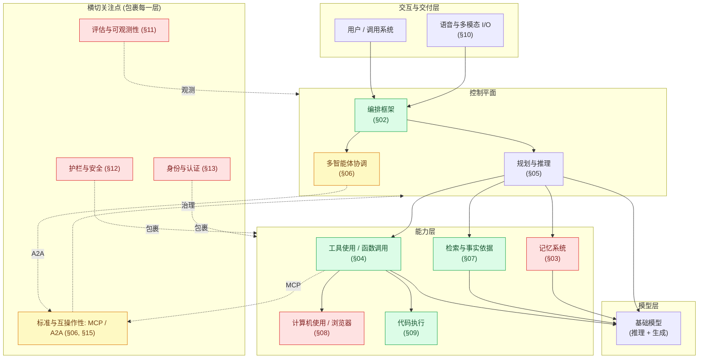
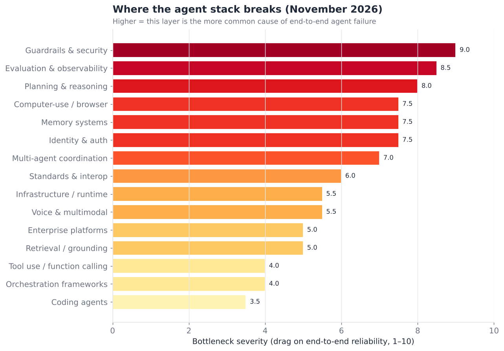
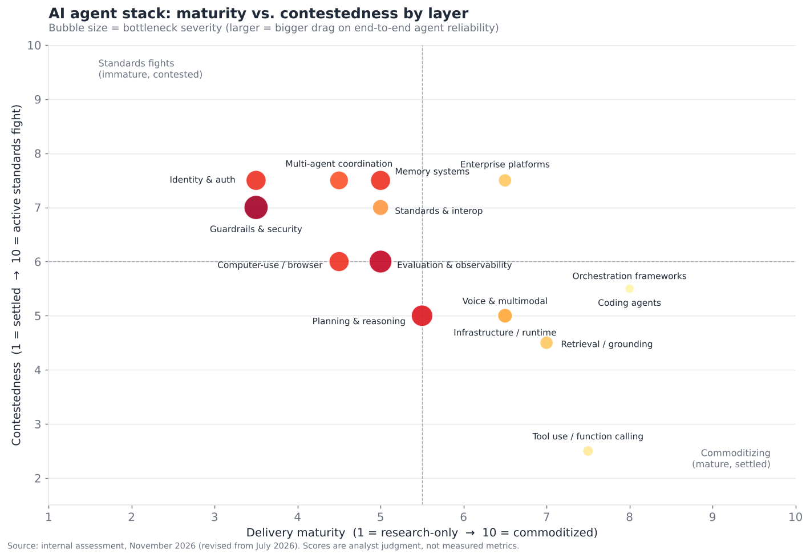

# 01 — 执行摘要

> **说明：** 本文为英文原文 [`sections/01-exec-summary.md`](../../sections/01-exec-summary.md) 的简体中文参考译文，仅供参考；如有出入，以英文原文为准。

*AI 智能体技术栈的跨类别挑战地图。内容截至 2026 年 11 月（基于 2026 年 7 月 22 日的快照更新；参见下文“2026 年 7 月以来的变化”）。*

---

## 一段话版本

2026 年年中的 AI 智能体领域并不是一项均衡成熟的技术，而是十五个松散耦合、成熟速度差异巨大的层。最靠近模型的那些层——工具调用、单智能体编排、检索和自主编码——已经从“已演示”跨入“已发布，且可靠到足以在其上构建业务”的阶段。而那些让智能体*安全、可问责、可互操作*的层——记忆、安全、身份、评估以及跨厂商协议——仍然混杂着活跃的工程瓶颈和悬而未决的标准之争。2026 年 11 月的更新与其说改变了这一图景，不如说让它更加清晰：新一代前沿模型已经发布，定义各能力层的基准测试要么已经饱和，要么被揭示为可以被刷分，互操作性标准进一步整合到同一个中立基金会之下，而资本和收购方则果断涌入瓶颈层。2026 年最重要的一个结构性事实是：**瓶颈已经从模型本身转移到了模型周围的脚手架上**。对大多数智能体任务而言，前沿模型已不再是“限制性试剂”；真正的限制性试剂是持久记忆、可信的工具执行、权限管理，以及衡量智能体究竟是在变好还是变差的能力。本文梳理全部十五个层，为其成熟度打分，列出每一层的参与者，并指出哪些领域的标准确实尚未定型、哪些领域已经出现了事实上的赢家。

---

## 2026 年 7 月以来的变化（2026 年 11 月更新）

2026 年 7 月的快照很快就过时了。从 2026 年 7 月下旬到 11 月上旬，十五个层中的每一层都有所变化，但挑战地图的*整体形态*保持不变：能力层持续商品化，而信任与互操作层持续吸纳工程投入和资本。下面的跨类别摘要提炼自各章节的更新日志（每份日志都包含注明日期、附有来源链接并带有置信度标签的条目——参见 §02–§15 开头的“2026 年 7 月以来的变化”小节）。置信度标签遵循 §17 的定义。

**模型与能力层**

- **新一代前沿模型发布（2026 年 9–10 月）。** Anthropic 的 Claude 5.x 系列（Fable 5.1、Opus 5.5、Sonnet 5.5、Haiku 5.5）*（official（官方））*，OpenAI 的 GPT-6 系列（Astra/Sol/Luna，随后是 GPT-6.1）以及 Google 的 Gemini 4 Argon *（inferred（推断））*。推理如今是始终开启/自适应的，而不再是一个单独的“推理模型”档位；HLE（带工具）的成绩突破 60%，ARC-AGI-3 在标准脚手架上的成绩在七个月内从发布时的 <1% 提升到约 63% *（inferred）*——但长周期可靠性仍然是 §05 中尚未解决的部分。
- **工具使用的剩余修复已全面可用（GA）。** 工具搜索、程序化（基于代码的）工具调用以及基于约束解码的结构化输出，均已成为主要模型 API 的正式可用功能 *（official/inferred）*；τ-bench 升级为不兼容的 2.0 版本 *（official）*（§04）。
- **编码领域的旗舰基准测试已饱和，资金也在集中。** SWE-bench Verified 达到约 95–97%，并被至少一家评估机构以“已饱和”为由归档；厂商现在主打 Terminal-Bench 4.0 *（official/inferred）*。SpaceX 以 600 亿美元的全股票交易完成了对 Cursor 的收购（8 月 14 日）*（official）*；Cognition 以约 480 亿美元的估值完成融资 *（inferred）*；Google 停用了面向消费者的 Gemini CLI，转而推出闭源的 Antigravity CLI *（official）*（§09）。
- **计算机使用取得的是部分得分上的进展，而非可靠性上的进展。** 长周期 OSWorld 的部分得分上升到约 78–82%，但没有任何模型明确报告远高于约 21% 的完整任务完成率 *（official/inferred）*。智能体浏览正在并入扩展程序和内置浏览器智能体（Claude in Chrome 正式可用；ChatGPT Atlas 于 8 月 9 日停止服务）*（official/inferred）*（§08）。
- **语音进入全双工、具备推理能力的语音到语音阶段**（OpenAI GPT-Live-1、Gemini 3.8 Live），成本仅为每分钟几美分；ElevenLabs 以 220 亿美元估值完成了一次股份要约出售（tender offer）*（official）*（§10）。

**脚手架与瓶颈层**

- **编排向图运行时和托管平台集中。** Microsoft 归档了 AutoGen，转而支持 Microsoft Agent Framework；Google ADK 2.0 是一个图引擎；托管运行时（Claude Managed Agents、AWS AgentCore、Gemini Enterprise Agent Platform——即更名后的 Vertex AI）持续领先 *（official）*（§02）。
- **记忆出现了托管产品和离线整合预览版**（Anthropic “Dreams”、Google 记忆档案正式可用、AgentCore 情景记忆），与此同时 LoCoMo/LongMemEval 在 90 分出头到 95 分左右的区间趋于饱和，评估正在转向千万（10M）token 级别以及基于行动的测试 *（official/inferred）*（§03）。
- **检索成为一个可度量、估值很高的类别。** Exa（约 22 亿美元）和 Parallel（约 20 亿美元）完成融资，Nebius 收购了 Tavily，Perplexity 停用了其 Sonar 聊天 API 并改推 Agent API，一个独立的搜索 API 索引也已上线 *（official/inferred）*（§07）。
- **评估与可观测性公司正在被收购**——Langfuse（被 ClickHouse 收购）、Galileo（Cisco/Splunk）、Promptfoo（OpenAI）、Helicone（Mintlify）、Fiddler（CrowdStrike，11 月 3 日宣布）——而审计显示，大多数智能体基准测试无需真正解决任务即可被刷分 *（official/inferred）*（§11）。
- **安全与身份在商业上正在融合。** 提示注入仍未解决，但终端安全、身份和 AI 实验室类收购方（CrowdStrike、Okta、Cyera、Palo Alto、OpenAI）收购了智能体安全和非人类身份领域的初创公司；MCP 的 7 月规范收紧了授权机制，NIST 发布了智能体身份设计原则 *（official/inferred）*。欧盟《人工智能法案》（EU AI Act）针对通用 AI 模型（GPAI）的执法权力于 8 月 2 日生效 *（official）*（§12、§13）。
- **智能体支付正在分层，而非整合**：AP2 移交给 FIDO 联盟，x402 移交给 Linux 基金会旗下的 x402 Foundation，Google 推出了 UCP，OpenAI 逐步关停了 ChatGPT Instant Checkout；实际交易量仍然很小 *（official/inferred）*（§13、§15）。
- **企业市场演变为一场控制平面竞赛。** Microsoft Agent 365（5 月正式可用；注册智能体超过 5000 万个）、ServiceNow 的 AI Control Tower/“AI Passport”以及 Salesforce 的第三方智能体编排，都在竞相治理*所有*厂商的智能体；在口径放宽后，Agentforce 的年度经常性收入（ARR）突破 15 亿美元 *（official）*（§14）。

**标准**

- **MCP 规范 `2026-07-28` 已定稿**——采用无状态核心，Tasks 被移入正式扩展，授权机制更加严格 *（official）*。**A2A（自 3 月起为 v1.0）于 8 月 17 日加入 Agentic AI Foundation**，因此两个协议如今同处一个中立的归属机构；AAIF 已发展到 10 个项目（新增 Agent Skills、Open Responses、OpenEnv、OpenSandbox）和 300 多个成员 *（official）*。前沿问题已不再是“选哪个协议”，而是智能体身份，以及 MCP Tasks 与 A2A 委托之间的边界（§06、§15）。
- **对 7 月快照的更正：** IBM 的 ACP（Agent Communication Protocol）早在 2025 年 8 月就已并入 A2A *（official）*；7 月快照中描述的“A2A 对 ACP”之争，在快照撰写之前实际上就已经结束。§06、§15 和 §16 已相应更正。

**对评分的净影响。** 下方的成熟度表已按 2026 年 11 月重新评分（如有变动，括号中为 7 月的数值）。变动最大的是**标准/互操作性**和**多智能体**（由于 MCP 和 A2A 同属一个基金会，争议有所减少）、**编码、工具使用和编排**（进一步商品化），以及**记忆、计算机使用和语音**（产品更加成熟，拖累略有降低）。**安全、评估和规划**的严重程度**没有改善**——它们仍然是智能体最容易出故障的前三个环节。

---

## 各层之间的关系

生产环境中的智能体是一个技术栈。请求从顶部进入，下面的每一层都必须稳定可靠，智能体才能可靠地完成一项非平凡的任务。下图展示了本文所围绕的依赖结构——编排位于中间，协调一切；模型只是其中一个（日益商品化的）组件；而横切关注点（安全、身份、评估）包裹着整个系统，而不是位于某一个单点上。

请把图中的颜色理解为整篇文档的核心论点：**绿色**层正在商品化（选一家厂商，然后继续前进）；**红色**层是活跃的工程瓶颈（你的智能体就是在这里出故障）；**黄色**层是尚未定型的标准之争（在这里押错代价高昂）。

---

## 三类挑战地图

十五个类别中的每一个都归入以下三类之一。这是给管理层的核心结论；本文其余部分都是支撑证据。

### 第 1 类——已解决 / 正在商品化（选一家厂商，然后继续前进）

这些层已有主导方法、多家可互换的厂商，并且可靠性足够好，很少成为智能体失败的原因。

- **工具使用 / 函数调用（§04）。** 原生结构化工具调用如今已是所有前沿模型的标配。模式定义（JSON Schema）、调用约定（MCP）和可靠性（在定义良好的工具集上，单次调用的选择准确率达 95% 以上）均已趋于一致。到 2026 年 11 月，针对*多工具*问题的主要修复——工具搜索、程序化工具调用以及基于约束解码的结构化输出——都已成为正式可用的 API 功能；错误恢复仍然是建设不足的那一半。
- **编排框架（§02）。** LangGraph、CrewAI、合并后的 Microsoft Agent Framework（AutoGen 已于 2026 年 10 月归档），以及模型厂商自己的 SDK（OpenAI Agents SDK、Anthropic Agent SDK、Google ADK）都已足够成熟，框架选择如今是一个偏好/锁定问题，而不是能力问题。
- **检索与事实依据（§07）。** 智能体式 RAG——由智能体自己的工具调用驱动检索，而不是固定的预取——已是定型的模式。向量数据库已成为商品化的基础设施。
- **编码智能体（§09）。** 智能体最成熟的*垂直*应用。SWE-bench Verified 在 2026 年实际上已经饱和（前沿配置约 95–97%），正在被更难的测试套件（如 Terminal-Bench 4.0）取代，不再作为主打指标。自主编码是整个领域中“已发布且可靠”的最清晰例证——而且随着 SpaceX 以 600 亿美元收购 Cursor、Cognition 估值达到约 480 亿美元，它也是估值最高的领域。

### 第 2 类——活跃的工程瓶颈（智能体就是在这里出故障）

这些层在演示中可以工作，在生产环境中却会出故障。它们是当前*工程*（而不一定是研究）投入的前沿。

- **记忆系统（§03）。** 对于持久的、可整合的、可遗忘的记忆，尚无定型的架构。每一款严肃的智能体产品都在构建定制化的记忆，而它正是“智能体忘了我们昨天确定的事情”的头号原因。
- **计算机使用 / 浏览器智能体（§08）。** 屏幕理解和操作可靠性属于 demoed-brittle（已演示但脆弱）。在贴近现实的基准测试（OSWorld、WebArena 类）上，任务成功率仍远低于生产使用的要求。
- **护栏与安全（§12）。** 提示注入从根本上仍未解决——不存在稳健的防御，只有纵深防御式的缓解措施。这是整个技术栈中严重程度最高的单一瓶颈，因为它卡住了企业部署。
- **评估与可观测性（§11）。** 你无法可靠地衡量智能体是否出现了退化。基准测试可以被刷分，也无法预测生产环境中的行为；追踪工具在改进，但并不标准化。
- **身份与认证（§13）。** “智能体如何在不持有我的密码的情况下代表我行事”仍在探索之中。面向智能体的 OAuth 和委托凭证标准尚处于早期阶段。

### 第 3 类——尚未定型的标准之争（押错代价高昂）

- **多智能体协调（§06）**和**标准 / 互操作性（§15）。** MCP 实际上已经赢得了*工具连接*层（第 15 节认为它如今已是定型的事实标准；其 `2026-07-28` 规范使核心变为无状态）。A2A 于 2026 年 3 月达到 v1.0，并于 2026 年 8 月与 MCP 一同加入 Linux 基金会旗下的 Agentic AI Foundation（AAIF），而 IBM 的 ACP 早在 2025 年就已并入 A2A——因此*选哪个协议*之争已基本结束。仍未定型的是：MCP Tasks 与 A2A 委托之间的边界、跨组织的智能体身份，以及智能体支付——在这一领域，AP2、ACP（Agentic Commerce Protocol）、UCP 和 x402 正在分层叠加而非整合。

---

## 技术栈在哪里出故障

下图按*瓶颈严重程度*对全部十五个层进行排序——即根据我们的评估，该层成为端到端智能体失败直接原因的频率。列表越靠前的位置，就是 2026 年工程投入边际回报最高的地方。

安全、评估、记忆、规划和计算机使用占据了列表的前列。请注意*不在*前列的是什么：基础模型、工具调用和检索。这正是“瓶颈已经从模型身上转移”这一论断的实证基础。

第二张图从两个维度为每一层定位——成熟度和争议程度——气泡大小表示同样的严重程度评分。四个象限讲述了四种不同的战略故事。

- **右下（成熟、已定型）：** 工具使用、检索、编码。已商品化。在其上构建即可。
- **左上（不成熟、有争议）：** 身份/认证、多智能体、标准。战略风险最高——地基仍在变动。
- **中上（有争议、中等成熟度）：** 记忆、评估、安全。如今艰难的*产品*差异化正是在这里决出胜负。
- **中下（基本定型、中等成熟度）：** 规划、语音、基础设施。稳步渐进，标准之争的戏剧性较低。

---

## 全部十五个类别的成熟度评分

下表是本摘要的量化骨架。**成熟度**（1–10）衡量该层距离商品化可靠性有多近。**争议程度**（1–10）衡量主导方法和标准有多大程度尚未定型。**严重程度**（1–10）衡量该层对端到端可靠性的拖累有多大。**分类**将每一层归入上文三类战略分类之一。评分是参照各详细章节校准的分析师判断，而非实测指标。**2026 年 11 月重新评分：** 凡自 7 月快照以来发生变化的评分，均在括号中列出 7 月的数值。

| # | 类别 | 成熟度 | 争议程度 | 严重程度 | 分类 | 主导方法（2026 年 11 月） | 主要参与者 |
|---|---|:--:|:--:|:--:|---|---|---|
| 02 | 编排框架 | 8.0 (7.5) | 5.5 (6.0) | 4.0 | 商品化 | 图运行时 + 托管智能体平台 | LangGraph、MS Agent Framework、Google ADK、厂商 SDK/托管运行时 |
| 03 | 记忆系统 | 5.0 (4.5) | 7.5 | 7.5 (8.0) | 瓶颈 | 托管记忆 + 离线整合，尚无标准 | Mem0、Zep、Letta、厂商原生（Anthropic、Google、AWS） |
| 04 | 工具使用 / 函数调用 | 7.5 (7.0) | 2.5 (3.0) | 4.0 (4.5) | 商品化 | 基于 MCP 的原生工具调用 + 工具搜索 | 所有前沿厂商 |
| 05 | 规划与推理 | 5.5 (5.0) | 5.0 | 8.0 (8.5) | 瓶颈 | 始终开启的自适应模型内推理 | Anthropic、OpenAI、Google、DeepSeek、Qwen |
| 06 | 多智能体协调 | 4.5 (4.0) | 7.5 (8.5) | 7.0 | 标准之争 | A2A（AAIF）+ 主管/角色模式 | AAIF A2A、MS、Anthropic、CrewAI、LangGraph |
| 07 | 检索 / 事实依据 | 7.0 | 4.5 (4.0) | 5.0 | 商品化 | 智能体式 RAG + 智能体原生网页搜索 API | 向量数据库、Exa、Parallel、Perplexity、厂商检索 |
| 08 | 计算机使用 / 浏览器 | 4.5 (4.0) | 6.0 | 7.5 (8.0) | 瓶颈 | VLM 屏幕理解 + 浏览器内智能体 | Anthropic、OpenAI、Google、Perplexity |
| 09 | 编码智能体 | 8.0 (7.5) | 5.5 | 3.5 | 商品化 | 基于前沿模型的智能体脚手架 | Claude Code、Cursor（SpaceX）、Codex、Devin、Copilot |
| 10 | 语音与多模态 | 6.5 (6.0) | 5.0 | 5.5 (6.0) | 准瓶颈 | 全双工语音到语音模型 | OpenAI、Google、ElevenLabs、xAI、初创公司 |
| 11 | 评估与可观测性 | 5.0 (4.5) | 6.0 (6.5) | 8.5 | 瓶颈 | 追踪 + LLM 评审（LLM-as-judge）；厂商正在整合 | LangSmith、Braintrust、Arize、Langfuse（ClickHouse）、Datadog/Splunk |
| 12 | 护栏与安全 | 3.5 | 7.0 | 9.0 | 瓶颈 | 纵深防御，无稳健解决方案 | Check Point/Lakera、Palo Alto、CrowdStrike、Cisco、厂商 |
| 13 | 身份与认证 | 3.5 (3.0) | 7.5 (8.0) | 7.5 | 标准之争 | OAuth/MCP 企业认证、智能体 ID | Okta/Auth0、Microsoft Entra、CyberArk、卡组织 |
| 14 | 企业平台 | 6.5 (6.0) | 7.5 (7.0) | 5.0 | 有争议 | 跨厂商智能体控制平面 | Microsoft、Salesforce、ServiceNow、Google、OpenAI |
| 15 | 标准与互操作性 | 5.0 (4.0) | 7.0 (9.0) | 6.0 (6.5) | 标准之争 | AAIF 旗下的 MCP + A2A | Agentic AI Foundation（LF）、所有主要厂商 |
| — | 基础设施 / 运行时 | 6.5 | 5.0 | 5.5 | 商品化 | 沙箱化执行 + 无服务器 | E2B、Modal、Daytona、云厂商 |

同一组数据的第二种视图，压缩为三类结论以及每个类别最重要的一个开放问题：

| 类别 | 结论 | 真正重要的那个开放问题 |
|---|---|---|
| 工具使用 | **已解决** | 在数百个工具中进行可靠的选择 |
| 编排 | **已解决** | 智能体定义的锁定与可移植性之间的取舍 |
| 检索 | **已解决** | 低延迟下的新鲜度 / 实时事实依据 |
| 编码 | **已解决** | 无需人工审查的可信自主合并（既然 SWE-bench 已经饱和） |
| 规划 | **瓶颈** | 可靠的长周期（100 步以上）任务分解 |
| 记忆 | **瓶颈** | 一种标准的、可移植的记忆架构 |
| 计算机使用 | **瓶颈** | 在长时间真实 UI 任务上的完整任务完成（而非部分得分） |
| 语音/多模态 | **瓶颈** | 端到端低于 500 毫秒且能处理打断 |
| 评估 | **瓶颈** | 能够预测生产表现的退化检测 |
| 安全 | **瓶颈** | 任何一种稳健的提示注入防御 |
| 多智能体 | **标准之争** | A2A 是否会出现真正的跨组织流量？它的边界止于何处，MCP Tasks 又从何处开始？ |
| 身份/认证 | **标准之争** | 一个胜出的委托凭证标准 |
| 标准 | **标准之争** | 既然 MCP/A2A 已同属 AAIF，智能体身份和支付标准如何确定 |
| 企业 | **有争议** | 平台锁定与最佳组合式拼装之间的取舍 |
| 基础设施 | **基本已解决** | 每个智能体专属沙箱的成本/冷启动 |

---

## 五个横切论点

贯穿每一章节的主线，在此统一陈述一次。

**1. 对大多数任务而言，模型已不再是瓶颈。** 2026 年末的前沿模型（Claude Opus 5.5 / Fable 5.1、GPT-6 系列、Gemini 4，以及 DeepSeek V4、Qwen3.6 和 Kimi K3 等强大的开放权重模型）单独来看都已足够强大，以至于智能体失败绝大多数可以追溯到记忆丢失、工具执行错误、糟糕的长周期规划或缺失的护栏——而不是模型无法推理。这颠覆了 2023–2024 年的局面，并重新定向了价值积累的方向：流向脚手架公司。

**2. 标准在工具层的整合速度超出预期，随后在智能体层也是如此。** MCP 从 Anthropic 的一项实验（2024 年末）发展为由 Linux 基金会治理的标准（通过 Agentic AI Foundation，2025 年 12 月），并获得 OpenAI、Google、Microsoft 和 AWS 的支持，这是近代计算史上最快的标准趋同之一——其速度更接近 JSON 这样的事实赢家，而不是 SOAP 这样的委员会标准。A2A 大约落后一年跟进：2026 年 3 月发布 v1.0，2026 年 8 月加入同一基金会，而 IBM 的竞争协议 ACP 早已并入其中。开放的标准问题已转向身份、支付以及 MCP/A2A 的边界。§15 对此有深入阐述。

**3. 安全是企业自主化的关键门槛，而它尚未解决。** 提示注入没有稳健的解决方案。目前每一次企业自主智能体部署，都是一场以*限制爆炸半径*（限定权限范围、沙箱、人在回路）为目标而非以*防止被攻破*为目标的风险管理实践。在这一点改变之前，企业中的“自主”智能体仍将是半自主的。这是整份文档中严重程度最高的一项（§12）。

**4. 评估是无声的瓶颈。** 这个领域无法可靠地回答“这个智能体比上周的更好吗？”基准测试正在饱和且可以被刷分；生产环境中的行为缺乏充分的监测。这拖慢了其他每一层，因为你无法安全地迭代你无法衡量的东西（§11）。

**5. 垂直领域的成熟度参差不齐，且颇具启发意义。** 编码智能体领先其他所有垂直领域数年，因为这一领域拥有廉价、自动、高质量的奖励信号（测试通过了吗？能编译吗？）。缺乏这种信号的领域——通用计算机使用、开放式研究、语音客服——之所以落后，恰恰是因为奖励信号昂贵且主观。**是否存在廉价的验证器，是预测一个智能体垂直领域成熟度的最佳单一指标。**

---

## 2023 → 2026 的演进脉络，一页看懂

有必要明确说明这个领域是如何走到今天的，因为这条轨迹预示着瓶颈接下来会移向何处。

**2023——提示时代。** 智能体就是提示链。主导抽象是“给模型一个草稿区和一份写在系统提示中的工具列表，然后从它的文本输出中解析出动作”。工具调用依赖字符串解析，并不可靠；ReAct 是当时最先进的方法；没有真正的标准。本文中几乎每一层要么尚不作为一个独立的关注点存在，要么只是在单个提示内部临时处理。模型*就是*瓶颈：GPT-4 级别的模型勉强才能维持一个多步骤计划。

**2024——框架时代。** 原生函数调用在各厂商中推出，将工具使用从字符串解析变成一种结构化、基本可靠的机制。LangChain、LlamaIndex、CrewAI 和 AutoGen 竞相成为编排抽象层。基于向量数据库的 RAG 成为默认的事实依据模式。正是在这一时期，本文中的各个*层*分化为独立的工程关注点——记忆、规划、检索和编排不再是“提示的一部分”，而成为拥有各自厂商的组件。瓶颈开始从模型滑向管道。

**2025——协议时代。** MCP（2024 年末）和 A2A（2025 年 4 月）相继出现，并以惊人的速度被采用，分别标准化了工具连接层和智能体间通信层。推理被移*入*模型内部（先是 OpenAI 的 o 系列，随后所有主要厂商都具备了推理能力），因此规划质量无需外部脚手架便大幅跃升。编码智能体跨过了实用门槛。计算机使用功能上线（Anthropic，2024 年 10 月），浏览器智能体大量涌现——演示令人印象深刻，但始终脆弱。企业平台（Agentforce、Copilot Studio）相继推出，为非开发人员打包这一切。

**2026——可靠性与治理时代（当下）。** 开放问题已不再是“模型能不能做到”，而是“我们能否信任它、衡量它、保护它，并让各个组件互操作”。MCP 和 A2A 都已归入 Linux 基金会旗下的 Agentic AI Foundation（MCP 于 2025 年 12 月，A2A 于 2026 年 8 月），标志着标准之争已进入整合阶段。记忆、评估、安全和身份是当下活跃的工程前沿。上方的成熟度表正是这一时刻的快照：能力层是绿色的，信任与互操作层是红色和黄色的。

这条演进脉络有一个明确的方向：**每一年，瓶颈都会离模型更远一层，离生产、治理和信任这些混乱的现实更近一层。** 如果这一规律成立，2027 年的瓶颈将是今天几乎还难以辨认的那些——智能体经济学（智能体交易时谁向谁付费）、责任与审计，以及运营大规模智能体集群的运维纪律。本文的组织方式，正是为了让*当前*的前线——红色和黄色的层——尽可能清晰可辨。

## 如何使用本文的其余部分

第 02–15 节各自聚焦一个层，描述其主导方法及失败模式，以表格形式列出竞争/标准格局（在类别规模允许的情况下列出 10 个以上参与者），并提供图示和图表。第 16 节将文中提到的每一家公司汇总为一张超过 100 行的总表（同时导出为 CSV）。第 17 节是术语表，以及支配文中每一项论断的置信度方法论。全文反复出现三个标签——**shipped-reliable（已发布且可靠）**、**demoed-brittle**、**research-only（仅限研究）**——并且每一项路线图论断都带有一个置信度标签：**official**、**inferred** 或 **speculative（推测）**。

*（本节目标字数：2,500 词。本节实际：约 3,800 词，含 2026 年 11 月更新。）*
