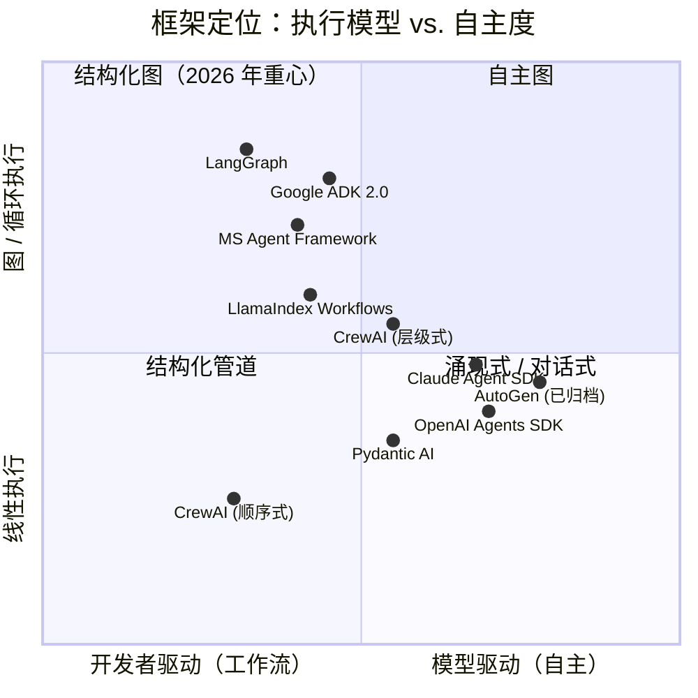
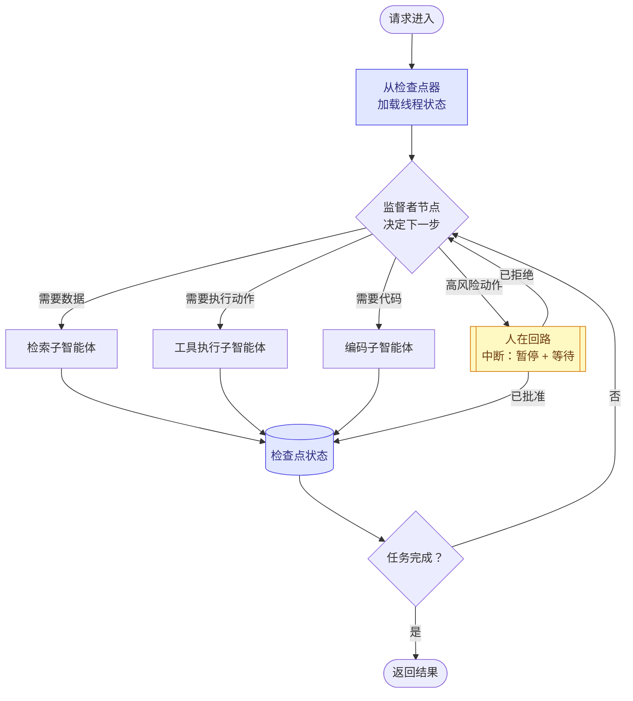
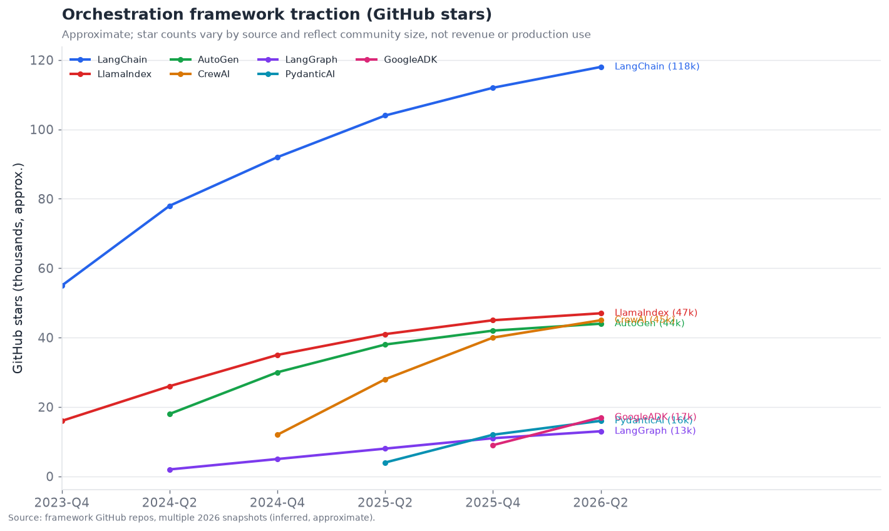
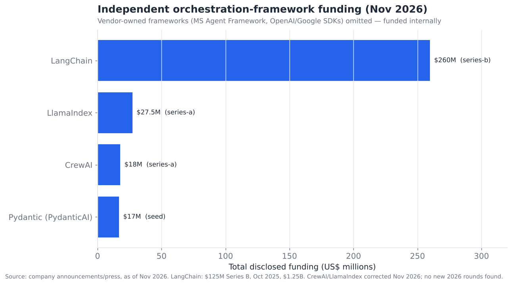
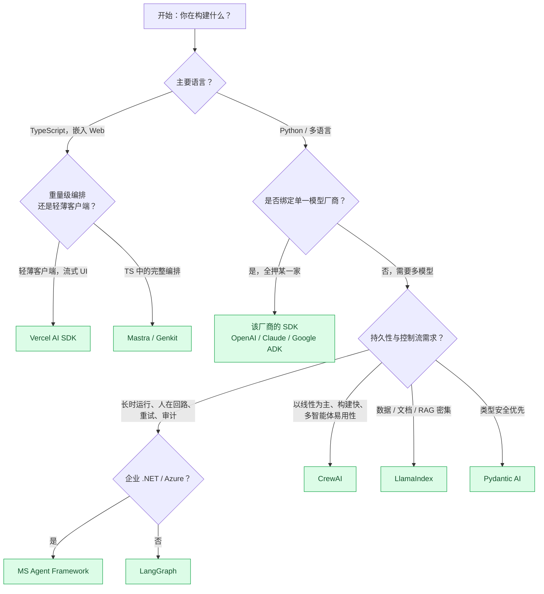

# 02 — 智能体编排框架

> **说明：** 本文为英文原文 [`sections/02-orchestration-frameworks.md`](../../sections/02-orchestration-frameworks.md) 的简体中文参考译文，仅供参考；如有出入，以英文原文为准。

*控制平面。循环如何组织、状态存放在哪里，以及谁赢得了框架之战。目标篇幅：7,000 词。快照日期 2026 年 7 月 22 日；内容更新至 2026 年 11 月。*

---

## 编排框架究竟做什么

剥去营销包装，智能体编排框架恰好只做四件事，而本节中的每个框架，都是对这四件事持有的一套不同主张：

1. **它运行循环。** 总得有某个东西来决定："调用模型，查看输出，如果模型请求了工具就运行该工具，把结果回传，重复直到完成。"这个控制循环——即智能体循环（agentic loop）——是不可再化简的核心。
2. **它持有状态。** 在循环的各次迭代之间，*某个东西*要记住迄今为止的对话、中间结果、计划，以及当前执行到计划的哪一步。状态如何表示，是最重要的单一设计维度。
3. **它连接工具。** 框架把模型请求的工具调用编组（marshal）到实际代码（函数、API、MCP 服务器），再把结果编组回来。
4. **它进行组合。** 真实系统往往不止一个智能体，或是一个智能体带若干子例程，或是有人在回路中。框架提供把这些部分连接起来的原语——顺序式、图式、层级式，或自由对话式。

其余一切——记忆后端、检索、评估钩子、部署——要么是这四件事的插件，要么是框架厂商另外售卖的独立产品（LangChain 售卖用于评估的 LangSmith；那是另一层，在 §11 中讨论）。

这一层之所以比大多数层更快地**商品化**，原因在于智能体循环确实很容易被拙劣地实现，而要实现得好也只是中等难度。一名称职的工程师用五十行代码就能写出一个可用的 ReAct 循环。框架真正的价值在于那*困难的 20%*：跨故障的持久状态、流式输出、人在回路中断、用于调试的确定性重放、多智能体组合，以及生产级可观测性。2023 年时，这困难的 20% 是一道真正的护城河。到 2026 年，它已是被充分理解的工程问题——这正是该类别获得 **7.5/10 成熟度**评分的原因，也是竞争问题从"哪个框架能做到这一点？"转向"我愿意被锁定在哪个框架的抽象之中？"的原因。

---

## 2026 年 7 月以来的变化（2026 年 11 月更新）

7 月快照之后的四个月并未改变这一层的形态，而是使其更加固化。有三件事尤为突出。第一，**整合不再只是预测**：Microsoft 归档了 AutoGen 仓库，并将所有用户引导至 Microsoft Agent Framework（MAF），这是迄今最清晰的"独立项目被平台吸收"案例。第二，**图/工作流运行时变得普遍**：Google 的 ADK 2.0（5 月发布，快照中遗漏）围绕图引擎重建了 ADK，并带有基于检查点的人在回路关卡；Pydantic AI 2.0 和 Haystack 3.0 发布了大版本；Anthropic 的托管运行时增加了由服务器运行的多智能体工作流。第三，**托管运行时持续领先于库**：Claude Managed Agents、LangSmith Deployment、Google 更名后的 Agent Runtime 以及 Azure Foundry 托管智能体，是新功能最先落地的地方。发布节奏同样值得注意：MAF 在七个月内发布了 24 个次版本，Google ADK 大约每两周一个次版本，因此本节中的任何版本号都会在数周内过时。

重大进展的时间日志（置信度依据第 17 节）：

- **2026 年 4 月 8 日（快照遗漏）：Anthropic 推出 Claude Managed Agents** 公开测试版。它是一个托管运行时（沙箱、会话、检查点、凭据保管库、追踪），定价为模型用量加每智能体运行时小时 0.08 美元，与自托管的 Claude Agent SDK 相互独立。*（official（官方），来源
  [SiliconANGLE](https://siliconangle.com/2026/04/08/anthropic-launches-claude-managed-agents-speed-ai-agent-development/)）*
- **2026 年 4 月 15 日（遗漏）：OpenAI 的 Agents SDK 增加原生沙箱执行和"模型原生脚手架"**（MCP、skills、AGENTS.md、shell 与 apply-patch 工具）。
  *（official，[OpenAI](https://openai.com/index/the-next-evolution-of-the-agents-sdk/)）*
- **2026 年 4 月 22 日（遗漏）：Google 将 Vertex AI 更名为 Gemini Enterprise Agent
  Platform。** Vertex AI Agent Engine 更名为 **Agent Runtime**。*（official，
  [Google Cloud 博客](https://cloud.google.com/blog/products/ai-machine-learning/introducing-gemini-enterprise-agent-platform)）*
- **2026 年 5 月 19 日（遗漏）：Google ADK Python 2.0 正式发布（GA）**，以**基于图的 Workflow 引擎**取代层级式执行器。智能体成为节点，人在回路关卡可从检查点恢复。ADK Go 2.0 于 6 月 30 日跟进。到 10 月 23 日，Python 版本已达 2.13。*（official，[adk.dev](https://adk.dev/2.0/index.md)；
  [PyPI](https://pypi.org/project/google-adk/)）*
- **2026 年 6 月 23 日：Pydantic AI 2.0 稳定版。** 可组合的"capabilities"将工具、指令、钩子和设置打包在一起。独立的 `pydantic-ai-harness` 包增加了记忆和护栏。*（official，
  [changelog](https://pydantic.dev/docs/ai/changelog/)）*
- **2026 年 6 月 25 日：Vercel AI SDK 7.0** 发布。Mastra 早在 **2026 年 1 月 20 日即已达到 1.0**，到 11 月已是 1.82。*（official，
  [npm `ai`](https://www.npmjs.com/package/ai)；[npm `@mastra/core`](https://www.npmjs.com/package/@mastra/core)）*
- **2026 年 7 月 15 日：MAF "Agent Harness" 在 .NET 和 Python 中正式发布**，为工具调用、状态和遥测提供稳定接口。*（inferred（推断）：依据二手追踪者转述的 Azure Updates 条目，我们无法获取原始页面。）* MAF Python 从 1.0.0（4 月 2 日）发展到 **1.24.0（10 月 30 日）**。*（official，
  [PyPI](https://pypi.org/project/agent-framework/)）*
- **2026 年 7 月 20 日：Haystack 3.0**（deepset）发布，重新定位为围绕显式的管道与智能体工作流。当前版本为 3.4。*（official，
  [PyPI](https://pypi.org/project/haystack-ai/)）*
- **2026 年 8 月 24 日：Agno 3.0**，如今自称"智能体软件的编程语言"。*（official，[PyPI](https://pypi.org/project/agno/)）*
- **2026 年 9 月 3 日：LangChain 1.4** 发布，LangGraph 1.2.x 继续每周更新（10 月 30 日为 1.2.19）。LangChain 的 **Deep Agents** 脚手架（文件系统、子智能体、skills、长期记忆）处于 0.7.x。托管运行时仍以 **LangSmith Deployment** 之名销售（2025 年 10 月由 LangGraph Platform 更名而来）。
  *（official，[PyPI langchain](https://pypi.org/project/langchain/)，
  [PyPI deepagents](https://pypi.org/project/deepagents/)，
  [LangSmith Deployment](https://www.langchain.com/langsmith/deployment)）*
- **2026 年 9 月：有报道称 LangChain 完成约 30 亿美元估值的 C 轮融资，但未经官方宣布。** 唯一来源是 Forge Global 基于申报文件得出的数字。除 2025 年 10 月的 B 轮之外，LangChain 未宣布任何融资。*（speculative（推测））*
- **2026 年 10 月 9 日：Claude Managed Agents 增加"dynamic workflows"**（测试版）。智能体编写一个程序，分阶段把工作分发给多个智能体，由服务器在后台运行。由模型编写的编排已成为一种托管原语。
  *（official，[Claude 发布说明](https://platform.claude.com/docs/en/release-notes/overview)）*
- **2026 年 10 月 15 日：OpenAI Agents SDK 0.24.0**（Python；TS 0.21 于 10 月 20 日发布）。它仍处于 1.0 之前，其 `RunState` 模式变更会破坏已保存的运行。*（official，
  [PyPI](https://pypi.org/project/openai-agents/)）*
- **约 2026 年 10 月 20–28 日：Microsoft 归档 AutoGen 仓库。** 此后不再有缺陷或安全修复，README 指定 MAF 为后继者并链接了迁移指南。AutoGen 在 PyPI 上的最后一个版本是 2025 年 9 月 30 日的 0.7.5。*（归档状态为 official，见
  [GitHub](https://github.com/microsoft/autogen/) 和
  [迁移指南](https://learn.microsoft.com/agent-framework/migration-guide/from-autogen)。
  确切日期依据追踪者推断。）*
- **2026 年 11 月 2 日：Anthropic "message threads"**（测试版）将对话状态保存在服务器端，因此智能体循环只需发送新消息。这是厂商托管线程存储理念（见下文）落实到原始 API 层面。*（official，
  [发布说明](https://platform.claude.com/docs/en/release-notes/overview)）*
- **2026 年 11 月 3 日：LangSmith BYOC**（自带云）在 AWS 上正式发布之后，进入 Azure 和 Google Cloud 的测试阶段。*（inferred，[Unite.AI](https://www.unite.ai/langchain-brings-langsmith-byoc-beta-to-azure-and-google-cloud/)）*
- **对快照融资数字的更正。** CrewAI 已披露的总额约为 **1,800 万美元**（2024 年 10 月一轮），而非约 4,500 万美元。LlamaIndex 为 **2,750 万美元**（2025 年 3 月 A 轮，Norwest 领投），而非约 6,000 万美元。我们未发现二者在 2026 年有新一轮融资。*（official，
  [SiliconANGLE](https://siliconangle.com/?p=675043)，
  [LlamaIndex](https://www.llamaindex.ai/blog/announcing-our-series-a-and-llamacloud-general-availability)）*

尚未出现智能体定义可移植性标准。Oracle 的 Open Agent Spec 作为一种声明式提案存在。Agentic AI Foundation（AAIF）目前托管 AGENTS.md、Agent Skills 和 A2A，它们标准化的是智能体的*边缘*，而非其内部的图。
*（official，[AAIF](https://aaif.io/blog/a2a-joins-aaif)；
[Anthropic](https://www.anthropic.com/news/donating-agent-skills-to-the-agentic-ai-foundation)）*

---

## 定义每个框架的两个维度

每个编排框架都可以在两个维度上定位。理解这两个维度，无需阅读文档，就能预测一个框架的行为、它的失败模式，以及它适合什么样的团队。

### 维度 1 — 执行模型：线性 vs. 图 vs. 对话式

**线性 / 管道式。** 智能体（一个或多个）按预先确定的顺序执行：先 A，再 B，再 C。分支仅限于简单条件判断。这是 CrewAI 的"sequential process"（顺序流程）模型，也是经典的 LangChain `Chain`。它易于推理、易于调试，足以胜任绝大多数真实部署（文档处理、结构化抽取、直接的"先研究再写作"任务）。其局限在于，真正动态的控制流——"如果失败，就回退并重试另一个子计划"——难以表达。

**基于图。** 智能体的控制流是一个显式的有向图，由节点（工作单元）和边（转移，可能带条件）构成。图可以包含环，因此循环、重试和回访都是一等公民。这是 LangGraph 的模型；也是 Google 的 ADK 在 ADK 2.0（2026 年 5 月）围绕基于图的 Workflow 引擎重建时全盘采纳的模型；同时也是 Microsoft Agent Framework 借助其图/工作流层所采取的方向。图的编写更冗长，但表达力强得多；关键在于，由于控制流本身是*数据*，框架可以对其设置检查点、重放、可视化，并在执行中途中断。基于图的执行是 2026 年生产系统的主导范式，恰恰因为生产系统需要这些持久性和可观测性特性。

**对话式 / 涌现式。** 根本没有显式控制流。多个智能体被置于一个共享对话中，由轮流发言策略（轮询、一个管理者智能体，或一个发言者选择函数）决定下一个发言者；"程序"从对话中涌现。这是最初的 AutoGen 模型（AutoGen 仓库已于 2026 年 10 月归档，转向 Microsoft Agent Framework）。它最灵活，也最不可预测——对开放式研究和头脑风暴很强大，但对任何需要可靠性的场景都很危险，因为涌现的控制流就意味着涌现的失败模式。

### 维度 2 — 自主粒度：模型决定多少

与此正交的是，各框架在控制流中有多少由*模型*决定、有多少由*开发者*预先指定这一点上各不相同。

- **开发者驱动（工作流）。** 开发者编写图/管道，模型只负责填充节点。Anthropic 2024 年颇具影响力的表述将其称为"workflows"（工作流），并主张大多数生产系统应当是工作流而非智能体，因为确定性本身就是一种特性。LangGraph 最常见的用法正是如此。
- **模型驱动（自主）。** 模型在每次迭代中从工具菜单中决定下一步；没有作者指定的图。这就是纯粹的 ReAct 循环，也是 OpenAI Agents SDK 和 Claude Agent SDK 的默认方式。更灵活，更不可预测。
- **混合式。** 编写高层的图，但让各个节点成为自主的子智能体。这是大多数成熟的 2026 年系统的落脚点，也是 CrewAI 中"hierarchical"（层级式）编排以及各厂商 SDK 中子智能体模式所表达的内容。

2025–2026 年间逐渐固化的行业共识——在 Anthropic 的工程文章中表述得最清楚，并在各厂商 SDK 的实践中得到呼应——是：**使用能解决问题的最低自主度。** 自主性是一种可靠性税。优先选择工作流；只有当任务的分支因子确实无法事先枚举时，才升级到自主智能体。这就是"图 + 开发者驱动"象限成为重心的原因。

---

## 状态管理：在生产中真正重要的维度

如果你只从本节带走一件事，那就是：**状态管理决定了编排框架在生产中的生死**，它是各框架之间宣传最少、影响却最大的差异。

朴素的做法——把对话和中间结果放在内存中的一个 Python 列表里——在 notebook 中可行，但一旦你需要以下任一能力，就会在生产中失败：(a) 智能体运行能在进程重启后存活；(b) 智能体暂停数小时后由人工批准某一步；(c) 通过精确重放所发生的事情来调试故障；(d) 在水平扩展的集群上运行同一个逻辑智能体。生产环境中的智能体是长期运行、可中断且分布式的，这就要求持久化、外部化的状态。

各框架可归入四种状态管理理念：

| 理念 | 状态如何持有 | 持久性 | 谁在采用 | 权衡 |
|---|---|---|---|---|
| **内存对象** | 运行进程中的 Python/JS 对象 | 无（重启即丢失） | 朴素 LangChain、简单脚本 | 最简单；不适合生产 |
| **带检查点的图状态** | 可序列化的状态对象，每个节点之后持久化到存储 | 完整；可恢复、可重放、可时间旅行调试 | **LangGraph**、MS Agent Framework | 最稳健；搭建步骤更繁琐 |
| **外部化线程 / 会话存储** | 对话 + 记忆存放于按线程 ID 索引的托管存储中 | 完整，托管 | OpenAI Agents SDK（sessions）、Claude Agent SDK、Letta | 厂商托管；控制力较弱 |
| **事件溯源 / 消息日志** | 只追加的消息日志；状态是对日志的折叠（fold） | 完整；天然的审计轨迹 | AutoGen（消息历史）、部分 MCP 服务器 | 审计能力出色；状态重建有成本 |

LangGraph 的核心押注——也是它即便在 GitHub 原始星标数上落后于 CrewAI/AutoGen，却仍在*企业*采用上领先的原因——就是**检查点器（checkpointer）**。每次节点转移都会把图状态序列化到后端（内存、SQLite、Postgres、Redis）。这一个设计决策解锁了：恢复崩溃的运行、人在回路暂停（图实实在在地停在中断节点并等待）、"时间旅行"调试（回退到任意先前的检查点并从此分叉），以及持久的长时运行智能体。竞争对手此后都向同一理念靠拢——Microsoft Agent Framework 在 2026 年 4 月将持久/检查点执行作为 1.0 的头号功能发布，Google 的 ADK 2.0（2026 年 5 月）增加了可从检查点恢复的人在回路关卡，厂商 SDK 增加了会话持久化（Anthropic 在 2026 年 11 月更进一步，推出了服务器端的"message threads"）——这说明市场已经认定，带检查点的状态是正确答案。

---

## 一个有代表性的编排模式

以下是 2026 年大多数生产智能体系统实际使用的模式：**带检查点状态和人在回路中断的图结构监督者（supervisor）**。值得把它内化于心，因为大致相同的形态会以不同名称出现在 LangGraph、MS Agent Framework、Google ADK 以及各厂商 SDK 中。

该模式中有三个特性是承重的，值得特别指出，因为它们正是框架存在的意义所在——那"困难的 20%"：

1. **监督者是一个节点，而非硬编码的路由器。** 它本身就是一次模型调用，读取状态并挑选下一个子智能体。这就是混合象限：开发者编写的图，其路由节点由模型驱动。
2. **每个子智能体之后都对状态设置检查点。** 如果进程在编码子智能体之后崩溃，运行会从最后一个检查点恢复，而不是从头开始——当步骤代价高昂（一次 90 秒的代码执行）或带有副作用（你不想重复发送一封邮件）时，这一点至关重要。
3. **人在回路节点是一等的中断。** 图会*暂停*——不是"轮询"，而是暂停，释放所有资源——并在批准到达时恢复，可能是在数小时之后。没有带检查点的图运行时，实现这一点会非常痛苦，这也是团队选择采用框架而非自行编写循环的很大一部分原因。

---

## 单智能体 vs. 多智能体：被过度推销的模式

2025–2026 年反复出现的一个主题，也是中立分析与框架营销明显分歧之处，是：**多智能体系统被过度开处方了。** 框架有商业动机让多智能体显得必不可少——它更令人印象深刻，也更有黏性。工程现实则更为冷静。

多智能体架构在三种特定情形下才物有所值，在此之外则是净负面：

- **真正的并行。** 可以并发运行的独立子任务（同时研究五个主题，再进行综合）。这里多个智能体只是并行的工作者，收益在于挂钟延迟。
- **上下文隔离。** 当把不同关注点混在一起会污染单个上下文窗口时——例如，"评审者"智能体不应看到"作者"智能体的思维链，只应看到其输出。独立的智能体 = 独立的上下文 = 更干净的推理。这是支持多智能体最有原则性的论据。
- **不同的工具/权限范围。** 能够触碰生产数据库的子智能体，应当是一个与起草邮件的子智能体相互*独立的身份*，拥有*独立的权限*（这与 §12 和 §13 直接相关）。

除此之外，多智能体会增加协调开销、延迟（智能体之间的对话是串行的模型调用）、成本（更多 token），以及——最具破坏性的——新的、微妙的失败模式：智能体之间意见不合、陷入循环，或在彼此之间丢失任务（即 §06 中的"协调失败模式"）。Anthropic 自己发布的指导和 2025 年的从业者共识趋于一致：**从单个智能体和一套好的工具开始；只有当上述三个条件之一具体存在时，才求助于多智能体。** 承认这一点的框架（厂商 SDK，以及 LangGraph"你可能需要的是一个图，而不是一群智能体"的姿态）往往比那些整个卖点就是"拉起一个团队（crew）"的框架构建出更可靠的系统。

---

## 竞争格局

编排层有十几个可信的参与者。它们分为三组：**独立开源框架**（LangChain/LangGraph、CrewAI、LlamaIndex、Pydantic AI）、**模型厂商 SDK**（OpenAI Agents SDK、Anthropic Claude Agent SDK、Google ADK），以及**云/企业厂商框架**（Microsoft Agent Framework、AWS 的智能体工具）。其战略主线是：*模型厂商在 2025–2026 年间进入了这一层*——如今每家前沿实验室都发布了自己的智能体 SDK——这一方面在把基础循环商品化，另一方面也在把独立框架挤向更高价值的差异化方向（持久性、可观测性、企业部署、多模型可移植性）。

上方的星标图是社区规模的代理指标，而非收入或生产采用率——而这两者是背离的。按星标计，LangChain 生态遥遥领先，但其中很大一部分来自庞杂的 `langchain` 包，而非生产级的 `langgraph`。CrewAI 和 AutoGen 凭借易上手性和多智能体炒作周期获得了巨量星标，但 LangGraph 和各厂商 SDK 在*企业生产*使用中的分量远超其星标数。应把星标解读为"心智份额"，而非"市场份额"。

在融资方面，LangChain 是独立框架中明确的商业领跑者——2025 年 10 月完成 1.25 亿美元 B 轮融资，估值 12.5 亿美元（由 IVP 领投，Sequoia、Benchmark、CapitalG、ServiceNow Ventures、Workday Ventures 等参投），累计融资约 2.6 亿美元。（一个归于 2026 年 9 月、约 30 亿美元估值的"C 轮"说法通过二级市场数据流传，但未经宣布——*speculative*。）CrewAI（已披露约 1,800 万美元，最近一轮为 2024 年 10 月）和 LlamaIndex（2,750 万美元，Norwest 领投的 A 轮，2025 年 3 月）远远落后——2026 年 11 月的更新更正了快照中二者偏高的数字。厂商框架没有出现在图中，因为它们由内部资金支持，作为战略性亏本引流产品来拉动模型消耗——这本身就是这一层最重要的竞争动态：**随模型一起提供的框架是免费的，并且"足够好"，因此独立框架必须明显更好才能证明自身存在的价值。**

### 竞争对比表 — 编排框架

成熟度标签：**shipped-reliable（已发布且可靠）** / **demoed-brittle（已演示但脆弱）** / **research-only（仅限研究）**。
置信度标签依据第 17 节。

| 框架 | 所有者 / 支持方 | 执行模型 | 成熟度 | 状态方案 | 知名采用者（置信度） | 差异化优势 | 主要竞争对手 |
|---|---|---|---|---|---|---|---|
| **LangGraph** | LangChain, Inc.（2.6 亿美元，B 轮） | 图 / 循环 | shipped-reliable | 带检查点的图状态 | Uber、LinkedIn、Klarna、Replit、Elastic（official/inferred） | 持久的检查点图；最深厚的生产工具链（LangSmith；LangSmith Deployment 运行时，BYOC）。截至 2026 年 11 月为 v1.2.x | MS Agent Framework、厂商 SDK |
| **LangChain（核心）** | LangChain, Inc. | 线性链 | shipped-reliable | 内存 / 可插拔 | 在原型中无处不在（inferred） | 最大的生态系统，700+ 集成；v1.4（2026 年 9 月） | LlamaIndex、厂商 SDK |
| **Deep Agents** *（新增，2026 年 11 月）* | LangChain, Inc. | 基于 LangGraph 的自主脚手架 | demoed-brittle | 文件系统 + 检查点图 | LangChain 用户（official） | 开箱即用的脚手架：文件系统、子智能体、skills、长期记忆（v0.7.x，1.0 之前） | Claude Agent SDK、OpenAI Agents SDK |
| **CrewAI** | CrewAI, Inc.（已披露约 1,800 万美元，A 轮，Insight；2026 年 11 月更正） | 基于角色的顺序式 + 层级式 | shipped-reliable | 外部化的 crew/会话状态 | 声称有约财富 500 强试点（inferred） | 角色/团队隐喻；最快做出可运行的多智能体演示；AMP 企业平台 | MS Agent Framework、LangGraph |
| **AutoGen** *（2026 年 10 月归档）* | Microsoft Research → 被 MS Agent Framework 取代 | 对话式 / 涌现式 | shipped-reliable（已停止维护） | 消息日志 | 研究 + MS 生态（official） | 仓库已归档；无缺陷/安全修复；迁移至 MAF | CrewAI、MS Agent Framework |
| **Microsoft Agent Framework** | Microsoft（2026 年 4 月 GA；2026 年 10 月 v1.24） | 图 + 工作流 | shipped-reliable | 持久检查点 | Azure 企业客户群（official） | AutoGen 与 Semantic Kernel 合并；C#/Python/Java；Azure 原生、持久；Agent Harness GA（2026 年 7 月，inferred） | LangGraph、Google ADK |
| **LlamaIndex（+ Workflows）** | LlamaIndex, Inc.（2,750 万美元，A 轮；2026 年 11 月更正） | 事件驱动工作流 | shipped-reliable | 事件/上下文存储 | 文档密集型企业（inferred） | 数据/RAG 优先；智能体化文档工作流 | LangChain、向量数据库技术栈 |
| **OpenAI Agents SDK** | OpenAI（v0.24，2026 年 10 月） | 自主循环 + 移交（handoffs） | shipped-reliable | 托管会话 | OpenAI 平台用户（official） | 随模型一起提供；内置追踪；原生沙箱 + 模型原生脚手架（2026 年 4 月） | Claude Agent SDK、LangGraph |
| **Claude Agent SDK**（+ Managed Agents） | Anthropic | 自主循环 + 子智能体 | shipped-reliable（SDK）；demoed-brittle（Managed Agents 测试版） | 托管会话 | 为 Claude Code 提供支撑（official） | 经 Claude Code 实战检验；强大的工具使用 + MCP；托管的 Managed Agents，支持动态多智能体工作流（2026 年 10 月） | OpenAI SDK、LangGraph |
| **Google ADK（Agent Dev Kit）** | Google（约 1.7 万星标；2026 年 10 月 v2.13） | 图 / 工作流（2.0 Workflow 引擎，2026 年 5 月） | shipped-reliable | 会话 + 状态存储；可从检查点恢复的 HITL | Google Cloud / Gemini 用户（official） | 代码优先、模型无关；Gemini Enterprise Agent Platform（原 Vertex），原生支持 A2A | MS Agent Framework、LangGraph |
| **Pydantic AI** | Pydantic（约 1,700 万美元） | 类型化智能体 + 图 | shipped-reliable | 类型化状态 / 图 | 注重类型安全的 Python 团队（inferred） | 类型安全、校验；V2（2026 年 6 月）可组合"capabilities" + 脚手架包 | LangGraph、LlamaIndex |
| **Semantic Kernel** | Microsoft（正并入 MAF） | 插件/规划器 | shipped-reliable | Kernel 上下文 | .NET 企业（official） | 企业级 .NET 传承；正被统一进 MAF | MS Agent Framework |
| **Haystack（deepset）** | deepset | 管道/图 | shipped-reliable | 管道状态 | 搜索/RAG 企业（inferred） | 成熟的 NLP/RAG 管道、智能体工作流；Haystack 3.0（2026 年 7 月） | LlamaIndex、LangChain |
| **Swarms / OpenClaw 及其他开源项目** | 社区 | 多样 | demoed-brittle | 多样 | 爱好者 / 早期（inferred） | 轻量、最少抽象的智能体群 | CrewAI、AutoGen |
| **DSPy** | Stanford / 社区 | 编译式程序 | demoed-brittle→reliable | 程序状态 | 研究型 + 注重优化的团队（inferred） | 优化提示/程序，而非手工调优 | LangChain、Pydantic AI |
| **AWS Strands / Bedrock Agents** | Amazon | 托管图 | shipped-reliable | 托管 | AWS 企业客户群（official） | 与 AWS 深度集成；托管运行时（Strands v1.63，2026 年 10 月） | Google ADK、MS Agent Framework |
| **Agno** *（新增，2026 年 11 月）* | Agno（原 Phidata） | 轻量智能体 + 工作流 | shipped-reliable | 可插拔的数据库支撑会话 | Python 初创公司（inferred） | 最少抽象、快速的多模态智能体；3.0（2026 年 8 月） | Pydantic AI、CrewAI |
| **Mastra** *（新增，2026 年 11 月）* | Mastra（种子轮） | TS 工作流 + 智能体 | shipped-reliable | 工作流快照 + 记忆 | TypeScript 产品团队（inferred） | TS 原生的完整编排；2026 年 1 月发布 1.0 | Vercel AI SDK、LangGraph.js |

以上共十八行（十七个仍活跃的参与者加上已归档的 AutoGen），远超 10 个条目的下限。该类别还能容纳更多：Griptape、SmolAgents、Motia 等各自都有真实的细分市场。这种密度本身就是一个成熟度信号：密集、重叠的竞争，正是一个正在商品化的层的样子。

---

## 事后回看：图 vs. 线性

到 2026 年年中，图与线性之争已基本尘埃落定，而结论是细致微妙的，而非一方大获全胜：

- **对于简单、基本确定性的任务**（已发布的企业智能体中的大多数——抽取、分类、结构化研究、模板化生成），**线性管道是正确选择。** 它们更易构建、运行更便宜，也更容易做到可靠。CrewAI 顺序式和简单链在这里占主导，这是恰当的，而非局限。
- **对于任何带有真实分支、重试、循环、人工审批或长生命周期的任务，图取得了决定性胜利。** 在生产规模下，检查点/持久性特性不是可选项，而只有控制流的图表示才能干净地提供这些特性。这就是为什么到 2026 年，每个严肃的厂商都汇聚到了图或工作流运行时。
- **涌现式/对话式编排输掉了生产之争，但保住了研究之争。** 纯涌现式多智能体（经典 AutoGen）如今被认为非常适合探索，但不适合生产，甚至 Microsoft 也把 AutoGen 的未来移到了结构化程度更高的 Agent Framework 旗下——随后在 2026 年 10 月直接归档了 AutoGen 仓库。

综合而言：**把你能预测的控制流结构化为图；把你无法预测的控制流委派给图中的一个自主节点。** 这句话实际上就是 2026 年编排层已经定型的架构。

---

## 状态管理深入剖析：检查点、线程与持久性

由于状态是关键所在，值得更仔细地审视三种重要的持久化机制及其失败模式。

**检查点（LangGraph、MS Agent Framework）。** 每个节点之后，整个图状态被序列化并写入后端。恢复即"加载最后一个检查点并继续"。*失败模式：* 不可序列化的状态（打开的连接、文件句柄）必须显式处理；在非常"话多"的图上，检查点写入延迟会不断累积；当状态携带大块数据时，朴素的全量状态检查点会变得很大（应附带引用，而非负载）。2026 年固化下来的缓解模式是：把大型工件保存在对象存储中，只把引用放进检查点状态。

**线程 / 会话存储（厂商 SDK、Letta）。** 状态是一个以 ID 为键的托管对话线程；框架透明地加载/保存它。*失败模式：* 你得接受厂商关于持久化什么、摘要/截断什么的主张，而这通常是不透明的——由此导致"为什么我的智能体忘了三轮之前的那件事？"这一类缺陷，而它实际上是一个静默的上下文管理决策。这是编排与记忆（§03）之间的接缝，也是大量生产意外的藏身之处。

**事件溯源 / 消息日志（AutoGen 风格，以及 MCP 的会话模型）。** 规范状态是一个只追加的消息/事件日志；当前状态是对日志的确定性折叠。*优势：* 完美的审计轨迹，天然适合合规（§12/§13）。*失败模式：* 重放长日志以重建状态代价高昂，而"编辑历史"（例如，删除一个泄露的密钥）在架构上很别扭。

下面的对比总结了团队在选择时所权衡的取舍：

| 属性 | 带检查点的图 | 托管线程存储 | 事件溯源日志 |
|---|---|---|---|
| 崩溃恢复 | 优秀 | 优秀 | 优秀 |
| 人在回路暂停 | 一等支持（中断） | 支持 | 手动 |
| 时间旅行调试 | 是（从检查点分叉） | 有限 | 是（重放到指定点） |
| 审计轨迹 | 良好 | 不透明 | 优秀 |
| 对保留内容的控制 | 完全 | 低（由厂商决定） | 完全 |
| 搭建复杂度 | 中–高 | 低 | 高 |
| 大型工件处理 | 需要引用模式 | 取决于厂商 | 需要引用模式 |
| 最适合 | 持久的生产智能体 | 基于单一厂商快速构建 | 合规要求高 / 需可审计 |

---

## 可移植性、锁定与标准视角

由于基础循环已经商品化，现实中的竞争问题是**锁定**。用 LangGraph 定义的智能体无法轻易移植到 MS Agent Framework；CrewAI 的 crew 也无法在 OpenAI SDK 上运行。不存在像 MCP 之于工具连接那样的"智能体定义标准"——这是一个真实的空白。有几股力量正在推动这一问题：

- **MCP 统一了工具层**，因此至少智能体使用的*工具*可以跨框架移植。这是 2025–2026 年间锁定程度最大的一次降低：你可以更换框架而保留你的 MCP 服务器。
- **A2A 统一了智能体之间的调用**（§06），因此多智能体系统可以混用基于不同框架构建的智能体，只要它们在边界上使用 A2A 通信。
- **内部智能体定义（图、提示、状态模式）尚无标准。** 各种提案层出不穷（一些厂商推销声明式智能体规范；A2A 中的"Agent Cards"概念标准化的是*接口*而非*实现*）。预计这将在 2027 年成为一个活跃的标准议题；如今它是锁定的真实来源，也是框架选择影响深远的原因。

由此得出的 2026 年实用指导是：**在 MCP 上标准化你的工具，在 A2A 上标准化你的智能体间边界，使这两者可移植；并把框架选择视为一次深思熟虑、具有一定黏性的押注**——依据你的状态/持久性需求（图检查点 → LangGraph 或 MAF）、你的模型承诺（全押某一厂商 → 该厂商的 SDK 免费且出色），以及你的团队（注重类型安全的 Python → Pydantic AI；.NET 企业 → MAF）来选择。

---

## 编排层特有的失败模式

为完整起见，以下是编排在生产中出问题的典型方式——有别于模型、工具或记忆的故障：

1. **失控循环。** 没有步数预算或进度检查的自主循环会无限空转（或直到 token 预算爆掉）。缓解措施：硬性步数上限、循环检测和进度启发式。如今每个成熟框架都自带这些；朴素的手写循环则出了名地遗漏它们。
2. **多智能体系统中的状态失同步。** 由于更新不是原子的，两个智能体对共享状态持有不同的视图。这是经典的分布式系统一致性缺陷的转世重现。基于单一事实来源的检查点可以缓解它；涌现式对话系统暴露得最严重。
3. **静默的上下文截断。** 框架悄悄丢弃或摘要旧消息以适配窗口，于是智能体"遗忘"了。这实际上是记忆层的决策（§03）渗漏到编排层，也是用户可见的不稳定性的首要来源之一。
4. **不确定的重放。** 由于运行没有被确定性地记录，你无法复现故障。带记录输入的图检查点是解决办法；这也是相比定制循环，更应选择具备真正重放能力的框架的一个主要原因。
5. **子智能体的工具/权限范围蔓延。** 由于框架难以按智能体划定范围，子智能体继承了超出所需的权限。这是一种带有安全后果的编排设计失误（§12/§13）。

---

## 路线图与展望（附置信度标签）

- **厂商 SDK 持续蚕食低端市场** *（official 发展轨迹；高置信度）。* OpenAI、Anthropic 和 Google 将继续发布与其模型捆绑、能力强且免费的智能体 SDK。基础的单智能体循环已是一个已解决、白送的功能。独立框架要生存，就得支持多模型、更持久，或具备更好的可观测性埋点。——*2026 年 11 月：已证实且正在加速。OpenAI 增加了沙箱和脚手架（4 月），Google 发布了 ADK 2.0（5 月），Anthropic 则凭借托管的 Managed Agents 和 dynamic workflows 更上一层（4 月–10 月）。*
- **持久性/检查点成为普遍标配** *（inferred；高置信度）。* 到 2026 年底，每个严肃的框架都将汇聚到带检查点、可恢复、支持人在回路的状态——MAF 的 1.0 已经做到，LangGraph 是开创者，厂商 SDK 正在增加。——*2026 年 11 月：基本证实。ADK 2.0 增加了可从检查点恢复的 HITL 关卡，Anthropic 发布了服务器端线程。OpenAI 的 SDK 会持久化 RunState，但在 1.0 之前其模式仍不稳定。*
- **出现智能体定义可移植性标准** *（speculative；中等置信度）。* 来自厌倦锁定的企业的压力，加上 MCP/A2A 的先例，使得某种声明式智能体规范标准在 2027 年出现成为可能。目前尚无明确胜出者。——*2026 年 11 月：尚未出现。Oracle 的 Open Agent Spec 是唯一值得一提的框架无关提案。AAIF 标准化的是边缘（AGENTS.md、Agent Skills、A2A），而非智能体的内部。*
- **独立框架的整合** *（speculative；中等置信度）。* 随着厂商 SDK 将核心商品化，预计独立框架之间将出现收购与合并；LangChain 的商业领先地位（LangSmith 收入）使其成为最持久的独立框架。CrewAI 和 LlamaIndex 分别在多智能体易用性和数据/RAG 上实现差异化。——*2026 年 11 月：部分应验。迄今为止的整合发生在 Microsoft 内部，AutoGen 被归档并入 MAF。尚无独立框架被收购，我们也未发现 CrewAI 或 LlamaIndex 在 2026 年有新的融资轮。*
- **新增（2026 年 11 月）：由模型编写的编排成为托管原语** *（inferred；中等置信度）。* Anthropic 的 dynamic workflows（2026 年 10 月）让智能体编写自己的多智能体程序并在服务器端运行。预计 OpenAI 和 Google 将在大约两个季度内推出同类功能。这模糊了"开发者驱动的图"这一共识，因为图是由模型在运行时编写并被持久执行的。
- **新增（2026 年 11 月）：框架发布节奏成为企业的负担** *（inferred；中等置信度）。* 每周一次的次版本发布（MAF 七个月内从 1.0→1.24；ADK 五个月内从 2.0→2.13），以及带有破坏性状态模式变更的 1.0 之前厂商 SDK，将在 2027 年推动企业转向托管运行时，或要求框架厂商提供类似 LTS 的支持承诺。

---

## TypeScript / JavaScript 生态——一个独立的市场

上文几乎全部以 Python 为中心，这反映了智能体工程的起点。但生产环境中的智能体工作有很大且快速增长的一部分——尤其是嵌入在 Web 产品中的一切——运行在 TypeScript 中，而 TypeScript 编排市场有其独特的一批赢家，以 Python 为先的分析经常忽略它们。

- **Vercel AI SDK** 是嵌入 Web 应用的智能体事实上的默认选择（大版本 7.0 于 2026 年 6 月发布）。其带工具调用的 `generateText`/`streamText` 原语，以及它的 `Agent` 抽象，是任何 Next.js/React 产品阻力最小的路径。它不是重量级的编排框架——它是一个轻薄、出色、流式优先的客户端，具备工具调用以及日益智能体化的循环——而正是这种极简主义使其主导了贴近前端的细分市场。它的触达范围极其庞大，因为它随 Vercel 平台一起提供，而大量 AI 初创公司都部署在该平台上。
- **Mastra** 是最严肃的 TypeScript 原生*编排框架*（区别于客户端 SDK）：工作流、智能体、记忆、RAG 和评估集成在一个 TypeScript 优先的包中，由 Gatsby 背后的团队打造。它是 TS 世界中最接近 LangGraph 的东西，凭借真正符合 TS 习惯而非从 Python 移植，增长迅速。它于 2026 年 1 月达到稳定的 1.0（到 11 月为 1.82），从"有前途"迈入了已发布状态。
- **LangChain.js / LangGraph.js** 把 Python 的抽象移植到 TypeScript。它们能力不俗，但把 Python 框架的抽象重量带进了一个社区倾向于更轻量工具的语言中，因此它们在 TS 中的主导地位不及 Python 原版在 Python 中的地位。
- **Genkit**（Google 的 TypeScript 优先框架，已增加 Go 支持）瞄准同一个 Web 后端细分市场，提供 Firebase/Google Cloud 集成和 A2A 支持。

战略要点：**编排市场按语言一分为二，Python 的赢家不是 TypeScript 的赢家。** 只列出 LangGraph/CrewAI/AutoGen 的竞争评估描述的是 Python 市场，并悄悄漏掉了 Vercel AI SDK——按原始部署数量计，它触及的生产智能体请求可能超过任何单一 Python 框架。任何在智能体技术栈上进行标准化的企业，都必须按语言分别做出选择，而答案各不相同。

## 一个完整构建示例：同一个智能体的三种实现

为了让抽象差异更具体，考虑一个不大的任务——"通过搜索文档回答一个客服问题，如果涉及退款，则在发放之前暂停等待人工批准"——看看三种框架理念如何表达它。

**作为自主循环（OpenAI/Claude Agent SDK）。** 你定义两个工具（`search_docs`、`issue_refund`），编写一段描述策略的系统提示（"回答之前一定要先搜索；未经明确批准绝不发放退款"），然后运行循环。由模型决定何时搜索、何时退款。胜在简单：大概 30 行。风险在于人工审批要求只存在于提示中——文档中的一次提示注入（§12）或模型的一次失误，都可能绕过它。审批是一种*行为上*的保证，而非*结构上*的保证。

**作为图（LangGraph / MS Agent Framework）。** 你编写一个图：`search` 节点 → `draft_answer` 节点 → 条件边：如果回答包含退款动作，则在 `issue_refund` 节点之前路由到 `human_approval` 中断节点；否则直接进入 `respond`。人工审批要求现在是*结构上*的——不存在一条从 `draft` 到 `issue_refund` 且绕过中断的边。这需要更多代码（你要显式编写图），但安全属性由控制流图强制执行，而不是寄希望于模型遵守提示。对于任何涉及资金、副作用或合规影响的场景，这种结构性强制正是图赢得生产的全部理由。

**作为团队（CrewAI）。** 你定义一个"客服研究员"智能体和一个"退款专员"智能体，采用顺序式（或层级式）流程，并把退款任务标记为需要人工输入。它最快做出可运行的演示，心智模型最拟人化，并且足以应付许多情况——但其安全保证介于 SDK 的提示级与 LangGraph 的结构级之间，具体取决于流程配置得有多严格。

本节反复强调的教训是：**安全关键的控制流越多地编码在结构（图）中而非行为（提示）中，智能体就越可靠、越可审计**——代价是更多的前期编写工作。请选择默认设置恰好符合你的风险容忍度的框架。

## 部署与运行时：没人演示的部分

框架在 notebook 中被演示；它们在基础设施上被*部署*，而部署方面才是一个真实却讨论不足的差异化因素。一个长时运行、可中断、带检查点的智能体，并不是无状态的请求处理器——它更接近一个持久工作流（Temporal/Step-Functions 意义上的），要运行好它，需要原始开源库所不提供的运行时支持。

- **LangSmith Deployment**（原 LangGraph Platform，2025 年 10 月更名；LangChain 的商业部署运行时，现也提供自带云版本）之所以存在，恰恰是因为自托管持久的、人在回路的、水平扩展的图并非易事：你需要一个持久化后端、一个用于恢复暂停运行的任务队列、流式基础设施，以及一套控制 API。这个托管运行时——而非开源库——与 LangSmith 一起构成了 LangChain 商业护城河的很大一部分。
- **Microsoft** 在 **Azure AI Foundry Agent Service**（现已包含 Foundry 托管智能体）上运行智能体，为 MS Agent Framework 提供了托管的、有 SLA 保障的托管方案，这是一项真正的企业优势：同样的持久执行保证，但由 Azure 运营。
- **模型厂商**提供托管的智能体运行时（OpenAI 的平台；Google 的 Agent Runtime——原 Vertex Agent Engine，2026 年 4 月在 Gemini Enterprise Agent Platform 旗下更名；以及 Anthropic 的 Claude Managed Agents，自 2026 年 4 月起公开测试），在*自家*模型附近运行*自家* SDK 的智能体——低延迟、统一计费，但锁定程度最高。
- **无服务器执行厂商**（E2B、Modal、Daytona，见 §08/§09）提供工具执行型和编码型智能体在其*内部*运行的沙箱化计算，这是一个独立但相邻的运行时关注点。

规律是：**开源框架是亏本引流品；托管运行时才是生意。** 这是编排层中最重要的单一商业动态，它解释了为什么每个框架厂商实际上都是一家运行时与可观测性公司，只是把开源库当作营销外衣。

## 编排选择的 token 经济学

编排决策会带来直接的、有时出人意料的成本后果，因为每一个设计选择都会改变流经模型的 token 数量——而 token 是大多数智能体系统的主要成本。

- **多智能体会成倍增加 token 成本。** 每个智能体都要重新读取共享上下文，而智能体之间的对话是额外的模型往返。对于同一任务，一个三智能体团队的 token 成本可能是单个工具完备的智能体的 3–5 倍。这是一个具体、可量化的理由，说明"从单智能体开始"的指导不仅关乎可靠性——也关乎成本。
- **图检查点在 token 上几乎免费**（它是 I/O，而非推理），但会增加存储和延迟；这种交换通常是值得的。
- **上下文累积是隐形的成本驱动因素。** 一个长时运行的智能体，如果每一步都重发完整历史，其 token 成本会随步数呈二次方增长。缓解手段——摘要、上下文压缩、结构化草稿板（scratchpad）——属于记忆层的关注点（§03），但由编排层决定*何时*触发，而上下文管理糟糕的框架会悄无声息地累积巨额账单。
- **工具结果的冗长程度。** 一个每次调用都返回 10,000 个 token JSON 的工具，在后续每一步中通过上下文被重发，可能成为主要成本。成熟的编排模式会把大结果存放在上下文之外并传递引用——这与有助于检查点的"传引用而非负载"纪律如出一辙。

中立的指导是：**剖析 token 流，而不仅仅是延迟。** 最便宜的正确架构通常是一个配备设计良好、简洁工具并具备严格上下文管理的单智能体——而最昂贵的则是一个埋点不足、每一步都重发臃肿上下文的多智能体系统。各框架在帮助你看清和控制这一点上差异很大，这是一个真实存在（且很少被宣传）的选型标准。

## 可观测性：编排的一等关注点

因为你无法调试你看不见的东西，追踪并不是事后硬接到编排上的 §11 附属物——最紧密的集成存在于框架与其自家追踪产品之间，而这种耦合是一种刻意的商业与技术策略。

- **LangSmith ↔ LangGraph** 是典型例子：LangGraph 几乎零配置就能向 LangSmith 发送结构丰富的追踪数据，提供步骤级可见性、token 计量和重放。这一集成是 LangGraph 即便面对技术上相当的运行时也能赢得企业评估的主要原因——可观测性免费附赠且非常出色。
- **厂商 SDK** 自带内置追踪（OpenAI 的追踪面板、Anthropic 的、Google 的 Vertex 追踪），*在该厂商生态内*同样顺畅，跨厂商则较弱。
- 通过 **OpenTelemetry** 和新兴的 **OpenLLMetry** 约定实现的**框架中立追踪**是可移植性的答案——Langfuse、Arize Phoenix、Braintrust 等可以消费来自任何框架的 OTel 格式追踪（§11）。2026 年的方向明确是基于 OTel、厂商中立的智能体追踪，它——就像 MCP 之于工具——即使在框架本身具有黏性的情况下，也降低了可观测性维度上的锁定。

与锁定相关的要点：**在 OpenTelemetry 上标准化追踪**，让你的可观测性能够在更换框架后存续，正如你在 MCP 上标准化工具、在 A2A 上标准化智能体边界一样。

## 选择框架：一套决策流程

面对十八个左右可信的选项，团队需要的是一套流程，而非一张功能矩阵。下面的决策流程反映了 2026 年有经验的团队实际如何选择以及原因。它针对最重要的两件事进行优化——持久性需求以及模型/语言承诺——因为让你后悔选错的是这两点，而非功能广度。

关于这套流程的两点元观察。第一，**第一个分支是语言，而不是功能**——因为跨语言移植智能体远比在 Python 框架之间移植痛苦，而且各语言的赢家确实不同。第二，**"绑定单一模型厂商"会让其他一切短路**——如果你全押 GPT、Claude 或 Gemini，该厂商的 SDK 免费、出色且阻力最小，推翻这一默认选择的唯一理由是 SDK 无法满足的硬性要求（多模型可移植性、持久性、.NET）。这正是"厂商 SDK 蚕食低端市场"这一动态的实际体现。

## 企业厂商框架与平台边界

纯框架对比往往低估了一个类别：**云厂商和应用厂商**，它们的智能体框架实际上是通往其平台的入口匝道。这些框架模糊了 §02（框架）与 §14（企业平台）之间的界线，而这种模糊是刻意为之。

- **AWS** 提供 **Bedrock Agents**（托管、更高层级）以及较新的 **Strands Agents** SDK（代码优先、开源、在 Bedrock 范围内模型无关）。其卖点一如既往：框架是通向 Bedrock 模型消耗乃至更广泛 AWS 账单的漏斗。
- **Salesforce**（Agentforce）、**ServiceNow** 和 **Microsoft**（Copilot Studio）推出了低代码智能体构建器，它们是面向非开发者受众的编排框架——控制流在可视化构建器中而非代码中编写，但底层是同样的图/管道。这些内容在 §14 中深入讨论；这里的要点在于，它们与代码优先框架争夺的是*同样的工作负载*，只是在抽象阶梯上高了一级。
- **Databricks**（Mosaic AI Agent Framework）和 **Snowflake**（Cortex Agents）直接在数据仓库之上嵌入智能体编排，争夺 LlamaIndex 同样瞄准的数据密集型工作负载——因为对许多企业而言，智能体的全部工作就是对已经存放在数据仓库中的数据进行推理，而在数据所在之处运行智能体可以避免大量数据搬运。

战略框架是：**编排正同时遭受来自上方（低代码企业平台）和下方（免费的厂商 SDK）的夹击**，把独立的代码优先框架挤压到中间——足够复杂以至于需要代码，又足够可移植以抵御单一厂商的平台。这个中间地带是一个真实且可防守的市场（LangGraph 就身处其中），但它比围绕"智能体框架"的原始热情所暗示的要窄。

## 值得关注的新兴替代方案

除了老牌参与者，若干较新的入局者正在塑造这一层的下一步走向，每一个都针对某个具体痛点：

- **DSPy** 彻底重新定义了问题：你不再手写提示和控制流，而是声明程序的*签名*，让编译器针对某个指标优化提示。随着评估日趋成熟（§11），"编译并优化智能体"的范式变得更具吸引力，而 DSPy 是其旗手。它仍更偏向研究而非生产默认选项，但颇具影响力。
- **Agno**（原 Phidata）以最少抽象的理念瞄准轻量、快速、多模态的智能体——这是对框架臃肿的反弹。它于 2026 年 8 月发布了 3.0，现已列入主竞争对比表。
- **SmolAgents**（Hugging Face）推动"写代码的智能体"：智能体把动作表达为 Python 代码而非 JSON 工具调用，这对复杂控制流更具表达力，并与 Microsoft Agent Framework 同样采纳的 CodeAct 研究路线相关联（智能体通过编写并运行代码来行动，而不仅仅是输出工具调用 JSON）。
- **Motia** 以及 **Inngest** 风格的**持久工作流优先**方案，从工作流引擎方向而非 LLM 方向切入智能体——主张一个久经考验的持久执行引擎（Temporal 一脉）才是长时运行智能体的正确底座，LLM 只是其中一种步骤类型。这是一个可信的逆向押注：框架们重新发现的*持久性*问题，在工作流编排领域早已解决，智能体应当继承这种成熟度，而不是重新发明它。

**CodeAct** 趋势值得特别关注，因为它可能重塑工具使用的边界（§04）：如果智能体越来越多地通过*编写调用工具的代码*而非*输出单个工具调用 JSON* 来行动，编排层与工具层就会部分融合，而"多工具选择"问题（§04 中的困难开放问题）也会缓和，因为智能体是在代码中组合工具，而不是逐个选择工具。Microsoft 在 2026 年于 Agent Framework 中推出 CodeAct，表明这一趋势正从研究走向主流框架。

## 这一层如何走到今天，以及历史类比

编排层的演进与 Web 框架的历史遥相呼应，而这一类比很有启发性。在 2000 年代中期，构建 Web 应用意味着要么手写请求处理，要么采用一个替你做出上百个决定的重量级框架（Rails、Django）。随着时间推移，市场分化为两类：面向希望替他们做好决定的团队的全栈框架，以及面向希望掌控一切的团队的轻薄库——而平台厂商（各家云）则把无差异的运行时工作吸收进了托管服务。

智能体编排层正以 5 倍速重演同样的剧本。LangChain（2022）是早期那种"开箱即用、处处有主张"的框架——对入门极其有用，又因抽象臃肿而饱受批评，与 Rails 如出一辙。随之而来的反弹既催生了更轻薄的库（厂商 SDK、Vercel AI SDK、SmolAgents），也催生了更结构化的继任者（LangGraph，它是 LangChain 自己对"我们抽象过度了；这里是更底层、更显式的原语"的回答）。与此同时，各家云正在吸收运行时（LangSmith Deployment、Azure Foundry Agent Service、Google Agent Runtime、Claude Managed Agents），正如它们当年把 Web 托管吸收进托管平台一样。如果这一类比成立，终局将是：中间有少数几个持久的框架，底部是轻薄的厂商库，托管运行时占据运维层，低代码平台占据非开发者细分市场——这恰恰就是 2026 年正在浮现的形态。

这一类比唯一不成立之处在于：**模型是非确定性的**，这是任何 Web 框架都从未需要应对的。确定性在 Web 框架中是免费的，在这里却很稀缺，而这种稀缺正是*状态、检查点、重放和评估*在智能体编排中比在 Web 框架中显得重要得多的原因。那些内化了"难题在于管理非确定性，而非路由请求"的框架（LangGraph 的检查点、DSPy 的编译、持久工作流类入局者），比那些把智能体仅仅当作另一种请求处理器的框架处于更有利的位置。

## 编排的研究前沿

即便在一个正在商品化的层，依然存在活跃的研究问题，它们暗示着 2027 年的差异化将从何而来：

- **习得的控制流。** 如今的图要么是手工编写，要么由模型逐步决定。关于智能体从经验中*学习*其控制流策略（基于轨迹的强化学习）的研究，指向一种编排本身会随使用而改进、而非静态不变的框架。
- **可验证的编排。** 对智能体控制流施加形式化方法式的保证——例如，证明没有任何执行路径绕过必需的审批节点——尚处于早期研究阶段，但对上文所述的安全关键、结构性强制用例具有显而易见的价值。
- **成本感知的规划。** 编排运行时在整个运行过程中对 token/延迟进行预算，并在预算压力下动态选择更便宜的模型或更短的路径，而不是把成本当作事后考虑。
- **跨框架的智能体组合。** 通过 A2A 让一个在某框架中构建的智能体成为另一个框架中的一等节点，从而使"每个子任务选用最佳框架"变得切实可行，而不是一个全有或全无的平台选择。

这些在 2026 年都还不是生产默认选项——它们是当前这一轮差异化（持久性、可观测性）完全商品化之后，下一轮差异化周期的种子。

## 本节要点

- 编排是一个**正在商品化**的层（成熟度 7.5）：基础的智能体循环已是一个已解决、往往免费的功能，因此竞争已转向持久性、可观测性和锁定。
- 定义每个框架的两个维度是**执行模型**（线性 / 图 / 对话式）和**自主粒度**（开发者驱动 / 模型驱动 / 混合）。2026 年的重心是**图 + 开发者驱动，并带有自主节点**。
- **状态管理才是真正的差异化因素。** 带检查点的图状态（LangGraph、MS Agent Framework）通过实现崩溃恢复、人在回路暂停和重放调试，赢得了生产之争。
- **多智能体被过度推销了。** 除非你有具体的并行、上下文隔离或权限范围划分需求，否则请使用配备良好工具的单个智能体。
- **模型厂商进入了这一层**，将核心商品化并给独立框架施加压力。MCP/A2A 使工具和智能体边界可移植，但内部智能体定义仍然是锁定所在——这是迈向 2027 年的一个活跃的标准空白。

- 市场**按语言一分为二**（Python 赢家 ≠ TypeScript 赢家），并且**两头受压**——下有免费的厂商 SDK，上有低代码企业平台——让持久的、多模型的、代码优先的框架守住一个可防守但狭窄的中间地带。在 MCP 上标准化工具，在 A2A 上标准化智能体边界，在 OpenTelemetry 上标准化追踪，让框架本身成为你唯一需要做出的黏性决策。

*目标字数：7,000 词。本节：2026 年 11 月更新后约 8,500 词（近似值，通过 `wc` 统计）。*

## 参考来源（2026 年 11 月更新）

- https://pypi.org/project/agent-framework/ (MAF release history)
- https://pypi.org/project/google-adk/ and https://adk.dev/2.0/index.md (ADK 2.0)
- https://pypi.org/project/langchain/ , https://pypi.org/project/langgraph/ , https://pypi.org/project/deepagents/
- https://www.langchain.com/langsmith/deployment
- https://www.unite.ai/langchain-brings-langsmith-byoc-beta-to-azure-and-google-cloud/
- https://techcrunch.com/2025/10/21/open-source-agentic-startup-langchain-hits-1-25b-valuation
- https://pypi.org/project/crewai/ ; https://siliconangle.com/?p=675043 (CrewAI $18M)
- https://www.llamaindex.ai/blog/announcing-our-series-a-and-llamacloud-general-availability
- https://pypi.org/project/openai-agents/ ; https://openai.com/index/the-next-evolution-of-the-agents-sdk/
- https://siliconangle.com/2026/04/08/anthropic-launches-claude-managed-agents-speed-ai-agent-development/
- https://platform.claude.com/docs/en/release-notes/overview (dynamic workflows, message threads)
- https://pypi.org/project/claude-agent-sdk/
- https://cloud.google.com/blog/products/ai-machine-learning/introducing-gemini-enterprise-agent-platform
- https://pydantic.dev/docs/ai/changelog/ ; https://pypi.org/project/pydantic-ai/
- https://pypi.org/project/haystack-ai/ ; https://pypi.org/project/agno/ ; https://pypi.org/project/strands-agents/
- https://www.npmjs.com/package/ai ; https://www.npmjs.com/package/@mastra/core ; https://www.npmjs.com/package/@openai/agents
- https://github.com/microsoft/autogen/ ; https://learn.microsoft.com/agent-framework/migration-guide/from-autogen ; https://pypi.org/project/autogen-agentchat/
- https://aaif.io/blog/a2a-joins-aaif ; https://www.anthropic.com/news/donating-agent-skills-to-the-agentic-ai-foundation
