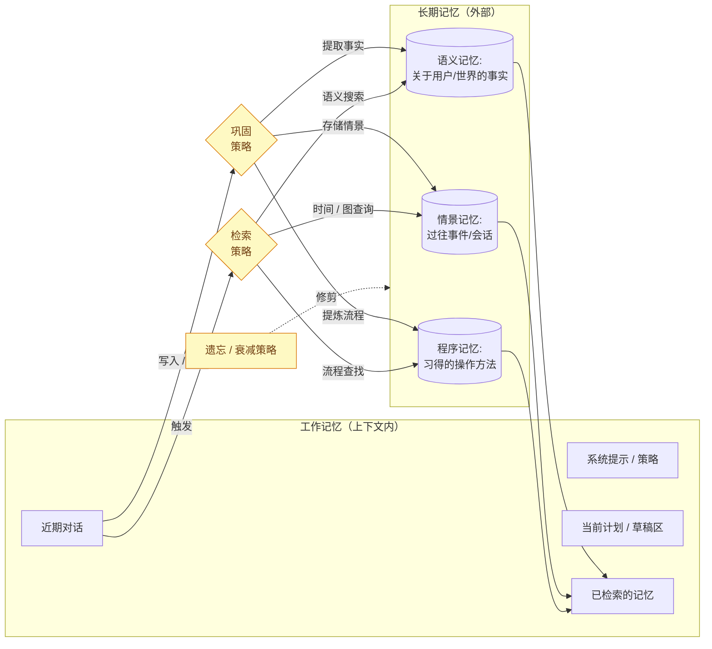
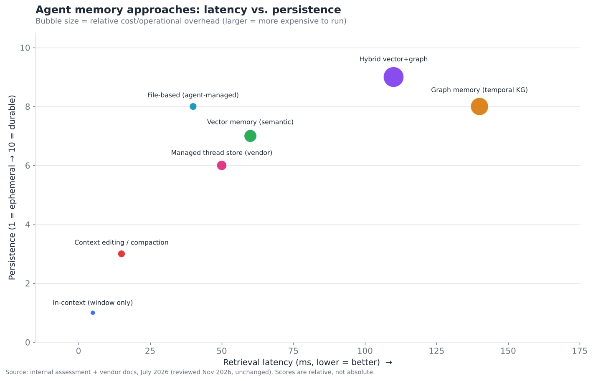
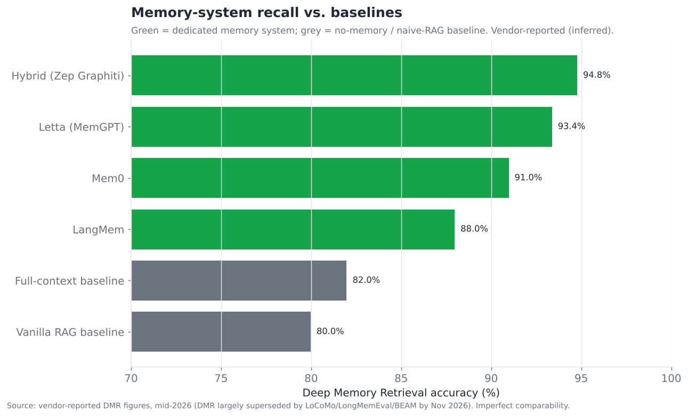
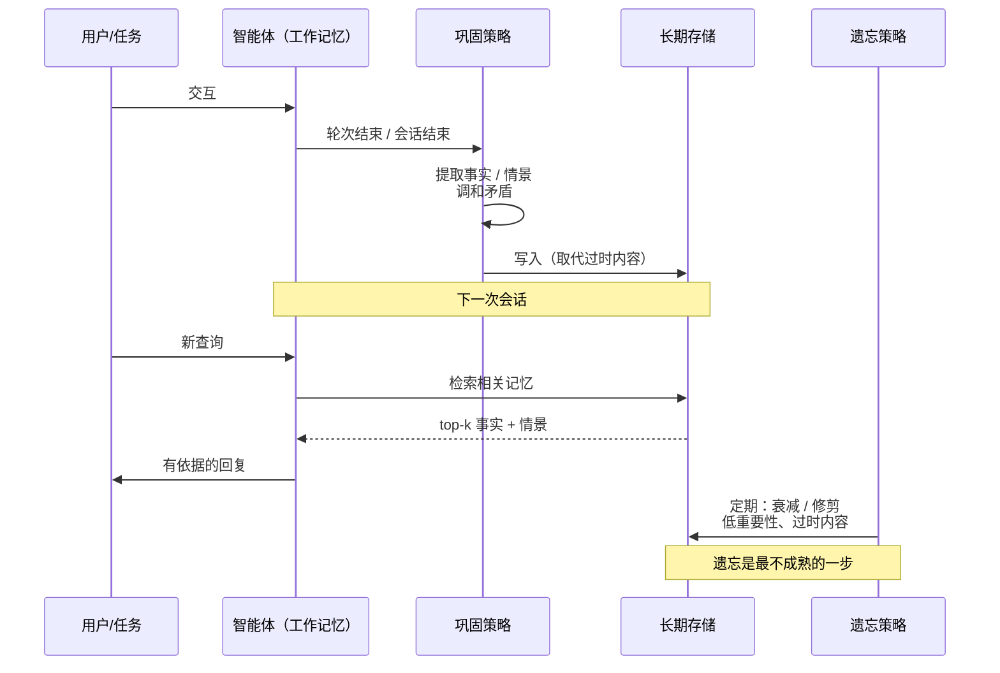
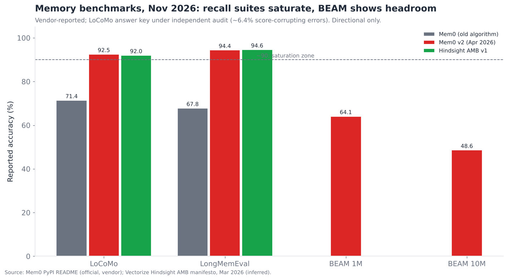

# 03 — 记忆系统

> **说明：** 本文为英文原文 [`sections/03-memory-systems.md`](../../sections/03-memory-systems.md) 的简体中文参考译文，仅供参考；如有出入，以英文原文为准。

*“智能体忘了”的头号原因。短期上下文、长期/情景记忆，以及向量 vs. 图 vs. 混合的架构之争。目标篇幅：7,000 词。
快照日期 2026 年 7 月 22 日；内容截至 2026 年 11 月。*

---

## 为什么记忆是严重程度最高的工程瓶颈

在全部十五个层中，记忆是演示效果与生产体验之间差距最大的一层，也是终结每一个智能体试点项目的那句抱怨最常见的单一来源：*“它把我们告诉它的事忘了。”* 在执行摘要中，它的得分为 **成熟度 4.5/10、瓶颈严重程度 8.0/10**——严重程度高、成熟度低、竞争激烈。这一组合恰恰定义了 2026 年工程投入边际回报最高的地方，也正因如此，2025 年涌现出了一整个供应商类别（Mem0、Zep、Letta、LangMem、Cognee 等），专门销售“记忆即服务”。

记忆之所以难，并不是因为存储文本难——而是因为 **记忆不是存储，而是一个策略问题。** 真正困难的问题全都关乎 *保留什么、丢弃什么、何时检索、如何调和矛盾*——而其中每一项都是业界尚无定论的判断题：

- **什么值得记住？** 并非每条消息都重要。全部存储会让检索充满噪声且代价高昂；存得太少又会丢失主线。
- **何时应该检索记忆？** 检索过于积极，会用无关的历史淹没上下文；过于懒惰，智能体又会在不了解应知信息的情况下行动。
- **如何处理矛盾？** 用户 1 月说自己的地址是 X，6 月又说是 Y。朴素的记忆会同时返回两者，让模型困惑。好的记忆知道 Y 取代了 X——这需要一种 *时间* 概念，而纯向量存储恰恰缺少这一点。
- **如何遗忘？** 人类记忆会自适应地衰减；从不遗忘的智能体记忆会不断积累过时、相互矛盾的冗余内容，并在数月之间拖累性能。有意识的遗忘是一项功能，而几乎没有人把它做好。

这些就是“巩固与遗忘”问题，也正是它们使记忆成为一个贴近研究前沿的瓶颈，而不是一个已经解决的工程层。

---

## 2026 年 7 月以来的变化（2026 年 11 月更新）

自快照以来最重要的消息是：**离线巩固——本节曾称为 research-only（仅限研究）的“记忆睡眠”构想——已作为供应商功能发布**。它被标注为研究预览，但确实存在。Anthropic 面向 Claude Managed Agents 推出的 **Dreams**（2026 年 5 月推出，快照中遗漏，并在 10 月前扩展到每一款新的 Claude 模型）会读取一个记忆存储及过往对话记录，然后写出一个重新组织过的存储，其中重复项被合并、过时条目被替换。据广泛报道，OpenAI 于 2026 年 6 月重建的 ChatGPT 记忆也使用了类似的后台流程。另有两个变化值得关注。**托管平台持续吸收记忆能力**：Google 的 Memory Bank 推出了 GA 版记忆画像（memory profiles）、TTL 过期和修订版本，AWS AgentCore 则增加了情景记忆和流式通知。**基准测试体系已经饱和**：领先供应商目前在 LoCoMo 和 LongMemEval 上报告的成绩都在 90 分出头到 95 分左右，一项公开审计发现 LoCoMo 的答案键存在错误，业界正转向 1M–10M token 规模的测试套件（BEAM）以及 *基于行动的* 评估。资金方面，我们没有发现 Mem0、Zep、Letta 或 Supermemory 在快照后有新的定价融资轮次。记忆初创公司正在算法和集成上竞争，而非依靠新资本。

重要进展的时间记录（置信度依据第 17 节）：

- **2026 年 4 月 16 日（快照中遗漏）：Mem0 2.0 发布新的记忆算法。** Mem0 报告 **LoCoMo 92.5 分**（其旧算法为 71.4）、**LongMemEval 94.4 分**（此前为 67.8），以及 **BEAM 1M / 10M 上 64.1 / 48.6 分**，每次检索调用约消耗 7K token。这些是供应商自报的数字。Mem0 2.1/2.2 于 9 月相继发布。
  *（official（官方），[PyPI/mem0ai README](https://pypi.org/project/mem0ai/)）*
- **2026 年 4 月 22 日（遗漏）：Vertex AI Memory Bank 更名为“Agent Platform Memory Bank”**，归入 Gemini Enterprise Agent Platform。其默认生成模型于 6 月 29 日切换为 Gemini 3.5 Flash，**记忆画像于 2026 年 7 月 15 日 GA**。文档现已涵盖巩固、基于 TTL 的过期、记忆修订，并对记忆投毒发出警告。*（official，
  [发布说明](https://docs.cloud.google.com/gemini-enterprise-agent-platform/release-notes)，
  [Memory Bank 文档](https://docs.cloud.google.com/gemini-enterprise-agent-platform/scale/memory-bank)）*
- **2026 年 5 月 6 日（遗漏）：Anthropic Dreams**（研究预览）为 Managed Agents 带来离线记忆巩固。随后加入了 Fable 5 和 Sonnet 5（7 月 10 日）、Opus 5（8 月 1 日），以及 Opus 5.5、Fable 5.1 和 Sonnet 5.5（10 月 1 日）。*（official，
  [Claude 发布说明](https://platform.claude.com/docs/en/release-notes/overview)）*
- **2026 年 6 月 4 日：OpenAI 重建 ChatGPT 记忆。** 新记忆能保持上下文为最新状态，向用户展示其使用了哪些记忆，为 Plus/Pro 用户将容量翻倍，并开始面向免费用户推出。**8 月 14 日**，项目（projects）新增了仅限项目的记忆选项。二手报道称该后台流程为“Dreaming”，并援引内部数据称事实召回率从 41.5% 提升到 82.8%。*（推出情况为 official，
  [ChatGPT 发布说明](https://help.openai.com/en/articles/6825453-chatgpt-release-notes)。
  名称和数字为 inferred（推断），[9to5Mac](https://9to5mac.com/2026/06/04/openai-says-chatgpts-memory-feature-is-getting-smarter-and-coming-to-free-users/)。）*
- **2026 年 3 月–6 月：AWS AgentCore Memory** 为长期记忆增加了流式通知（3 月）和强一致性元数据（5 月/6 月）。一种存储任务轨迹与反思的 **情景（episodic）** 策略已于 2025 年 12 月的 re:Invent 上推出。从 2026 年 10 月 6 日起按 GB 计费的摄取价格仅见于二手来源。
  *（功能为 official，
  [AWS What's New](https://aws.amazon.com/about-aws/whats-new/2026/03/agentcore-memory-streaming-ltm)。
  定价为 speculative（推测）。）*
- **2026 年 7 月 22 日 – 8 月 19 日：Anthropic 记忆存储趋于成熟。** 新增了 `agent-memory-2026-07-22` beta 请求头，记忆存储生命周期 webhook 上线（7 月 22 日），记忆存储现在还可以挂载到 **自托管沙箱**（8 月 19 日），在沙箱与托管存储之间同步基于文件的记忆。
  *（official，[发布说明](https://platform.claude.com/docs/en/release-notes/overview)）*
- **2026 年 7 月 24 日 – 10 月 7 日：1M token 窗口成为默认配置。** Claude Opus 5、Opus 5.5、Sonnet 5.5 和 Haiku 5.5 均以 1M token 上下文和 128k 输出发布。长窗口如今已是基线，但记忆需求并未下降（见下文“上下文腐化”）。*（official，[发布说明](https://platform.claude.com/docs/en/release-notes/overview)）*
- **2026 年 9 月 14 日：Anthropic“按需压缩”（compaction on demand）**（beta）。API 返回一个经签名的压缩块来替换较早的轮次，由开发者决定何时压缩以及保留哪些最近轮次的原文。**11 月 2 日：“消息线程”（message threads）** 在调用之间于服务器端保留工作记忆。*（official，
  [发布说明](https://platform.claude.com/docs/en/release-notes/overview)）*
- **2026 年 9 月：Mem0 新增 Vercel Marketplace 集成，并推出自己的基于行动的基准测试 DolphinBench。** *（inferred；二手报道）*
- **2026 年 7 月–9 月：对基准测试的批评成为主流。** BEAM 在最高 10M token 的规模上探测记忆。一项未经同行评审的审计（Penfield Labs）报告称，LoCoMo 答案键中约 6.4% 的条目是会破坏评分的错误。MemoryArena 和 MERIT（arXiv 2609.05441）依据下游 *行动* 而非问答来为记忆打分。7 月的一篇论文（arXiv 2607.21962）报告称，随着记忆存续时间的增长，各记忆架构的排名会 *发生交叉*。*（inferred，
  [Mem0 基准测试概览](https://mem0.ai/library/agent-memory/ai-memory-benchmarks-in-2026)，
  [Hindsight AMB 宣言](https://hindsight.vectorize.io/blog/2026/03/23/agent-memory-benchmark)，
  [arXiv 2609.05441](https://arxiv.org/pdf/2609.05441)，
  [arXiv 2607.21962](https://arxiv.org/pdf/2607.21962)）*
- **2026 年 10 月 14 日：Zep Cloud SDK 4.0。** Zep 现将自身定位为“上下文工程平台”，Graphiti 版本为 0.31.x。**Letta** 在 9 月发布了 0.32 至 0.34 版，并在力推 Letta Code——其记忆优先的编码智能体。**Cognee** 于 4 月达到 1.0，到 10 月下旬已到 1.6。*（official，
  [PyPI zep-cloud](https://pypi.org/project/zep-cloud/)，
  [PyPI letta](https://pypi.org/project/letta/)，
  [PyPI cognee](https://pypi.org/project/cognee/)）*
- **LangMem 自 2025 年 10 月（0.0.30）以来没有任何新发布。** LangChain 的记忆工作似乎已转移到 Deep Agents 脚手架中，后者宣传内置长期记忆。*（发布数据为 official，
  [PyPI](https://pypi.org/project/langmem/)。该解读为 inferred。）*

---

## 双层心智模型：工作记忆 vs. 长期记忆

思考智能体记忆最清晰的方式——大致借鉴自认知科学，如今已成为业界标准——是一个双层模型：

- **工作记忆（短期）** 是 *此刻位于上下文窗口中* 的内容：当前对话、正在执行的计划、最近的工具结果。它速度快（已在上下文中，检索延迟为零）、有边界（即使达到数百万 token，窗口仍是有限的）、且易失（除非持久化，否则会话结束即消失）。管理工作记忆就是 **上下文工程**：决定由什么来占据模型所拥有的这块有限且最宝贵的“地盘”。
- **长期记忆** 是持久化在窗口 *之外*、在相关时被检索回来的一切内容：关于用户的事实、过往情景、习得的流程、组织知识。它持久且实际上没有上限，但检索有延迟和成本，而且——关键在于——检索可能 *出错*（遗漏相关记忆，或召回无关记忆）。

几乎每一次真实的记忆失败，都是这两层之间 *边界* 上的失败：正确的长期记忆没能在正确的时间被检索进工作记忆，或者工作记忆溢出、悄无声息地丢掉了重要的内容。从本质上说，记忆系统的架构就是管理这一边界的策略。

三个黄色框——**巩固、检索与遗忘策略**——是所有难点所在，也是相互竞争的供应商实现差异化的地方。存储框（向量数据库、图数据库）已是大宗商品；*策略* 才是产品。

---

## 工作记忆：上下文工程

在求助于外部记忆系统之前，第一个、也往往是最有效的杠杆，是把上下文窗口管理好。“上下文工程”——这个术语在 2025 年间基本取代了“提示工程”——是一门策划工作记忆中应放入什么内容的学问。三种技术占主导地位：

**压缩 / 摘要。** 当对话变长时，把较早的轮次总结成紧凑的形式，用摘要替换逐字历史。这是最常见的技术，也是最常见的无声失败来源：由摘要器决定什么重要，如果它丢掉了用户在意的事实，智能体就会“忘记”，尽管什么都没有崩溃。好的压缩是 *结构化的*（显式保留实体、决策和未完成任务），而不是 *叙事性的*（丢失细节的散文式回顾）。

**上下文编辑。** 智能体不做整体摘要，而是像做手术一样移除过时内容——已完成的工具结果、已解决的子任务、已被取代的信息——同时逐字保留其余内容。Anthropic 在 2025 年将其作为一等能力发布：上下文编辑加上一个记忆工具，使智能体能够运行原本会耗尽窗口的 100 轮工作流，据报道在一项 100 轮的网页搜索评估中将 token 消耗降低了约 84% *（official，Anthropic）*。关键洞见在于，*移除* 正确的内容往往优于 *总结* 一切，因为对保留下来的内容而言，移除是无损的。（到 2026 年末，这两个杠杆都已成为 API 原语：Anthropic 在 2026 年 9 月增加了由开发者触发的“按需压缩”，它返回一个经签名的摘要块并逐字保留所选的最近轮次；又在 11 月增加了服务器端的“消息线程”——*official*。）

**结构化草稿区 / 外部工作记忆。** 把智能体的计划、任务清单和中间产物保存在一个结构化的外部存储中（一个文件、一个待办清单、一个状态对象），而不是让它们在对话中滚动消失。智能体有意识地读写这个草稿区。这正是 Anthropic 基于文件的记忆工具所做的事、编码智能体中“待办清单”工具所做的事，也是 LangGraph 的状态对象所提供的能力——它把工作记忆从被动滚动的记录变成了主动管理的工作空间。

全局要点：**更大的上下文窗口并没有解决记忆问题，只是转移了问题。** 即使有百万 token 的窗口，把所有内容都塞进上下文既慢又贵，而且——与直觉相反——会 *降低* 准确率，因为模型对埋在超长上下文中的信息注意力更差（即使窗口不断扩大，“迷失在中间”（lost in the middle）效应依然存在）。因此，无论窗口多大，上下文工程都不可或缺，“用更大的窗口就行”并不是一种记忆策略。

---

## 长期记忆：三种类型

长期记忆并不是单一的东西。业界收敛到一个三分法分类，同样借鉴自认知科学，它能清晰地对应不同的存储与检索需求：

- **语义记忆**——事实。“用户是素食者。”“公司的财年在 3 月结束。”这是（大体上）不随时间变化的知识，最好以离散的提取事实形式存储，并按语义相似度检索。这是 Mem0 的核心模型：从对话中提取原子事实，存储为嵌入向量，按相关性检索。
- **情景记忆**——事件。“6 月 3 日用户让我重新安排 Thompson 会议，我照做了。”这是带时间戳的经历，最好以带时间结构的方式存储，以便回答“什么时候发生了什么”以及“最新状态是什么”。这正是时间知识图谱（Zep/Graphiti）大放异彩、而纯向量存储力不从心的地方，因为情景具有嵌入向量本身无法捕捉的 *顺序* 和 *取代* 关系。
- **程序记忆**——习得的操作方法。“当用户要一份报告时，他们希望用 Q3 模板并包含这五个部分。”这是智能体无需再次指示即可应用的提炼后流程。它是三者中最不成熟的；大多数系统用存储的指令或少样本示例来近似实现，而非真正习得的流程。

成熟的记忆系统会处理全部三种，但各供应商在各自最擅长的类型上形成差异——这一分类也是观察竞争格局的有用视角：Mem0 最擅长语义记忆，Zep 擅长情景/时间记忆，Letta 擅长工作记忆/程序记忆的边界。

---

## 架构之争：向量 vs. 图 vs. 混合

这是记忆层的核心技术较量，并直接映射到供应商之间的竞争。

### 向量记忆

将记忆作为嵌入向量存储在向量数据库中；按与当前查询的语义相似度检索。**优势：** 简单、构建快，非常适合模糊/语义召回（“找出与用户此刻所问内容相关的记忆”），基础设施已是大宗商品（任何向量数据库都可以）。**劣势：** 没有 *时间* 概念（当事实发生变化时，难以回答“*当前* 的值是什么”），没有 *关系* 概念（无法遍历“用户经理的邮箱”），并且容易返回语义相似但错误的记忆。这就是 Mem0 的路线，而它之所以是最佳的 *即插即用* 选择，恰恰因为它简单而通用。

### 图记忆

将记忆存储为知识图谱——实体为节点，关系为边，边上通常带有时间戳（即 *时间* 知识图谱）。通过图遍历进行检索，通常结合向量搜索来找到入口点。**优势：** 能处理关系（“谁向谁汇报”），能处理时间和取代（“这个事实在这一天取代了那个事实”），并能回答向量搜索无法回答的多跳问题。**劣势：** 延迟更高（图构建和遍历的成本）、运维复杂度更高，而且图构建步骤（用 LLM 提取实体/关系）本身就容易出错且代价高昂。这就是 Zep/Graphiti 的路线，它在 *时间性* 和 *关系性* 查询上胜出——正是这类查询导致了“它返回了我的旧地址”这一类 bug。

### 混合

两者结合：用向量索引做模糊的语义召回，用图来表达关系/时间结构，再由一个检索策略同时查询两者并合并结果。对于要求苛刻的用例，这越来越成为公认的“最佳”架构，代价是运行起来最复杂、最昂贵。下面的权衡图从延迟、持久性和成本三个维度对各种方法进行了定位。

这张图的读法是：**上下文内记忆快速/廉价/短暂（左下角，小圆），向量+图混合记忆持久/高召回但缓慢昂贵（右上角，大圆），其他一切都介于两者之间进行权衡。** 天下没有免费的午餐；正确的选择取决于你的用例是对延迟敏感（语音智能体——§10——负担不起每轮 140ms 的记忆查找），还是对召回敏感（一个绝不能遗忘的长期运行个人助理）。

第二张图说明了为什么额外的复杂度可能是值得的——记忆基准测试上的召回准确率：

在深度召回基准测试上，专用记忆系统大幅超越“全部放进窗口”和“朴素 RAG”两种基线，其中时间图和混合方法位居前列。需要醒目标注的注意事项是：**这些数据大多是供应商自报的，所用基准测试有时还是供应商参与设计的，因此跨供应商的可比性并不完美**——应把排名视为方向性参考，而非精确结论（这恰恰是 §11 中的评估可信度问题在记忆层的体现）。

---

## 巩固与遗忘：无人解决的前沿

如果说检索是记忆中已被走熟的部分，那么 **巩固与遗忘就是前沿**，而且坦率地说，还没有人把它们解决好。

**巩固** 是把原始经历转化为持久记忆的过程——决定对话中哪些内容值得保留，将其提取为正确的形式（事实、情景、流程），与已有记忆进行调和，并解决矛盾。朴素的做法（存储每一条消息）会产生一个嘈杂、自相矛盾、随时间不断退化的记忆。较成熟的做法用 LLM 来提取和调和——但这代价高昂（每次巩固多一次模型调用）、容易出错（提取器会产生幻觉或张冠李戴），并且会增加延迟。调和问题——“这条新事实与已存储的事实相矛盾，以哪个为准？”——正是时间图谱发挥价值的地方（较新的边取代较旧的边），也是向量存储从根本上力不从心的地方（两个嵌入向量就那样并存着，被检索到的可能性完全相同）。

**遗忘** 更不成熟。人类记忆会自适应地衰减——我们忘掉无关的、保留重要的，而衰减本身还有助于泛化。从不遗忘的智能体记忆会变成负担：它积累过时的事实、已解决的任务和已被取代的偏好，污染检索，并且存储和搜索它们都要花钱。然而几乎没有生产系统做到有原则的遗忘；大多数要么永远保留一切（并缓慢退化），要么使用粗糙的 TTL/近因启发式规则。相关研究方向——按重要性加权的衰减、遗忘曲线、离线进行巩固和修剪的记忆“睡眠”阶段——在 2026 年 7 月快照时还是 **research-only**。到 2026 年 11 月，离线“睡眠”巩固已进入供应商的研究预览。Anthropic 的 Dreams（2026 年 5 月）会根据过往会话重写记忆存储，合并重复项并替换过时条目；据报道，OpenAI 重建后的 ChatGPT 记忆也运行着类似的后台流程。粗糙的过期机制如今已是有文档记载的托管功能：Google Memory Bank 有 TTL，AgentCore 有生命周期策略。*有原则的、按重要性加权的遗忘* 仍然是 research-only，也没有任何供应商公布对其巩固过程丢弃了哪些内容的评估。这是记忆层中最明确的“未解决”地带，也仍然是下一个突破最可能的来源。

巩固/检索/遗忘循环的具体呈现：

---

## 竞争格局

智能体记忆市场在 2024 年几乎还不存在，到 2026 年中已成为一个拥挤且资金充裕的类别——这是瓶颈层吸引一波专业供应商的教科书式案例。参与者分为 **专门的记忆初创公司**、**框架原生记忆** 和 **模型供应商的记忆功能** 三类。

### 竞争对比表——记忆系统

| 产品 | 背景 / 阶段 | 架构 | 成熟度 | 最擅长 | 知名采用者（置信度） | 差异化优势 | 主要竞争对手 |
|---|---|---|---|---|---|---|---|
| **Mem0** | 约 2,400 万美元（种子轮 + A 轮，Basis Set；Kindred、Peak XV、YC） | 向量事实提取（v2 算法，2026 年 4 月） | shipped-reliable | 即插即用的语义记忆 | AWS Agent SDK / Strands 记忆提供方（official） | 最简单的即插即用方案；庞大的开源社区（48k★）；供应商自报在约 7K token 下 LoCoMo 92.5 / LongMemEval 94.4 | Zep, LangMem, Letta |
| **Zep (Graphiti)** | 风投支持的初创公司（YC） | 时间知识图谱 + 向量 | shipped-reliable | 时间/关系召回 | 企业助理（inferred） | 具备时间感知的图谱；DMR 分数领先；重新定位为“上下文工程平台”（SDK 4.0，2026 年 10 月） | Mem0, Cognee |
| **Letta（原 MemGPT）** | 约 1,000 万美元种子轮（Felicis） | 上下文内核心 + 归档分层 | shipped-reliable | 记忆优先的有状态智能体 | 研究机构 + 初创公司（inferred） | 智能体 *本身就是* 记忆系统；类操作系统的分页；Letta Code 记忆优先编码智能体 | Mem0, LangMem |
| **LangMem** | LangChain, Inc. | 向量 + 摘要 | shipped-reliable（自 2025 年 10 月起无新版本） | LangGraph 原生记忆 | LangGraph 用户（official） | 与 LangGraph 紧密集成；势头正转向 Deep Agents 的内置记忆（inferred） | Mem0, Zep |
| **Cognee** | 种子阶段 | 图 + 向量“记忆操作系统” | demoed-brittle | 组织级记忆控制平面 | 早期采用者（inferred） | 记忆即受治理的数据管道（ECL）；2026 年 4 月发布 1.0 | Zep, Mem0 |
| **Anthropic 记忆工具**（+ Managed Agents 记忆存储） | Anthropic | 基于文件、由智能体管理 | shipped-reliable（工具）；demoed-brittle（Dreams 预览） | 透明、可检查的记忆 | Claude 平台用户（official） | 客户端文件；上下文编辑；托管记忆存储；Dreams 离线巩固 | OpenAI 记忆、供应商存储 |
| **OpenAI 记忆** | OpenAI | 画像 + 向量（托管） | shipped-reliable | ChatGPT 个性化 | ChatGPT 用户（official） | 后台用户画像；2026 年 6 月重建，支持可审阅的记忆、面向免费层推出、仅限项目的记忆 | Anthropic, Google |
| **Google（Agent Platform Memory Bank，原 Vertex）** | Google | 面向 Agent Runtime 的托管记忆 | shipped-reliable | Gemini Enterprise Agent Platform 智能体 | Google Cloud 用户（official） | 托管记忆；记忆画像于 2026 年 7 月 GA；TTL + 修订版本 | OpenAI, AWS |
| **AWS AgentCore Memory** | Amazon | 托管（以 Mem0 为后端） | shipped-reliable | Bedrock 智能体 | AWS 企业客户（official） | AgentCore 中的托管记忆；与 Mem0 合作；情景（反思）策略；流式长期记忆通知 | Vertex, Azure |
| **Redis / Redis Agent Memory** | Redis（准上市公司） | 向量 + 高速 KV | shipped-reliable | 低延迟工作记忆 | 延迟敏感型应用（inferred） | 亚毫秒级 KV + 向量合于一个存储 | 向量数据库 |
| **Pinecone / Weaviate / Qdrant** | 各异（各自 1 亿美元以上） | 向量数据库底座 | shipped-reliable | 存储底座 | 无处不在（official） | 记忆系统所依托的底层向量基础设施 | 彼此竞争 |
| **Chroma** | 约 1,800 万美元以上（种子轮/A 轮） | 向量数据库（开发者优先） | shipped-reliable | 本地/开发环境记忆 | 开源开发者（official） | 对开发者友好的嵌入式向量存储 | Qdrant, Weaviate |
| **ReMe / 基于文件的开源方案** | 社区 | 文件/文档记忆 | demoed-brittle | 透明的记忆 | 业余爱好者（inferred） | 人类可读的文件记忆 | Anthropic 记忆工具 |
| **MemoryScale / 类 Cognee 方案** | 早期初创公司 | 各类混合方案 | research-only→demoed | 细分领域 | 早期（speculative） | 实验性的巩固 | Cognee, Zep |
| **Supermemory** *（新增，2026 年 11 月）* | 约 260 万–300 万美元种子轮（Susa、Browder、SF1.vc） | 构建于非结构化数据之上的知识图谱 | demoed-brittle | 面向应用的通用记忆 API | 开发者应用（inferred） | 单一记忆 API，将文档 + 聊天摄入到图谱中 | Mem0, Zep |
| **Hindsight (Vectorize)** *（新增，2026 年 11 月）* | Vectorize | 智能体记忆 + 开放基准测试 | demoed-brittle | 基准测试透明的记忆 | 早期（inferred） | 发布开放的 Agent Memory Benchmark（AMB）批评文章/测试套件 | Mem0, Zep, Letta |

这已远超十个不同的参与者，而且这个类别仍在形成之中——每月都有新进入者（2026 年 11 月更新新增了 Supermemory 和 Hindsight；自快照以来，我们没有发现任何独立记忆供应商被收购或获得新的定价融资）。其格局颇具启发性：**模型供应商和云厂商正在把托管记忆构建进自己的平台（Anthropic、OpenAI、Google Vertex、AWS AgentCore），这将给独立厂商带来压力，就像供应商 SDK 曾给编排框架带来压力一样**——只不过 AWS/Mem0 的合作展示了另一条路径：云厂商 *采用* 一家独立厂商作为其记忆提供方，而不是自建。记忆初创公司究竟会被供应商功能商品化，还是会作为云厂商标准化采用的记忆层而站稳脚跟，这是悬而未决的竞争问题。

---

## 向量数据库底座

在记忆 *产品* 之下是向量数据库 *底座*——Pinecone、Weaviate、Qdrant、Chroma、Milvus、pgvector、Redis，以及如今已内置于每个主流数据库中的向量功能。值得把它们与记忆系统清晰地区分开来，因为一个常见的混淆是把“我们有一个向量数据库”当成“我们有一个记忆系统”。向量数据库是 *存储和相似度搜索*；记忆系统是 *位于其上的巩固、检索与遗忘策略*。向量数据库已经商品化（成熟度高、有许多可互换的选项、价格不断下降）；记忆策略才是价值和难点所在。

这一区分带来了战略层面的影响：**向量数据库厂商正试图沿技术栈向上进入记忆领域**（Pinecone、Weaviate、Redis 都在推出专门面向智能体记忆的功能），而 **记忆初创公司则构建在商品化的向量数据库之上**，添加策略层。谁拥有策略层，谁就拥有价值；下面的存储则是一场价格上的逐底竞争。这映射了经典的基础设施模式：数据库被商品化，价值累积在其上的应用逻辑中。

给构建者的一条务实建议：**pgvector 和 Redis 常常被低估。** 对于许多生产环境中的智能体，记忆根本不需要专门的向量数据库——团队已经在运行的 Postgres 或 Redis 加上向量扩展就足够了，还能避免引入新的基础设施。专门的向量数据库在超大规模或超高查询吞吐量时才物有所值；在此之下，“用你已有的数据库”往往是正确而平淡的答案。

---

## 记忆与其他层

记忆并非孤立存在；它的失败和设计选择会在整个技术栈中产生连锁反应：

- **记忆 ↔ 检索（§07）。** 记忆和 RAG 相互交融——两者都把外部信息检索到上下文中。有用的区分是：*检索* 让智能体以一个（相对静态的）知识语料为事实依据；*记忆* 则从智能体自身（动态的）经历中积累而来。实践中它们共享向量数据库底座，并越来越多地共享同一套工具，两者的界线确实模糊。一个简洁的理解方式：检索是阅读图书馆；记忆是记日记。
- **记忆 ↔ 编排（§02）。** 编排层的“上下文被静默截断”失败，其实是记忆策略的泄漏——框架默认的上下文管理 *就是* 一种工作记忆策略，而且往往是不透明的。
- **记忆 ↔ 语音（§10）。** 语音智能体施加了严格的延迟预算（端到端低于 500ms），这排除了在关键路径上进行缓慢的图记忆查找，迫使记忆必须预取或保存在快速的工作记忆中。记忆架构受到其上方接口层的延迟约束。
- **记忆 ↔ 安全（§12）。** 记忆既是 *数据外泄面*，也是 *注入面*。一次提示注入可以把一条被投毒的“事实”写入长期记忆，影响此后所有会话（记忆投毒）；如果隔离薄弱，已存储的记忆还可能在用户之间泄露。跨会话持久化的记忆会让单次攻陷的影响范围大得多——这是记忆供应商才刚刚开始应对的安全考量。
- **记忆 ↔ 身份（§13）。** 按用户隔离记忆是一个身份/授权问题：记忆必须限定在正确的主体范围内，而一个在租户之间泄露记忆的多租户记忆系统就是严重的安全事故。

---

## 记忆特有的失败模式

记忆在生产环境中出错的典型方式，有别于其他层：

1. **因截断而无声遗忘。** 工作记忆溢出，框架丢弃旧内容，智能体在没有任何报错的情况下“忘记”。这是最常见的抱怨；解决办法是有意识的上下文工程加上真正的长期记忆，而不是更大的窗口。
2. **检索到过时事实。** 由于存储没有时间模型，智能体检索到一条过时的事实（旧地址、旧偏好）。时间图谱可以缓解；纯向量存储则暴露于此风险之下。
3. **检索噪声 / 虚假记忆。** 语义相似但错误的记忆被检索出来，模型将其视为相关信息，从而给出自信但错误的答案。更好的检索策略和重排序有所帮助；但它永远无法被彻底解决。
4. **记忆投毒（安全）。** 对抗性输入导致一条虚假或恶意的事实被巩固进长期记忆，影响未来的会话。随着记忆持久化时间越来越长，这是一个被低估且日益增长的风险。
5. **跨用户泄露。** 薄弱的租户隔离把一个用户的记忆暴露给另一个用户——这是一种严重、而且遗憾的是并不罕见的多租户 bug。
6. **巩固漂移。** 反复基于 LLM 的摘要/提取会慢慢扭曲事实（就像传话游戏），直到存储的记忆不再与现实相符。
7. **无限增长。** 没有遗忘机制，记忆会无限增长，降低检索质量、推高成本，直到不得不手动修剪。

---

## 深入剖析：三种架构押注的机制

三个领先的独立记忆系统并不只是“向量 vs. 图”之分——每一个都体现了关于记忆应当 *位于何处* 的独特架构理念，而理解其机制就能明白为什么它们各自能在自己的细分领域胜出。

### Letta / MemGPT：记忆即操作系统

Letta 源自 MemGPT 论文，其核心类比是：LLM 的上下文窗口就像计算机的 RAM——快但小——长期记忆就像磁盘——大但慢——而智能体需要一个在两者之间调度分页信息的 *操作系统*。在 Letta 中，智能体有一个始终驻留在上下文中的小型 **核心记忆**（相当于锁定的 RAM：关于用户的关键事实、当前人设、活跃目标），以及一个位于“磁盘”上的大型 **归档记忆**，在需要时通过显式函数调用将其分页调入。关键在于，*智能体管理它自己的记忆*——它通过工具调用决定把什么提升到核心、把什么逐出、在归档中搜索什么。记忆系统和智能体是同一个东西；不存在外部记忆服务，智能体 *本身* 就是有状态的。

这种“记忆优先的有状态智能体”模型对于长期存在的助理非常强大，这类助理必须在数月间保持一致的人设，以及对用户不断演进的理解。它的弱点在于，自我管理的记忆会增加工具调用开销，并把良好记忆管理的负担压在模型的判断力上，而这种判断力并不稳定。它是最具 *智能体性* 的记忆方法——记忆作为行为而非基础设施——并且恰好处在导致大多数失败的工作记忆/长期记忆边界上，这既是它的机会，也是它的风险。

### Zep / Graphiti：记忆即时间知识图谱

Zep 的引擎 Graphiti 从对话流中构建并维护一个 **双时态知识图谱**。随着消息到达，LLM 提取实体（人员、项目、偏好）和关系（从事、偏好、位于），并将它们添加到一个 *边上带有有效区间* 的图中——这条事实自日期 X 起为真，在日期 Y 被取代。检索把图遍历（从查询中提及的实体出发沿关系遍历）、向量搜索（找到语义相关的节点）和文本搜索结合起来，然后重排序。双时态设计——既追踪某件事 *何时发生*，也追踪系统 *何时得知*——正是让 Zep 即使在多次变更之后仍能正确回答“用户 *当前* 的地址是什么”，并能为审计回答“我们在 6 月 1 日时相信的是什么”的关键。

它的优势恰恰在于那些让向量存储难堪的查询类型：时间性的（“当前” vs. “过去”）、关系性的（多跳）以及矛盾性的（取代）。其代价是基于 LLM 的提取管道（昂贵、增加延迟，而且可能提取出错），以及运行图数据库的运维负担。当时间正确性和关系推理比纯粹的简单性更重要时，Zep 就是首选——而在企业助理和面向客户的智能体中，情况往往正是如此。

### Mem0：记忆即提取事实层

Mem0 走的是务实的中间路线：用 LLM 从每次交互中提取显著的 *事实*，将其连同少量元数据存储为嵌入向量，并在每个新轮次检索 top-k 相关事实，同时执行一次“更新 vs. 新增 vs. 删除”的调和，使事实存储保持最新，而不只是不断堆积。它有意不做成完整的图——它是一堆经过策划、去重、可自我更新的事实——这就是为什么它最容易接入现有应用，也是为什么它成为社区的宠儿和 AWS 选定的记忆提供方。它以最少的繁文缛节处理了 80% 的情况（对用户事实的语义召回，并具备基本的时效性），而把最难的 20% 时间/关系问题让给了图方法。

机制对比：

| 维度 | Letta (MemGPT) | Zep (Graphiti) | Mem0 |
|---|---|---|---|
| 核心抽象 | 操作系统式分页（RAM/磁盘） | 双时态知识图谱 | 提取事实的向量存储 |
| 由谁管理记忆 | 智能体自身（工具调用） | Graphiti 管道 | Mem0 管道 |
| 时间正确性 | 中等 | 极佳（有效区间） | 基础（更新/删除调和） |
| 关系 / 多跳 | 弱 | 极佳（图遍历） | 弱 |
| 部署简易度 | 中等 | 复杂 | 最简单 |
| 检索延迟 | 低（上下文内核心） | 较高（图 + 向量） | 低到中等 |
| 最佳适用场景 | 长期存在的有状态人设智能体 | 时间/关系型企业召回 | 即插即用的语义记忆 |

综合来看：**这三者与其说是竞争对手，不如说是“简单性 vs. 能力”曲线上的不同点位。** 团队应根据自身用例所处的位置来选择：即插即用的语义召回 → Mem0；时间/关系正确性 → Zep；记忆即智能体、长期人设 → Letta。许多成熟的系统最终会把它们组合起来（Mem0 风格的事实 + 针对关系子集的图）。

## 评估记忆：基准测试及其局限

由于记忆质量难以直接观察，业界构建了基准测试——它们带有 §11 中的所有注意事项。主要包括：

- **LOCOMO**（Long Conversational Memory，长对话记忆）——一个由超长多会话对话组成的基准测试，其问题需要跨会话召回，测试单跳、多跳、时间性和开放域记忆。它已成为事实上的标准记忆基准测试，大多数供应商的数字都引用它或其变体。
- **Deep Memory Retrieval（DMR，深度记忆检索）**——源自 MemGPT 的基准测试，测试从长历史中召回事实的能力；上图中的数字来自 DMR 风格的评估。
- **LongMemEval** 以及各种长上下文召回测试套件——测试系统能否在很长的对话“草堆”中找到那根“针”。
- **BEAM** *（2026 年 11 月新增）*——将对话记忆探测扩展到 1M 和 10M token。在 LoCoMo 和 LongMemEval 接近天花板的情况下，它正成为“生产规模”的补充。Mem0 报告的成绩为 64.1（1M）和 48.6（10M），因此仍有提升空间。*（official 供应商数据；状态为 inferred）*

**2026 年 11 月注——饱和。** 领先供应商目前在 LoCoMo 和 LongMemEval 上报告的成绩都在 90 分出头到 95 分左右：Mem0 v2 声称 92.5/94.4，Hindsight 的 AMB 提案为 92.0/94.6。Hindsight 认为，朴素的“把所有内容都塞进上下文”基线在大多数实例上都具有竞争力。一项独立、未经同行评审的 LoCoMo 审计报告称，约 6.4% 的答案键条目会破坏评分，并且 LLM 评审接受了 62.81% 的故意错误答案。一旦系统之间的差距小于答案键中的噪声，排行榜就不再能区分任何东西。业界的应对是转向 **基于行动的** 评估（MemoryArena、MERIT、Mem0 的 DolphinBench、AMA-Bench），在这类评估中，成功意味着在模拟世界中产生正确的状态变化。此外还有一些关于 **纵向** 评估的早期工作，发现架构排名会随着记忆存续时间的增长而变化。这两个方向都针对下文的问题（3）。

这些基准测试的问题就是整个评估层问题的集中体现：（1）**供应商在自己有时参与影响的基准测试上报告自己的数字**，因此排行榜部分程度上是一个营销阵地；（2）基准测试考察的是 *召回*，而不是 *巩固质量* 或 *遗忘*——即那些困难的部分——因为后者要难评分得多；（3）基准测试中的对话是合成的，无法捕捉真实长期使用中混乱的矛盾和漂移；（4）针对某个基准测试调优的系统，可能会让其检索过拟合该基准测试的提问风格。诚实的解读是：**记忆基准测试能告诉你一个系统在召回上不算糟糕；但它们无法告诉你该系统能否在六个月的真实使用中维持一个一致、最新、无矛盾的记忆**——而这才是真正重要的事情，也是我们目前还无法很好衡量的。

## 多智能体共享记忆

随着 §06（多智能体）的发展，一个重要性日益增加的细节是：当多个智能体协作时，它们是共享记忆还是各自保留独立记忆？两种模式都存在，而这一选择会带来实实在在的后果：

- **共享记忆**（所有智能体读写同一个公共存储）能促进协调——研究智能体的发现对写作智能体可见——但会带来并发问题（两个智能体写入相互冲突的事实）、上下文隔离问题（一个智能体看到另一个智能体尚未成形的推理），以及安全问题（被投毒记忆的影响范围如今覆盖所有智能体）。
- **隔离记忆**（每个智能体拥有自己的存储）保留了上下文隔离的好处——这正是采用多智能体的主要理由之一（§02）——但需要在智能体之间显式交接相关记忆，而这很容易出错（即 §06 中“智能体之间任务掉落”的失败）。

正在形成的模式是 **限定范围的共享记忆**：一块用于有意发布结果的共享“黑板”，加上每个智能体私有的、用于推理的工作记忆——这映射了人类团队的做法：在共享文档中分享结论，同时保留自己的私人笔记。这在 2026 年仍缺乏工具支持；大多数框架要么提供完全共享的状态，要么提供完全隔离的智能体，而限定范围的黑板这一中间方案需要自行手工实现。

## 记忆的成本维度

记忆并不免费，而且其成本很容易被低估，因为它们分散在存储、计算和 token 之中：

- **巩固成本。** 基于 LLM 的事实/实体提取在每次巩固时都要进行一次模型调用。对于高流量的助理来说，这项成本可能与主智能体推理本身的成本相当。使用更便宜/更小的模型进行提取是标准的缓解办法，代价是一定的质量损失。
- **检索 token 成本。** 每条被检索出的记忆在其驻留的后续每一轮中都会占用上下文 token——这与 §02 中的“上下文累积”成本相同。过度检索是一个无声的预算杀手。
- **存储成本。** 大规模的嵌入向量和图谱（数百万用户 × 数月历史）会成为一项实实在在的存储开支，这正是遗忘缺口发挥作用的地方：没有遗忘就意味着存储无限增长。
- **延迟成本。** 这不是金钱成本而是用户体验成本——每轮 140ms 的图查找在批处理工作流中毫无感知，在语音智能体（§10）中却无法接受。

务实的指导原则是：**把记忆作为一等成本来做预算，节制地检索（取前几条，而非前很多条），用廉价模型做巩固，并把大型产物挡在上下文之外**——这与控制编排成本的纪律相同，只是应用于记忆层。

## 记忆 vs. 个性化 vs. 微调

最后一个需要澄清的区分，因为这三者经常被混为一谈：

- **记忆** 在推理时将显式信息（事实、情景）存储并检索到上下文中。它是透明的、可更新的，并且是按用户的。
- **个性化** 是一种 *结果*——智能体表现得好像了解你——记忆是实现它的一种方式，但存储的偏好、用户画像和 UI 设置也同样可以。ChatGPT 的“记忆”实际上是一个构建在记忆底座之上的个性化功能。
- **微调** 把信息烘焙进 *权重* 中。对于按用户的或频繁变化的信息，它是错误的工具（你无法为每个用户单独微调，而为更新一条事实去重新训练是荒谬的），但对于稳定的、全组织范围的行为，它是正确的工具。2026 年的共识很明确：**对变化的、按用户的信息使用记忆/检索；对稳定的、共享的行为使用微调**——而把两者混淆（试图把本应作为记忆的事实微调进模型，或者反过来）是一种常见且代价高昂的架构错误。

## 路线图与展望（附置信度标注）

- **托管记忆成为标准平台功能** *（official 的发展轨迹；高置信度）。* 每一家主要模型供应商和云厂商现在都已发布或正在发布托管记忆（Anthropic、OpenAI、Google Memory Bank（原 Vertex）、AWS AgentCore）。基础记忆将成为一个勾选项，迫使独立供应商转向价值更高的差异化（时间推理、治理、跨组织记忆）。——*2026 年 11 月：已确认。Google 将记忆画像推向 GA，AWS 增加了情景记忆，Anthropic 增加了自托管沙箱中的记忆存储，OpenAI 向免费 ChatGPT 用户开放了记忆。独立厂商的回应是推出新算法（Mem0 v2）和重新定位（Zep 定位为“上下文工程平台”），而非新的融资。*
- **时间/图记忆成为高要求用例的默认选择** *（inferred；中高置信度）。* 在时间性和关系性查询上的召回优势足够真实，使得向量+图的混合架构正成为新兴的“严肃”默认选择，而纯向量仍是即插即用/简单的选择。——*2026 年 11 月：尚无定论。托管平台（Memory Bank、AgentCore、Anthropic 记忆存储）发布的都是提取事实式或基于文件的记忆，而非图谱。Mem0 v2 的数字表明，一条调校良好的向量/事实管道在已饱和的基准测试上可以与图方法匹敌。图方法在时间性和关系性查询上的优势，如今是借助纵向和基于行动的评估来论证，而不再是 LoCoMo。*
- **遗忘迎来首批真正的解决方案** *（speculative；中等置信度）。* 有原则的、按重要性加权的遗忘以及离线巩固（“记忆睡眠”）是未来 12–18 个月内最有可能从研究走向生产的转变，因为在长期运行的部署中，无限增长带来的痛点正变得尖锐。——*2026 年 11 月：部分确认，且快于预测。离线巩固已进入供应商研究预览（Anthropic Dreams，2026 年 5 月；OpenAI 重建的 ChatGPT 记忆，2026 年 6 月），TTL 过期已成为有文档记载的托管功能（Google Memory Bank）。附带公开评估的按重要性加权遗忘尚未发布。*
- **记忆互操作性标准出现** *（speculative；中低置信度）。* 随着智能体在不同框架和供应商之间迁移，可移植的记忆（导出/导入智能体的记忆）变得令人期待；目前还没有任何方案胜出，而且供应商有 *反对* 可移植性的动机，因此这可能会滞后。——*2026 年 11 月：尚未出现。最接近事实上可移植性的情况是，Anthropic 的记忆存储和编码智能体约定（AGENTS.md，现归 AAIF 管理）都是纯文件。*
- **记忆安全成为一门有名称的学科** *（inferred；中等置信度）。* 记忆投毒和跨租户泄露将催生专门的工具和实践，类似于提示注入推动了护栏类别的形成（§12）。——*2026 年 11 月：已有早期迹象。Google 的 Memory Bank 文档带有明确的记忆投毒警告，并出现了针对记忆的来源水印研究（例如 MemMark，arXiv 2605.25002）。目前尚不存在专门的商业产品类别。*
- **新增（2026 年 11 月）：记忆评估从召回问答转向行动与存续时长** *（inferred；中高置信度）。* 随着 LoCoMo 和 LongMemEval 已经饱和，且 LoCoMo 的答案键正受到审计，预计 2027 年供应商的宣称将引用 BEAM 规模和基于行动的测试套件，并预计至少会有一个纵向（数月使用）基准测试获得关注。
- **新增（2026 年 11 月）：“睡眠时”巩固成为标准的托管记忆功能** *（speculative；中等置信度）。* 继 Anthropic 和 OpenAI 的预览之后，Google 和 AWS 很可能在 2027 年为其托管记忆服务推出定时离线巩固。差异化的关键将在于巩固过程改动或丢弃了哪些内容的可审计性。

---

## 上下文窗口、“上下文腐化”，以及为什么记忆问题持续存在

一个反复出现的乐观说法——“百万 token 的上下文窗口将使记忆系统过时”——值得直接反驳，因为它不断重现，而它错误的原因恰恰能照亮整个记忆层。

第一，**成本和延迟随上下文长度增长。** 每一轮都发送一百万 token 既昂贵（按 token 付费，每一轮都要付）又缓慢（注意力成本随序列长度增长）。一个只检索相关 2,000 token 的记忆系统，比每次调用都把 500,000 token 的历史塞进窗口要便宜和快速得多。即使质量相同，仅凭经济性也会倾向于检索。

第二，**质量并不相同——长上下文会削弱注意力。** 经验上稳健的“迷失在中间”发现——模型对上下文开头和结尾的注意力最好、对中间部分最差——即使窗口不断扩大也依然存在。从业者越来越多地把这一更广泛的现象称为 **“上下文腐化”（context rot）**：随着上下文中填入更多材料，包括离题或过时的内容，模型可靠地利用其中任何特定片段的能力会 *下降*。一个塞满一百轮历史的窗口，并不等同于一份精心策划、只包含相关五条事实的 2,000 token 摘要；策划后的版本往往能产出 *更好的* 答案，恰恰因为它没有被稀释。这就是上下文工程能在大窗口时代存续的深层原因：**稀缺资源是模型的注意力，而不是窗口的容量**，而记忆系统的存在就是为了明智地使用这份注意力。

第三，**窗口是按会话的；记忆是跨会话的。** 即使是无限大的窗口，对于 *上周* 对话中的信息也无能为力，除非那次对话被持久化并检索——而这正是记忆系统所做的事。窗口是工作记忆；按定义它就不是长期记忆，无论把它扩大多少都改变不了这一点。（这一点如今已变得具体。2026 年下半年，1M token 窗口成为 Anthropic 整个模型产品线的 *默认* 配置，包括小型的 Haiku 5.5（2026 年 10 月）。而在同样的几个月里，每一家主要供应商推出的长期记忆机制都更多了，而不是更少。）因此正确的表述是：更大的窗口是对 *工作* 记忆的可喜改进，减少了你必须进行压缩的激进程度，但它们让 *长期* 记忆问题——巩固、跨会话召回、遗忘——完全原封未动。这就是为什么记忆供应商类别在百万 token 窗口时代一路持续增长，而不是被它抹去。

## 写入路径：记忆中设计不足的那一半

大多数关注（以及大多数基准测试）都集中在 *读取* 路径——检索质量上。但 **写入路径——决定什么进入长期记忆以及以何种形式进入——才是真正决定质量的地方**，而它长期处于设计不足的状态。如果写入了错误的内容，任何检索策略都无法挽回；如果事实以有损或扭曲的形式写入，检索就会忠实地返回垃圾。

良好的写入路径设计涉及每个系统都要做出（往往是隐式做出）的若干决策：

- **显著性过滤。** 并不是每句话都值得记住。“天气怎么样？”通常不值得；“我对贝类过敏”通常值得。系统使用启发式规则或 LLM 判断来决定持久化什么。写入过多会用噪声淹没记忆；写入过少会丢失信号。
- **提取粒度。** 存储原始消息、提取出的原子事实，还是总结后的情景？原子事实检索精确但丢失上下文；原始消息保留上下文但检索时噪声大。大多数系统提取原子事实并接受上下文的丢失。
- **写入时调和。** 当新事实与已存储的事实矛盾时，写入路径必须决定：取代、两者都保留，还是合并。这正是时间图谱（以有效区间进行取代）胜过向量存储（只会把两者都累积下来）的地方。调和出错是“过时事实”失败的直接原因。
- **归属与来源。** 记录一条记忆 *来自何处*（哪个会话、哪个用户、是用户声明的还是智能体推断的）对于信任、调试和安全（区分用户陈述的事实与可能被注入的事实——§12）至关重要，然而许多系统在存储事实时不记录来源，事后无法分辨“用户偏好 X”到底是用户说的还是幻觉出来的。

被忽视的写入路径，正是为什么两个基于同一向量数据库的系统在记忆质量上可能天差地别：**智能在于你选择记住什么以及如何记录它，而不在于之后找到它的相似度搜索。**

## 检索策略：不仅是检索什么，还有何时检索

对称地，读取路径不仅是“检索什么”，还有“*何时* 检索”，而 *何时* 这一点被低估了。两种策略占主导：

- **积极 / 每轮检索。** 在每次模型调用之前，查询记忆并注入 top-k 结果。简单，但会用常常无关的记忆淹没上下文，浪费 token 并招致上下文腐化。这是常见的默认做法，也是膨胀的常见来源。
- **智能体式 / 按需检索。** 记忆是一个 *工具*，由智能体在判断自己需要回忆某些内容时调用（“在我的记忆中搜索用户的饮食限制”）。这与智能体式 RAG（§07）相呼应，而且更加精确——智能体只在相关时才检索——但它依赖模型正确识别自己何时需要记忆，而模型有时做不到这一点（不知道自己不知道什么）。

2026 年的方向倾向于 **以工具形式进行智能体式按需检索**，这与从固定预取管道转向智能体驱动检索的更广泛趋势一致——积极检索则保留给一小部分始终相关的事实（用户的姓名、定义人设的偏好），这些事实无论如何都应驻留在工作记忆中。这种混合方式——一个极小的常驻核心加上按需的深度检索——本质上就是 Letta 核心/归档划分的泛化版本，并且正在汇聚成跨供应商的最佳实践。

## 智能体记忆简史

这一层短暂的历史解释了它当前的形态。在 **2023 年**，“记忆”指的是一个近期消息的缓冲区，或许再加上一份滚动摘要——即 LangChain 最初的 `ConversationBufferMemory` 和 `ConversationSummaryMemory`。那完全是工作记忆管理；并不存在真正的长期存储。**MemGPT 论文（2023 年末）** 是思想上的转折点：它把记忆定义为操作系统式的分页问题，并证明智能体可以管理远大于其窗口的虚拟上下文，播下了后来成为 Letta 的“记忆优先智能体”理念的种子。在整个 **2024 年**，RAG 和向量数据库日趋成熟，人们开始把检索基础设施改作记忆之用——模糊了延续至今的记忆/检索界线。**2025 年** 是记忆成为 *产品类别* 的一年：Mem0、Zep 等公司获得了实质性融资，模型供应商推出了记忆功能（ChatGPT 记忆，随后是 Anthropic 的记忆工具和上下文编辑），“上下文工程”取代“提示工程”成为业内的技艺术语。到了 **2026 年**，记忆已是一个拥挤、资金充裕、仍未解决的层：存储已是大宗商品，策略才是产品，遗忘仍是开放的前沿——这正是本节所看到的状态。2026 年下半年又增加了一个里程碑：离线“睡眠”巩固走出论文，进入供应商的研究预览（Anthropic Dreams、OpenAI 重建的 ChatGPT 记忆），与此同时，定义了 2025 年的召回基准测试已趋于饱和。

这一轨迹与技术栈的其他部分如出一辙：一个临时拼凑的功能（2023 年）变成了一个差异化组件（2024–25 年），吸引了专业供应商，而平台所有者如今正在吸收它（2026 年）——与编排层走过的弧线相同，只是换了一层。

## 特定领域的记忆：编码智能体案例

记忆并非一刀切，最具启发性的反例是编码智能体（§09），它们的记忆需求与对话式助理截然不同，而它们的解决方案也指向了通用记忆可能的发展方向。

编码智能体最有价值的“记忆”根本不是对话历史——而是 **关于代码库的结构化知识**：文件树、符号定义、调用图、过往变更、测试结果和项目约定。这与对话式记忆的映射很差，而与 *带索引的、结构化的、可再生成的* 表示形式映射得好得多：代码符号索引、基于代码仓库的检索系统，以及像 `AGENTS.md`/`CLAUDE.md` 文件这样以人类可读形式记录持久项目约定的持久化产物。最后这种模式——一个签入仓库、智能体在每次会话开始时读取的 Markdown 文件——本质上就是 **基于文件的程序记忆**，而它之所以效果好，恰恰因为它透明、受版本控制、可由人类编辑且可再生成。最成熟的智能体垂直领域收敛到最透明、最不神秘的记忆机制上，这绝非偶然。

这一教训具有普遍意义：**正确的记忆表示形式是由领域决定的。** 编码智能体需要带索引的代码加一份约定文件；客户支持智能体需要一个关于客户关系的时间图谱；个人助理需要一份持久的语义画像；研究智能体需要一条记录自己已探索过哪些内容的情景轨迹。通用记忆系统是一个合理的默认选择，但质量最高的记忆通常是按照该领域实际结构塑造的——这就是为什么对于一个严肃的产品而言，“买一个通用记忆 API”只是起点，而不是终点。

## 何时你可能根本不需要记忆系统

一份中立的评估应当指出那些答案是“你不需要”的情况，因为供应商类别有动机让记忆显得在任何场景下都必不可少：

- **无状态任务。** 一次性的提取、分类或转换智能体，没有值得持久化的跨轮次状态。添加记忆纯属额外开销。
- **简短的单次会话。** 如果交互是自成一体且简短的，工作记忆管理（一个好的系统提示加上对话本身）就足够了；不需要长期存储。
- **检索已能覆盖。** 如果智能体需要“记住”的一切实际上都存在于一个权威的外部系统中（CRM、工单、数据库），那么从该系统进行 *检索*（§07）才是正确的工具，而不是一个与事实来源重复、并有与之产生分歧风险的独立记忆层。

需要避免的失败模式是 **过早引入记忆**：在智能体表现出跨会话召回需求之前就硬加上记忆系统，这会增加成本、延迟、新的失败面（投毒、泄露、漂移）和运维负担，却毫无收益。有纪律的路径是：从良好的上下文工程开始，仅在出现具体的召回需求时才加入长期记忆，并选择适合该具体需求的架构（向量/图/混合/文件）。

## 本节要点

- 记忆是 **边际价值最高的工程瓶颈**（成熟度 4.5，严重程度 8.0）：成熟度低、影响大，并正被一个新的供应商类别激烈争夺。
- **记忆是策略问题，而不是存储问题。** 难点在于巩固（保留什么）、检索（何时呈现）和遗忘（丢弃什么）——而不是底层已商品化的向量数据库。
- 用 **两层**（工作记忆 vs. 长期记忆）和 **三种类型**（语义、情景、程序）来思考。大多数失败发生在工作记忆/长期记忆的边界上。
- 架构之争是 **向量（简单、快速、无时间概念）vs. 图（时间/关系、较慢、复杂）vs. 混合（召回最佳、最昂贵）**。Mem0 在向量/即插即用方向领先，Zep 在时间图谱方向领先，Letta 在记忆优先智能体方向领先。
- **更大的上下文窗口转移了问题，而没有解决它**——上下文工程（压缩、编辑、草稿区）依然不可或缺。
- **遗忘是尚未解决的前沿。** 几乎没有人做到有原则的衰减。离线巩固（“做梦”）在 2026 年中进入了供应商预览，但具备可衡量质量的、按重要性加权的遗忘，仍然是下一个突破最可能出现的地方。
- **模型供应商和云厂商正在内建托管记忆**，这将给独立厂商带来压力——尽管 AWS/Mem0 的合作表明，被采用（而不仅仅是被取代）也是可能的。
- **写入路径和“何时检索”的决策是记忆中设计不足的那两半**：质量取决于你选择记住什么、如何记录（附带来源）、以及何时选择回忆——而不是找到它的相似度搜索。并且 **正确的表示形式由领域决定**——编码智能体需要带索引的代码加一份约定文件，而不是对话式记忆——因此通用记忆 API 只是起点，而非终点。避免 *过早引入记忆*：只有在证明存在具体的跨会话召回需求时，才加入长期存储。

归根结底，记忆是智能体不再只是无状态的应答者、开始成为持久且可问责的实体的地方——它们会与用户和自己的工作积累起一种关系——这就是为什么尽管尚不成熟，它仍是最需要做对、影响最深远的层之一。

*目标字数：7,000。本节：2026 年 11 月更新后约 8,800 词（近似值，通过 `wc` 统计）。*

## 参考来源（2026 年 11 月更新）

- https://platform.claude.com/docs/en/release-notes/overview (Dreams, memory stores, compaction on demand, message threads, model context windows)
- https://pypi.org/project/mem0ai/ (Mem0 v2 algorithm and benchmark table)
- https://techcrunch.com/2025/10/28/mem0-raises-24m-from-yc-peak-xv-and-basis-set-to-build-the-memory-layer-for-ai-apps/
- https://mem0.ai/library/agent-memory/ai-memory-benchmarks-in-2026
- https://hindsight.vectorize.io/blog/2026/03/23/agent-memory-benchmark
- https://arxiv.org/pdf/2609.05441 ; https://arxiv.org/pdf/2607.21962 ; https://arxiv.org/pdf/2605.25002
- https://help.openai.com/en/articles/6825453-chatgpt-release-notes
- https://9to5mac.com/2026/06/04/openai-says-chatgpts-memory-feature-is-getting-smarter-and-coming-to-free-users/
- https://cloud.google.com/blog/products/ai-machine-learning/introducing-gemini-enterprise-agent-platform
- https://docs.cloud.google.com/gemini-enterprise-agent-platform/release-notes
- https://docs.cloud.google.com/gemini-enterprise-agent-platform/scale/memory-bank
- https://aws.amazon.com/about-aws/whats-new/2026/03/agentcore-memory-streaming-ltm
- https://aws.amazon.com/about-aws/whats-new/2026/05/agentcore-memory-scmetadata
- https://aws.amazon.com/blogs/machine-learning/designing-lifecycle-policies-for-agentcore-memory/
- https://pypi.org/project/zep-cloud/ ; https://pypi.org/project/graphiti-core/ ; https://github.com/getzep/graphiti
- https://pypi.org/project/letta/ ; https://pypi.org/project/cognee/ ; https://pypi.org/project/langmem/ ; https://pypi.org/project/deepagents/
- https://supermemory.ai/blog/supermemory-raises-3-million-and-building-the-best-memory-engine-for-llms
- https://techcrunch.com/2025/10/06/a-19-year-old-nabs-backing-from-google-execs-for-his-ai-memory-startup-supermemory/
