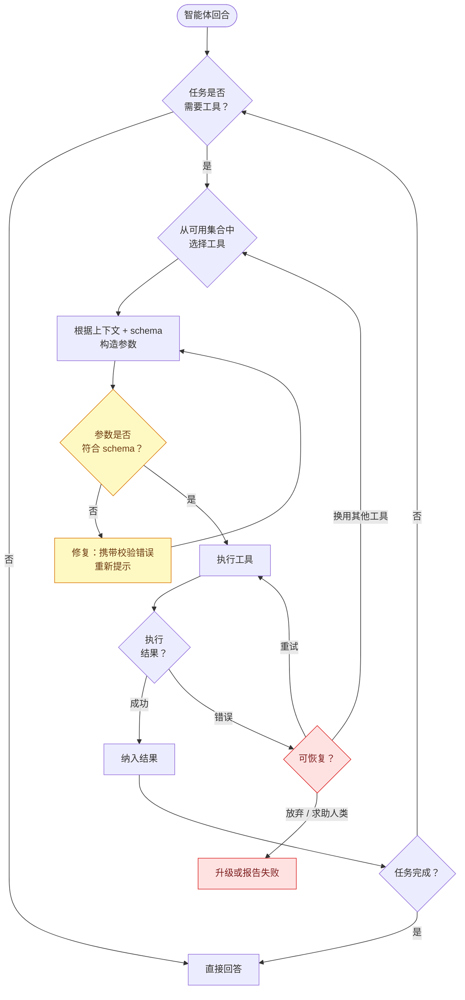
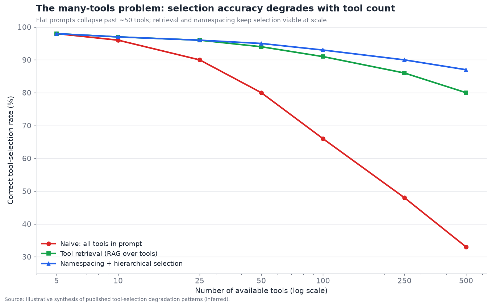
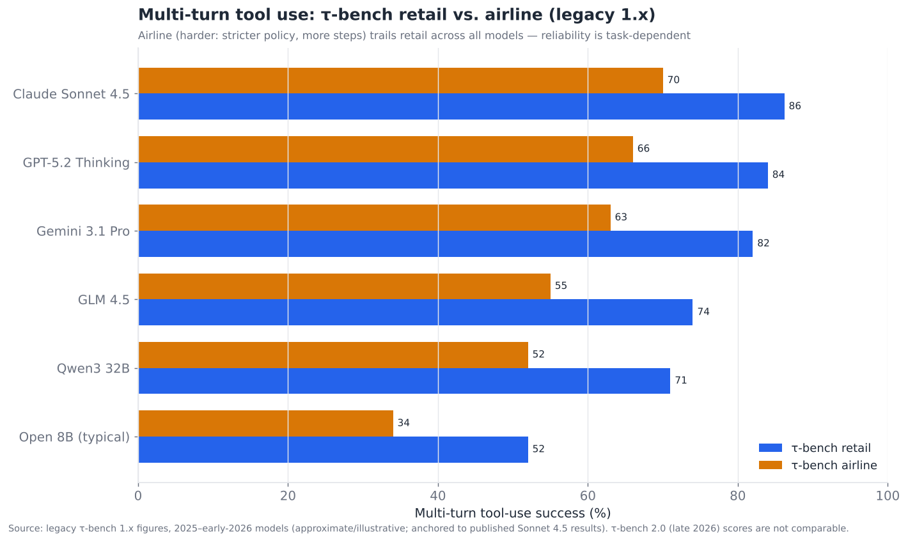

# 04 — 工具使用与函数调用

> **说明：** 本文为英文原文 [`sections/04-tool-use-function-calling.md`](../../sections/04-tool-use-function-calling.md) 的简体中文参考译文，仅供参考；如有出入，以英文原文为准。

*智能体如何作用于外部世界。涵盖 schema 标准、选择可靠性、结构化输出与错误恢复。目标篇幅：6,500 词。内容截至 2026 年 11 月（2026 年 7 月 22 日快照，2026 年 11 月 4 日更新）。*

---

## 让智能体成为可能的那一层

工具使用是把语言模型从文本生成器变成智能体的能力。一个只能输出文本的模型只能提建议；一个能够可靠地调用函数的模型——查询数据库、发送邮件、运行代码、预订航班——才能*行动*。本文档中其他所有内容都以这一层能正常工作为前提；它是能力栈（§§04–09）赖以建立的基础。在所有层中，它也是成熟得最快、最彻底的一层：在执行摘要中，它的得分为**成熟度 7.0/10，争议度 3.0/10**——是整个技术栈中争议最小的一层，因为业界以罕见的速度和一致性收敛到了一种共同方法上。

这种收敛值得重视。2023 年，工具使用意味着提示模型以某种临时格式（"Action: search[query]"）输出文本，再用正则表达式解析——脆弱、依赖特定模型，而且只要模型措辞稍有不同就容易出错。到 2024 年，每一家前沿厂商都已推出**原生函数调用**：模型经过训练，能以既定的 JSON 格式输出结构化工具调用，API 将其作为一等结构化对象返回，开发者不再需要解析自由文本。到 2025–2026 年，*连接*层也通过 MCP（§15）实现了标准化。结果是，基本机制——"模型请求一次工具调用，你执行它，你返回结果"——已成为一种已解决的、可靠的、跨厂商通用的商品化能力。

但"基本机制已解决"并不等于"工具使用已解决"。单次规范良好的工具调用可靠性很高；而智能体*从数百个工具中选对工具*、*在工具失败时恢复*、*对杂乱的输出强制施加结构*的可靠性，才是真正的、仍未解决的工程问题所在。本节将已解决的核心与未解决的边缘区分开来。

---

## 2026 年 7 月以来的变化（2026 年 11 月更新）

自 7 月快照以来的四个月并未改变本节的核心论点：工具使用的基本机制仍是商品化能力，难题仍在边缘（在众多工具中做选择、从错误中恢复、把参数值填对）。变化的是缓解措施*所在的位置*。本节在 7 月时描述为开发者自律的那些做法（工具检索、CodeAct 式组合、约束解码），如今在 Anthropic 和 OpenAI 两家都已成为**厂商原生、正式可用（GA）的 API 功能**。连接标准（MCP）发布了一次重大的无状态修订。周边规范的治理进一步转移到 Linux 基金会旗下的 Agentic AI Foundation（AAIF）。前沿模型也完成了一次全面换代（Claude 5.x、GPT-6、Gemini 4），主要的多轮工具使用基准测试也重新定基，因此 7 月时代的基准测试数据如今只是历史数据。

- **2026 年 7 月 9 日：OpenAI GPT-5.6 系列（Sol / Terra / Luna）正式可用（GA）**，此前应美国政府要求进行了分阶段预览。它为 Responses API 带来了**程序化工具调用**：模型编写在隔离运行时中执行的编排代码，以循环或并行方式调用工具，只向模型返回一个精简的结果。GPT-5.4 及以后版本支持工具搜索（`tool_search`）。
  *（inferred（推断）：来自对 OpenAI 文档的二手报道）*
  [Axios](https://axios.com/2026/07/09/ai-openai-gpt-release)，
  [Apidog](https://apidog.com/blog/gpt-5-6-programmatic-tool-calling/)
- **2026 年 7 月 15 日：τ³-bench v1.0.1。** τ³-bench（v1.0）新增了以检索为主的 `banking_knowledge` 领域、全双工语音评估以及 75 项以上的任务修复，v1.0.1 则修复了其评分。随后推出的 **τ-bench 2.0** 增加了六种语言（τ-i18n）、每种语言的语音模式，以及一个新的 `intake` 实体采集领域。其英文分数明确声明与 1.x 排行榜*不可比*。*（official（官方））*
  [sierra-research/tau2-bench](https://github.com/sierra-research/tau2-bench)
- **2026 年 7 月 24 日：Claude Opus 5** 新增了**对话中途变更工具**功能，可在不使提示缓存失效的情况下更改可用工具集（beta）。它还新增了**自动回退**功能，将被分类器标记的请求路由到另一个模型（beta）。*（official）* [Anthropic](https://www.anthropic.com/news/claude-opus-5)
- **2026 年 7 月 28 日：MCP 规范 2026-07-28 定稿。** 核心协议现已无状态：`initialize` 握手和 `Mcp-Session-Id` 被废除。`Mcp-Method` 和 `Mcp-Name` 请求头让网关无需解析请求体即可按工具名称路由。借助 MRTR，工具可以在调用中途暂停以等待用户输入（`input_required`）。`tools/list` 响应可以被缓存（`ttlMs`）。长时间运行的任务被移入一个扩展，并且现在有了正式的扩展框架。动态客户端注册（Dynamic Client Registration）被弃用，改用客户端 ID 元数据文档（Client ID Metadata Documents），Roots、Sampling 和 Logging 也被弃用。*（official）*
  [MCP blog](https://blog.modelcontextprotocol.io/posts/2026-07-28/)
- **2026 年 9 月 1 日 – 10 月 28 日：前沿模型换代。** 这一时间窗口内的发布：Claude Fable 5.1（9 月 1 日）、GPT-6 Astra（9 月 3 日）、GPT-6 Sol/Luna 与 Claude Opus 5.5（9 月 22 日）、Claude Sonnet 5.5（9 月 28 日）、Gemini 4 Argon（9 月 30 日发布，10 月 13 日 GA）、Claude Haiku 5.5（10 月 7 日）、Meta Muse Wonder（10 月 12 日）以及 Gemini 4 Carbon（10 月 28 日，受限访问）。厂商发布会的成绩表如今以*长周期智能体*基准测试打头，如 Terminal-Bench 4.0、OSWorld 2.x 和 AutomationBench，而不是单次调用的函数调用分数。这表明单次调用机制已不再是厂商竞争的焦点。*（Anthropic 的日期为 official；其他为 inferred）*
  [Anthropic news](https://www.anthropic.com/news)，
  [Claude models overview](https://platform.claude.com/docs/en/about-claude/models/overview)
- **2026 年 9 月 28 日：Claude Sonnet 5.5。** 早期测试者反馈，它**每一步批量发起更多工具调用**（往返更少），且失败的工具调用更少。新的 `between_tools` 思考设置取代了关闭思考的选项。
  *（官方博文；合作伙伴说法）*
  [Anthropic](https://www.anthropic.com/news/claude-sonnet-5-5)
- **截至 2026 年 11 月：Anthropic 的高级工具使用功能全部为 `stable`。**
  - **工具搜索工具**（正则与 BM25 两种变体）每个请求可处理多达 10,000 个延迟加载的工具，文档称它通常能将工具定义的 token 减少 85% 以上。
  - **程序化工具调用**已 GA。
  - **结构化输出与严格工具使用**已 GA，并通过约束解码强制执行：schema 被编译为语法，每个请求最多 20 个严格工具。

  工具搜索文档指出，选择准确率"一旦可用工具超过 30–50 个就会下降"，这与下文的多工具图表相吻合。*（official）*
  [Tool search](https://platform.claude.com/docs/en/agents-and-tools/tool-use/tool-search-tool)，
  [Programmatic tool calling](https://platform.claude.com/docs/en/agents-and-tools/tool-use/programmatic-tool-calling)，
  [Structured outputs](https://platform.claude.com/docs/en/build-with-claude/structured-outputs)
- **2026 年 10 月 22 日：AAIF 在 AGNTCon + MCPCon North America 上新增四个项目。** 它们是 **Agent Skills**（由 Anthropic 贡献）、**Open Responses**（OpenAI）、**OpenEnv**（Hugging Face）和 **OpenSandbox**。
  - Open Responses 是一个厂商中立的、Responses 风格的 API 规范。它将消息、工具调用和推理建模为带类型的条目，并包含一套针对工具调用的验收测试。Vercel 和 Databricks 已实现该规范。
  - Agent Skills（SKILL.md）将指令和脚本打包，供智能体按需加载。

  报道中的采用数据（约 2.8 亿次技能安装）未经核实。
  *（官方列表；细节为 inferred）*
  [Anthropic news](https://www.anthropic.com/news)，
  [The New Stack](https://thenewstack.io/openai-donates-open-responses/)，
  [Simon Willison](https://simonwillison.net/2026/Oct/22/donating-agent-skills/)
- **BFCL：未发现新的官方版本。** 第三方聚合网站显示，BFCL v3 的榜首成绩仍在 70 分段中高位（截至 2026 年 9 月 29 日，GLM 4.5 约为 76.7%）。它们的 BFCL v4 榜单彼此矛盾。*（inferred）*
  [PricePerToken](https://pricepertoken.com/leaderboards/benchmark/bfcl-v3)，
  [BenchLM](https://benchlm.ai/benchmarks/bfcl-v4)

**净效应：** 7 月路线图中的"约束解码走向普及"和"多工具问题通过检索 + CodeAct 解决"两项，如今已在前沿厂商处得到基本确认。悬而未决的问题仍是语义正确性、错误察觉和长链误差累积，本季度的任何发布都没有声称已解决这些问题。

---

## 一次工具调用的解剖

在所有厂商那里，每一次工具调用都具有相同的四部分结构，准确地命名这些部分是理解问题出在哪里的关键：

1. **Schema（声明）。** 开发者向模型描述工具：它的名称、功能，以及带类型和描述的参数——几乎总是用 JSON Schema 表达。这就是模型对该工具的*全部*认知；如果 schema 含糊，模型就会用错工具。Schema 质量是开发者可控的、影响工具调用可靠性的最大杠杆，而它长期投入不足。
2. **选择（决策）。** 给定对话和可用工具，模型决定*是否*调用工具、调用*哪个*工具，以及*何时*调用。这是与推理相关的部分，也是随着工具数量增加而退化的部分。
3. **参数构造（绑定）。** 模型填写参数——从上下文中提取正确的值，并按 schema 格式化。这里的错误（类型错误、幻觉出的值、缺少必填字段）很常见，而且往往是静默的。
4. **执行与结果处理（反馈）。** 开发者的代码实际运行工具，并将结果返回给模型，模型将其纳入并继续。这里的失败——API 报错、超时、返回意料之外的内容——决定了错误恢复（或其缺失）会让智能体勉强继续还是直接崩溃。

原生函数调用在*机制*层面解决了第 1 和第 4 部分（结构化 schema 输入、结构化调用输出、结构化结果返回）。第 2 和第 3 部分——选择与参数构造——属于*模型能力*，虽已大幅提升但仍不完美；而第 4 部分中的*恢复*逻辑仍是开发者的责任，框架只能提供部分帮助。

黄色（校验/修复）和红色（错误恢复）节点决定了生产环境可靠性的成败。主路径——决策、选择、绑定、执行、纳入——运行良好；而*偏离主路径*时行为的健壮性，才是区分演示品与产品的关键。

---

## Schema 标准：JSON Schema 胜出，MCP 标准化了外层封装

**声明**格式收敛到了 **JSON Schema**，几乎是一致通过。每个主要厂商的函数调用 API 都用 JSON Schema（或其近似子集）来描述工具参数，因为它是描述结构化数据的成熟且与语言无关的方式，模型在海量此类数据上训练过，而且它能干净地映射到模型必须产出的结构化输出上。不存在任何有分量的竞争性声明格式；标准问题的这一部分甚至从未演变成一场争夺。

*真正*在近期实现标准化的是**外层封装**——工具如何跨进程和跨厂商边界被发现、连接和调用——这正是 MCP 的贡献（§15 中有完整介绍）。在 MCP 之前，每个应用都用定制的胶水代码把工具接到模型上；为一个应用构建的工具无法在另一个应用中使用。MCP 定义了一种客户端-服务器协议：由"服务器"暴露工具（以及资源和提示），任何支持 MCP 的"客户端"（智能体）都能发现并调用它们。工具仍然用 JSON Schema 声明；MCP 标准化的是围绕它们的*传输、发现和生命周期*。这对本层的影响是深远的：**工具变得可移植了。** 一个面向 GitHub、Slack 或某个数据库的 MCP 服务器，可以与任何支持 MCP 的智能体框架和模型协同工作——而如今所有框架和模型都支持 MCP。这就是 §02 能够说"把你的工具标准化到 MCP 上，并在更换框架时保留它们"的原因。

这两项标准能够干净地组合，其分工值得明确说明：

| 关注点 | 标准 | 定义内容 |
|---|---|---|
| 如何描述工具接口 | **JSON Schema** | 参数名称、类型、约束、描述 |
| 如何跨边界发现和调用工具 | **MCP** | 服务器/客户端协议、传输、发现、生命周期 |
| 模型如何发出调用 | 厂商函数调用 API | 结构化工具调用对象格式（均基于 JSON Schema） |
| 智能体如何调用*其他智能体*的工具 | **A2A**（§06） | 智能体到智能体的任务委托 |

这些标准的成熟度，是本层在整个技术栈中争议最小的最深层原因。*声明*之争尚未开始就已结束（JSON Schema）；*连接*之争结束得快速而决定性（MCP）；只有更高层的*智能体到智能体*问题（A2A 与其他替代方案之争）仍真正悬而未决，而那实际上属于 §06/§15 的范畴。

---

## 工具选择的可靠性：多工具问题

这是本层中第一个真正困难且未解决的问题。当只有五个工具且彼此区分明确时，选对工具很容易。随着可用工具数量增长到几十个、几百个，或者（在大型 MCP 部署中）几千个，它会变得困难——继而非常困难。这就是**多工具问题**，它是 2026 年工具使用的核心可靠性挑战。

这种失败是机械性的、可预测的。所有工具的 schema 都会进入模型的上下文。有数百个工具时，这就是大量的上下文（上下文腐化，§03，在这里同样会发生），而模型必须在许多相似的选项之间做出区分——三个不同的"搜索"工具、五个功能重叠的"获取用户"端点——结果常常选错，选中一个看似合理但实际错误的工具，或者被一个无关工具分散注意力。退化曲线十分陡峭：

图表展示了核心动态：**朴素的"把所有工具都放进提示"式选择在超过大约 50 个工具后崩溃**，而两种缓解策略能使其在大规模下依然可行。按复杂程度排列，缓解措施如下：

- **工具检索（针对工具的 RAG）。** 不要把所有工具都放进上下文——针对当前查询*检索*出最相关的少数几个（使用与 §07 相同的向量检索机制），只把它们暴露给模型。这是最有效的单一缓解措施，如今已是大型工具集的标准做法。它把多工具问题转化为一个检索问题，而后者被理解得更透彻。*2026 年 11 月：* 工具检索现已成为厂商原生的 API 功能。Anthropic 的工具搜索工具已是 `stable`，每个请求可处理多达 10,000 个延迟加载的工具；OpenAI 的 Responses API 则在 GPT-5.4 及以后版本上提供 `tool_search`。对于常见场景，团队不再需要自建工具检索*（official / inferred）*。
- **命名空间与分层选择。** 将工具组织成分组/命名空间，让模型先选择一个命名空间，再在其中选择工具——这是一个两阶段漏斗，在每个阶段都缩小了区分难度。MCP 的服务器结构天然支持这一点（每个服务器就是一个命名空间）。
- **工具集精选。** 最可靠的系统干脆*不*向单个智能体暴露数百个工具。它们给每个智能体一个小而精、彼此区分明确的工具集，并采用多智能体分解（§06），使每个智能体的选择问题保持在小规模。"每个智能体更少、范围更明确的工具"是最稳健的答案，它更多是一种设计纪律，而非一项技术。

与 CodeAct（§02）的关联在这里很重要：如果智能体通过*编写调用工具的代码*来行动，而不是一次选择一个工具，多工具问题就会缓和——智能体以编程方式组合和串联工具，把工具当作库 API 而非待选菜单来使用，并且可以通过代码发现合适的函数，而不必把所有函数签名都塞进上下文。这是 CodeAct 模式在重度依赖工具的智能体中日益流行的真实原因。

---

## 结构化输出的强制执行

与工具*调用*不同的是结构化输出的*强制执行*——让模型产出严格符合某个 schema 的输出（匹配特定结构的有效 JSON），无论是否涉及工具。只要智能体的输出要输入给期望结构化数据的下游系统，这一点就必不可少，它也有自己一套严格程度递增的技术：

- **提示加祈祷。** 礼貌地请模型输出 JSON，然后祈祷。不可靠；模型偶尔会输出散文、格式错误的 JSON 或额外的评论。只适用于低风险场景。
- **解析失败即重试。** 尝试解析；若失败，就携带错误信息重新提示并再试一次。这是务实且被广泛采用的折中方案——Pydantic AI、Instructor 及类似的库都围绕这种"校验，若无效则携带校验错误再问一次"的循环构建。通常一到两次重试即可收敛。
- **约束解码 / 语法强制。** 约束模型的 token 采样，使其*在结构上不可能*输出无效内容——解码器只允许与 schema/语法一致的 token。这是最强的保证（输出*不可能*格式错误）。OpenAI 的"Structured Outputs"（严格 JSON Schema 模式）提供这种保证，Anthropic 的结构化输出 / 严格工具使用同样提供，后者截至 2026 年已 GA：schema 被编译为语法，并有诸如每个请求最多 20 个严格工具、不支持递归 schema 等限制。Outlines、XGrammar 和 llguidance 等开源库也提供这种能力。大多数前沿模型端点和许多开放模型端点都支持它，它会带来少量质量/延迟上的取舍（包括首次请求时的语法编译时间），但只要可用，它就能彻底消除格式错误输出这一类失败。

2026 年的现状：**当约束解码可用时，结构化输出基本已解决；不可用时，也能通过重试循环得到很好的缓解。** 这是一个真正的成功案例——困扰 2023 年时代智能体的一类失败（无法解析的输出）如今已可避免。剩余的问题是*语义*正确性（JSON 有效但*值*是错的），这是任何解码约束都无法解决的——那是一个参数构造/推理问题，而不是格式问题。

| 技术 | 保证 | 成本 | 适用场景 |
|---|---|---|---|
| 提示加祈祷 | 无 | 免费 | 原型、低风险场景 |
| 失败即重试 | 最终（通常）成功 | 失败时额外调用 | 无约束解码端点 |
| 约束解码 | 结构性（不可能格式错误） | 少量延迟/质量取舍 | 端点支持时；严格的流水线 |
| 约束解码 + 校验 | 结构性 + 语义检查 | 两者兼有 | 生产环境、对下游至关重要的输出 |

---

## 错误恢复：工具使用中建设不足的另一半

如果说多工具问题是最难的*选择*问题，那么**错误恢复就是建设最不足的*健壮性*问题。** 工具会失败——API 报错、超时、返回限流响应、返回意料之外的结构，或返回语义上错误的数据——而智能体如何处理失败，正是生产系统与演示品的区别所在。演示假定工具会成功；生产环境则假定工具会失败并为此做好规划。

工具失败的分类及相应的应对方式：

- **瞬时失败**（超时、限流、503）。正确的应对是*带退避的重试*，最好加入抖动，并设置上限。这是经典的分布式系统卫生习惯，缺少它的智能体会毫无必要地脆弱。处理这一问题的越来越多是框架或工具封装层，而不是模型。
- **参数格式错误的失败**（模型发送了错误的类型或缺少字段，工具拒绝了它）。正确的应对是*修复*：把校验错误反馈给模型，让它修正参数并重试。这就是流程图中的"校验→修复"循环，参数构造中的瑕疵正是在这里被捕获的。
- **语义失败**（工具调用成功了，但返回了智能体未曾预料的内容——没有结果、有效载荷中带有错误信息、一个毫无意义的值）。正确的应对是*推理*：模型必须识别出结果不可用，并决定换用其他工具、换用其他参数，或进行升级处理。这是最难的一类，因为它要求模型*察觉*到失败，而模型常常把垃圾结果当作有效结果继续埋头推进——即"自信地犯错"式失败。
- **不可恢复的失败**（该操作确实无法完成）。正确的应对是*优雅地升级*：清晰地报告失败、询问人类，或降级完成任务，而不是无限循环或伪造成功。

反复出现的生产经验是：**模型在从它察觉到的失败中恢复方面表现尚可，但在一开始察觉失败方面表现很差。** 一个返回 `{"results": [], "note": "no matches"}` 的工具，是一次成功的 HTTP 调用，却是一个失败的*任务*步骤，而模型经常忽略这一区别，仿佛已经找到数据一样继续执行。缓解措施是**防御性工具设计**（让工具返回明确的、模型可读懂的错误信号，而不是静默的空结果——好的工具结果会*告诉模型*它失败了以及失败原因）和**显式验证步骤**（让智能体在依据结果行动之前检查结果是否可用）。两者更多是开发者的纪律而非模型能力，这正是错误恢复"建设不足"的原因——它依赖于细致的工具工程，而这很容易被省略。

---

## 工具设计作为一门一等学科

2025–2026 年间逐渐确立的一个主题是：**工具的质量比提示的质量更重要。** 智能体的好坏取决于它能调用的工具，以及这些工具在多大程度上是为*模型*使用而设计的——这与为人类开发者设计工具不同。新兴的"面向智能体的工具设计"学科有以下几条信条：

- **描述就是提示。** 工具的描述和参数文档在每次调用时都会被模型读取；它们实际上是系统提示的一部分。含糊的描述（"获取数据"）会导致误用；精确的描述（"根据客户邮箱返回该客户最近的 5 个订单；如果客户没有订单则返回空列表"）则带来正确的使用。在描述上投入，是本层中可靠性投资回报率最高的事情之一。
- **合并，而非拆分。** 五个功能重叠的细粒度工具（`get_user`、`get_user_email`、`get_user_orders`……）会造成选择噩梦；一个设计良好、参数清晰的工具更容易被选中并正确使用。更少但更强的工具胜过众多狭窄的工具。
- **返回模型可读懂的结果。** 结果应当简洁、结构化且无歧义——包括显式的失败信号。倾倒 10,000 个 token 的原始 JSON 既浪费上下文又淹没了信号；返回一份聚焦的摘要并附上完整有效载荷的引用（又是"传引用而非传载荷"模式）会更好。
- **尽可能让副作用显式化且可逆。** 发送邮件的工具是不可逆的；设计工具时让高风险操作被清晰标记（并通过人在回路审批，§02），是工具层的一项安全属性。
- **幂等性与安全性。** 可能被重试的工具应当是幂等的，以免一次重试导致重复扣款或重复发送。这是基本的 API 卫生习惯，而智能体让它变得更加重要，因为智能体的重试比人类驱动的代码更激进、更难预测。

Anthropic、OpenAI 和各框架厂商在 2025–2026 年间都发布了工具设计指南，内容大致收敛于上述要点，这表明该学科正从民间经验走向工程实践。

---

## 基准测试：工具使用评估实际衡量的是什么

工具使用的可靠性由一系列基准测试来衡量，理解它们能捕捉什么（以及不能捕捉什么）对于解读厂商宣传至关重要：

- **Berkeley Function Calling Leaderboard（BFCL）。** 被引用最多的函数调用基准测试。其 v3 版本超越了单次调用的参数匹配，转向跨现实 API 套件（文件系统、旅行、交易、车辆控制）的**多轮、多步**场景，并依据最终的*系统状态*而非参数精确匹配来判定成功——这是一个现实得多的标准。顶尖模型在 BFCL v3 上集中在 70 分段中高位（GLM 4.5、Qwen3 和前沿模型轮流领先）。截至 2026 年 9 月下旬，聚合网站仍显示榜首为约 76.7% 的 GLM 4.5 和约 76.6% 的 Claude Opus 4.7*（inferred）*。即便对最好的模型而言，多轮工具使用也是*良好但尚未解决*的。较新的 BFCL v4 增加了智能体类别，但第三方的 v4 榜单彼此不一致，因此对任何单一的 v4"榜首"说法都要谨慎对待。
- **τ-bench（tau-bench）。** 在零售和航空两个领域测试**工具-智能体-用户交互**，智能体必须在与模拟用户交互的同时使用工具*并*遵守领域策略。由于它把工具使用与策略遵循和多轮对话混合在一起，它是一个比纯函数调用更难、更具智能体性质的标准。
- **τ²-bench（tau2-bench）。** 一个增加了电信等领域的演进版本；在狭窄领域上的头条数字可能非常高（90% 以上），这会*夸大*人们感知到的能力——提醒我们不要把任何单一基准测试数字解读为"工具使用已解决"。
- **τ³-bench 与 τ-bench 2.0（2026）。** 同一个代码仓库此后又演进了两次。τ³-bench（v1.0，于 2026 年 7 月 15 日修补为 v1.0.1）新增了以检索为主的 `banking_knowledge` 领域和全双工语音。τ-bench 2.0 增加了六种语言、每种语言的语音模式，以及一个 `intake` 实体采集领域。Sierra 声明 2.0 的分数与 1.x 排行榜不可比*（official）*。第三方追踪者报告，即使文本类 τ² 领域已超过 85%，前沿模型在 τ³ 银行知识领域上仍低于约 56%*（inferred）*。这一差距正是本节所预测的"检索加策略"的困难情形。

τ-bench 的结果揭示了一个关键的细微差别——可靠性是*依任务而定*的，而不是一个单一数字。下图使用的是 2025 年至 2026 年初这一代模型的 τ-bench 1.x 零售/航空历史数据。Claude 5.x / GPT-6 / Gemini 4 这一代主要报告 τ-bench 2.0 及其他智能体测试套件的成绩，这些数字无法放到同一坐标轴上，但这里重要的是零售与航空之间的*模式*：

每个模型在*航空上的得分都明显低于零售*，因为航空任务的策略更严格、多步链条更长，任何一次工具调用出错都会导致整个任务失败。这就是误差累积问题：如果每一步的可靠性是 95%，那么一个 10 步任务的端到端可靠性只有约 60%。**头条上的单次调用可靠性数字掩盖了一个事实：长工具使用链的可靠性远低于其单步准确率所暗示的水平**——这就是航空（长链）落后于零售（较短链）的原因，也是即便单次工具调用已经成熟，长周期可靠性（§05）仍是瓶颈的原因。§11 中关于基准测试的所有告诫在此同样适用：这些数字只具方向性意义，厂商会针对它们做优化，而且它们未能充分反映真实生产工具的杂乱程度。

---

## 竞争格局

工具使用与其说是一个由独立公司构成的市场，不如说是一种嵌入在模型、框架以及一层专门工具中的*能力*。参与者可分为几类：**模型厂商**（其原生函数调用质量构成基础能力）、**结构化输出 / 校验库**、**MCP 基础设施**（服务器、网关、注册中心），以及提供智能体所调用工具的**工具/集成平台**。

### 竞争对比表——工具使用与函数调用

| 参与者 | 类别 | 成熟度 | 在本层中的角色 | 值得关注（置信度） | 差异化优势 | 竞争对手 |
|---|---|---|---|---|---|---|
| **Anthropic (Claude)** | 模型厂商 | shipped-reliable | 原生工具调用；工具搜索、程序化工具调用、严格工具使用均已 GA | Fable 5.1 / Opus 5.5 / Sonnet 5.5 / Haiku 5.5 产品线，2026 年 11 月（official） | 可靠的多轮工具使用；MCP 与 Agent Skills 的发起者 | OpenAI, Google |
| **OpenAI** | 模型厂商 | shipped-reliable | 函数调用 + 严格 Structured Outputs；程序化工具调用 + tool_search（Responses API） | GPT-6 Astra / Sol / Luna（2026 年 9 月）；Open Responses 捐赠给 AAIF（inferred） | 基于约束解码的 JSON 保证；Responses API 成为事实上的智能体 API 形态 | Anthropic, Google |
| **Google (Gemini)** | 模型厂商 | shipped-reliable | 函数调用 + Vertex 工具 | Gemini 4 Argon 于 2026 年 10 月 13 日 GA；Carbon 受限访问（inferred） | 深厚的 Google/Vertex 工具生态；聚焦长周期工作流 | OpenAI, Anthropic |
| **开放模型（Qwen、GLM、DeepSeek、Kimi、Llama）** | 模型厂商 | shipped-reliable | 具有竞争力的 BFCL 分数 | GLM 4.5 仍居 BFCL v3 榜首（约 76.7%，2026 年 9 月）；DeepSeek V4、Kimi K3.1（inferred） | 可自托管的开放权重工具使用（注：Qwen3.7-Max 旗舰版为闭源权重） | 前沿厂商 |
| **Instructor** | 结构化输出库 | shipped-reliable | 校验 + 重试的结构化输出 | 广泛使用的开源项目（official） | Python 风格的结构化抽取 | Pydantic AI, Outlines |
| **Outlines** | 约束解码 | shipped-reliable | 语法约束生成 | 开源约束解码（official） | 通过解码保证结构有效 | XGrammar, llguidance |
| **Pydantic AI** | 框架 + 校验 | shipped-reliable | 类型安全的工具调用 + 自我纠错 | Pydantic 团队（official） | 校验优先的智能体框架 | Instructor, LangChain |
| **MCP (Linux Foundation / AAIF)** | 标准 | shipped-reliable | 工具连接协议 | 2026-07-28 无状态规范定稿（official） | 通用的工具连接封装 | （无——事实标准） |
| **Open Responses (AAIF)** | API 规范 | demoed-brittle | 厂商中立的 Responses 风格请求/工具调用格式 | 由 OpenAI 于 2026 年 10 月 22 日捐赠；Vercel、Databricks 已实现（inferred） | 跨提供商可移植的工具调用/推理条目 schema | 厂商原生 API |
| **Agent Skills (AAIF)** | 打包标准 | shipped-reliable | 按需加载的、由指令 + 脚本组成的 SKILL.md 包 | 由 Anthropic 于 2026 年 10 月 22 日捐赠（official） | 渐进式披露流程/工具，避免上下文膨胀 | MCP prompts, AGENTS.md |
| **Composio** | 工具/集成平台 | shipped-reliable | 为 250 多个应用提供托管工具 + 认证 | 智能体工具提供商（inferred） | 预构建、已认证的工具集成 | Arcade, Pipedream |
| **Arcade.dev** | 工具平台 + 认证 | shipped-reliable | 带委托认证的工具（§13） | 以认证为核心的工具平台（inferred） | 支持按用户 OAuth 的工具调用 | Composio, MCP 服务器 |
| **Pipedream / Zapier MCP** | 集成 → MCP | shipped-reliable | 将数千个应用连接器作为工具 | 庞大的连接器目录（official） | 预构建集成的广度 | Composio, 原生 MCP |
| **Toolhouse / MCP 注册中心** | 工具发现 | demoed-brittle | MCP 服务器注册中心 | 新兴（inferred） | 工具生态的发现/精选 | 官方 MCP 注册中心 |
| **XGrammar / llguidance** | 约束解码 | shipped-reliable | 快速的语法约束推理 | 推理引擎层面（inferred） | 高性能结构化解码 | Outlines |
| **Jsonformer / 其他** | 结构化输出 | demoed-brittle | Schema 约束生成 | 开源（inferred） | 轻量级 JSON 强制 | Outlines |

这里共有十六个不同的参与者，横跨模型、库、标准和工具平台——远超十个。（2026 年 11 月的更新新增了 Open Responses 和 Agent Skills，两者如今均归 AAIF 治理。）重要的结构性观察是：**基础能力（函数调用）是免费的模型功能，因此独立价值集中在三个地方**——约束解码库（保证结构）、MCP 基础设施（连接工具），以及工具/集成平台（提供预构建、已认证的工具）。其中最后一类（Composio、Arcade、Pipedream/Zapier）在商业上最有意思，因为为智能体提供数百个*现成、已认证*的集成是实实在在、具有粘性的工作，模型不会替你完成——而且它与身份/认证层（§13）直接相连，因为一个接触 Gmail 或 Salesforce 的工具，难点在于*认证*，而不在于调用本身。

---

## 工具使用与其他层的关系

- **工具使用 ↔ 标准（§15）。** MCP 就位于这一层；工具连接标准*就是*工具使用的外层封装。工具使用争议度低，正是 MCP 快速而决定性胜出的直接结果。
- **工具使用 ↔ 身份/认证（§13）。** 许多真实工具最难的部分是*以用户身份*向第三方服务进行认证。这就是工具平台与认证层正在融合（Arcade、Composio）的原因——一个读取你邮件的工具，10% 是 API 调用，90% 是 OAuth。
- **工具使用 ↔ 规划（§05）。** 选择*哪个*工具以及*何时*调用属于推理；长工具使用链会把单步误差累积成较低的端到端可靠性，这既是工具问题，也是规划/长周期问题。
- **工具使用 ↔ 安全（§12）。** 每一个工具都是智能体可能被操纵去执行的一个动作。诱导出恶意工具调用（把数据发送给攻击者、删除记录）的提示注入是主要的攻击路径；工具权限控制和针对高风险工具的人在回路是第一道防线。
- **工具使用 ↔ 计算机使用（§08）。** 计算机使用是一种"工具"为 GUI 上的鼠标/键盘的工具使用——这是一种比结构化 API 层级低得多、可靠性也差得多的工具接口，这就是为什么计算机使用是瓶颈，而 API 工具使用已经成熟。

---

## 工具使用特有的失败模式

1. **大规模下的错误工具选择。** 工具众多时，模型会选中一个看似合理但错误的工具。缓解方法：检索、命名空间以及小而精的工具集。
2. **参数幻觉。** 模型编造出一个在上下文中没有依据的参数值（一个凭空捏造的 ID）。缓解方法：校验，以及把工具设计为能拒绝并解释错误参数。
3. **静默的语义失败。** 工具返回空结果/垃圾结果，而模型将其当作成功。缓解方法：模型可读懂的错误信号以及显式验证。
4. **链式误差累积。** 长工具使用序列会把单步误差相乘，导致较低的端到端可靠性。缓解方法：缩短链条、增加检查点、验证中间状态。
5. **冗长结果导致的上下文膨胀。** 每一轮都被重新发送的大型工具输出会主导成本并引发上下文腐化。缓解方法：简洁的结果以及上下文外存储。
6. **经由工具结果的注入。** 工具返回了攻击者控制的内容，而模型将其当作指令（§12）。缓解方法：把所有工具输出都视为不可信数据，绝不视为指令。
7. **非幂等的重试。** 重试一个非幂等的工具会让副作用被执行两次。缓解方法：幂等键以及安全的重试设计。

---

## 并行与顺序工具调用

一个对延迟和可靠性都有实质影响的重要能力区别是：模型能否请求**并行**工具调用——在一轮中发起多个相互独立的调用——还是只能一次一个。

现代函数调用 API 支持并行工具调用：当一个任务需要三次相互独立的查询（三个城市的天气，或三个互不依赖的数据库查询）时，模型一次性发出全部三个调用，运行时并发执行它们，所有结果一起返回。这在延迟上是一大收益——经过模型的三次顺序往返变成了一次——而且如今在前沿模型中已是标配。可靠性上的细微之处在于，模型必须正确识别*独立性*：只有当没有任何调用依赖其他调用的结果时，并行调用三个工具才是正确的。当调用*确实*存在依赖时（查找用户，*然后*用其 ID 获取订单），它们必须顺序执行，而把有依赖的调用并行化的模型就会产生错误。优秀的模型能很好地处理这一区别；这又是一个变量在于能力而非机制的地方。

实践建议：**设计工具和提示，使独立的工作可以被并行化**（这是免费的延迟收益），同时把依赖关系表达得足够明确，让模型能正确地顺序执行有依赖的调用。框架越来越多地把并行工具调用处理作为一等功能提供，而能够可视化一次运行中并行/顺序结构的可观测性工具（§11）对调试延迟很有价值。

## CodeAct 范式：把工具当作库，而非菜单

本节已多次提到 CodeAct；它值得专门讨论，因为它可能是下一个周期中工具使用方式最重大的转变。传统模式是**工具调用即菜单**：模型从列表中挑选一个工具并填写 JSON 参数，每一步一次调用。CodeAct 模式则是**工具即库**：模型编写把工具作为函数调用的*代码*（通常是 Python），用循环、条件、变量和中间计算把它们组合起来，再由运行时在沙箱中执行这段代码（§08/§09）。

其优势是真实的，并能同时解决本节中的若干难题：

- **组合。** 串联五个工具并让数据在它们之间流动，在 CodeAct 中是一个代码块，而在菜单式中则是五个独立的模型回合——往返更少、延迟更低、误差累积的面更小。
- **多工具问题得到缓和。** 工具变成一个可导入的 API 表面，模型像程序员一样在其中导航（还可以选择通过代码进行发现），而不是一个必须被完整塞进上下文的菜单。
- **表达力。** 菜单式难以表达的控制流（遍历一个长度未知的列表、对每个条目调用一次工具、汇总结果）在代码中轻而易举。
- **中间计算留在上下文之外。** CodeAct 代码块可以在代码中处理一个大型工具结果，只把摘要返回到模型的上下文中，而不是把整个有效载荷倾倒进窗口。

其代价同样真实：**执行模型编写的代码是一个严重的安全与沙箱问题**（§08/§09/§12）——你在运行任意生成的代码，这需要强隔离——而且调试一个失败的代码块比调试一次参数出错的工具调用更难。若干进展表明 CodeAct 正从研究走向主流框架：Microsoft 于 2026 年在 Agent Framework 中推出 CodeAct，Hugging Face 的 SmolAgents 以它为核心，该模式也在编码智能体（它们本来就原生编写代码）中传播开来。到 2026 年 11 月，它还成为了一种*模型厂商的 API 原语*：Anthropic 的**程序化工具调用**（`stable`，运行在其代码执行容器中）和 OpenAI 在 Responses API 中的**程序化工具调用**（随 GPT-5.6 于 7 月推出，运行在隔离运行时中）都让模型编写调用你的工具的代码，并只返回一个精简结果。Anthropic 的文档报告，在智能体搜索基准测试上平均准确率提升 11%，同时输入 token 减少 24%*（official）*。厂商托管的沙箱部分解决了这里所说的沙箱门槛，代价是数据驻留问题（Anthropic 的版本不符合 ZDR 条件）。自托管 CodeAct 的采用仍与计算机使用/编码执行层绑定在一起。

2026–2027 年可能的均衡状态**不是** CodeAct 取代菜单式工具调用，而是两者共存：菜单式用于简单、离散、对安全敏感的操作（在这些场景中你希望每个动作都显式且可审批），CodeAct 则用于复杂、组合性强、计算密集的工具编排（在这些场景中表达力能带来回报，而且工作在沙箱内进行）。按用例在两者之间做选择，将成为智能体设计的一部分。

## 一个算例：误差累积的数学

由于误差累积这一点如此核心却又常被一带而过，值得把其中的算术明确写出来，因为它重新定义了"可靠的工具使用"究竟意味着什么。

假设一次工具调用——选对工具、构造正确参数、执行、解读结果——的成功率为 95%。这听起来非常出色。现在来看长度递增的任务：

| 任务长度（工具调用次数） | 每步 95% 时的端到端成功率 | 每步 98% 时 | 每步 99% 时 |
|---|---|---|---|
| 1 | 95.0% | 98.0% | 99.0% |
| 3 | 85.7% | 94.1% | 97.0% |
| 5 | 77.4% | 90.4% | 95.1% |
| 10 | 59.9% | 81.7% | 90.4% |
| 20 | 35.8% | 66.8% | 81.8% |
| 50 | 7.7% | 36.4% | 60.5% |

这张表令人清醒，也解释了整个领域的许多现象。**一个看起来极佳的单步可靠性（95%），到 15–20 步时端到端可靠性就只剩抛硬币的水平，到 50 步时几乎必然失败。** 这就是为什么：

- 对每个模型而言，航空 τ-bench（长链）都落后于零售（短链）。
- 即使单个步骤已经成熟，长周期任务（§05）仍是瓶颈。
- 减少步骤*数量*（通过 CodeAct 组合、更好的工具或任务分解）比小幅提升单步准确率更能提高可靠性。
- 验证与检查点很重要：在链条中途捕获并纠正一个错误会重置累积过程，这就是为什么"校验→修复"和错误恢复循环具有不成比例的高价值。

战略上的重新定位：**工具使用可靠性的前沿不是更高的单次调用准确率——而是更短的链条和更好的链中纠错。** 一个用 5 个经过验证的步骤完成任务的系统，会胜过一个用 20 个未经验证的步骤完成同一任务的系统，即使后者的单步准确率更高。这正是"更少、更好的工具"和"先验证再继续"成为主导性可靠性纪律的量化核心原因。

## 针对工具操作的人在回路

由于工具会*作用于外部世界*，本层特有的一个关键安全模式是**对有重大后果的工具调用进行人在回路审批**——即 §02 编排模式中的中断节点，专门应用于工具。设计问题在于：哪些操作需要审批，以及如何让审批足够低摩擦以便实际可用：

- **工具风险分级。** 只读工具（搜索、获取）自由运行；具有写入/副作用的工具（发送、删除、支付、部署）则需要把关。按影响范围对工具分类、只对危险工具设卡，能让人类的注意力集中在真正重要的地方，并避免审批疲劳。
- **结构性强制与行为性强制。** 与 §02 一样，在*控制流*中对操作设卡（没有审批令牌，工具在字面意义上无法执行）远比在*提示*中设卡（请模型务必寻求审批）安全，因为提示注入（§12）能够推翻后者，却无法推翻前者。
- **批量处理与预授权。** 在规模化场景下，逐个审批每次调用是不可用的；实用的系统会把相关操作批量合并为一次审批，或对某些类别进行预授权（"你可以不经询问发送日历邀请，但绝不能未经审批发送外部邮件"）——这是一个与 §13 相关的权限范围划定问题。

2026 年的共识：**不可逆或影响范围大的工具调用应当在结构上设卡**，而一个生产级智能体的成熟度，往往体现在它对工具风险分级做得有多好，而不是它有多自主。对有重大后果的操作给予完全自主权，至今仍然（而且理应）罕见——因为能使其安全的安全层（§12）尚未解决。

## 工具使用的成本与延迟

工具使用会带来直接的性能影响，智能体设计者必须为此做预算：

- **每次工具调用至少带来一次额外的模型往返。** 模型发出调用，等待结果，然后处理它——因此一个包含 N 次工具调用的任务至少需要 N+1 次模型推理。延迟主要由这一往返次数决定，这就是并行调用（往返更少）和 CodeAct（在一个代码块中组合）能带来延迟收益的原因。
- **工具结果在之后的每一轮都会占用上下文。** 一个冗长的结果在上下文中被反复重发，会在剩余的回合中成倍放大 token 成本——即 §02/§03 中的上下文累积成本，在重度依赖工具的智能体中尤为集中。简洁的结果和上下文外存储是缓解措施。
- **约束解码有少量延迟/吞吐成本。** 在大多数引擎上，语法约束生成比自由生成略慢，通常为换取可靠性保证而言是值得的取舍，但值得测量。
- **重试与修复循环会在失败时成倍放大成本。** 一次"校验→修复"循环就是额外的推理；首轮参数准确率差的系统要为重试量付出代价，这是 schema 质量（它能提高首轮准确率）具有高投资回报率的又一个原因。

有纪律的观点是：**剖析往返次数和上下文增长，而不仅仅是挂钟时间**，因为它们才是真正的杠杆。最廉价的可靠工具使用架构，通常是由简洁、描述清晰、经过合并的工具构成，并在任务允许的情况下以尽可能少的（最好是并行或组合的）往返来调用它们。

## 路线图与展望（标注置信度）

- **函数调用仍是商品化的模型功能** *（official；高置信度）。* 每个模型都提供它；它将在多轮和多步基准测试上持续改进。这里不会有标准之争。——*2026 年 11 月：已确认；厂商发布博文已完全不再以函数调用分数作为头条。*
- **约束解码走向普及** *（inferred；高置信度）。* 结构性输出保证（严格 schema 模式）将在几乎所有端点上可用，从而把格式错误输出作为一类失败彻底消除。——*2026 年 11 月：在前沿厂商处已基本确认；Anthropic 的结构化输出与严格工具使用已 GA，与 OpenAI 的严格模式并列。Schema 功能上的限制（递归、数值约束）依然存在。*
- **多工具问题通过检索 + CodeAct 解决** *（inferred；中高置信度）。* 工具检索与编写代码的智能体共同使大型工具集变得可控；"把所有工具塞进提示"的做法逐渐淡出。——*2026 年 11 月：已确认并产品化；工具搜索和程序化工具调用在 Anthropic 和 OpenAI 处均为厂商原生功能。*
- **工具/集成平台围绕 MCP + 认证整合** *（inferred；中等置信度）。* 随着现成、已认证工具的供给成为真正的瓶颈，Composio/Arcade/Pipedream 式平台将会增长——并与身份层（§13）融合。——*2026 年 11 月：尚无定论；本季度未核实到重大整合。*
- **错误恢复获得框架级支持** *（speculative（推测）；中等置信度）。* 稳健的重试/修复/验证模式将从手工实现走向框架默认能力，就像持久化在编排领域所经历的那样。——*2026 年 11 月：部分实现；MCP 的 MRTR（`input_required`）和 tasks 扩展标准化了暂停/恢复，但语义失败检测仍需手工实现。*
- **（2026 年 11 月新增）API 表面本身走向标准化** *（inferred；中等置信度）。* 随着 Open Responses 归入 AAIF、MCP 实现无状态，预计多提供商网关将收敛到单一的工具调用条目 schema。值得关注 Anthropic 和 Google 是否会原生实现 Open Responses；截至 11 月，相关报道相互矛盾。
- **（2026 年 11 月新增）工具使用评估转向多语言、语音和知识密集型场景** *（官方趋势；中高置信度）。* τ-bench 2.0 和 τ³ 银行知识领域表明，下一个可靠性差距在于检索加策略加语音，而不是单次调用准确率。

---

## 长时间运行与异步工具

一个常被忽视的细节：并非每个工具都能在毫秒级返回。有些工具启动的工作需要数秒、数分钟甚至数小时——运行大型数据作业、配置基础设施、等待人类、训练模型。同步的"调用、等待、获取结果"模式在这些场景下会失效，妥善处理它们正成为工具使用层中一个新兴的组成部分。

已经出现的模式包括：

- **轮询。** 工具立即返回一个作业句柄；智能体轮询一个状态查询工具，直到作业完成。简单，但浪费模型回合，并迫使智能体自己管理等待过程。
- **异步回调 / webhook。** 工具立即返回，作业完成时由运行时通知智能体（恢复其运行）——这需要 §02 中那种持久化、可中断的编排（图在回调时暂停并恢复）。这正是检查点状态直接发挥价值的地方：长时间运行的工具只是运行必须能够在暂停中存活的又一个理由。*2026 年 11 月：* MCP 2026-07-28 规范把长时间运行的 **tasks** 移入了一个正式扩展（`tasks/get`、`tasks/update`）。它还新增了 MRTR，允许工具在调用中途暂停，并在需要用户确认或缺少参数时返回 `input_required`。两者都把此前各自定制的模式标准化了*（official）*。
- **发出即不管，事后对账。** 对于智能体并不立即需要其结果的工具，派发出去后继续前进，稍后再对结果进行对账。

与持久化编排的关联是关键洞见：**长时间运行的工具与人在回路暂停是同一个问题**——两者都要求智能体运行能够低成本地挂起，并在外部事件发生时恢复，而只有具备检查点的运行时才能干净地提供这一点。不具备持久化执行的框架会迫使人们写出别扭的轮询循环；具备这一能力的框架（LangGraph、MS Agent Framework）则把长时间运行的工具作为其中断/恢复机制的自然延伸来处理。随着智能体承担更长、后果更重大的现实任务，异步工具处理正从边缘情况变为核心需求。

## 在你自己的系统中评估工具使用

除了公开基准测试之外，团队还需要*在自己特定的系统中*评估工具使用，因为公开基准测试使用的是通用工具集，无法反映你的工具、你的数据或你的策略。业界已经形成的实用方法包括：

- **轨迹评估。** 不要只检查最终答案——要检查工具调用的*序列*。智能体是否以合理的顺序、使用正确的参数调用了正确的工具？经由错误或侥幸路径得到的正确答案无法泛化。这需要 §11 中的追踪基础设施。
- **按工具追踪可靠性。** 按*每个工具*衡量成功率，而不仅仅是整体成功率。一个描述糟糕或不稳定的工具常常会拖累一个原本不错的智能体，而按工具统计的指标能把它暴露出来。这是生产环境可观测性所能带来的最高价值之一。
- **参数准确性检查。** 在选择之外，单独检查参数是否正确——一种常见的静默失败是"工具对了、参数错了"，如果工具能容忍错误输入，整体成功率就可能掩盖这一问题。
- **故障注入测试。** 故意让工具失败（超时、报错、空结果），验证智能体能够优雅地恢复，而不是埋头继续推进。由于错误恢复是本层建设不足的那一半，对其进行显式测试具有不成比例的高价值。
- **回归测试套件。** 保留一组固定的工具使用场景，并在每次提示或模型变更时重新运行，以捕获回归——这是把 §11 中通用的评估纪律专门应用到工具上。

元层面的要点与评估瓶颈相呼应：**你无法提升你看不见的工具使用可靠性**，而大多数团队对工具层的监测不足，恰恰在那些能告诉他们智能体实际在哪里出问题的按工具、按参数、按恢复情况的指标上盲目飞行。投资于工具层面的可观测性，在实践中是团队让智能体变得可靠的最高杠杆举措之一——这就是为什么本层尽管机制已经成熟，仍要依赖尚不成熟的评估层（§11）才能被良好地*运营*。

## 为什么这一层成熟了，而其他层没有

值得以更深层的原因作结：为什么工具使用比记忆、安全或评估成熟得快得多——因为这个原因对于预测*其他*哪些层将会接着成熟颇具启发。工具使用具备三个让一项能力变得易于攻克的特性：**清晰的接口**（带类型参数的函数是一份明确、边界清楚的契约）、**廉价的验证器**（你可以自动检查一次工具调用是否格式正确，并且通常还能检查它是否产生了正确的状态变化——因此 BFCL 依据执行后的系统状态来评判），以及**训练数据中的强先验**（模型见过海量的代码和 JSON，因此结构化调用与其已有能力十分接近）。三者皆具之处，能力就会迅速商品化。

对比那些瓶颈层。记忆缺乏廉价的验证器（你无法轻易评分"它是否在六个月里保持了连贯的记忆"），也缺乏清晰的接口（记住什么是一种模糊的判断）。安全则完全缺乏验证器（你无法证明不存在成功的注入）。评估*本身*就是把"缺少验证器"这一问题显式化。这一模式推广了执行摘要的第五个论点：**一个层大致按照其成功能被验证的廉价和清晰程度而商品化**——而工具使用在全部三项可攻克性特性上得分都很高，这就是它成为技术栈其余部分赖以立足的成熟基础的原因。能够借用工具使用那种廉价验证器的层（编码，§09，它有测试）与之同步成熟；不能借用的层（记忆、安全）则无论模型如何进步，仍是瓶颈。

## 本节要点

- 工具使用是**争议最小、成熟最快的一层**（成熟度 7.0，争议度 3.0）：原生函数调用 + JSON Schema + MCP 迅速且一致地确立了核心。
- **基本机制已解决；边缘问题尚未解决。** 单次规范良好的工具调用是可靠的；*在众多工具中做选择*、*错误恢复*和*语义*正确性仍是真实存在的问题。
- **多工具问题是核心的可靠性挑战。** 在扁平提示中，超过约 50 个工具后选择就会崩溃；检索、命名空间、小而精的工具集以及 CodeAct 是缓解措施。
- **当约束解码可用时，结构化输出已解决**；不可用时也能通过重试循环得到很好的缓解——这是一个真正的成功案例。
- **错误恢复建设不足**，因为它依赖于防御性工具设计；模型能从它察觉到的失败中恢复，但常常*察觉*不到语义失败。
- **工具设计是一门一等学科**：精确的描述、经过合并的工具、模型可读懂的结果以及幂等性，比调整提示更重要。
- 独立价值集中在**约束解码库、MCP 基础设施以及已认证的工具/集成平台**——最后一类正与身份层（§13）融合，因为真实的工具主要是一个认证问题。

- **误差累积是本层的量化核心。** 单步 95% 的可靠性到约 15 步时就只剩抛硬币的水平；前沿在于*更短的链条和链中验证*，而不是小幅提升单次调用准确率。并行调用和 CodeAct 组合能同时减少往返次数和误差面。
- **长时间运行与异步工具与人在回路暂停是同一个问题**——两者都需要持久化、可恢复的运行时——而且你无法提升你看不见的工具可靠性，因此按工具、按参数以及故障恢复层面的可观测性（§11）是把这个在其他方面已经成熟的层运营好的最高杠杆投资。
- **2026 年 11 月：** 工具搜索、程序化（基于代码的）工具调用以及基于约束解码的结构化输出，如今都已是 GA 的厂商原生功能。MCP 实现了无状态化（2026-07-28），Open Responses 和 Agent Skills 也与 MCP 一同归入 AAIF。边缘问题（语义失败、错误察觉、链式累积）仍是悬而未决的问题。

*目标篇幅：6,500 词。本节：约 8,300 词（通过 `wc` 核实，含 2026 年 11 月更新）。*

## 参考来源（2026 年 11 月更新）

- https://www.anthropic.com/news
- https://www.anthropic.com/news/claude-opus-5
- https://www.anthropic.com/news/claude-opus-5-5
- https://www.anthropic.com/news/claude-sonnet-5-5
- https://platform.claude.com/docs/en/about-claude/models/overview
- https://platform.claude.com/docs/en/agents-and-tools/tool-use/tool-search-tool
- https://platform.claude.com/docs/en/agents-and-tools/tool-use/programmatic-tool-calling
- https://platform.claude.com/docs/en/build-with-claude/structured-outputs
- https://blog.modelcontextprotocol.io/posts/2026-07-28/
- https://github.com/sierra-research/tau2-bench
- https://axios.com/2026/07/09/ai-openai-gpt-release
- https://apidog.com/blog/gpt-5-6-programmatic-tool-calling/
- https://thenewstack.io/openai-donates-open-responses/
- https://simonwillison.net/2026/Oct/22/donating-agent-skills/
- https://pricepertoken.com/leaderboards/benchmark/bfcl-v3
- https://benchlm.ai/benchmarks/bfcl-v4
- https://techcrunch.com/2026/09/30/google-releases-gemini-4-argon-called-its-most-powerful-model-yet/
