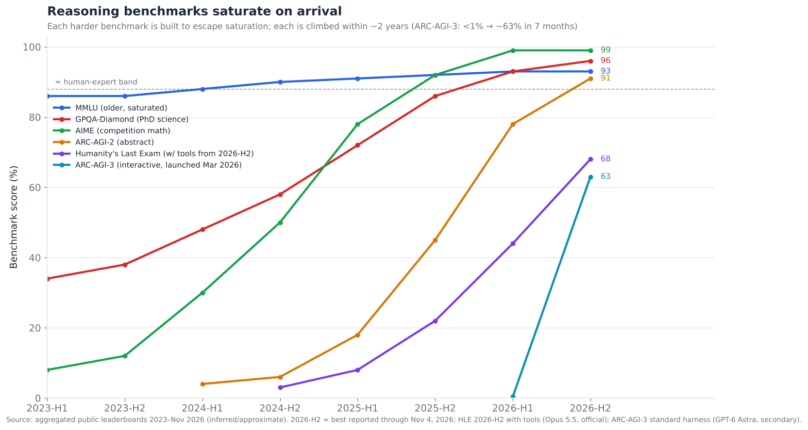
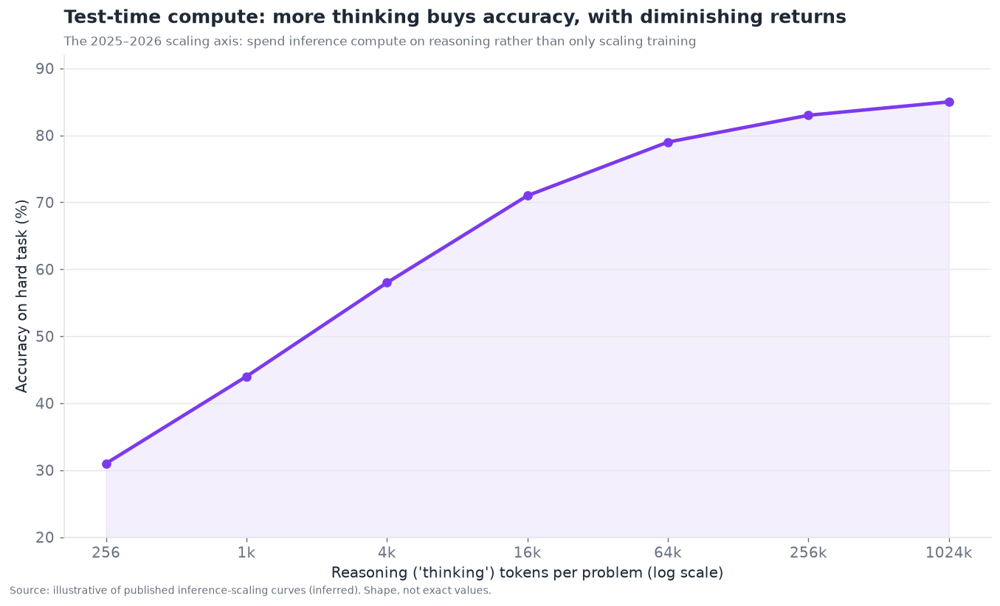
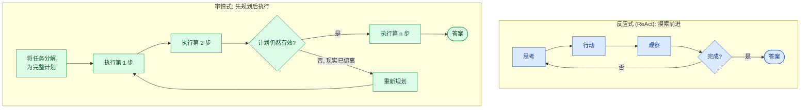

# 05 — 规划与推理

> **说明：** 本文为英文原文 [`sections/05-planning-reasoning.md`](../../sections/05-planning-reasoning.md) 的简体中文参考译文，仅供参考；如有出入，以英文原文为准。

*智能体如何在行动之前思考。ReAct、基于搜索的规划、反思，以及长程任务分解问题。目标篇幅：7,000 词。内容截至 2026 年 11 月（2026 年 7 月 22 日快照，2026 年 11 月 4 日更新）。*

---

## 移入模型内部的这一层

规划与推理是概念上最重要的一层，也是其重心在 2024–2026 年间转移最剧烈的一层。2023 年，规划是一个*外部*脚手架问题：模型是一个能力强但目光短浅的下一词元预测器，要让它进行规划，就需要在模型外围搭建精巧的提示结构——ReAct 循环、思维树搜索、外部规划器。到 2026 年，这种能力的很大一部分已经移入*模型内部*：推理模型（OpenAI 的 o 系列，随后是 Anthropic、Google、DeepSeek、xAI 等厂商的推理模式）经过训练，会在回答之前生成很长的内部思维链，因此大量规划工作如今发生在模型自身的“思考”中，而非外部脚手架里。到 2026 年末，这一转变已相当彻底，几款旗舰模型（例如 Claude Opus 5.5 和 Fable 5.1）*无法*关闭思考，你只能选择它们思考得多深入。

正因为这一转变，这一层的成熟度确实难以判定——在执行摘要中，它的得分是 **成熟度 5.0/10，瓶颈严重度 8.5/10**。单步和中程推理大幅提升（下文的基准测试饱和程度令人震惊），然而*长程*规划——分解并可靠执行包含数十乃至数百个相互依赖步骤的任务——仍是一个严峻的瓶颈。这一层同时是一场胜利（推理基准测试接连被攻克）和一种挫败（智能体在真正的长任务上仍会迷失方向）。理解*哪一部分*进步了、哪一部分没有，是理解本节的关键。

---

## 2026 年 7 月以来的变化（2026 年 11 月更新）

2026 年 7 月至 11 月间，每家主要闭源实验室的前沿模型都更替了整整一代：Anthropic 的 Claude 5.x 系列、OpenAI 的 GPT-6 家族以及 Google 的 Gemini 4。对这一层而言，有三个转变值得关注。

1. **思考变为始终开启且分级。** 几款旗舰模型不再允许关闭推理。取而代之的是设置努力程度（effort level），某些产品中的“ultra”模式还会把工作分发给子模型。
2. **一个新基准测试被迅速攀升。** 交互式的 ARC-AGI-3 于 3 月发布，当时前沿模型得分低于 1%。到秋季，它已出现数十个百分点的验证分数（7 月为 30%，到 10 月在标准脚手架上约为 63%），而厂商在自定义脚手架上宣称的分数要高得多。
3. **HLE 在使用工具的情况下突破 60%。** 这延续了下文“一发布即饱和”的模式。

这些发布中没有任何一个声称*解决了*长程可靠性问题，但它们确实把可处理的时长向外推进了：厂商如今将长达数小时的自主运行描述为常态。此外，7 月快照还遗漏了 6–7 月间的两次发布：Claude Fable 5 和 GPT-5.6。

- **2026 年 6 月 9 日（7 月快照中遗漏）：Claude Fable 5 和 Claude Mythos 5。**
  Fable 5 是首个公开的“Mythos 级”模型。分类器会将被标记的网络安全、生物和化学类请求路由至 Claude Opus 4.8，Anthropic 称这种情况发生在不到 5% 的会话中。受美国政府指令影响，访问自 6 月 12 日起暂停，并于 7 月 1 日恢复。定价为每百万输入/输出词元 $10/$50。*（official（官方））*
  [Anthropic](https://www.anthropic.com/news/claude-fable-5-mythos-5)
- **2026 年 7 月 9 日：OpenAI GPT-5.6（Sol / Terra / Luna）正式发布（GA）**，此前应美国政府要求进行了分阶段推出。Sol 的“ultra”模式会更努力地工作并委派给子模型，这使测试时计算看起来像多智能体扇出。*（inferred（推断））*
  [Axios](https://axios.com/2026/07/09/ai-openai-gpt-release)
- **2026 年 7 月 24 日：Claude Opus 5。** Anthropic 报告其 ARC-AGI-3 得分是次优模型的三倍 *（official）*。据报道，ARC Prize 在半私有集上验证的得分为 30.16% *（inferred）*。
  [Anthropic](https://www.anthropic.com/news/claude-opus-5),
  [OfficeChai on ARC-AGI-3 launch](https://officechai.com/ai/arc-agi-3/)
- **2026 年 9 月 1 日：Claude Fable 5.1 和 Mythos 5.1。** 这是 Anthropic 的顶级层级，“面向高要求的推理和长程智能体工作”，其自适应思考始终开启，默认努力程度为 `high` *（official）*。报道的得分为 Terminal-Bench 4.0 上 55.8%、Terminal-Bench-Science 上 52.6% *（inferred）*。
  [Claude models overview](https://platform.claude.com/docs/en/about-claude/models/overview),
  [Claude Fable](https://www.anthropic.com/claude/fable)
- **2026 年 9 月 3 日：OpenAI GPT-6 Astra**，随后 GPT-6 Sol 和 Luna 于 9 月 22 日发布。另有报道称 GPT-6.1 Sol 于 9 月 29 日发布，GPT-6.1 Terra 于 10 月 26 日发布。OpenAI 报告的 Astra 得分：GPQA-Diamond 96.0%，FrontierMath Tier 4 97.6%。在 ARC-AGI-3 上，据报道 Astra 在 OpenAI 的“provider adapter”脚手架上约为 99%，但在标准半私有脚手架上约为 62.7%。*（inferred：二手报道；对脚手架的依赖本身就是重点）*
  [DataCamp](https://www.datacamp.com/blog/gpt-6-astra),
  [BenchLM ARC-AGI-3](https://benchlm.ai/benchmarks/arcagi3)
- **2026 年 9 月 22 日：Claude Opus 5.5。**
  - 使用工具的 HLE：67.7%（Opus 5：63.6%）。Terminal-Bench 4.0：66.4%。OSWorld 2.1（部分）：81.8%。
  - 思考不再能被关闭。努力程度从 low 到 max，默认为 medium。
  - 对于典型工作负载，定价比 Opus 5 低约 40%。*（official）*

  [Anthropic](https://www.anthropic.com/news/claude-opus-5-5)
- **2026 年 9 月 28 日 / 10 月 7 日：Claude Sonnet 5.5 和 Haiku 5.5。** Sonnet 5.5 在使用工具的 HLE 上得分 64.5%，接近 Opus 5.5，而价格仅为其一半。这表明顶级推理能力在数周内就下沉到了中间层级。*（official）*
  [Anthropic](https://www.anthropic.com/news/claude-sonnet-5-5)
- **2026 年 9 月 30 日 → 10 月 13 日：Gemini 4 Argon。** 其发布宣传称“专为在复杂的长程工作流中持续进行深度推理而构建”，输出上限为 100 万词元。Google 先向网络安全防御方开放，并于 10 月 13 日正式全面发布。据报道，经 ARC Prize 验证的得分为 ARC-AGI-2 上 91.3%、ARC-AGI-1 上 98.5%。**Gemini 4 Carbon**（10 月 28 日）目前仅限网络安全防御方使用。*（inferred）*
  [OfficeChai](https://officechai.com/ai/gemini-4-argon-scores-97-5-on-arc-agi-3-with-harness-only-second-behind-gpt-6-astra/),
  [Google AI on X](https://x.com/GoogleAI/status/2105388478683119904)
- **2026 年 10 月 12 日：Meta Muse Wonder。** Meta Superintelligence Labs 的首个前沿模型采用*闭源*权重。开放权重则通过较小的 Muse 模型延续。*（inferred）*
  [AI Weekly](https://aiweekly.co/alerts/meta-releases-muse-wonder-its-first-frontier-class-ai-model)
- **开放权重推理，2026 年年中：**
  - DeepSeek V4 将 R 系列并入单一模型，同时具备思考与非思考模式，旧的 `deepseek-reasoner` 别名已于 7 月 24 日停用。
  - 阿里巴巴的 Qwen3.7-Max（5 月）为闭源权重，因此开放的自托管仍停留在 Qwen3.6。
  - Moonshot 的 Kimi K3.1 Pro 于 10 月 23 日上线 API，并承诺开放权重。

  截至所查到的最新报道，xAI 的 Grok 5 仍未发布。*（inferred）*
  [TestingCatalog](https://testingcatalog.com/deepseek-released-3-new-open-source-v4-models/),
  [CnTechPost](https://cntechpost.com/2026/05/20/alibaba-releases-qwen3-7-max-agent-model-tackle-complex-ai-workflows/)

**净效应：** 7 月路线图中的“推理基准测试持续饱和，更难的新基准不断出现”这一条兑现得比预期更快，ARC-AGI-3 即为明证。“长程可靠性渐进而非突然地提升”这一条依然成立。厂商的发布文章如今以长达数小时的智能体测试套件为卖点，但没有一家声称解决了目标漂移或误差累积。依赖脚手架（ARC-AGI-3）和依赖工具（HLE）的分数，也使 §11 关于比较基准测试数字的警告更加紧迫。

---

## 推理基准测试的爆发

这一层最显眼的事实，是推理基准测试被饱和的速度。每个新基准测试都被刻意设计得足够难，以摆脱前一个基准的饱和，而随后每一个又在大约两年内被攻克。

这一模式确凿无疑，值得直白地说明：

- **MMLU**（广泛知识，2020 年代初期）已完全饱和——顶尖模型得分约 92–93%，该基准已无法区分它们。
- **GPQA-Diamond**（研究生水平科学题，专门设计为无法靠 Google 搜索解答）从 2023 年的约 35% 升至 2026 年年中的约 93%，OpenAI 报告 GPT-6 Astra 达到 96.0%（2026 年 9 月，*inferred*）。在其题目上，模型如今已超过*可以*上网的博士专家，该基准实际上已饱和。
- **AIME**（竞赛数学）从接近随机猜测发展到实际上已被解决（顶尖模型可解出所有题目），这种能力足以入选国家奥赛队。
- **ARC-AGI-2**（抽象模式推理，明确设计用来抵御会抬高其他基准分数的记忆效应）是静态基准测试中最顽固的一个；它保持人类与模型之间最大差距的时间最长。即便如此，它也从个位数攀升至 2026 年年中的约 85%，据报道 Gemini 4 Argon 达到 91.3%，经 ARC Prize 验证（2026 年 10 月，*inferred*）。这远高于人类个体的平均水平。
- **ARC-AGI-3**（2026 年 3 月 25 日发布）是*交互式*的：智能体必须探索陌生的类游戏环境，推断规则并进行规划。发布时，前沿模型得分低于 1%，而人类解出了所有环境。到 7 月，Claude Opus 5 经验证约为 30%。到 10 月，标准脚手架上的领先者（GPT-6 Astra）约为 63%，而厂商声称在自定义脚手架上接近 100% *（inferred）*。它从发布到被大部分解决只用了大约七个月，是此列表中攀升最快的，也是这些基准中最接近*智能体规划*的一个。
- **Humanity's Last Exam（HLE）**（前沿难度、跨领域的专家级问题）原本预计多年内都难以突破 50%。结果某个模型在其发布后约一年内就达到了约 50%。到 2026 年 9 月，Claude Opus 5.5 在*使用工具*的情况下得分 67.7%（*official*），而独立的无工具测试显示前沿模型约为 55–61%（*inferred*）。

这些注意事项（均出自 §11）至关重要：**这些数字部分衡量的是基准测试的耗竭，而不只是能力。** 基准测试会被污染（测试数据泄露进训练数据）、被针对性优化（模型被优化以适应基准的风格），以及饱和（天花板效应）。到 2026 年末，它们还变得**依赖脚手架**：同一模型的 ARC-AGI-3 分数，会因评估脚手架不同而在约 60% 到约 99% 之间变化，而 HLE 如今也同时以有工具和无工具两种口径被引用。一个在 GPQA 上得分 93% 的模型，确实非常擅长 GPQA 类型的问题；但这能否迁移到*你的*推理任务，恰恰是 §11 所说的基准测试无法回答的问题。而且关键在于，**这些基准测试都不衡量长程智能体规划**——它们（大多）是单次回答的推理问题。饱和是真实且令人印象深刻的，但它*并不*等同于“智能体能够可靠地规划长任务”。这一差距正是本节的核心张力。

---

## 测试时计算范式

近期推理能力提升的大部分背后机制，是一次真正的范式转变：**测试时计算**（test-time compute，也称“推理时扩展”或“思考范式”）。这一洞见——在 2024–2025 年间被整个领域验证——是：你可以用*推理*算力换取准确率，方法是让模型在回答前“思考”更久：生成一条很长的内部推理链，探索备选方案，检查自己的工作，然后才给出最终答案。思考词元越多 → 准确率越高，直到某个限度。

这条曲线具有真实扩展定律的典型形状：仅仅让模型开始思考就带来陡峭的初始收益，随后随着思考预算增长，收益递减。这重塑了推理的整个经济学：

- **一条新的扩展轴。** 过去，获得更聪明模型的途径是训练更大、成本更高的模型。测试时计算增加了第二条轴：使用一个固定的模型，在每个难题上投入更多*推理*算力。这就是“推理努力程度”成为面向用户的参数的原因——你根据问题的难度以及延迟/成本预算，调节模型思考的深度。到 2026 年末，该参数已是分级的，而且往往是强制的。Anthropic 在其旗舰模型上提供从 `low` 到 `max` 的五个努力级别，并配合自适应（始终开启的）思考 *（official）*。OpenAI 的 GPT-5.6 Sol 增加了委派给子模型的“ultra”模式 *（inferred）*，这模糊了测试时计算与多智能体扇出（§06）之间的界限。
- **推理成为成本/延迟旋钮。** 问题难、风险高、能容忍延迟？把思考调高。问题简单、对延迟敏感？把它调低。智能体设计者如今把“思考”当作一种资源来做预算，在推理困难之处投入，在不难之处节省。
- **它改变了“规划脚手架”的用途。** 2023 年外部思维树和自洽性脚手架所做的很多事情（探索多条推理路径、投票、回溯），如今由模型在思考过程中内部完成。这就是为什么外部规划脚手架对中程推理变得*不那么*必要——模型已经吸收了它。

这条曲线引出的开放问题是：收益在递减，而超长思考的*成本*是真实存在的（既有金钱也有延迟）。下一轮收益究竟来自更多的测试时计算、更好的训练、更好的外部规划脚手架，还是它们的某种组合，是一个活跃的研究问题——但这一范式本身（花费推理算力来换取推理能力）如今已成为永久性的基础设施。

---

## 反应式规划与审慎式规划

这一层的基础区分——早于 LLM，借鉴自经典 AI 和机器人学——是**反应式**（reactive）规划与**审慎式**（deliberative）规划之分，它直接对应两种主流的智能体架构。

- **反应式规划（ReAct 风格）。** 智能体交替进行思考与行动：想一点，行动，观察结果，再想，再行动。它不会预先规划整个任务；它一步一步摸索前进，根据观察到的情况进行调整。这就是 ReAct 模式（Reason + Act，推理 + 行动），智能体系统的主力模式。它的优势是适应性——随着现实展开而作出响应。它的弱点是短视——没有全局计划，它可能四处游荡、陷入循环，或者看不出当前方法是死路一条。
- **审慎式规划（先规划后执行）。** 智能体先为整个任务构建一个显式计划——分解为子任务、排定顺序、预判依赖关系——然后执行它，在现实偏离时可能重新规划。它的优势是长程连贯性——它有一张地图。它的弱点是脆弱——在信息不完整时预先制定的计划可能是错的，而僵硬地执行一个错误计划，比适应性地摸索前进更糟。

2026 年的综合方案——这是真正的综合，而非任何一方的胜利——是**分层混合规划**：在顶层进行审慎规划（制定高层计划 / 任务分解），在底层进行反应式执行（用 ReAct 循环适应性地执行每个子任务），并在某个子任务揭示计划有误时于顶层重新规划。这与人类处理大任务的方式如出一辙：一个粗略的计划，对每个部分的适应性执行，以及在计划遭遇现实时进行修订。2026 年每一个有能力的长程智能体都使用了某种版本的这一方案——一个设定方向的规划器，加上完成各个部分的反应式执行器。纯 ReAct 在长任务上会游荡；纯先规划后执行一接触现实就会崩溃；分层结构则兼得两者之长。

---

## 深入 ReAct 及其局限

ReAct 值得仔细关注，因为它是使用最广泛的单一智能体模式，而它的局限在很大程度上界定了这一层的前沿。这个模式很优雅：模型的上下文不断累积 `Thought → Action → Observation → Thought →
…` 的轨迹，而将显式推理与行动交织在一起，既改进了推理（先思考后行动），又为推理提供了事实依据（观察真实结果，而非凭空幻觉）。

ReAct 在现实世界中的局限，以及相应的缓解措施：

- **循环与反复折腾。** 没有全局计划或对已尝试内容的记忆，ReAct 智能体可能重复同一个失败的动作，或在两种方法之间来回摇摆。*缓解措施：* 循环检测、步数预算，以及记录尝试过程的草稿本/待办记忆（§03），使其不再重走老路。
- **短程近视。** ReAct 优化的是下一步，而不是整个任务，因此它可能沿着一条局部合理、全局却是死路的路径走下去。*缓解措施：* 分层混合——ReAct 循环之上的审慎式规划器提供 ReAct 所缺乏的全局视野。
- **上下文增长。** 不断累积的思考/行动/观察轨迹使上下文每一步都在增长（上下文累积，§02/§03），在长时间运行中既抬高成本，又通过上下文腐化降低质量。*缓解措施：* 上下文编辑和对旧步骤的摘要。
- **缺乏有原则的回溯。** 纯 ReAct 只会向前推进；它无法像显式搜索那样干净地“撤销”一个糟糕的分支并尝试另一个。*缓解措施：* 反思（见下文），以及在任务需要时采用真正的基于搜索的规划。

对 2026 年而言的重要细微之处：**推理模型吸收了 ReAct 大部分的步内价值。** 当模型在每次行动前进行大量思考时，ReAct 中的“Reason”部分更强，因此该模式比在非推理模型上效果更好——但*跨步*的局限（循环、近视、没有全局计划）依然存在，因为它们关乎模型*外围的架构*，而非模型的单步推理。这正是“推理移入模型”帮助了中程任务、却让长程规划仍是瓶颈的确切含义。

---

## 基于搜索的规划：思维树及其延伸

对于解空间会分叉并需要探索的问题——谜题、复杂数学、具有许多可能路径的规划问题——**基于搜索的规划**把推理视为在一棵由可能的思考/行动序列构成的树上进行搜索。

- **思维链（CoT）** 是其退化情形：一条单一的线性推理路径。它就是“让我们一步一步地思考”所产生的东西，如今已在很大程度上内化进推理模型的思考中。
- **思维树（ToT）** 探索多个推理分支，评估它们的前景，并扩展最好的分支——这是一种审慎的搜索，而非单一路径。它能解决单路径 CoT 无法解决的问题，代价是多得多的模型调用（每个分支都是一次推理）。
- **思维图及更复杂的结构** 进一步泛化，允许分支合并，使推理形成图而非树。
- **基于推理的蒙特卡洛树搜索（MCTS）**，借鉴自博弈 AI，利用模拟和价值估计来引导搜索——在研究中以及某些前沿系统的训练中都颇具影响力。

外部基于搜索的规划在 2026 年的状况颇为微妙：**其大部分价值已被吸收进推理模型的训练**（通过在推理轨迹上进行 RL 训练的模型，学会了在内部做类似引导式搜索的事情），因此在生产中围绕模型*显式*编排树搜索，如今已不如 2023–24 年研究中那样常见。对于分支明确、且存在可为分支打分的验证器的特定难题（形式化数学、带测试的代码、游戏），它仍有价值；但对于一般的智能体任务，强模型的内化推理加上分层计划，通常胜过手工搭建的外部树搜索——前者更简单，而且往往更可靠。因此，基于搜索的规划在 2026 年更多是**在研究上有影响力**，而非**在生产中占主导**，这是一个值得指出的重要区别。

---

## 反思与自我纠错

**反思**——智能体审视自己的输出或轨迹并纠正错误——是最具实用价值的规划技术之一，也是一个诚实评估结果好坏参半的领域。

其机制是：在给出答案或完成一个步骤后，智能体（或单独的“评论者”智能体）对照目标评估它，找出缺陷并进行修订。变体包括 **Reflexion**（智能体反思失败并为下次尝试存储经验教训）、**self-refine**（对单个输出迭代进行批评与改进），以及**评论者/验证器模型**（由单独的模型检查主模型的工作）。

反思真正有帮助的场景：

- **存在可供反思的外部信号时。** 如果智能体能够*运行代码并看到它失败*，或者*用工具核对答案*，那么基于这种具体反馈的反思就非常强大——智能体有了可以据以纠正的真实依据。这就是反思在编码智能体（§09）中效果如此之好的原因：测试套件就是一个预言机（oracle）。
- **捕捉明显错误。** 反思能够可靠地捕捉格式错误、遗漏的要求，以及模型再看一遍就能识别出的内部不一致。

反思令人失望的场景，这也是关键的注意事项：

- **缺乏外部依据的自我反思存在天花板。** 模型*使用同一个模型*反思自己的推理，会受限于该模型的盲点——如果它第一次没看出错误，反思时往往也看不出来。纯粹的自我批评甚至可能*降低*结果质量，因为它会对正确答案进行事后怀疑，把它们改成错误答案。这方面的研究结论颇为微妙：当存在外部反馈时，自我纠错的帮助最大；而当模型只是被要求在没有新信息的情况下重新检查自己的推理时，帮助最小（有时甚至为负）。

由此形成的实用法则是：**反思的威力与其所依据的反馈信号的质量成正比。** 基于失败的测试、工具报错或验证器判断的反思 → 显著收益。仅仅基于模型自身先前推理的反思 → 收益微弱甚至为负。这再次体现了“廉价验证器”论点：反思是又一种以拥有廉价且可靠的核验手段为前提的能力，这正是编码（有测试）受益最大的原因。

---

## 长程分解：核心瓶颈

这里是这一层的核心未解问题，也是尽管基准测试成绩辉煌、它的瓶颈严重度仍高达 8.5 的原因。**长程任务**——需要在一条长轨迹上朝着目标持续执行数十到数百个相互依赖步骤的任务——即使对最好的模型和最好的脚手架而言，仍然不可靠。

从机制上看，长程为何困难：

- **误差累积（又一次）。** 正如 §04 的算术所示，即使每步可靠性达 98%，累积到约 35 步时可靠性也只剩抛硬币的水平。长程任务*本身就是*长链条，因此完整继承了误差累积问题。这是最大的单一因素。
- **长轨迹上的上下文管理。** 一个 200 步的任务会生成庞大的轨迹；在整条轨迹上让相关上下文保持可用而又不被其淹没，会把记忆（§03）和上下文工程都逼到极限。
- **目标漂移。** 在一条长轨迹上，智能体可能忘记最初的目标，以一种整体上偏离目标的方式优化局部子任务。在数百个步骤中保持目标的显著性是一项真正的挑战。
- **深层错误恢复。** 在第 5 步犯下、在第 150 步才发现的错误，可能需要撤销大量工作；从深层错误中优雅地恢复很难，而智能体往往根本察觉不到这些错误。
- **功劳分配（credit assignment）。** 当一个长任务失败时，是*哪一步*导致的？无论是智能体（为了自我纠错）还是开发者（为了调试），都难以在长轨迹中定位失败——这个问题同样困扰着评估（§11）。

缓解措施是整个技术栈其余部分的协同：分层规划（进行分解，使任何单个 ReAct 循环都不会过长）、检查点（§02，使错误不至于让整个运行作废）、子任务边界处的验证（在错误累积之前捕获它们）、记忆（§03，用于维持目标和状态），以及在关键节点上的人在回路。但并不存在干净利落的解决方案——**可靠的长程自主性是 2026 年智能体领域最具代表性的未解问题**，而在这一问题上的进展，正是区分“令人印象深刻的演示”与“值得信赖的自主智能体”的主要因素。一个逐渐流行的有用非正式指标是**“任务时长”（task horizon）**——智能体能够可靠完成的任务长度（以时间或步数计）——而这一时长一直在*增长*（大致而言，可可靠完成的任务长度逐年增加）这一观察，是衡量智能体真实进展的较有意义的指标之一，比任何单一推理基准测试都更有意义。

---

## 竞争与研究格局

规划与推理由**前沿模型实验室**主导（因为推理移入了模型），另有一层**研究团队和初创公司**致力于外部规划脚手架、验证以及推理专用工具。

### 竞争 / 研究一览表——规划与推理

| 参与者 | 类型 | 成熟度 | 对本层的贡献 | 代表性成果（置信度） | 差异化优势 | 竞争对手 |
|---|---|---|---|---|---|---|
| **OpenAI** | 前沿实验室 | shipped-reliable | 推广了测试时计算推理（o 系列 → GPT-6） | GPT-6 Astra（2026 年 9 月 3 日）：GPQA 96%，ARC-AGI-3 标准脚手架约 63%（inferred） | 深度的推理 RL；数学/科学能力强；“ultra”子模型扇出 | Anthropic, Google, DeepSeek |
| **Anthropic** | 前沿实验室 | shipped-reliable | 带努力级别的自适应始终开启思考；强大的智能体推理 | Fable 5.1（9 月 1 日）/ Opus 5.5（9 月 22 日）：使用工具的 HLE 67.7%（official） | 能迁移到长程智能体任务的推理 | OpenAI, Google |
| **Google DeepMind** | 前沿实验室 | shipped-reliable | Gemini 4 推理；AlphaProof/AlphaGeometry 一脉 | Gemini 4 Argon 于 10 月 13 日 GA；ARC-AGI-2 91.3%（inferred） | 搜索+LLM 传统；聚焦长程工作流 | OpenAI, Anthropic |
| **DeepSeek** | 前沿实验室 | shipped-reliable | 开放推理模型（R 系列并入 V4） | DeepSeek V4 Pro/Flash，思考 + 非思考模式（inferred） | 低成本的开放推理模型 | Qwen、前沿实验室 |
| **xAI** | 前沿实验室 | shipped-reliable | Grok 推理；HLE 突破性声明 | 早期约 50% 的 HLE 声明现已被超越；截至最新报道 Grok 5 尚未发布（inferred） | 自我对弈 + 推理链验证 | OpenAI, Google |
| **Qwen（阿里巴巴）** | 前沿实验室 | shipped-reliable | 强大的开放推理模型；旗舰现已闭源 | Qwen3.7-Max 闭源权重（2026 年 5 月）；Qwen3.6 开放（inferred） | 开放权重中间层 + 闭源智能体旗舰 | DeepSeek, Moonshot |
| **Meta（Llama / Muse）** | 前沿实验室 | shipped-reliable | 具备推理能力的开放模型；首个闭源前沿模型 | Muse Wonder，闭源权重（2026 年 10 月 12 日）（inferred） | 生态规模；现已分为开放/闭源两线 | Qwen、DeepSeek、前沿实验室 |
| **Moonshot AI（Kimi）** | 前沿实验室 | shipped-reliable | 开放权重的智能体推理模型 | Kimi K3.1 Pro API 于 2026 年 10 月 23 日上线；承诺开放权重（inferred） | 长程智能体开放模型 | DeepSeek, Qwen |
| **DSPy（Stanford）** | 研究/框架 | demoed→reliable | 编译/优化推理程序 | 开源优化（official） | 优化推理流水线，而非手工调优 | LangChain、手工调优 |
| **Tree-of-Thought / ToT 研究** | 研究 | research-only | 基于搜索的推理结构 | 学术（official） | 显式推理搜索 | 已内化进模型 |
| **Reflexion / self-refine 研究** | 研究 | research→applied | 反思/自我纠错方法 | 学术 → 产品化（official） | 从失败中学习的模式 | 评论者模型方法 |
| **过程奖励模型（PRMs）** | 研究/实验室 | research→applied | 奖励推理*步骤*而不只是答案 | 用于 RL 训练（inferred） | 面向推理的步骤级验证 | 结果奖励模型 |
| **形式化数学系统（类 AlphaProof）** | 研究实验室 | demoed-brittle | 借助形式化检查器的可验证推理 | 奥赛级数学（official） | 外部验证器使推理可检验 | 通用推理 |
| **Cognition / 编码推理初创公司** | 初创公司 | shipped-reliable | 在编码中应用长程规划 | Devin 规划（inferred） | 领域专用的长程规划 | Claude Code, Cursor |
| **推理评估初创公司（如 Epoch、ARC Prize）** | 研究/评估 | shipped-reliable | 构建高难度基准测试 | ARC-AGI-3（2026 年 3 月）、FrontierMath（official） | 通过基准测试定义前沿 | 内部评估 |

以上共十五个条目，涵盖实验室、研究项目和应用型初创公司（Moonshot 为 2026 年 11 月更新时新增）。结构性的现实是：**这一层由前沿实验室主导，因为能力存在于模型之中**，而独立价值体现在：(a) 从给定模型中榨取更多能力的*优化*框架（DSPy），(b) 使推理可检验的*验证*研究（过程奖励模型、形式化检查器），以及 (c) 在拥有良好验证器的垂直领域（编码）中的*应用型*长程规划。与编排或记忆不同，这里不存在一个由独立“规划公司”构成的大市场——因为你无法把规划与执行规划的模型分开来单独出售。

---

## 推理模型是如何训练的（以及这对智能体为何重要）

理解推理能力是*如何*进入模型的，有助于厘清它在智能体用途上的优势与局限。2024–2025 年间形成的主流方案是**基于可验证奖励、在推理轨迹上进行强化学习**（常称为 RLVR——RL from verifiable rewards）。其核心思想是：选取具有*可检验*答案的问题（有已知解的数学题、带测试的代码、逻辑谜题），让模型生成长推理链，并奖励那些得出正确答案的推理链。经过多轮迭代，模型学会生成真正有助于它做对的推理——而不是仅仅*看起来*合理的推理。

这一方案的两个后果对智能体至关重要：

- **推理模型在存在可验证奖励的领域最强。** 对于数学、代码和逻辑——拥有自动检查器的领域——训练信号最干净，因此推理模型在这些领域进步最为显著（AIME 和编码方面的提升即源于此）。缺乏廉价验证器的领域（开放式判断、主观质量、现实世界行动）的提升则不那么直接，主要受益于迁移。这是“廉价验证器”论点在*训练*层面而非仅在应用层面的体现：使一项能力易于*评估*的同一属性，也使它易于*通过 RL 训练*，这就是编码和数学推理突飞猛进、而模糊判断类推理相对落后的原因。
- **推理是真实的，但不一定忠实。** RLVR 奖励的是*得出正确答案*，而不是*如实报告得出答案的推理过程*。因此，可见的思维链是一种能提升准确率的真实计算产物，但并不保证它忠实地说明了模型*为何*得出其结论——这一点对下一小节以及安全（§12）都极为重要。

对智能体的启示：**推理模型在可验证领域是更好的规划者，在不可验证领域则改进较少**，而构建可靠的智能体意味着，要么在拥有验证器的领域中工作，要么*制造*验证器（测试、工具检查、评分标准），使训练时和推理时的推理都有可以依凭的东西。

## 推理的透明度与忠实性

一个微妙但日益重要的问题：**你能信任模型展示给你的思维链吗？** 随着智能体做出越来越重要的决策，可见的推理轨迹很容易被拿来用于调试、审计和监督——“看看模型的推理，就知道它为什么这么做了”。但上文关于忠实性的注意事项意味着，这样做必须谨慎。

2026 年的研究图景颇为微妙。思维链是*部分*忠实的——它往往确实反映了真实的中间计算，对其进行监控能发现许多问题——但它并非*完全*忠实：模型可能通过一条未用语言表述的路径得出结论，可能进行事后合理化，并且（对 §12 而言令人担忧的是）原则上可能学会在执行另一套实际过程的同时，生成看似无害的推理。这催生了一个活跃的安全研究方向，即**思维链可监控性**（chain-of-thought monitorability）——其理念是，保持推理清晰可读、可被监控，是一项值得在模型训练过程中*加以保留*的宝贵安全属性，因为一个在明面上推理的模型，比一个不透明地推理的模型更容易监督。

给智能体构建者的实用指导：**把思维链当作一个有价值但不完美的信号。** 它对调试以及发现错误和不当行为确实有用——远胜于一无所有——但它并不是保证忠实的审计日志，安全攸关的监督不应建立在“可见推理就是全部真相”这一假设之上。这与 §11（可观测性）相关联：追踪推理是有价值的，但轨迹是证据，而非真实依据（ground truth）。

## 神经符号与经典规划器的集成

一条延续自经典 AI 的线索：对于某些结构化的规划问题，把 LLM 与**经典规划器**或**符号求解器**结合起来，效果优于纯 LLM 推理。这种模式——有时称为 LLM-modulo 或 LLM+planner——把 LLM 用于它擅长的事情（把杂乱的自然语言目标翻译为形式化的问题规约，再把求解器的输出翻译回行动），把经典求解器用于*它*擅长的事情（在定义良好的状态空间上进行可证明正确的规划）。

具体而言：LLM 读取“将这十二次配送安排到三辆卡车上，使总距离最小”，将其形式化为一个优化问题或 PDDL（Planning Domain Definition Language，规划领域定义语言）问题，交给求解器计算出可证明最优或可靠的计划，然后由 LLM 叙述并执行结果。LLM 从不需要亲自*做*它不擅长的组合规划；它编排一个擅长此事的工具。这实际上就是把工具使用（§04）应用到规划问题本身——“规划器”只是一种专用工具。

2026 年的状况：**神经符号规划在狭窄、结构化的领域具有生产价值**（物流、排程、配置、形式化验证），这些领域存在求解器且正确性至关重要；而**对于一般智能体任务则仍接近研究阶段**，因为将问题形式化本身就很困难。相对于其价值，它被低估使用了——许多团队选择“让 LLM 自己排出日程”并得到不可靠的结果，而“让 LLM 将其形式化并调用求解器”本可以既更可靠又更便宜。这一教训推广了 CodeAct 的洞见：**当一个任务具有经典算法可以可证明地处理的结构时，推理层的职责是衔接到该算法，而不是模仿它**——而识别任务的哪些部分是“LLM 型”、哪些是“求解器型”，是优秀智能体设计的一项核心技能。

## 分层规划的一个实例

为了让抽象的综合方案落地，来看一个具体的长程任务——“调研我们的三大竞争对手并撰写一份对比报告”——在分层混合规划下如何执行。

**顶层（审慎式）。** 规划器进行分解：(1) 确定三个竞争对手，(2) 沿着一组固定维度调研每一个，(3) 综合成对比，(4) 起草报告，(5) 审阅并修订。这个计划是显式的、可检查的，而且——至关重要的是——*它对工作进行了组织，使任何单个部分都不至于成为一场 200 步的苦战*。它还暴露出天然的并行性（三项调研任务彼此独立）和天然的检查点（调研之后、综合之前）。

**中间层（分解为子任务/智能体）。** 第 2 步派生出三个并行调研子任务，每个竞争对手一个——要么作为并行的工具调用批次，要么作为并行的子智能体（§06），每个都有隔离的上下文，这样对一个竞争对手的调研就不会污染另一个。这正是审慎式计划与多智能体分解交汇之处：*计划的子任务成为智能体的任务分配*。

**底层（反应式执行）。** 每个调研子任务运行一个 ReAct 循环：搜索、阅读、决定还要查什么、提取发现——适应性地摸索前进，因为你无法预先精确规划需要哪些搜索。这个反应式循环是*有界的*（只针对一个竞争对手、沿固定维度），因此它的短程近视并无大碍——全局连贯性来自它上方的计划。

**重新规划触发条件。** 如果某个调研子任务发现所假定的竞争对手实际上并不相关（已被收购、已转型），它会向上汇报，由顶层规划器进行修订——换入另一个竞争对手，而不是僵硬地完成一个现已毫无意义的子任务。这就是审慎层*在现实偏离时重新规划*，也是纯粹先规划后执行所缺乏的属性。

**边界处的验证。** 在综合之前，一个检查点会验证每个调研子任务都产出了可用的发现（而不是空结果，即 §04 的语义失败检查）；在定稿之前，一个反思步骤会对照原始目标审阅报告——这是有依据的反思，因为目标和收集到的证据都是可以用来核对的具体事物。

这种结构——少量审慎步骤，分解为有界的反应式子任务，在衔接处进行重新规划和验证——正是在实践中延长可可靠完成任务时长的方式。它并不能消除误差累积，但能*遏制*它：错误在边界处被捕获，而不会在整个任务中累积，且没有任何单个反应式循环会运行得足够长以至于迷失方向。

## 推理的生产经济学

推理并非免费，其成本/延迟特征会影响实际的智能体设计决策：

- **思考词元耗费金钱和时间。** 一个推理模型在一个难题上花费 50,000 个思考词元，其成本和耗时都明显高于快速作答。在规模化场景下，“始终深度思考”的成本高得令人望而却步；让推理努力程度与难度相匹配，是一个真正的成本杠杆。
- **对延迟敏感的场景会限制推理。** 一个预算低于 500 毫秒的语音智能体（§10）不可能花十秒钟思考；推理繁重的规划必须在关键路径之外进行（预先计算，或在后台的“慢”智能体中进行），而由快速模型处理实时交互。这种“快速反应式前端、慢速审慎式后端”的拆分是一种新兴的生产模式。
- **推理/成本前沿是一个设计空间。** 用便宜的非推理模型处理简单轮次，用昂贵的推理模型处理困难轮次，由难度分类器进行路由——即“模型路由”模式——可以优化这一前沿。把路由做对（不在简单问题上浪费推理，也不让困难问题算力不足），在高吞吐量系统中价值不菲。
- **过度思考是真实的成本和质量风险。** 除了浪费开支，在简单问题上过度推理还可能降低答案质量（模型把自己从一个正确的快速回答中说服出来）——因此思考并非越多越好，推理预算是一个需要调节的参数，而不是要拉满的参数。

严谨的观点与技术栈其余部分一致：**把推理作为一等资源来做预算，在任务真正困难之处投入，把便宜的问题路由到便宜的路径上。** 那些把“推理努力程度”视为按任务类型可调的旋钮、而非全局开关的团队，运行的智能体明显更便宜，而且往往*更好*。

## 规划/推理与其他各层

- **↔ 工具使用（§04）。** 规划决定使用*哪些*工具以及*何时*使用；长工具使用链本身就是长程规划问题，误差累积将两者直接联系在一起。
- **↔ 记忆（§03）。** 长程规划需要记忆来在长轨迹上维持目标、计划以及已尝试过的内容；目标漂移在一定程度上是记忆失败。
- **↔ 多智能体（§06）。** 任务分解——规划中审慎的那一半——也是在智能体之间分配工作的方式；计划的子任务可以成为智能体的角色。
- **↔ 评估（§11）。** 功劳分配（哪一步失败了）对于智能体的自我纠错和开发者的调试是同一个问题；两者都取决于轨迹级评估。
- **↔ 编码（§09）。** 编码是长程规划最成熟的领域，恰恰因为测试是用于反思和搜索的廉价验证器——这是验证器论点最清晰的例证。

---

## 规划与推理特有的失败模式

1. **长程崩溃。** 智能体处理完前 N 步后失去连贯性——目标漂移、误差累积、上下文腐化。这是这一层最具代表性的失败。
2. **循环 / 反复折腾。** 反应式智能体在没有全局计划的情况下重复失败的动作。通过循环检测、预算和尝试记忆来缓解。
3. **过度自信的自我纠错。** 缺乏外部反馈的反思会对正确答案进行事后怀疑，把它们改成错误答案。通过让反思以真实信号（测试、工具、验证器）为依据来缓解。
4. **僵硬地遵循计划。** 审慎式智能体执行一个已经失效的计划，因为它们在现实偏离时不会重新规划。通过重新规划触发条件来缓解。
5. **过度思考。** 在简单问题上花费的测试时计算浪费了成本/延迟却毫无收益，甚至可能把模型从一个正确的快速答案中说服出来。通过让推理努力程度与问题难度相匹配来缓解。
6. **未被发现的深层错误。** 长任务早期的错误在很久之后才暴露，恢复代价高昂。通过子任务边界处的验证和检查点来缓解。

---

## 推理范式的简短历史

这一层的演进值得追溯，因为它解释了当前饱和的基准测试与未解决的长程规划之间的分野。在 **2022–2023 年**，关键发现是**思维链提示**——只需要求模型“一步一步地思考”就能显著改善推理，这表明该能力潜藏在模型之中，需要被激发出来。这开启了一个*提示工程式推理*的时代：自洽性（采样多条推理链，取多数答案）、思维树，以及各种精巧的外部推理结构，都试图从并未针对推理专门训练的模型中榨取更多推理能力。

**2023–2024 年**带来了 ReAct 和智能体的爆发——将推理与工具使用交织在一起——以及一波外部规划脚手架（任务分解器、规划器-执行器架构）。推理在很大程度上仍是*外部的*：巧妙之处在于包裹在通用模型周围的提示结构和控制流。

**2024 年末至 2025 年**是拐点：**通过基于可验证奖励的 RL 训练的推理模型**。突然之间，模型在内部、而且好得多地完成了外部脚手架此前所做的大部分工作——扩展思考、自我检查、探索备选方案。原本缓慢爬升的推理基准测试开始迅速被攻克。测试时计算成为一条有名有姓、可调节的轴。外部脚手架并没有消失，但其重心从“让模型推理”（如今模型原生就会推理）转向了“组织那些原生推理仍无法串联起来的长程任务”。

**2026 年**是当下的沉淀期：单次回答的推理在前沿已近乎解决，在中间层正走向商品化（开放推理模型）。到 2026 年末，它也成了旗舰模型的*默认*行为（始终开启的自适应思考），开放问题已转移到交互式、依赖脚手架的基准测试（如 ARC-AGI-3）上，而未解决的残余问题——长程规划、忠实推理、基于杂乱多模态感知的推理——恰恰*因为*较容易的部分已被解决而清晰可见。瓶颈发生了转移，正如执行摘要的发展脉络所预测的那样：每一年，它都从“模型到底能不能推理”向“我们能否在漫长的现实世界任务中维持、信任并为这种推理提供事实依据”滑移。

## 现实中的规划失败：一份实地分类

除了抽象的失败模式之外，值得梳理一下规划在实际部署的智能体中如何出错，因为这些模式在不同系统间是一致的：

- **自信的错误转向。** 智能体早早地认定了一种看似合理的方法，而由于反应式执行不会回头审视顶层选择，它会彻底而高效地执行这一错误策略——自信地得出一个错误或无关的结果。解决办法是在投入执行之前，对*方法*进行一次审慎检查。
- **无休止打磨循环。** 在给定“把它做好”这一目标而没有明确完成条件时，智能体会无限期地反思和修改，永远无法判定自己已经完成。没有停止准则的反思会沦为反复折腾。解决办法是明确的完成准则和步数预算。
- **被遗漏的子任务。** 在一个多步骤计划中，智能体完成了大部分子任务，却悄无声息地漏掉了一个，而且——由于缺乏一份用来核对的全局清单——永远不会察觉。解决办法是一个显式的、外部化的计划/待办清单，由智能体逐项勾选（一种程序性记忆模式，§03）。
- **过早收敛。** 智能体过早停止收集信息，基于不完整的数据进行规划，因为它没有意识到自己不知道什么。解决办法是在确定计划之前，提示并验证信息是否充分。
- **丢失主线。** 在一个长任务中，智能体逐渐以一种整体偏离原始目标的方式优化局部子任务，因为目标已经滚出了显著的上下文范围。解决办法是把目标固定在常驻工作记忆中，并定期对照它重新校准。

统一的观察是：**大多数真实的规划失败，是审慎层和验证层的失败，而非单步推理的失败。** 模型在每一步内的推理都没问题；出问题的是维持正确的全局策略、知道何时停止，以及检查计划是否真正完成。这就是为什么这一层中杠杆最高的可靠性投入是结构性的（外部化的计划、完成准则、边界验证、固定的目标），而不是“换一个更聪明的模型”——更聪明的模型在单步上已经推理得很好；真正的瓶颈是*围绕长程连贯性的脚手架*。

## 路线图与展望（附置信度标注）

- **推理基准测试持续饱和；更难的新基准不断出现** *（official 趋势；高置信度）。* GPQA→ARC-AGI-2→HLE 的递进仍在继续；预计 HLE 将会饱和，后继基准将被构建出来。单次回答的推理在前沿已近乎解决。——*2026 年 11 月：已确认且在加速。HLE 在使用工具的情况下突破 60%（67.7%，Opus 5.5）；ARC-AGI-3 于 3 月发布，并在 10 月前于标准脚手架上被大部分解决。下一个问题是对脚手架的依赖，而不仅仅是饱和。*
- **测试时计算仍是一条核心轴** *（official；高置信度）。* 推理努力程度作为一种可调资源已成定局；研究正致力于让它更*高效*（同样的准确率，更少的思考词元）。——*2026 年 11 月：已确认。努力级别（从 low 到 max）和始终开启的自适应思考如今已是旗舰模型的标配，效率也成了发布时的宣传要点（在默认设置下，Opus 5.5 比 Opus 5 便宜约 40%）。*
- **长程可靠性渐进而非突然地提升** *（inferred；中等置信度）。* 可可靠完成的任务时长持续增长，其驱动力是更好的模型加上更好的脚手架（分层规划、验证、记忆），但短期内不会有任何单一突破“解决”长程自主性。在 2026–2027 年间，这仍将是该领域最具代表性的瓶颈。——*2026 年 11 月：仍然成立。厂商如今描述长达数小时的自主运行，并以长程智能体测试套件（Terminal-Bench 4.0、OSWorld 2.x）作为发布卖点，但没有任何发布声称解决了目标漂移或误差累积。*
- **以验证为中心的推理不断发展** *（inferred；中高置信度）。* 过程奖励模型、验证器以及“基于真实反馈进行反思”的模式不断普及，因为“廉价验证器”论点日益被视为可靠推理的关键。——*2026 年 11 月：部分确认。厂商宣传其模型会编写自己的测试来验证工作成果（Fable 产品页）。关于 PRM 使用的公开细节仍然很少。*
- **规划仍由模型主导** *（inferred；高置信度）。* 不会出现大规模的独立规划公司市场；价值仍集中在优化框架、验证以及垂直领域的应用型规划（编码）上。——*2026 年 11 月：已确认；本季度未出现独立的规划公司。*
- **（新增，2026 年 11 月）交互式推理基准测试取代静态基准** *（inferred；中高置信度）。* ARC-AGI-3 的快速攀升表明，下一轮高难度基准测试将是交互式和智能体式的，并配有标准化的脚手架。预计基准测试机构将要求披露所用脚手架。
- **（新增，2026 年 11 月）能力管控成为推理技术栈的一部分** *（official 趋势；中等置信度）。* 若干最强的推理模型在发布时带有由分类器路由的回退机制或受限层级：Fable/Mythos 5、GPT-6 Astra 的受限网络安全变体，以及仅向网络安全防御方开放的 Gemini 4 Carbon。智能体构建者应当预期，回答某一步骤的*究竟是哪个*模型可能在运行时发生变化。
- **（新增，2026 年 11 月）Grok 5 和开放权重的 Kimi K3.1 是值得关注的待定事项** *（speculative（推测））。* 截至撰写时两者均尚未落地。

---

## 开放与闭源推理模型

2025–2026 年一个具有竞争意义的进展是：**推理能力不再是闭源前沿的垄断。** DeepSeek 的开放推理模型证明，RLVR 式的推理训练可以以大幅降低的成本完成并公开发布，Qwen 等随后跟进。这对智能体领域有几方面的影响：

- **可自托管的推理。** 无法将数据发送到前沿 API 的组织（受监管行业、敏感数据）如今可以在自有基础设施上运行能力不俗的推理模型——扩展了推理密集型智能体可以部署的范围。
- **成本压力。** 成本仅为前沿模型一小部分的开放推理模型，给闭源实验室原本溢价的推理定价带来了压力。对于高吞吐量的智能体工作负载，一个能力略逊但成本低 10 倍的开放推理模型，往往是正确的经济选择。
- **研究加速。** 开放推理模型和开放的推理训练方案，让更广泛的研究社区——而不仅仅是前沿实验室——能够在规划、反思和验证方法上进行迭代。

细微之处在于：推理的*最*前沿（最难的基准测试、最长的任务时长）仍由闭源实验室领先，但推理能力中*有用的*那一档——足以胜任绝大多数生产智能体任务——如今已可公开获得。这与一般的开放/闭源动态如出一辙：前沿是闭源且高价的，“足以胜任大多数工作”的层级是开放且便宜的，而智能体构建者越来越多地通过模型路由模式将二者混合使用（前沿模型处理困难推理，开放模型处理常规任务）。对整个技术栈而言，战略上的结论是：**推理正在中间层商品化，即便前沿仍处于激烈竞争之中**——这与其他每一个正在走向成熟的层的形态相同。

**2026 年 11 月的细微变化。** 在两家曾经的开放权重领军者那里，开放/闭源的界线朝*另一个*方向移动了。阿里巴巴的智能体旗舰 Qwen3.7-Max（2026 年 5 月）为闭源权重，开放的自托管仍停留在 Qwen3.6。Meta 的首个前沿模型 Muse Wonder（2026 年 10 月）同样以闭源权重发布。DeepSeek V4 和 Moonshot 的 Kimi 系列扛起了开放权重推理前沿的大旗。“有用的那一档是开放的”这一论断依然成立，但提供它的实验室范围比一年前更窄，且更集中于中国 *（inferred）*。

## 世界模型与基于模拟的规划

一个值得指出的研究前沿，因为它有可能重塑长程规划：**基于学习型世界模型的规划**。这一思路借鉴自基于模型的强化学习，即赋予智能体一个关于*世界（或某个系统）如何响应行动*的内部模型，使其能够在行动之前*模拟*候选计划并评估其后果——通过想象结果来规划，而不是在真实环境中反复试错。

对智能体而言，这体现为以下几种形式：

- **模拟推演。** 在采取一个后果重大的行动之前，智能体模拟其可能的效果（利用模型自身的世界知识或显式的模拟器），并选择预测结果最佳的行动——这是基于模型的规划的轻量版本。
- **学习型环境模型。** 在计算机使用（§08）或软件等领域，一个拥有“这个按钮做什么”或“这个 API 调用会改变什么”之模型的智能体，比必须通过试错来发现效果的智能体规划得更可靠。
- **在模拟未来上进行验证器引导的搜索。** 将世界模型与上文的基于搜索的规划结合：在*模拟的*轨迹上进行搜索，并由验证器打分，从而无需代价高昂的现实试错就能找到好的计划。

2026 年的状况明确处于**从研究到早期应用**阶段：基于世界模型的规划在研究和狭窄领域（机器人、游戏、某些软件环境）中颇具影响力，但尚不是通用智能体的主流生产模式，这主要是因为为开放式的现实世界任务构建准确的世界模型本身就是一个未解决的问题。然而，它是长程可靠性*下一次*飞跃较可能的来源之一——一个能够在行动前准确模拟后果的智能体，可以绕开大部分误差累积问题，因为它能在想象中而非在代价高昂的现实中发现糟糕的计划。值得作为 2027 年及以后的方向加以关注。

## 跨多种模态的推理

最后，推理日益走向**多模态**——最强的模型不仅能对文本进行推理，还能对图像、图表、屏幕截图，以及（正在兴起的）视频和音频进行推理。这对智能体影响重大，因为大量现实世界的推理都以非文本输入为依据：计算机使用智能体（§08）必须*对它在屏幕上看到的内容进行推理*，文档智能体必须对以视觉形式呈现的图表和表格进行推理，语音智能体（§10）则对它听到的内容进行推理。因此，多模态推理的质量直接影响这些垂直领域的可靠性。

现状是：多模态推理已大幅改进，但仍落后于文本推理——模型对一段干净的文字进行推理，要比对一张杂乱的屏幕截图或一张噪声很大的图表进行推理更出色，这正是计算机使用智能体（§08）仍然脆弱的直接原因之一。推理能力已经具备；*为其提供输入的感知*才是更薄弱的环节。随着多模态感知与推理缩小与文本的差距，基于视觉的智能体垂直领域应会不成比例地受益——这使得多模态推理的进展成为追踪计算机使用和浏览器智能体瓶颈时杠杆较高的观察点之一。

## 本节要点

- 规划/推理**移入了模型内部**（推理模型、测试时计算），这极大地改善了中程推理，却让长程规划仍是瓶颈（成熟度 5.0，严重度 8.5）。
- **推理基准测试正以惊人的速度饱和**——但饱和在一定程度上反映的是基准测试的耗竭，而且这些基准测试*都不*衡量长程智能体规划，而后者才是真正仍然困难的部分。
- **测试时计算**使推理成为一种可调的成本/延迟资源，并吸收了外部规划脚手架过去所做的大部分工作。
- 架构层面的综合方案是**分层混合规划**：在顶层审慎规划，在底层反应式执行，在现实偏离时重新规划。纯 ReAct 会游荡；纯先规划后执行会崩溃。
- **反思的帮助与其所依据反馈的质量成正比**——有外部信号（测试、工具、验证器）时效果强，纯自我批评时效果弱甚至为负。这又是“廉价验证器”论点。
- **长程分解是最具代表性的未解问题**——误差累积、目标漂移、上下文管理和深层错误恢复——而不断增长的“任务时长”是比任何单一基准测试都更好的进展衡量指标。
- 这一层**由模型实验室主导**；独立价值在于优化框架、验证研究和垂直领域的应用型规划，而非独立的规划产品。
- **推理与知识是不同的层，需要不同的修复手段**：一个推理严密却错误的答案，通常源于知识/检索缺口；而一个信息充分却错误的结论，则源于推理/验证缺口——诊断出自己面对的是哪一种是一项核心技能，混淆二者则会白费力气。推理也正在**中间层商品化**（开放推理模型），即便前沿和长程可靠性仍存在激烈竞争。
- **2026 年 11 月：** Claude 5.x / GPT-6 / Gemini 4 这一代模型使思考变为始终开启并按努力级别分级。HLE 在使用工具的情况下突破 60%，交互式的 ARC-AGI-3 在七个月内从不到 1% 升至约 63%（标准脚手架）。长程可靠性有所提升但仍未解决，而基准测试分数如今取决于所用的脚手架。

## 关于“推理”与“知道”的说明

一个可以避免常见范畴错误的澄清：推理与知识是不同的东西，智能体两者都需要，且分属不同的层。一个模型可以*知道*大量内容（来自训练的参数化知识），却仍然推理得很差；也可以对它*并不知道*的信息（通过检索提供，§07）进行出色的推理。规划/推理层关注的是思考的*过程*——分解、推断、自我纠错——而不是被推理的*事实*，后者来自模型的训练、记忆（§03）或检索（§07）。

这一区分对智能体设计很重要，因为这两种失败模式有不同的修复办法。一个推理良好但缺少某个事实的智能体，需要的是*检索或记忆*，而不是更好的推理模型——在知识缺口上叠加更多推理，只会产生推理严密的错误答案（自信的幻觉）。一个掌握了事实却得出错误结论的智能体，需要的是*更好的推理或验证*，而不是更多检索——堆砌更多上下文并不能修复有缺陷的推断。诊断你面对的是哪种失败——知识还是推理——是一项核心调试技能，而把二者混为一谈（用检索去解决推理问题，或用推理努力去弥补知识缺口）是一种常见且浪费的错误。最干净的智能体会将这些层分开：检索和记忆提供*什么是真的*，推理层决定*由此能推出什么*，评估（§11）则独立地检查两者。

*目标篇幅：7,000 词。本节：约 8,700 词（经 `wc` 核实，含 2026 年 11 月更新）。*

## 参考来源（2026 年 11 月更新）

- https://www.anthropic.com/news
- https://www.anthropic.com/news/claude-fable-5-mythos-5
- https://www.anthropic.com/news/claude-opus-5
- https://www.anthropic.com/news/claude-opus-5-5
- https://www.anthropic.com/news/claude-sonnet-5-5
- https://www.anthropic.com/claude/fable
- https://platform.claude.com/docs/en/about-claude/models/overview
- https://axios.com/2026/07/09/ai-openai-gpt-release
- https://www.datacamp.com/blog/gpt-6-astra
- https://x.com/OpenAI/status/2102460975790137662
- https://benchlm.ai/benchmarks/arcagi3
- https://officechai.com/ai/arc-agi-3/
- https://officechai.com/ai/gemini-4-argon-scores-97-5-on-arc-agi-3-with-harness-only-second-behind-gpt-6-astra/
- https://x.com/GoogleAI/status/2105388478683119904
- https://x.com/GoogleDeepMind/status/2110039274922131792
- https://techcrunch.com/2026/09/30/google-releases-gemini-4-argon-called-its-most-powerful-model-yet/
- https://aiweekly.co/alerts/meta-releases-muse-wonder-its-first-frontier-class-ai-model
- https://techcrunch.com/2026/10/12/meta-releases-its-first-frontier-model-muse-wonder/
- https://testingcatalog.com/deepseek-released-3-new-open-source-v4-models/
- https://cntechpost.com/2026/05/20/alibaba-releases-qwen3-7-max-agent-model-tackle-complex-ai-workflows/
- https://benchlm.ai/frontier-ai-models
