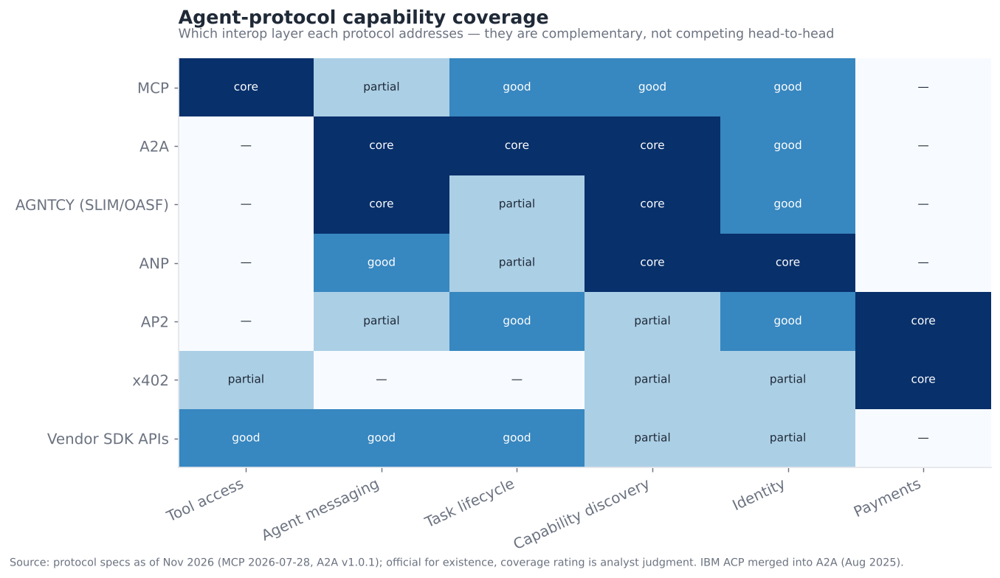
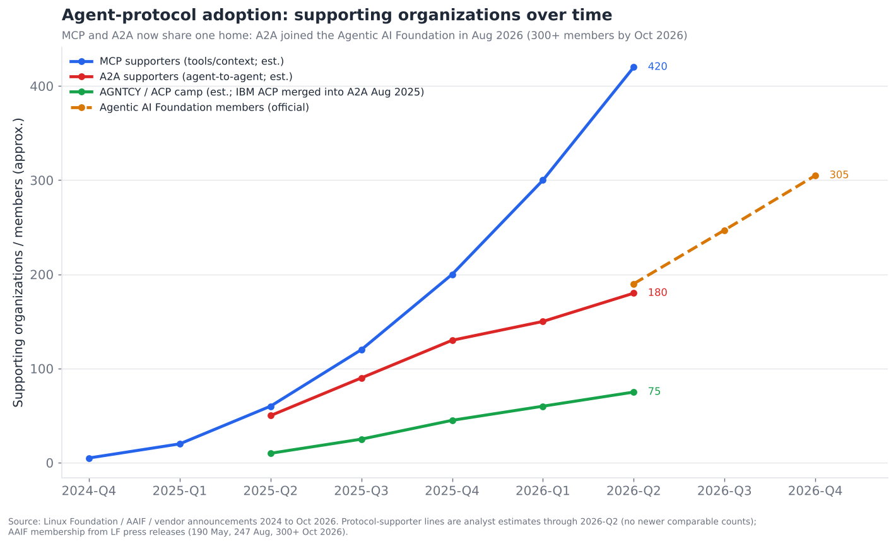
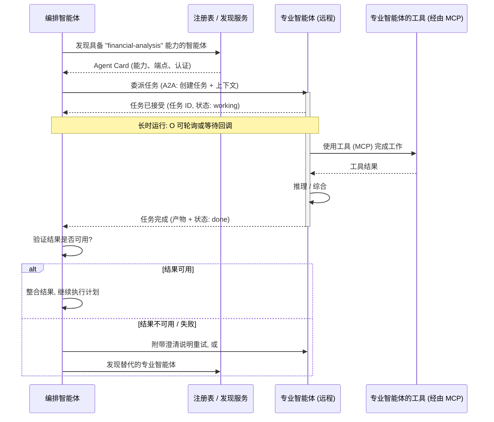

# 06 — 多智能体协调

> **说明：** 本文为英文原文 [`sections/06-multi-agent-coordination.md`](../../sections/06-multi-agent-coordination.md) 的简体中文参考译文，仅供参考；如有出入，以英文原文为准。

*智能体如何协同工作。智能体间协议（MCP、A2A、ACP）、委派与角色专业化，以及使多智能体系统变得脆弱的协调失效模式。目标篇幅：7,000 词。内容截至 2026 年 11 月（基于 2026 年 7 月 22 日快照更新）。*

---

## 最受追捧、也最具争议的一层

多智能体协调是热情与可靠性之间差距最大的地方，也是标准之争最激烈的地方。在执行摘要中，它的得分为 **成熟度 4.0/10、争议度 8.5/10**——属于成熟度最低、争议*最大*的层之一，而这恰恰是围绕一项尚不成熟的能力展开的一场正在进行中的标准之争应有的样子。有两件事正在同时发生，必须将其区分开来：

1. **多个智能体协作这一*模式*被过度宣传，且往往并不可靠**——这正是 §02 的观点：多智能体会增加协调开销和失效模式，只有在并行性、上下文隔离或权限范围划分确实需要时才应使用。
2. **用于智能体间通信的*协议*正在迅速整合**——MCP 赢得了工具层，A2A 正在赢得智能体间层（它在 2025 年吸收了 IBM 的竞争协议 ACP），两者如今都隶属于 Linux 基金会旗下的 Agentic AI Foundation（A2A 自 2026 年 8 月起加入），互操作性技术栈正呈现出清晰可辨的形态。

这是关于不同事物的不同论断。*协调*很难，而且常常很脆弱；而协调所需的*管道*正在迅速标准化。本节同时涵盖两者——既包括让智能体可靠协作的工程现实，也包括正在确定智能体之间如何对话的标准格局。

---

## 2026 年 7 月以来的变化（2026 年 11 月更新）

自 7 月 22 日快照以来，这一层的两半一直以不同的速度演进，这正是本节的核心论点。*管道*进一步整合：A2A 如今与 MCP 同属一个基金会，而 MCP 2026 年 7 月的修订版增加了长时运行的 Tasks，并将"智能体消息传递"（agentic messaging）定为下一项优先事项，因此这两个协议正在智能体如何委派这一问题上趋于一致。与此同时，关于*协调*的证据仍不断指向"多智能体仅对特定任务结构有帮助"。本次更新还纠正了快照中的一处错误：下文所述的"A2A 对 ACP"之争早在 2025 年 8 月就已尘埃落定，当时 IBM 的 Agent Communication Protocol 并入了 A2A。快照曾将 ACP 错误地归于另一个由 Cisco 牵头的 AGNTCY 联盟，而后者仍是一个独立的（互补性）项目。

**重要进展日志（按日期）：**

- **2025 年 8 月 29 日（快照遗漏）：IBM 的 ACP 并入 A2A**，归属 Linux 基金会；ACP 代码仓库已归档，并附有迁移到 A2A 的指南 *(official（官方）)*
  ([LF AI & Data](https://lfaidata.foundation/?p=7689))。
- **2025 年 12 月（遗漏）："Towards a Science of Scaling Agent Systems"** 在 180 种受控配置上报告：一旦单智能体基线在任务上的表现超过约 45%，增加智能体带来的回报便会递减甚至为负 *(inferred（推断）；论文)*
  ([arXiv 2512.08296](https://arxiv.org/abs/2512.08296))。
- **2026 年 3 月 12 日（遗漏）：A2A v1.0**，首个稳定版本。它相对 v0.3 是一次破坏性变更，新增了支持过滤与分页的 `tasks/list`、现代化的 OAuth 流程以及 gRPC 多租户；v1.0.1 于 5 月 28 日发布 *(official)* ([A2A releases](https://github.com/a2aproject/A2A/releases))。
- **2026 年 4 月（遗漏）：Microsoft Agent Framework 1.0** 面向 .NET 和 Python 发布，作为 AutoGen 与 Semantic Kernel 编排的继任者，随后 .NET 版增加了 A2A v1 支持 *(official)*
  ([Visual Studio Magazine](https://visualstudiomagazine.com/articles/2026/04/06/microsoft-ships-production-ready-agent-framework-1-0-for-net-and-python.aspx)；
  [Microsoft devblog](https://devblogs.microsoft.com/agent-framework/a2a-v1-is-here-cross-platform-agent-communication-in-microsoft-agent-framework-for-net/))。
- **2026 年 4 月：A2A 支持组织超过 150 家**，包括 AWS、Cisco、Google、IBM、Microsoft、Salesforce、SAP 和 ServiceNow *(official)*
  ([LF press](https://www.linuxfoundation.org/press/a2a-protocol-surpasses-150-organizations-lands-in-major-cloud-platforms-and-sees-enterprise-production-use-in-first-year))。
- **2026 年 7 月 28 日：MCP `2026-07-28` 规范。** 它引入了无状态核心和多轮往返请求（Multi Round-Trip Requests），将 **Tasks**（通过 `tasks/get` 和 `tasks/update` 处理的长时运行工作）移入一个正式扩展，并新增了 `subscriptions/listen` 流。MCP 现在可以承载过去作为 A2A 标志性特性的那类长时运行委派工作 *(official)*
  ([MCP blog](https://blog.modelcontextprotocol.io/posts/2026-07-28/))。
- **2026 年 8 月 17 日：A2A 加入 Agentic AI Foundation（AAIF）**，成为托管项目，与 MCP、goose 和 AGENTS.md 并列 *(official)* ([AAIF](https://aaif.io/blog/a2a-joins-aaif))。
- **2026 年 8 月 22 日：新的 MCP 路线图。** 其首要优先事项是"智能体消息传递原语"（服务器发起的事件、webhook 和通道，使客户端不必再轮询，并将 Tasks 纳入核心规范），由 Agents、Transports 以及 Triggers & Events 三个工作组共同推进。智能体身份与委派是另一项单独的优先事项 *(official)*
  ([roadmap](https://github.com/modelcontextprotocol/modelcontextprotocol/blob/main/blog/content/posts/2026-08-22-mcp-roadmap.md))。
- **2026 年 9 月："Rethinking Multi-Agent Collaboration: When More Is Less"** 发现，多智能体的收益集中在依赖关系稀疏的长周期任务上；而在紧密耦合的顺序性工作上，单智能体表现更好 *(inferred；论文)* ([arXiv 2609.19759](https://arxiv.org/abs/2609.19759))。
- **2026 年 10 月：各框架围绕 A2A 原生的多智能体持续迭代。** Google ADK（2.x，采用基于图的执行引擎）、Microsoft Agent Framework（1.2x）、LangGraph 和 CrewAI 均发布了新版本。第三方对比将 ADK 和 Microsoft Agent Framework 列为原生支持 A2A *(inferred；二手对比资料)*
  ([Morph comparison](https://www.morphllm.com/ai-agent-framework))。
- **2026 年 10 月 22 日：在 AGNTCon + MCPCon 北美大会上，AAIF 的托管项目达到 10 个，成员超过 300 家。** 其新项目包括 OpenSandbox（托管式智能体执行环境）和 OpenEnv（智能体训练与评估环境）。Anthropic 宣布在 Claude Code 中支持 MCP Tasks，以支持运行时间长得多的工具调用 *(official / inferred)*
  ([LF press](https://www.linuxfoundation.org/press/agentic-ai-foundation-announces-four-new-projects-agent-skills-open-responses-openenv-and-opensandbox)；
  [InfoQ](https://www.infoq.com/news/2026/10/agntcon-mcpcon-2026/))。

**净效应。** 连接问题已更接近解决，且如今归于单一基金会之下。协调问题的特征得到了更清晰的刻画，关于多智能体*何时*值得使用也有了更有力的实证证据，但它并没有变得更容易。当下真正的设计问题已从"选 A2A 还是 ACP？"转变为"一项被委派的工作何时应是 MCP Task，何时应是 A2A task？"

---

## 两个不同的问题：连接与协调

这一层中最能澄清问题的区分，是两个常被混为一谈的问题之间的区别：

- **连接（协议问题）。** 智能体 A 究竟如何与智能体 B 或某个工具*对话*？消息格式是什么，能力如何被发现，任务如何移交、结果如何返回？这是一个*管道*问题，正由标准（MCP、A2A、ACP）加以解决。它在很大程度上是规范与采用的问题，而且进展顺利。
- **协调（可靠性问题）。** *假定*智能体之间可以对话，你如何让它们真正共同完成一项任务，而不遗漏工作、重复劳动、陷入死锁或相互放大错误？这是一个*分布式系统与非确定性相遇*的问题，而且确实很难。标准无法解决它；标准只是让底层基础变得统一。

人们对多智能体系统的大部分失望，其实是对协调的失望，却被错误地归因于技术不成熟——而事实上，协调问题是*根本性*的，正是那些让分布式系统变得困难的问题，如今又因智能体的非确定性而雪上加霜。标准让智能体变得*可互操作*；它们并不能让智能体*善于协作*，正如 TCP/IP 并不能让两个程序正确地协同工作一样。把这两者区分开来，是清晰理解这一层的关键。

---

## 互操作性技术栈

到 2026 年年中，智能体互操作格局已经演化为一个由互补协议组成、清晰可辨的*分层技术栈*——不是一个协议包揽一切，而是多个协议分别应对不同的层，正如网络协议栈中 IP、TCP、HTTP 和 TLS 各司其职。能力覆盖视图把这种互补性展示得一目了然：

逐行看下来，分工十分清晰——**每个协议掌管不同的层，它们是相互组合，而非正面竞争**：

- **MCP（Model Context Protocol）** 掌管**工具/上下文层**：智能体如何连接到工具、数据资源和提示词。它是"智能体 ↔ 工具/数据"的标准，在 §04 和 §15 中有深入讨论。它是根基最稳固的协议，实际上已是其所在层的胜出标准。
- **A2A（Agent2Agent）** 掌管**智能体间层**：独立的智能体如何相互发现（通过宣告能力的"Agent Cards"）、委派任务，并跨越组织和框架边界交换结果。它由 Google 发起，由 Linux 基金会治理（自 2026 年 8 月起隶属 Agentic AI Foundation），自 2026 年 3 月起 v1.0 稳定，拥有 150 多家支持组织。这是领先的智能体间标准。
- **ACP（Agent Communication Protocol）** 出自 IBM Research 的 BeeAI 项目，它将智能体交互映射到 REST/HTTP 动词上（POST 创建任务、GET 查询状态等）——一种与运行时无关的消息传递方式。在 **2025 年 8 月并入 A2A** 之前，它一直是 A2A 在同一层上的主要替代方案 *(official)*。另一个由 Cisco 牵头的 **AGNTCY** 联盟（成员包括 Dell、Google Cloud、Oracle、Red Hat 等）贡献了 OASF 智能体模式（schema）、SLIM 消息传输以及其自有的 Agent Connect Protocol。如今它将这些定位为 A2A 的补充，而非竞争对手 *(inferred)*。
- **ANP（Agent Network Protocol）** 面向**去中心化**的智能体网络——基于 DID 的身份、点对点发现、JSON-LD 能力图谱——服务于开放、无需许可的"智能体互联网"愿景，而非企业集成。
- **AP2（Agent Payments Protocol）** 由 Google 发起，并于 2026 年 4 月捐赠给 FIDO 联盟，掌管**智能体商务**层：智能体如何在授权额度内进行资金交易（见 §13）。x402（现归属 Linux 基金会旗下的 x402 Foundation）则覆盖智能体与服务之间的 HTTP 原生微支付。
- **厂商 SDK API** 在单一厂商的生态系统内充当*事实上的*协议——当你全面押注某一厂商时，这是阻力最小的路径。

2026 年严肃部署中形成的共识架构是：**MCP 负责工具和上下文，A2A 负责跨边界的智能体间委派，身份/发现层（OASF/ANP）负责查找和认证智能体，AP2 负责支付，厂商 SDK 负责内部推理循环。** 这些是层层堆叠的；你不是从中选一个，而是组装你需要的层。相较于 2025 年把"MCP 对 A2A"视为竞争对手的框架，这是一次重大澄清——它们从来都不是对手；它们处理的是不同的层，真正的竞争发生在层*内部*（智能体间层的 A2A 对 ACP，已于 2025 年以合并告终），而不是跨层。*2026 年 11 月补充说明：* 随着 MCP 推出 Tasks 扩展并在路线图中规划服务器发起的事件，MCP 正在增加用于长时运行委派工作的原语，因此层与层之间的边界需要一条设计规则。一条合理的规则是：当远端是*你所调用的一种能力*时使用 MCP，当远端是*你所委派的一个自主智能体*时使用 A2A *(inferred)*。

---

## 采用情况：标准正在迅速整合

其采用轨迹是计算领域中较快的标准趋同之一：

MCP 在约 18 个月内，从 Anthropic 的一项实验（2024 年末）发展到拥有数百家支持组织和 18,000 多个社区收录的服务器。到 2026 年 10 月，第三方统计显示其注册表中约有 43,000–47,500 个服务器 *(inferred)*，其一级（Tier-1）SDK 的月下载量接近 5 亿次 *(official)*。A2A 于 2025 年 4 月发布，在捐赠给 Linux 基金会时已有 50 多家合作伙伴，并在发布第一年内突破 150 家组织。两者如今都隶属 Linux 基金会的 **Agentic AI Foundation**（MCP 自 2025 年 12 月起，A2A 自 2026 年 8 月 17 日起），该基金会的成员在 2026 年 10 月已超过 300 家组织。这是决定性的治理信号：**主要厂商选择了厂商中立的管理，而非专有控制**，从而大幅降低了采用风险。当 OpenAI、Google、Microsoft、AWS 和 Anthropic 都支持由 Linux 基金会治理的协议时，通常会让企业采用陷入停滞的"哪个标准会胜出"风险，在工具层和智能体层基本消失了——这正是 §15 认为标准之争正进入整合阶段的原因。

一年滞后的模式值得注意：A2A 在发布和采用两方面都落后 MCP 大约一年，这合乎情理——你会先标准化*工具连接*，再标准化*智能体间协作*，因为智能体需要工具先于需要彼此，而且智能体间问题更难规范（它涉及任务生命周期、发现和信任，而不仅仅是一次调用/响应）。预计智能体间层将在 2026–2027 年间持续成熟，大致沿着 MCP 的路径、落后一年前进。（图中各协议的支持者曲线是截至 2026 年年中的分析师估计；此后尚未发布可比的新统计。虚线加入了 AAIF 的官方成员数——2026 年 5 月 190 家、8 月 247 家、10 月 300 多家——作为 MCP/A2A 合并治理基础的当前最佳代理指标。）

---

## 一次具体的多智能体任务移交

为了让协调变得具体，下面是一个具有代表性的 A2A 风格任务移交——一个"客户端"智能体将子任务委派给一个专业化的"远程"智能体，后者是通过其能力宣告被发现的。该序列同时展示了管道（A2A 如何组织这次交换）和协调层面的关注点（可能出错的地方）。

在这张简洁的图中，隐藏着三个对协调至关重要的时刻，而真实系统恰恰在这些地方出问题：

1. **发现与信任。** 编排者必须找到具备正确能力的智能体，*并且信任它*——信任它能完成任务，也信任它不是恶意的（§12）。能力宣告（Agent Cards）解决了*查找*问题；而跨组织边界的*信任*则是更难、解决得更少的部分，与身份问题（§13）相关联。
2. **移交契约。** 编排者究竟要求了什么，专业智能体的理解是否与之一致？含糊的任务规范是头号协调失效——专业智能体信心十足地做了错事，因为委派本身说明不足。这就是"传话游戏"式失效。
3. **结果验证。** 编排者在以返回结果为基础继续工作之前，必须检查它是否真正可用（即 §04 中的语义失效检查）。不加批判地信任子智能体输出的多智能体系统，会把错误传播到整个系统——一个智能体的错误结果会污染下游的一切。

协议处理的是消息传递；它*不*处理上述三个协调问题中的任何一个，这些仍是开发者（以及模型）的责任。这正是"管道已解决，协调尚未解决"这一说法的确切含义。

---

## 委派与角色专业化模式

协调*模式*——工作如何在智能体之间划分和指挥——可归为少数几种原型，每种都有其典型的优势和失效模式：

- **监督者 / 编排者-工作者。** 一个负责协调的智能体分解任务，将子任务委派给工作者智能体，然后综合它们的结果。这是最常见、也最可靠的模式，因为控制是集中且清晰可读的——有一个单一的智能体对计划和整合负责。这是 §02 中的监督者模式在多个智能体上的扩展。它的局限在于监督者是瓶颈和单点故障，而且非常复杂的任务会考验它良好分解与整合的能力。
- **层级式（监督者的监督者）。** 对于大型任务，采用一棵监督者树，每个监督者管理一个子团队。分解的可扩展性更好，但协调开销更大，移交契约问题在每一层都有更多出问题的机会。
- **顺序流水线 / 装配线。** 智能体按固定顺序排列，每个智能体加工工作后传给下一个（研究 → 起草 → 编辑 → 事实核查）。当任务确实是线性流水线时，它简单、清晰且可靠；这就是 CrewAI 的顺序模型。它的局限是僵化——无法根据任务调整工作流。
- **对等协作 / 对话式。** 智能体作为对等方进行对话，由轮流发言或发言者选择策略决定下一个由谁行动；这是经典的 AutoGen 模型。最灵活，也最不可预测——§02 中涌现式控制流的风险在此被放大。适合开放式探索，但对可靠的生产环境而言是危险的。
- **市场 / 拍卖 / 黑板。** 智能体竞标任务，或在共享的工作项"黑板"上发布/读取。更偏研究性质；用于一些大规模或去中心化的愿景（ANP 的智能体互联网），在生产中很少见。

贯穿这些模式的**角色专业化**理念——赋予每个智能体独特的角色、人设和工具集（"研究员"、"评论者"、"编码者"）——是支持多智能体的主要*原则性*论据，因为它带来了**上下文隔离**（§02）：评论者只看到作者的输出，而看不到其杂乱的推理过程，从而给出更干净的批评；编码智能体拥有电子邮件智能体所没有的代码工具和权限。出于上下文隔离和权限范围划分而做的角色专业化是合理的工程；出于拟人化趣味而做的角色专业化（"给它配一个人设团队！"）则是一场表演，只会增加成本和协调风险而毫无收益。这个区分——*这些角色给你带来的是真正的隔离，还是仅仅是叙事？*——正是检验一个多智能体设计是工程还是角色扮演的标准。

| 模式 | 控制方式 | 可靠性 | 最适用于 | 主要风险 |
|---|---|---|---|---|
| 监督者 / 工作者 | 集中式 | 高 | 大多数需要分解的任务 | 监督者瓶颈 |
| 层级式 | 集中式、分层 | 中高 | 可分解的大型任务 | 开销大、每层都有移交错误 |
| 顺序流水线 | 固定顺序 | 高（对线性任务而言） | 装配线式工作流 | 僵化 |
| 对等 / 对话式 | 涌现式 | 低-中 | 开放式探索 | 不可预测、循环 |
| 市场 / 黑板 | 去中心化 | 低（目前） | 去中心化 / 研究 | 协调复杂度 |

---

## 协调失效模式：为何多智能体如此脆弱

这正是这一层成熟度得分偏低的核心原因。多智能体系统存在一整类单智能体系统所没有的失效模式，它们是分布式系统失效在非确定性加持下的"转世重生"：

- **任务遗漏（协调缺口）。** 某个子任务落在了智能体之间的缝隙里——监督者以为某个工作者会处理，工作者以为它超出了自己的范围，结果它就这样悄无声息地没有完成。这是 §05 中"遗漏子任务"的多智能体版本，如今跨越多个智能体，而且更难察觉，因为没有任何一个智能体掌握全局。
- **重复劳动。** 由于分工含糊，两个智能体冗余地做了同一件事——浪费成本，更糟的是，可能产生相互冲突的结果。
- **输出冲突。** 两个智能体产生相互矛盾的结果（不同的数值、互不兼容的计划），而系统没有原则性的方法来调和它们。这是分布式一致性问题，如今上升到了语义层面，而不仅仅是数据层面。
- **错误放大 / 级联。** 一个智能体的错误成为另一个智能体的输入，后者使其叠加，下一个又将其放大——错误在智能体图中传播并增长，而不是被遏制。一个信心十足却出错的子智能体，就可能让整个多智能体系统脱轨。
- **协调死锁 / 活锁。** 智能体相互等待（A 需要 B 的输出，B 需要 A 的输出）而停滞，或者无休止地把任务来回推诿而毫无进展。这是经典的分布式死锁，如今之所以可能发生，是因为智能体缺乏全局感知。
- **上下文碎片化。** 每个智能体只拥有上下文的一部分，而这些部分无法拼合——某个智能体掌握的关键信息永远无法到达需要它的智能体，因为移交时没有携带。这是上下文隔离之益处的另一面。
- **传话游戏式退化。** 在智能体之间逐跳传递的信息在每一跳都会退化（被概括、被重新解读），直到最后一个智能体依据的是原始意图的失真版本。委派链越长，这种效应越被放大。
- **涌现式失调。** 在对话式/对等模式中，涌现的动态会产生病态行为——智能体过于轻易地达成一致（群体思维，没有真正的批评），或无休止地争论，或集体幻觉出一个虚假的共识。

统一的教训，也是这一层的坦率结论：**多智能体协调重新引入了分布式系统的每一个难题——一致性、部分失效、死锁、协调开销——还在其上叠加了非确定性，而用于管理这些问题的工具（分布式系统花了数十年才建立起来）在智能体领域仍不成熟。** 这正是 §02 的指导如此坚持的原因：**除非并行性、上下文隔离或权限范围划分有具体需求，否则不要动用多智能体**，因为那意味着你要承受分布式系统的难度，而一个配备良好工具的单智能体可以完全避免这些。当你*确实*需要它时，采用带有明确任务契约、结果验证和集中整合的监督者/工作者模式是最可靠的选择——因为它让协调保持清晰可读、责任保持明确。

---

## 竞争与标准格局

这一层横跨**标准机构/协议**、**实现多智能体编排的框架**以及**推动协议的厂商**。由于大部分价值体现在标准（而非产品）上，下表将协议与实现者混合列出。

### 竞争 / 标准一览表——多智能体协调

| 实体 | 类型 | 成熟度 | 所针对的层 | 支持方（置信度） | 差异化特点 | 竞争对象 |
|---|---|---|---|---|---|---|
| **MCP** | 标准 | shipped-reliable | 工具/上下文连接（+ Tasks 扩展） | LF Agentic AI Foundation；所有主要厂商 (official) | 赢得了工具层；无状态的 `2026-07-28` 规范；数以万计的服务器 | （在其所在层无对手）；在 Tasks 边界上与 A2A 相交 |
| **A2A** | 标准 | demoed→reliable | 智能体间 | Google→LF→AAIF（2026 年 8 月）；150+ 组织 (official) | 领先的智能体间标准；Agent Cards；v1.0（2026 年 3 月） | MCP Tasks（边界）、AGNTCY |
| **ACP (IBM)** | 标准 | merged (Aug 2025) | 智能体间消息传递 | IBM→LF；并入 A2A (official) | 基于 REST/HTTP 动词的智能体消息传递；仓库已归档，提供迁移到 A2A 的指南 | （现已成为 A2A 的一部分） |
| **ANP** | 标准 | research→demoed | 去中心化智能体网络 | 开放社区 (inferred) | DID 身份、P2P、JSON-LD 图谱 | A2A（不同愿景） |
| **AP2** | 标准 | demoed-brittle | 智能体支付 | Google→FIDO Alliance（2026 年 4 月）；Mastercard (official) | 经授权的智能体交易（§13）；v0.2 | x402、卡组织方案 |
| **x402** | 标准 | demoed-brittle | 智能体微支付 | x402 Foundation (LF)；Coinbase、Cloudflare、Stripe (official) | 基于 HTTP 402 原生的智能体/服务间按调用付费 | AP2、卡组织方案 |
| **AGNTCY (OASF / SLIM)** | 标准 | demoed-brittle | 智能体发现/身份/传输 | Cisco、Dell、Google Cloud、Oracle、Red Hat；LF (official) | 开放的智能体模式（可映射到 Agent Cards）；SLIM 安全消息传递 (inferred) | A2A Agent Cards |
| **LangGraph (multi-agent)** | 框架 | shipped-reliable | 实现 | LangChain (official) | 基于图的多智能体，支持监督者模式 | CrewAI、MS Agent Framework |
| **CrewAI** | 框架 | shipped-reliable | 实现 | Insight (official) | 角色/团队式多智能体的易用性 | MS Agent Framework、LangGraph |
| **MS Agent Framework (ex-AutoGen)** | 框架 | shipped-reliable | 实现 | Microsoft (official) | 2026 年 4 月 1.0 正式发布；AutoGen + Semantic Kernel 的继任者；支持 A2A v1 | CrewAI、LangGraph、Google ADK |
| **Google ADK + A2A** | 框架+标准 | shipped-reliable | 实现 | Google (official) | A2A 原生的多智能体；2.x 基于图的引擎 (inferred) | MS Agent Framework |
| **OpenAI Agents SDK (handoffs)** | 框架 | shipped-reliable | 实现 | OpenAI (official) | 智能体"handoffs"（移交）原语 | Claude 子智能体 |
| **Claude Agent SDK (sub-agents)** | 框架 | shipped-reliable | 实现 | Anthropic (official) | 带隔离的子智能体派生；用 MCP Tasks 处理长时运行调用 (inferred) | OpenAI handoffs |
| **IBM BeeAI / watsonx Orchestrate** | 平台 | shipped-reliable | 企业多智能体 | IBM (official) | 企业编排；ACP 的遗产现已汇入 A2A (inferred) | MS、Google |
| **Cisco / Outshift (AGNTCY)** | 联盟 | demoed-brittle | 标准 + 基础设施 | Cisco (official) | 推动"智能体互联网"（Internet of Agents）基础设施；现与 A2A 互补 (inferred) | — |
| **Agentic AI Foundation (AAIF)** | 治理机构 | shipped-reliable | MCP、A2A 及另外 8 个项目的中立归属 | Linux Foundation；300+ 成员 (official) | 工具层与智能体间层的单一基金会 | — |

以上共十六个条目，涵盖标准、框架、平台和治理机构——远超十个。从结构上看：**标准已经在 Linux 基金会的统一伞下（AAIF）完成整合，并获得广泛支持，而*实现*则由 §02 中的那些框架完成。** 因此，多智能体的竞争态势是标准故事与已讲过的框架故事的混合。快照曾把 **A2A 对 ACP** 列为真正悬而未决的竞争问题。但事实上，它早在 2025 年 8 月就已解决——IBM 将 ACP 并入了 A2A，这恰恰是 §15 所预测的趋同结局。剩下的互操作问题是一个边界问题，而非对抗：MCP 日益增长的长时运行任务原语与 A2A 的任务模型如何划分委派工作。

---

## 深入解析 A2A 机制

由于 A2A 是领先的智能体间标准，也是最值得理解的一个，因此有必要剖析其核心概念——它们定义了整个智能体间层正在趋同的词汇。

- **Agent Cards。** 一种机器可读的文档（在一个约定俗成的 URL 上提供），智能体通过它宣告自己：其能力/技能、端点、认证要求和元数据。这是发现原语——编排者通过读取 Card 找到合适的智能体，类似于服务宣告其 API 的方式。Card 使智能体无需事先硬编码，就能跨越组织边界*被找到、被描述*，它也是其他标准（OASF）同样瞄准的部分。自 v0.3 起，Card 位于 `/.well-known/agent-card.json`，并可携带签名；v1.0 则将需认证的"扩展"Card 移入了声明的能力之中 *(official)*。
- **Tasks。** A2A 中的工作单元。客户端智能体在远程智能体上创建任务；任务有一个生命周期（submitted → working → input-required → completed/failed/canceled）。关键在于，任务被设计为**长时运行**的——一个任务可以长时间停留在"working"状态，客户端则轮询或接收推送更新——这反映了一个现实：真实的委派工作（研究、分析、多步骤作业）并非瞬间完成。正是这种长时运行任务模型，使持久化编排（§02）变得重要：发起委派的智能体必须能在等待缓慢的远程任务期间存活下来。v1.0 增加了 `tasks/list`（支持过滤和分页），这样客户端可以枚举自己尚未完成的委派，而不必自行追踪每一个任务 ID *(official)*。
- **Messages 与 Parts。** 任务内的通信被组织为由多个部分（文本、文件、结构化数据）组成的消息，以支持智能体工作的多模态现实——一个智能体可能发出一份文档，收回一张图表。
- **Artifacts。** 任务产生的输出——远程智能体返回的交付物，以结构化、带类型的结果呈现，而不仅仅是一段文本。

值得注意的设计理念：A2A 刻意将远程智能体视为**不透明**的——你通过其宣告的能力和任务接口与智能体交互，*无需*了解其内部实现、框架或模型。这是跨框架、跨厂商互操作性的关键：基于 LangGraph 的 A2A 客户端可以委派给基于 Google ADK、CrewAI 或定制技术栈构建的 A2A 服务器，因为双方都不需要了解对方的内部——它们在 A2A 接口处相遇。正是这种不透明性，使 A2A 成为真正的*互操作性*标准，而不只是同一技术栈内的便利工具；也正是这一特性，让"每个子任务都用最好的智能体，无论是谁构建的"这一愿景在技术上成为可能（尽管跨组织真正这样做所需的*信任*仍然滞后，见 §13）。

## A2A 与 ACP 之争，以及历史类比

快照曾将智能体间消息传递层的 **A2A 对 ACP** 视为这一层中唯一真正悬而未决的标准之争。*更正（2026 年 11 月）：* 这场竞争当时已经结束。**IBM 的 ACP 于 2025 年 8 月 29 日并入 A2A**，归属 Linux 基金会；ACP 团队停止了独立开发，并发布了迁移指南 *(official)*。它的结局方式，仍然能告诉我们关于整个领域发展轨迹的一些东西。

两者的相似之处多于不同：都对智能体如何委派任务和交换结果进行了标准化；都被捐赠给了 Linux 基金会；都有重量级的支持者。A2A 来自 Google，采用任务/Agent-Card 模型；ACP 来自 IBM Research（BeeAI），将智能体交互映射到 REST/HTTP 动词上，并强调与运行时无关的消息传递。（快照错误地将 ACP 归于 Cisco 牵头的 AGNTCY 联盟。AGNTCY 是一个独立的 Linux 基金会项目，其 OASF 模式和 SLIM 传输与 A2A 并存，而非与之竞争。）两者的差异是真实的，但并非鸿沟。这类差异在历史上往往会被调和，而不是斗个你死我活——事实也正是如此。

历史类比（在 §15 中有完整展开）颇具启发性。这看起来不太像 **VHS 对 Betamax**（格式互不兼容，必有一方消亡），而更像 **SOAP 对 REST** 或**容器格式**之争——要么一方凭借开发者体验明显胜出（REST 以更简单取胜），要么各标准在共同的治理机构下*趋同*（正如许多 Web 标准在 W3C/IETF 下所经历的那样）。A2A 和 ACP *都*在 Linux 基金会旗下、且支持者相互重叠，这一事实使直接趋同或顺畅互操作的可能性远高于一场焦土式的标准战争——治理结构本身就是为调和而非对抗设计的。最可能的结局按大致顺序为：(1) A2A 成为主导的智能体间标准，ACP 的概念被吸收进来，或 ACP 服务于与运行时无关的细分场景；(2) 两者在 LF 的管理下正式趋同；(3) 两者稳定共存，并在其间搭建桥接。一场惨烈的赢家通吃是*最不*可能的结局，恰恰因为治理就是为避免这种局面而设计的——这本身就是这个领域在吸取过去标准战争的教训。——*2026 年 11 月：实际发生的是结局 (1) 和 (2)。ACP 于 2025 年 8 月在共同的 LF 治理下并入 A2A，随后 A2A 于 2026 年 8 月加入 MCP 所在的 Agentic AI Foundation。* 下一个值得关注的调和，将发生在 **MCP 的 Tasks 扩展与 A2A 的任务模型**之间——这两种长时运行委派设计如今由同一个基金会治理 *(speculative（推测）)*。

## 多智能体真正胜出的时候：三个具体案例

在所有这些审慎之外，同样重要的是具体说明多智能体在哪些地方*真正*值得，因为答案是"特定情形"，而不是"永不"。以下是多智能体为正确选择的三个案例，每个都对应三种理由中的一种：

**案例 1——并行研究（并行性）。** 像"分析这十家公司"这样的任务是易并行的：十个相互独立的研究子任务可以同时运行。十个并行的子智能体（每个在隔离的上下文中研究一家公司）完成所需的实际耗时大约相当于一个智能体，而顺序执行则需要十倍的时间。收益纯粹体现在延迟上，而协调很简单（监督者分发再汇总），因此风险很低。这是理由最为充分的多智能体——并行性是真实的，子任务相互独立，整合也只是直截了当的综合。

**案例 2——作者/评论者分离（上下文隔离）。** 产出高质量的工作往往受益于将创作与批评分开。作者智能体生成草稿；一个*独立的*评论者智能体——它只看到草稿，看不到作者的思维链——以全新的视角评估草稿并找出缺陷；作者再进行修改。这种分离很重要：如果同一个智能体在同一上下文中批评自己的工作，它会被自己的推理所锚定，批评就很无力（即 §05 中的自我反思上限）。一个真正独立、拥有隔离上下文和批评性角色提示词的评论者能发现更多问题——因为它在审视工作时没有作者的盲点。在这里，*上下文隔离*正是关键所在，它带来了单智能体无法实现的真实质量提升。

**案例 3——权限分离（权限范围划分）。** 在一个工作流中，若某一步需要危险权限（写入生产数据库）而其他步骤不需要，就应将这一危险能力隔离到*一个拥有独立、最小化身份和受限权限的单独智能体*中（§12/§13）。负责起草邮件的智能体根本无法触碰数据库，因为它没有凭据；只有权限范围严格受限的数据库智能体才能触碰，而且它的操作是可审计、受门控的。这是一种以多智能体设计形式表达的*安全*架构——这些角色为你带来了最小权限，而这是一项真实且重要的属性。一个持有全部权限的单体式单智能体一旦被攻破，其爆炸半径要大得多（§12）。

请注意，在这三个案例中，多智能体结构都是由一项*具体的工程属性*（并行加速、为质量而隔离、为安全而隔离）所证成的，而不是出于拟人化的吸引力。这就是检验标准。当你能说出自己买的是这三者中的哪一个时，多智能体就是工程；说不出来时，它多半是表演。

## 评估多智能体系统

多智能体系统出了名地难以评估，这又加剧了它们的可靠性问题（无法衡量的东西就无法修复——§11 中的瓶颈在这里更为严重）。具体挑战包括：

- **归因。** 当一项多智能体任务失败时，*是哪个智能体*造成的？失败可能出在智能体 C，但表现为消费了 C 的错误的智能体 E 给出的糟糕最终输出。在智能体图中定位失败，是 §05 中信用分配问题的多智能体版本，而且确实很难。
- **轨迹复杂度。** 单智能体运行是一条线性轨迹；多智能体运行则是由交错的、有时并行的智能体活动构成的一张*图*。可视化并推理这张图需要可观测性工具（§11），而这类工具才刚刚开始成熟——智能体图追踪比单智能体追踪要新得多。
- **涌现行为。** 系统行为源于智能体之间的交互，因此无法通过孤立地测试各个智能体来评估——整体不等于部分之和，交互缺陷只有在集成时才会显现。
- **不可复现性。** 每个智能体的非确定性会在整个系统中叠加，因此同一输入可能产生不同的多智能体执行轨迹，这使回归测试（§11）比单智能体更难。

正在形成的实用方法论是：**追踪完整的智能体图**（每条消息、每次委派和每个结果，并附带时间信息），**在移交边界处进行评估**（每个被委派的任务是否被良好地规定并正确地完成？），以及**测试集成，而不只是单元**（风险在于协调，因此测试必须覆盖协调）。用于此目的的工具——多智能体可观测性——是 §11 中的一个增长领域，而它的不成熟确实拖累了多智能体的可靠性：团队在恰恰会出问题的协调动态上处于盲飞状态。

## 多智能体的经济性与延迟

多智能体的成本与延迟特征值得专门讨论，因为它经常被低估，且往往具有决定性：

- **Token 成本成倍增加。** 每个智能体都要重新读取共享上下文并加入自己的推理；智能体之间的对话是额外的模型往返。对于同一任务，多智能体方案消耗的 token 可能是配备良好工具的单智能体的 3–10 倍（这是 §02 的观点，此处加以量化）。对于高并发量的生产环境，这常常是*反对*多智能体的决定性因素。
- **延迟可能变好也可能变差。** 并行多智能体（案例 1）通过并发执行独立工作*降低*了实际耗时——这是真正的收益。但*顺序式*或*对话式*多智能体（智能体轮流行动）会*增加*延迟，因为每次移交都是一次串行的模型调用，往返次数会不断累积。多智能体对延迟是有利还是有害，完全取决于智能体是并行运行还是串行运行。
- **协调开销是纯粹的"税"。** 智能体之间为协调而交换的消息——任务规范、状态更新、结果打包——是不做任何直接工作的 token 和往返；它们是分工的开销。这种开销随智能体数量和模式的"话痨"程度而增长，这也是为什么在超过真正并行/隔离收益的临界点后继续增加智能体，会*同时恶化*成本和延迟。

规范的思考框架与技术栈其他部分一致：**明确地以单智能体基线为参照来为多智能体做预算。** 如果一个配备良好工具的单智能体就能完成任务，那么多智能体版本必须用具体收益（并行加速、隔离带来的质量、安全范围划分）来证明其 3–10 倍的成本和协调风险是值得的。它往往做不到，单智能体仅凭经济性就能胜出——这也是该领域对条件反射式多智能体降温的重要原因。

实证文献已开始为此给出数据。2025 年 12 月的一项受控研究（"Towards a Science of Scaling Agent Systems"，180 种配置）发现，一旦单智能体基线已能解决任务的约 45% 以上，协调带来的回报就会递减甚至变为*负值*。2026 年 9 月的一篇论文（"Rethinking Multi-Agent Collaboration: When More Is Less"）发现，多智能体的收益集中在子任务间依赖稀疏的长周期任务上，而紧密耦合的顺序性工作更适合单智能体 *(inferred；论文，尚未被独立复现)*。两者都与本节的规则相符：多智能体在**可并行、松耦合**的工作上物有所值，而在**顺序性、紧耦合**的工作上则让你付出代价。

## 多智能体系统中的人在回路

最后一个实践维度：在多智能体系统中，人处于什么位置？§02 中的人在回路模式可以扩展到多智能体，但有一个变化——人可能需要介入的位置更多了，而决定*哪个*智能体的操作需要审批，本身就是一个设计问题。相关模式包括：

- **监督者层面的审批。** 人在工作者执行之前审批监督者的*计划*——这是一个单一的、高杠杆的检查点，可以在错误策略扩散之前将其拦截。高效，但粒度较粗。
- **操作层面的审批。** *任何*智能体执行的特定后果重大的操作（数据库写入智能体的写操作、邮件智能体的发送操作）都需要审批，无论由哪个智能体执行——粒度更细、更安全，但审批摩擦更大。
- **分歧时升级。** 当智能体产生系统无法调和的冲突结果时，将其升级给人来处理，而不是随意选择一个——把协调失效转化为人的决策点。

设计原则沿用自 §02 和 §04：**在结构上为后果重大的操作设置门控，并将人的注意力集中在爆炸半径最大的地方**——在多智能体中，这通常意味着监督者的计划（及早发现策略错误）加上少数真正危险的操作（在损害发生之前拦截）。在各处都撒上审批会造成审批疲劳，适得其反；按爆炸半径有针对性地设置审批，才能使其保持可用。

## 多智能体与其他各层

- **↔ 标准（§15）。** 这一层*正是*智能体间标准之争所在之处；§15 深入讨论了整合路径。
- **↔ 编排（§02）。** 多智能体由编排框架实现；"从单智能体开始"的指导和监督者模式均源自那里。
- **↔ 记忆（§03）。** 智能体之间共享记忆还是隔离记忆（范围受限的黑板问题），是一项核心的多智能体设计决策，涉及并发与安全方面的后果。
- **↔ 身份（§13）。** 跨组织的智能体间信任需要智能体身份和认证——一个智能体必须先证明自己是谁、被授权做什么，另一个智能体才会向它委派。这是一个重大缺口。
- **↔ 安全（§12）。** 多智能体扩大了攻击面：网络中被攻破或恶意的智能体、跨智能体传播的注入攻击，以及协同行动带来的更大爆炸半径。智能体间信任是一个安全问题，而不仅仅是管道问题。

---

## 多智能体协调特有的失效模式

1. **任务遗漏/重复。** 分工含糊。缓解办法：明确的任务契约，并由一个监督者负责整个计划。
2. **错误级联。** 一个智能体的错误输出污染下游智能体。缓解办法：在每次移交时、在以结果为基础继续工作之前进行结果验证。
3. **死锁/活锁。** 循环依赖或无休止的移交。缓解办法：超时机制、进度检查和无环的委派图。
4. **传话游戏式漂移。** 意图在委派跳转中逐渐退化。缓解办法：保持委派链简短，传递原始意图而不仅仅是摘要。
5. **上下文碎片化。** 所需信息没有到达需要它的智能体。缓解办法：有意识的上下文移交和范围受限的共享记忆。
6. **涌现式失调。** 对等模式中的群体思维或无休止争论。缓解办法：在生产环境中优先采用受监督的模式，而非涌现式模式。
7. **信任/安全缺口。** 未验证被委派智能体的身份或授权。缓解办法：智能体身份（§13）和最小权限范围划分（§12）。
8. **成本暴涨。** 每个智能体都要重新读取上下文并增加往返；对于同一任务，多智能体的成本可能是单智能体的数倍。缓解办法：以单智能体基线为参照，证明每个智能体存在的必要性。

---

## 组织内与跨组织的多智能体

有一个区分能够澄清多智能体在哪些地方如今已是现实、在哪些地方仍是愿景：协作的智能体是位于*同一个信任边界之内*，还是*跨越多个组织*。

**组织内多智能体**——由同一个团队在同一个系统内构建和运营的多个智能体——是 2026 年几乎所有生产级多智能体所在的地方。在这里，智能体天然相互信任（同一所有者、同一部署），协调处于一个团队的控制之下，而标准（A2A、MCP）虽然有用，但并非绝对必要，因为两端都由你掌控。上文三个"多智能体胜出"的案例都属于组织内场景。这是真实的、已在交付的，也是如今部署多智能体的明智之处。

**跨组织多智能体**——X 公司的智能体委派给 Y 公司的智能体——是这些协议所要服务的更激进的愿景，也是那些困难的、尚未解决的问题集中之处：

- **信任与身份（§13）。** X 公司的智能体凭什么相信 Y 公司的智能体会正确、诚实地完成任务，而且不会窃取数据？跨组织委派需要智能体身份、授权和信誉机制，而这些几乎还不存在。
- **责任与问责。** 如果 Y 公司的智能体代表 X 公司做错了事，谁来负责？相关的法律和问责框架尚付阙如。
- **安全（§12）。** 跨组织智能体是一个你正在授予某种能力的不受信任方；攻击面很大，防御却不成熟。
- **经济性。** Y 公司如何因其智能体的工作获得报酬？这正是 AP2 和智能体支付基础设施（§13）要解决的问题，而这方面还处于早期。

2026 年的坦率评估：**跨组织多智能体的协议正在迅速成熟，但其所需的*信任、身份、责任、安全和经济*基础却没有**——因此跨组织的智能体协作大体上处于 demoed-brittle（已演示但脆弱）乃至仅停留在愿景的阶段，而组织内多智能体才是生产现实。这一缺口——能力强大的管道，缺失的信任基础——是多智能体层的决定性特征，也是 §13（身份/认证）一再被列为关键门槛约束的原因。管道跑在了信任前面，而信任是更难的问题。

## "智能体互联网"愿景及其障碍

这一层最宏大的愿景——在 AGNTCY 的"Internet of Agents"（智能体互联网）和 ANP 的去中心化网络等旗号下推广——设想了一个开放的生态系统：来自任何地方的智能体都能无需许可地相互发现、协商、交易和委派，就像 Web 服务器为任何客户端提供服务一样。这是一个真正令人兴奋的愿景，也是一个有用的北极星，但有必要清醒地认识到它为何仍停留在愿景层面。

障碍主要不在于技术管道（协议正日益完备）；而在于那些*困难的系统性问题*：

- **规模化信任。** 一个开放的智能体网络，就是一个由*潜在敌对*的智能体组成的开放网络。如果缺乏健全的身份、信誉和验证机制，开放的智能体网络就会成为规模空前的垃圾信息/欺诈/攻击面——计算史上每一个开放网络（电子邮件、Web）都成了滥用的目标，而一个有能力*采取行动*的智能体网络，远比只提供文档的网络危险。
- **安全（§12）。** 提示注入尚未解决；在一个开放的智能体网络中，智能体会把彼此不可信的输出当作潜在指令来处理，这就是提示注入的游乐场。仅凭这一点，如今就足以否定高风险场景下的开放委派。
- **经济激励。** 谁向谁付费、如何付费，以及一个智能体为什么要为陌生人的智能体干活——这一微观经济基础尚处于萌芽阶段（AP2 是一个开端，见 §13）。
- **问责与治理。** 在开放的智能体经济中，尚不存在关于责任、争议解决或治理的框架。

因此，现实的近期轨迹*并非*开放的智能体网络，而是**在信任边界内的联邦式多智能体**——智能体在一个组织内部协作，或在少数几个具有明确双边信任关系和合同的组织之间协作，以标准作为管道，以人类协商达成的信任作为基础。开放、无需许可的智能体互联网是一个合理的长期方向（协议正在为它奠定基础），但它受制于同样阻碍跨组织多智能体的那些尚未解决的信任/安全/身份/经济问题，而这些问题离解决还有数年而非数月之遥。把这一愿景当作 2027 年的现实是推测性的；把它当作指引当下管道建设的北极星则是合理的。

## 多智能体简史

这一层短暂的发展弧线解释了其当前的冷静状态。**2023 年**，多智能体还是研究领域的新奇事物（早期 AutoGPT 式的智能体集群、最早的 AutoGen 工作）——演示令人印象深刻，可靠性极差，但智能体团队的愿景激发了人们的想象。**2024 年**，各种框架（CrewAI、AutoGen、LangGraph 的多智能体功能）让构建多智能体系统变得容易，一波炒作浪潮达到顶峰："给它配一组智能体"成了对每个问题的条件反射式回答，大量多智能体系统被构建出来，而这些本可以由单智能体更可靠、更便宜地完成。

**2025 年**既是清算之年，也是标准发布之年：从业者以惨痛的方式认识到，多智能体会重新引入分布式系统的难度（上述失效模式变得广为人知），该领域的指导意见也逐渐成熟，转向"单智能体优先"。*与此同时*，各种协议纷纷登场——A2A（2025 年 4 月）、ACP、MCP 生态爆发——标准的故事正式开启。因此，2025 年同时存在两个看似相反的事实：多智能体*协调*经历了一次现实检验，而多智能体*管道*则开始腾飞。

**2026 年**是当下的综合阶段：多智能体被理解为*用于特定工作的特定工具*（并行性、隔离、范围划分），而非默认选项，如今还有了关于协调何时值得的受控研究作为支撑。各协议在同一屋檐下完成了整合：3 月的 A2A v1.0、7 月带有长时运行 Tasks 的 MCP 无状态 `2026-07-28` 规范，以及 8 月 A2A 加入 MCP 所在的 Agentic AI Foundation。前沿已转向更宏大的跨组织和开放网络愿景所需的信任/身份基础。这条弧线与技术栈其他部分遥相呼应——炒作、清算、冷静的综合——并落脚于同一处：一项真实的能力，拥有一组真实而有限的适用场景，外加一个比其下方的可靠性层成熟得更快的标准层。

## 路线图与展望（附置信度标注）

- **智能体间标准在 Linux 基金会下完成整合** *(official 轨迹；高置信度)。* A2A 领先，ACP 是主要替代方案，两者都由 LF 治理且支持者重叠；趋同或稳定共存比赢家通吃更有可能，而"MCP 对 A2A"的框架已被理解为范畴错误（二者处于不同层）。——*2026 年 11 月：已得到证实。ACP 已并入 A2A（2025 年 8 月），A2A 也已加入 MCP 所在的 Agentic AI Foundation（2026 年 8 月 17 日）。*
- **智能体身份/信任成为关键门槛问题** *(inferred；高置信度)。* 跨组织的智能体间委派需要智能体身份和授权（§13），而这是最不成熟的相邻层；预计它将成为组织间多智能体的约束性限制，也是 2026–2027 年的重点之一。——*2026 年 11 月：已被证实为重点。智能体身份与委派是 MCP 8 月路线图中明确列出的优先事项，NIST 的 CAISI 计划和 FIDO 的新工作组都瞄准了这一问题，它也主导了 10 月 AAIF 大会的议程。但它尚未得到解决。*
- **协调可靠性缓慢提升** *(inferred；中等置信度)。* 分布式系统加非确定性的难度是根本性的；工具（验证、跨智能体追踪、协调原语）会逐步改进，但在可预见的未来，多智能体仍比单智能体更难做到可靠。带验证的受监督模式仍是可靠的默认选择。——*2026 年 11 月：与新证据一致。受控研究（2025 年 12 月、2026 年 9 月）发现收益受任务结构限制；尚无协调可靠性出现阶跃式提升的报告。*
- **"智能体互联网"愿景在很大程度上仍停留于愿景** *(speculative；中等置信度)。* 去中心化、开放、无需许可的智能体网络（ANP 的愿景）很有吸引力，但受制于远未解决的身份、信任、安全和经济激励问题；近期的现实是信任边界内的企业多智能体，而非开放的智能体网络。——*2026 年 11 月：未变；仍停留于愿景。*
- **多智能体仍是"按需使用"的工具，而非默认选项** *(inferred；高置信度)。* 该领域的认识已经超越了 2024 年"一切都应该是一个团队"的炒作，走向"先用配备良好工具的单智能体，在并行性/隔离/范围划分有需要时再用多智能体"——这种冷静的框架很可能会持续下去。——*2026 年 11 月：保持不变。*
- **新增（2026 年 11 月）：MCP 与 A2A 在长时运行委派上趋向共同模型** *(speculative；中等置信度)。* 随着 MCP Tasks 正在进入核心规范、服务器发起的事件被列入 MCP 路线图，这两个 AAIF 协议如今都在对异步委派工作进行建模。预计 2027 年会出现 AAIF 层面的指导、桥接或配置规范（profile）工作，用以厘清"调用一项能力"（MCP）与"委派给一个智能体"（A2A）之间的区别，而不是一场地盘之争。
- **新增（2026 年 11 月）：沙箱和环境成为标准的多智能体基础设施** *(inferred；中等置信度)。* OpenSandbox 和 OpenEnv 加入 AAIF 表明，子智能体运行所在的执行环境，以及用于评估多智能体行为的环境，将是下一批走向中立标准化的对象。

---

## 通信语义：智能体之间究竟在说什么

区分稳健与脆弱的多智能体系统的一个微妙设计维度，是智能体间通信的*语义*——不是传输（A2A 负责这一点），而是智能体*传达什么*以及传达得有多精确。通信的丰富程度可分为三个层次，复杂度依次递增：

- **结果传递。** 最简单的方式：一个智能体返回其输出，下一个智能体消费它。对流水线而言足够，但信息有损——接收方智能体得到了*是什么*，却没有得到*为什么*、置信度或注意事项，这是错误级联的根本原因之一（下游智能体无法区分一个不牢靠的结果和一个可靠的结果）。
- **带元数据的结构化移交。** 智能体返回结果*外加*元数据：置信度、所做的假设、它无法验证的内容以及悬而未决的问题。这使接收方智能体（或监督者）能够推断该结果*值得多大程度的信任*以及是否需要验证——直接缓解错误级联。成熟的系统会将移交模式标准化，使每个结果都携带这些元数据。
- **协商与澄清。** 最丰富的方式：智能体可以在承诺之前互相提出澄清问题、协商任务规范并提出异议（"这个任务说明不足；你指的是 X 还是 Y？"）。这从源头上缓解了传话游戏和契约含糊的失效，但会增加往返（成本/延迟）并带来其自身的失效模式（智能体无休止地协商）。在高风险的移交处审慎使用很有价值；处处使用则只是开销。

设计指导：**在移交中携带置信度和注意事项，而不仅仅是结果**，因为对于防止错误级联而言，价值最高的单条信息就是下游智能体知道自己收到的内容可以信任到什么程度。这一点的落实严重不足——大多数多智能体系统只传递裸结果——而它是这一层中成本较低、影响较大的可靠性改进之一。

## 把监督者模式实现好

既然监督者/工作者模式是推荐的可靠默认选择，就值得详细说明*良好*的监督者实现是什么样子，因为该模式的可靠性在很大程度上取决于执行：

- **监督者掌管计划和整合，而非具体工作。** 它负责分解、委派和综合——但不应同时尝试亲自完成子任务，否则关注点分离（以及上下文隔离的好处）就会瓦解。
- **明确、可验证的任务契约。** 每次委派都应足够精确地规定子任务，使工作者不至于合理地误解它，*并且*规定成功的结果是什么样子，以便验证完成情况。含糊的委派是工作遗漏/重复/出错的根源。
- **整合前进行结果验证。** 监督者在以每个工作者的结果为基础继续工作*之前*，检查其可用性（非空、不是伪装成正常结果的错误、符合契约）——这是防御错误级联最重要的一道防线。
- **全局检查清单。** 监督者维护一份明确的、外部化的子任务及其状态清单（一种程序性记忆模式，§03），并在宣布任务完成前核实所有子任务均已完成——防止悄无声息的子任务遗漏。
- **有界的委派深度。** 保持层级扁平（避免"监督者的监督者的监督者"式的深层链条），以限制传话游戏式漂移和协调开销；每多一层委派，两者都会增加。
- **优雅降级。** 当某个工作者发生不可恢复的失败时，由监督者决定：重试、委派给替代者、在缺少该部分的情况下完成任务，或升级给人处理——而不是因为一个工作者失败就让整个系统失败。

按这种方式实现，监督者模式可以遏制大部分协调失效模式：集中的计划防止工作遗漏/重复，验证防止级联，检查清单防止悄然遗漏，有界深度限制漂移。成熟的框架（LangGraph 的 supervisor、CrewAI 的层级流程、各厂商 SDK 的 handoffs）都趋同于这一模式并非巧合——它是让多智能体尽可能可靠的结构，而即便如此，它仍不如单智能体可靠，这正是"仅在需要时使用"这一指导依然成立的原因。

## 本节要点

- 将**连接**（协议/管道问题，正由标准解决）与**协调**（可靠性问题，根本上很难）区分开来。对多智能体的大部分失望，其实是把协调的难度误读为技术不成熟。
- 互操作性技术栈是**分层且互补的，而非单一赢家**：MCP（工具）、A2A（智能体间；已于 2025 年吸收 IBM 的 ACP）、ANP/OASF（发现/身份）、AP2/x402（支付）、厂商 SDK（内部循环）。"MCP 对 A2A"一直是范畴错误——不过 MCP 的 Tasks 扩展如今使二者之间的*边界*成为一个真正的设计决策。
- **标准正在 Linux 基金会下迅速整合**，并获得广泛的厂商支持——MCP 赢得了其所在层；A2A 以约 1 年的滞后领跑智能体间层。截至 2026 年 11 月，两者都隶属 Agentic AI Foundation（300 多家成员），而昔日的替代方案 ACP 已并入 A2A。
- **协调重新引入了分布式系统的每一个难题**（任务遗漏/重复、错误级联、死锁、漂移、碎片化），再加上非确定性，而工具尚不成熟——这正是这一层成熟度得分偏低的原因。
- **当角色专业化带来上下文隔离或权限范围划分时，它是工程；当它只是人设时，它是表演。** 带有明确任务契约和结果验证的监督者/工作者模式是可靠的默认模式。
- **智能体身份/信任（§13）是跨组织多智能体的关键门槛约束**——管道已基本就绪；信任层却没有。
- **仅当并行性、上下文隔离或权限范围划分有具体需求时**才使用多智能体——否则，一个配备良好工具的单智能体就能避开所有协调难题。

*目标篇幅：7,000 词。本节：约 8,700 词（经 `wc` 核实；含 2026 年 11 月更新）。*

## 参考来源（2026 年 11 月更新）

- LF AI & Data — ACP joins forces with A2A (Aug 29, 2025): https://lfaidata.foundation/?p=7689
- A2A releases (v1.0.0 Mar 12, 2026; v1.0.1 May 28, 2026; v0.3.0 Agent Card changes): https://github.com/a2aproject/A2A/releases
- Linux Foundation — A2A surpasses 150 organizations (Apr 2026): https://www.linuxfoundation.org/press/a2a-protocol-surpasses-150-organizations-lands-in-major-cloud-platforms-and-sees-enterprise-production-use-in-first-year
- AAIF — A2A joins AAIF's open agentic stack (Aug 17, 2026): https://aaif.io/blog/a2a-joins-aaif
- MCP blog — The 2026-07-28 Specification: https://blog.modelcontextprotocol.io/posts/2026-07-28/
- MCP — The New MCP Roadmap (Aug 22, 2026): https://github.com/modelcontextprotocol/modelcontextprotocol/blob/main/blog/content/posts/2026-08-22-mcp-roadmap.md
- Linux Foundation — AAIF announces four new projects (Oct 22, 2026): https://www.linuxfoundation.org/press/agentic-ai-foundation-announces-four-new-projects-agent-skills-open-responses-openenv-and-opensandbox
- Linux Foundation — AAIF surpasses 300 members: https://www.linuxfoundation.org/press/agentic-ai-foundation-surpasses-300-members-in-less-than-one-year
- Linux Foundation — AAIF welcomes 57 new members (Aug 2026): https://www.linuxfoundation.org/press/agentic-ai-foundation-welcomes-57-new-members-gaining-major-financial-services-players-and-apac-leaders
- InfoQ — AGNTCon + MCPCon 2026 coverage: https://www.infoq.com/news/2026/10/agntcon-mcpcon-2026/
- Visual Studio Magazine — Microsoft Agent Framework 1.0 (Apr 2026): https://visualstudiomagazine.com/articles/2026/04/06/microsoft-ships-production-ready-agent-framework-1-0-for-net-and-python.aspx
- Microsoft devblog — A2A v1 in Microsoft Agent Framework for .NET: https://devblogs.microsoft.com/agent-framework/a2a-v1-is-here-cross-platform-agent-communication-in-microsoft-agent-framework-for-net/
- Framework release comparison (Oct 2026, secondary): https://www.morphllm.com/ai-agent-framework
- arXiv 2512.08296 — Towards a Science of Scaling Agent Systems: https://arxiv.org/abs/2512.08296
- arXiv 2609.19759 — Rethinking Multi-Agent Collaboration: When More Is Less: https://arxiv.org/abs/2609.19759
- AGNTCY project proposal / changelog (OASF, SLIM status): https://github.com/aaif/project-proposals/issues/57 ; https://agntcy.org/changelog
- Google — AP2 donated to the FIDO Alliance (Apr 2026): https://blog.google/products-and-platforms/platforms/google-pay/agent-payments-protocol-fido-alliance/
- Coinbase — x402 Foundation: https://docs.cdp.coinbase.com/x402/support/x402-foundation
- LocalCan — State of MCP server development (Oct 2026 registry census): https://www.localcan.com/blog/state-of-mcp-server-development
