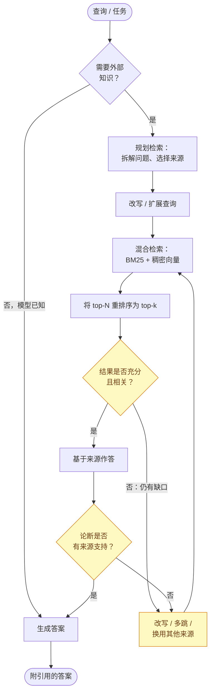
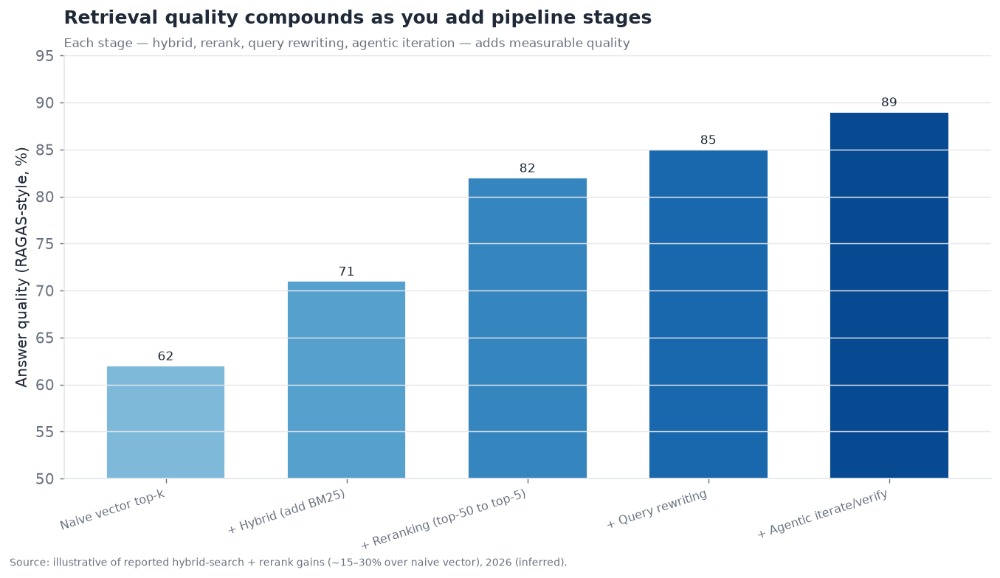
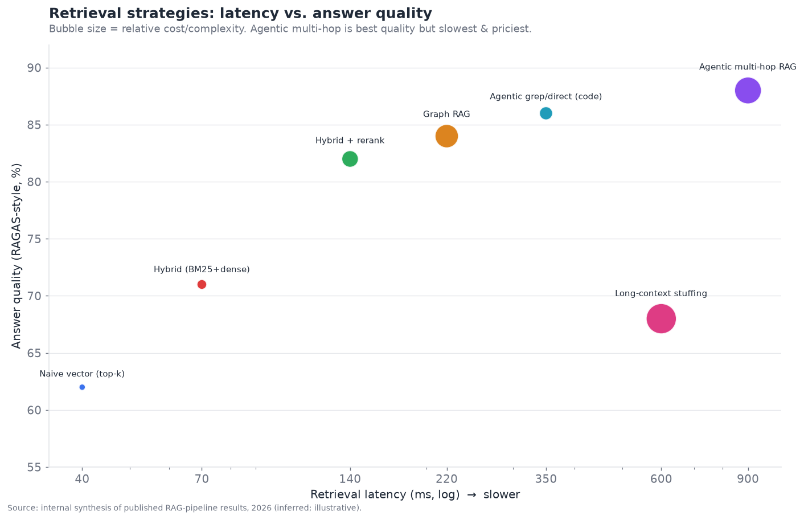

# 07 — 面向智能体的检索与知识接地

> **说明：** 本文为英文原文 [`sections/07-retrieval-knowledge-grounding.md`](../../sections/07-retrieval-knowledge-grounding.md) 的简体中文参考译文，仅供参考；如有出入，以英文原文为准。

*智能体如何获得所需的事实。智能体式 RAG、知识新鲜度与混合检索——以及为什么如今的瓶颈在于检索而非生成。目标篇幅：6,000 词。
内容截至 2026 年 11 月（基于 2026 年 7 月 22 日的快照，并补充了截至 2026 年 11 月初的进展）。*

> **读者导引。** “模型不了解我们的数据”这一问题正是在这一层得到解决。它在技术上已经成熟，但在运营上要求很高：模式已经定型，然而能否针对特定语料库把检索*做对*，仍然决定了一个接地的智能体是值得信赖，还是会自信满满地引用错误内容。

---

## 从“作为模式的 RAG”到“作为智能体能力的检索”

检索增强生成（RAG）最初是为解决一个特定问题而提出的：语言模型存在训练截止时间，也不了解你的私有数据，因此在生成之前先*检索*相关文档并将其放入上下文。这一基本模式——对语料库做嵌入、针对查询做向量检索、把排名靠前的结果塞进提示词——就是 2023 年“RAG”的含义，而如今它已是检索故事中*最不*有趣的部分。在执行摘要中，这一层的评分为 **成熟度 7.0/10、争议度 4.0/10**——一个正在商品化的层——但这个分数掩盖了一场真实的演变：面向*智能体*的检索与面向单轮问答的检索在本质上是不同的问题，而从“RAG 作为固定的预取流水线”转向“检索作为智能体所掌握的工具”，正是 2025–2026 年的标志性变化。

整个领域反复强调的一个最重要的框架是：**在 2026 年，接地准确性的瓶颈在于检索，而非生成。** 模型能够流畅地生成并很好地推理；当一个接地的智能体给出错误答案时，原因绝大多数是*正确的信息没有被检索进上下文*，而不是模型在正确信息上推理出错。这颠倒了投入的方向：接地系统的边际改进更多来自更好的检索，而非更好的生成器。这也是为什么这一“成熟”层仍然获得大量工程关注——模式已经定型，但针对特定语料库和智能体把检索*做对*，是一项困难且持续的工作。

---

## 2026 年 7 月以来的变化（2026 年 11 月更新）

本节所描述的架构在 2026 年 7 月至 11 月期间没有变化：混合检索加重排序仍是生产流水线，智能体式检索仍是主流模式。但围绕它的市场发生了变化，有三件事出现了进展。第一，**智能体网络搜索 API 成为一个有独立定价和基准测试的品类**：一个独立排行榜上线，Exa 和 Parallel 的估值达到 20 亿美元或更高，Perplexity 停用了其 Sonar 聊天补全 API，转而推出智能体 API。第二，**整合仍在继续**：AI 基础设施云厂商和前沿实验室通过收购和人才授权交易吸纳了检索公司。第三，**嵌入模型寡头刷新了其模型**：新一代模型原生支持多模态，并提供更多成本/质量选项。其中若干事件发生在 2026 年 1 月至 6 月，未被 7 月快照收录，因此在此一并补充。

- **2026-01-15：MongoDB 发布 Voyage 4 嵌入模型系列。** 该系列包含四个模型：voyage-4、voyage-4-large、voyage-4-lite，以及开放权重的 voyage-4-nano。同时还发布了 voyage-multimodal-3.5，Atlas 推出了“Automated Embedding”预览版。MongoDB 声称在 RTEB 排行榜上领先，但这一说法来自厂商自报 *（official（官方））*。
  [MongoDB](https://investors.mongodb.com/news-releases/news-release-details/mongodb-sets-new-standard-retrieval-accuracy-voyage-4-models)
- **2026-02-10：Nebius 同意收购 Tavily。** Tavily 保留其品牌和产品线，并将与 Nebius Token Factory 并列。交易本身为 *（official）*。据报道，价格约为 2.75 亿美元，外加最高 1.25 亿美元的里程碑付款，这一数字为 *（inferred（推断），据媒体报道）*。
  [Nebius](https://nebius.com/newsroom/nebius-announces-agreement-to-acquire-tavily-to-add-agentic-search-to-its-ai-cloud-platform)
- **2026-03-12：Qdrant 完成由 AVP 领投的 5,000 万美元 B 轮融资。** 这是今年最引人注目的向量数据库融资。相比之下，Pinecone 自 2023 年以来未宣布任何新一轮融资 *（inferred）*。
  [SiliconANGLE](https://siliconangle.com/?p=733993)
- **2026-04-28：Parallel Web Systems 以 20 亿美元估值完成 1 亿美元 B 轮融资，由 Sequoia 领投。** Parallel 由 Parag Agrawal 创立，销售专为智能体打造的 Search、Extract、Task（深度研究）、FindAll 和 Monitor API *（inferred）*。
  [SiliconANGLE](https://siliconangle.com/2026/04/28/parag-agrawals-startup-raises-100m-build-parallel-web-ai-agents/)
- **2026 年 5 月：Google 扩展了其托管 RAG 服务 Gemini API File Search。** 它现在支持多模态（文本加图像）语料库、自定义元数据和页面级引用。这延续了模型厂商捆绑检索能力的趋势 *（official）*。
  [Google](https://blog.google/innovation-and-ai/technology/developers-tools/expanded-gemini-api-file-search-multimodal-rag/)
- **2026-05-20：Google DeepMind 聘用了包括 CEO Douwe Kiela 在内的 20 多名 Contextual AI 员工，并获得了 Contextual AI 技术的授权。** 这是一笔“授权加聘用”交易，而非收购。据报道付款约为 8,000 万至 1 亿美元。Contextual AI 作为独立产品的前景尚不明朗 *（inferred）*。
  [Bloomberg Law](https://news.bloomberglaw.com/antitrust/google-hires-staff-from-ai-startup-contextual-in-licensing-deal)
- **2026 年 5 月：Exa 以 22 亿美元估值完成 2.5 亿美元 C 轮融资，由 a16z 领投。** 其上一轮是 2025 年 9 月以 7 亿美元估值完成的 8,500 万美元 B 轮 *（official 新闻稿）*。
  [Exa release](https://techintelpro.com/pressreleases/exa-raises-250m-series-c-to-build-the-search-engine-for-ais)
- **2026-08-18：Artificial Analysis 推出面向网络搜索 API 的 Search Index。** 该指数是三个基准测试的等权平均：DeepSearchQA、BrowseComp 和 AA-Omniscience。每个提供商都在相同的智能体循环和答案模型下运行，因此唯一的变量是搜索 API。上线时，Parallel（advanced）以 75 分领先；到 8 月下旬，Perplexity Search（medium）以 80 分领先 *（official 方法论；分数为快照）*。这是智能体搜索层第一个被广泛引用的独立衡量标准。
  [Artificial Analysis](https://artificialanalysis.ai/methodology/search-api)
- **2026-09-25：Exa 推出 Agent Ultra。** 它是 6 月上线的 Exa Agent 深度研究产品中投入最高的模式，会将一个请求分发给并行的子智能体 *（Exa Agent 为 official；Agent Ultra 的日期系根据媒体报道 inferred）*。
  [Exa](https://exa.ai/blog/exa-agent)
- **2026-09-27：Perplexity 终止对 Sonar 聊天补全的支持。** 开发者被引导至 Agent API——一个统一端点，将跨多个实验室的模型选择与网络搜索、URL 抓取、代码执行和 MCP 结合在一起。2025 年 9 月推出的独立 Search API 继续提供 *（official）*。
  [Perplexity docs](https://docs.perplexity.ai/docs/agent-api/migrate-from-sonar/overview.md)
- **2026-09-30：Cohere 发布 Embed 5，分为 Pro 和 Fast 两个档位。** 两者共享同一嵌入空间，因此可以用 Pro 建索引、用 Fast 查询。输入可以是文本、图像或混合内容（如 PDF 页面），Matryoshka 维度最高可达 2,048。Cohere 报告称 Pro 在其自有基准测试套件上优于 Voyage 4 Large。这一说法来自厂商自报 *（official）*。
  [Cohere changelog](https://docs.cohere.com/changelog/embed-v5)
- **2026-10-19：Exa 发布 Exa 3.0。** 它带来了更大的索引和嵌入模型、更便宜的“Lite”档位（据报道为每 1,000 次请求 4 美元），以及“Dynamic Highlights”——在所有结果之间分配 token 预算，而不是返回整页内容。Exa 声称在八项基准测试中领先，这一说法来自其自有测试。在 Artificial Analysis 上，Exa Auto 与 Perplexity 并列 80 分 *（inferred）*。
  [MarkTechPost](https://www.marktechpost.com/2026/10/20/exa-3-0-search-api-lite/)

**综合判断。** 智能体搜索层现在有了自己的独立记分板，排名靠前的提供商在榜上彼此仅相差几分。差异化正在转向单任务成本、延迟、token 效率（返回摘要片段而非整页）以及深度研究模式。与此同时，独立厂商正被拉入更大的技术栈：Tavily 并入 Nebius，Contextual AI 的团队并入 Google DeepMind。这正是本节此前预测的“捆绑对低端形成压力”的动态。

---

## 组织这一层的关键区分：检索与记忆

在深入之前，先澄清一个从 §03 延续而来的问题：检索与记忆容易混为一谈（两者都会把外部信息取入上下文），但区分它们是有益的。**检索让智能体以一个（相对静态、具有权威性的）知识语料库为依据——公司的文档、代码库、知识库。** **记忆则从智能体自身（动态）的经历中积累——用户说过什么、过去的会话中发生了什么。** 检索是*阅读图书馆*；记忆是*写日记*。二者共享向量数据库这一底层基础和大量工具，界线也确实模糊，但这个心智模型很有帮助：本节讨论的是以语料库（图书馆）为依据的接地；§03 讨论的是经验性记忆（日记）。一个生产级智能体通常两者都需要。

---

## 智能体式 RAG：作为推理循环的检索

现代检索的核心概念是 **智能体式 RAG（agentic RAG）**：不再是在生成前检索一次的固定流水线，而是由智能体*决定*何时检索、检索什么，评估所得结果是否足够，不够则再次检索——即包裹在检索外层的一个推理循环。这与智能体式工具使用（§04）是同一种转变，只是应用到了检索上：检索成为*智能体在判断自己需要信息时调用的工具*，而不是强制性的前置步骤。

二者对比鲜明：

- **经典（朴素）RAG：** 查询 → 嵌入 → 向量检索 → 把 top-k 塞进提示词 → 生成。一次检索，固定不变，发生在生成之前。如果检索没命中，答案就是错的，而系统并不知道自己没命中。
- **智能体式 RAG：** 智能体对查询进行推理，决定要查什么，执行检索，*评估*结果是否回答了问题；如果没有——就改写查询、换一个来源检索、拆解为子问题并分别检索，或者进行多跳检索（用第一次的结果来指导第二次查询）。它可以在作答前对照来源核验论断。检索是迭代的、自适应的、可自我纠正的。

黄色的循环节点——*评估充分性*、*改写*、*对照来源核验*——正是使其成为“智能体式”的关键，也正是它们修复了朴素 RAG 的核心缺陷：**朴素 RAG 无法判断自己是否检索到了错误内容；智能体式 RAG 会检查并重试。** 代价是延迟和模型调用次数（每一轮循环都是一次推理），这也是核心的权衡：智能体式 RAG 比朴素 RAG 更准确，但也更昂贵、更慢；额外的准确性是否值得额外的延迟，取决于具体用例。

有一个生动的例子说明了这一转变走了多远：**一些领先的智能体在某些领域已完全放弃了向量 RAG。** 例如 Claude Code 在很大程度上放弃了对代码库的向量嵌入检索，转而采用*智能体式 grep 风格搜索*——智能体使用搜索工具（grep、文件导航）像开发者那样*主动探索*代码库，而不是依赖预先构建的向量索引。对于代码而言，这通常更好：代码结构是可导航的（导入、定义、调用点），精确匹配搜索很准确，而索引会随着代码变化而过时。这是智能体式检索的逻辑终点——智能体不再查询静态索引，而是*用工具直接调查源头*——它在语料库可导航、精确匹配很重要的场景（代码、结构化数据）中效果最好。这是一个真实的信号：“RAG = 向量检索”这一等式已经过时。

---

## 混合检索：已定型的生产流水线

在检索步骤本身，业界已明确收敛到以 **混合检索加重排序** 作为生产级质量的流水线。值得详细说明，因为这正是让检索真正奏效的具体工程。

单独使用朴素的稠密（向量）检索有一个已知弱点：嵌入能捕捉*语义*相似性，却会漏掉*精确*匹配——查询某个特定错误码、产品 SKU 或专有名词时可能失败，因为该代码的嵌入与周围文本的嵌入并不接近。稀疏（关键词/BM25）检索的特性恰恰相反：擅长精确匹配，却对语义（同义词、改写）视而不见。**混合检索将两者融合**——同时运行稠密和稀疏检索并合并结果——从而同时捕捉语义匹配与精确匹配。仅此一项就是一个显著且有充分文献记录的质量提升。

然后是 **重排序**：混合检索先撒一张大网（检索 top-50），再由一个交叉编码器（cross-encoder）重排序模型针对查询为每个候选打分，其精度高于初始检索，从而把真正相关的少数结果提升到顶部（重排序为 top-5），再交给生成器。重排序器对每个候选的开销更高，但只作用于已检索出的子集，因此成本可以承受，而且它始终能带来又一次大幅的质量提升。

标准流水线及其叠加收益：

每个阶段都带来可衡量的质量提升——混合检索优于朴素向量检索，重排序优于混合检索，再加上查询改写，最后是智能体式的迭代/核验循环——据报道，完整流水线相对朴素向量检索的总体提升在 RAG 评估指标（RAGAS 风格的忠实度/相关性）上通常在 15–30% 区间。启示是：**检索质量是流水线的属性，而非单个模型的属性**，那些把“我们有向量数据库”等同于“我们有检索能力”的团队，放弃了大部分本可获得的质量。完整流水线——混合检索 + 重排序 + 查询改写 + 智能体式迭代——就是 2026 年的生产标准。

各策略在延迟/准确性/成本上的权衡：

解读这条前沿曲线：朴素向量检索快速/便宜/表现平平（左下）；完整的智能体式多跳流水线质量最高，但最慢也最贵（右上）；混合检索+重排序处于颇具吸引力的中间位置。值得注意的是，**长上下文堆砌**（跳过检索，把所有内容倒进一个巨大的上下文窗口）*既*昂贵*又*质量低于良好的检索流水线——这是对“大窗口会终结 RAG”这一说法的实证反驳，原因与 §03 中的上下文腐化（context rot）相同。合适的工作点取决于用例：一个对延迟敏感的语音智能体（§10）承受不起在关键路径上进行智能体式多跳检索；而一个高风险的研究型智能体则应该为此付出代价。

---

## 知识新鲜度：实时接地问题

一个独立且日益重要的维度是 **新鲜度**：智能体所依据的信息有多新？静态向量索引只是一个快照；一旦底层数据发生变化，索引就过时了，而智能体会自信地以过时信息为依据。对于许多智能体用例——针对不断变化的政策的客户支持、金融或新闻分析、库存，以及任何运营性业务——数据陈旧是一种正确性故障，而不是轻微的滞后。

按时效性递增，应对新鲜度的方法有：

- **批量重建索引。** 定期重建索引。简单，但两次重建之间索引是过时的，且重建大型索引代价高昂——因此新鲜度与成本之间存在张力。适用于变化缓慢的语料库，不适用于运营数据。
- **增量 / 流式索引。** 随文档变化更新索引（写入时添加、更新、删除嵌入）。无需完全重建即可让索引保持接近最新；这是持续变化语料库的标准做法。
- **直接从源头实时检索（跳过索引）。** 对于真正的实时需求，根本不做预索引——在检索时直接查询权威来源（访问数据库、调用 API、搜索实时网络）。这是可能达到的最新鲜的接地方式，并与“智能体式直接搜索”模式相呼应：智能体通过工具从实时来源检索，而不是从快照检索。代价是延迟（实时查询比索引查找慢）以及对源系统造成的负载。
- **混合新鲜度。** 对语料库中稳定的主体部分建立索引以实现快速语义检索，但对易变字段进行实时获取——例如，对产品描述建索引，但在查询时实时获取当前价格和库存。这是针对混合易变性数据的务实生产方案。

关键设计原则：**让检索策略与数据的易变性相匹配。** 静态参考资料 → 建索引。持续变化的运营数据 → 增量索引或实时检索。实时关键数据（价格、可用性、状态）→ 始终实时获取，绝不信任快照。一个常见且代价高昂的失败是：对易变数据建立索引，由于索引落后于现实而提供过时的答案——解决办法是认识到*并非所有东西都应该放进向量索引*，易变数据属于实时检索。这也是检索与工具使用（§04）相连接的地方：实时检索*本身就是*对权威系统的一次工具调用，“实时接地”往往更适合表述为“给智能体一个查询事实来源的工具”，而不是“构建一个更新鲜的索引”。

---

## 网络规模的接地与搜索技术栈

检索中一个具体且庞大的子场景是 **以实时网络为依据**——为智能体提供最新的开放世界信息。这在 2025–2026 年成为一个重要的能力领域，伴随着有别于消费级搜索的 **面向智能体的搜索 API** 的兴起：

- 传统的消费级搜索引擎返回供人点击的链接；**智能体搜索 API** 则返回干净、结构化、可直接供 LLM 使用的内容（提取出的文本，而非搜索结果页），专为智能体消费而设计。Exa、Parallel、Tavily（自 2026 年起归 Nebius 所有）、Brave Search API、Firecrawl、Perplexity 的 Search 与 Agent API，以及模型厂商自己的网络搜索工具，都在满足这一需求。
- **该品类现在有了独立的衡量标准。** 在 2026 年 8 月之前，所有搜索 API 的比较都由厂商自己进行。Artificial Analysis Search Index 改变了这一点。它固定智能体循环和答案模型，只改变搜索 API，并在 DeepSearchQA、BrowseComp 和 AA-Omniscience 上为提供商打分。在该指数上，不使用搜索的模型得分为 33，领先的 API 得分约为 75–80 *（official 方法论；分数为快照）*。因此，良好的网络接地能让这些任务上的答案质量提升一倍以上。排名靠前的提供商之间仅相差几分，这将竞争推向单任务成本、延迟和 token 效率。
- 价值在于*面向智能体消费的提取与排序质量*——没有广告/导航杂质的干净内容、针对问答而非人类浏览调优的相关性，以及通常内置的摘要功能。以网络为依据的智能体需要的是*内容*，而不是十条蓝色链接。
- 新鲜度是内在的（网络是实时的），这正是其吸引力所在——网络接地是智能体获取比其训练数据更新、也比任何内部索引更新的信息的途径。

这一网络搜索层是一个真实且不断增长的市场，估值也很高。Exa（22 亿美元，2026 年 5 月）和 Parallel（20 亿美元，2026 年 4 月）的估值都在约 20 亿美元或以上，Nebius 以据报道约 2.75 亿美元收购了 Tavily *（inferred）*。它位于检索（§07）、工具使用（§04）与模型厂商原生能力的交汇处（所有前沿厂商现在都把网络搜索作为内置的智能体工具提供）。它也是“检索作为智能体调用的实时工具”这一框架最自然的场景——网络搜索在定义上就是实时检索工具，而非预先构建的索引。

---

## 竞争格局

检索领域涵盖 **向量数据库底层**（§03 中的参与者，在此复用）、**检索/RAG 平台**、**重排序与嵌入模型提供商**、**智能体搜索 API**，以及 **模型厂商的原生检索**。这是一个密集且正在商品化的市场。

### 竞争对比表——检索与知识接地

| 参与者 | 类别 | 成熟度 | 角色 | 值得关注（置信度） | 差异化 | 竞争对手 |
|---|---|---|---|---|---|---|
| **Contextual AI** | RAG 平台 | shipped-reliable | 端到端企业 RAG | CEO D. Kiela 及 20 多名员工于 2026 年 5 月通过授权加聘用交易加入 Google DeepMind（inferred） | 专为接地 RAG 打造的平台；独立路线图不确定 | Vectara, Glean |
| **Vectara** | RAG 平台 | shipped-reliable | 托管式 RAG 即服务 | 获 Gartner 认可（official） | 专注减少幻觉，托管服务 | Contextual AI, Onyx |
| **Glean** | 企业搜索/RAG | shipped-reliable | 全工作范围搜索 + 智能体 | 2025 年 6 月 F 轮估值 72 亿美元（official）；后续一轮融资有传闻，未经证实（speculative） | 企业知识图谱 + 连接器 | Vectara, Onyx, MS |
| **Cohere (Rerank/Embed)** | 模型提供商 | shipped-reliable | 重排序 + 嵌入 | Embed 5 Pro/Fast（2026 年 9 月）、Rerank 4（official） | 多模态嵌入；Pro/Fast 共享同一向量空间 | Voyage, OpenAI, Google embed |
| **Voyage AI (MongoDB)** | 嵌入/重排序 | shipped-reliable | 嵌入 + 重排序器 | 归 MongoDB 所有；Voyage 4 系列含开放权重 nano 模型（2026 年 1 月；official） | 高质量领域嵌入，数据库内自动嵌入 | Cohere, OpenAI |
| **Exa** | 智能体搜索 API | shipped-reliable | 网络搜索 + 研究型智能体 | 以 22 亿美元估值完成 2.5 亿美元 C 轮（2026 年 5 月）；Exa 3.0（2026 年 10 月）（official） | 基于嵌入的网络索引；Lite 档位、Dynamic Highlights | Parallel, Perplexity, Tavily |
| **Tavily (Nebius)** | 智能体搜索 API | shipped-reliable | 网络搜索 + 提取 | 被 Nebius 收购，2026 年 2 月宣布（official）；据报道约 2.75 亿美元（inferred） | 搜索+提取与 AI 云捆绑 | Exa, Parallel, Brave API |
| **Perplexity (API)** | 搜索/问答 | shipped-reliable | Search API + Agent API | Sonar 聊天补全于 2026 年 9 月 27 日停用 → Agent API（official） | 自有网络索引；带引用的多模型智能体端点 | Exa, Parallel, 厂商网络搜索 |
| **Parallel Web Systems** | 智能体搜索 API | shipped-reliable | 搜索、提取、深度研究任务 | 以 20 亿美元估值完成 1 亿美元 B 轮，Sequoia 领投（2026 年 4 月；inferred） | 专为智能体设计的网络 API，含 Task/Monitor | Exa, Perplexity, Tavily |
| **LlamaIndex** | RAG 框架 | shipped-reliable | RAG/智能体式文档框架 | 约 6,000 万美元（official） | 以数据/文档为中心的 RAG 编排 | LangChain, Haystack |
| **Onyx (ex-Danswer)** | 开源企业 RAG | shipped-reliable | 可自托管的企业 RAG | 开源 + 连接器（inferred） | 开源企业搜索/RAG | Glean, Vectara |
| **Pinecone / Weaviate / Qdrant** | 向量数据库 | shipped-reliable | 检索底层 | 无处不在（official）；Qdrant 2026 年 3 月 5,000 万美元 B 轮（inferred） | 向量存储 + 混合搜索 | 彼此互为对手 |
| **Elastic / OpenSearch** | 搜索引擎 | shipped-reliable | 混合（BM25+向量） | 成熟的搜索基础设施（official） | BM25 传统 + 新增向量能力 | 向量数据库 |
| **模型厂商检索** | 原生 | shipped-reliable | 内置网络/文件搜索 | OpenAI/Anthropic/Google；Gemini File Search 于 2026 年 5 月支持多模态（official） | 检索与模型捆绑 | 独立 RAG |
| **Graph-RAG (Microsoft GraphRAG, Neo4j)** | 图检索 | demoed→reliable | 图增强检索 | MS GraphRAG、Neo4j（official） | 基于知识图谱的检索 | 向量 RAG |

以上共十五个条目，涵盖平台、模型提供商、搜索 API 和底层基础设施。Parallel 于 2026 年 11 月新增，Tavily 现已标注为归 Nebius 所有。结构性解读：**检索是一个分层且正在商品化的市场：底层（向量数据库、搜索引擎）是一场逐底竞争；模型组件（嵌入、重排序器）是一个小型寡头市场（Cohere、Voyage、OpenAI）；而差异化价值在于为企业整合连接器、流水线、治理与接地质量的*平台*（Glean、Contextual AI、Vectara）。** 与记忆和编排一样，模型厂商捆绑检索（原生网络/文件搜索）对低端形成压力，而具备安全、权限和连接器的企业级接地 RAG 仍是一个真实且可防守的市场。

*2026 年 11 月补充。* 2026 年的交易显示，外围各层正从两个方向被吸纳。基础设施云厂商在收购智能体搜索层：Nebius 收购了 Tavily。前沿实验室通过授权加聘用交易获取 RAG 平台人才：Google DeepMind 与 Contextual AI。与此同时，最强的独立搜索 API（Exa、Parallel）筹集了足够的资本，试图自成一层。我们的判断是，智能体搜索层正在分化：少数资本雄厚、拥有自有网络爬取和索引的索引所有者，正在与依附于他人索引的薄封装层拉开距离，而后者正被收购或挤压 *（inferred）*。

---

## 接地、引用与幻觉

检索之所以重要，一个核心原因是 **减少幻觉**——让模型的输出以检索到的来源为依据，使其陈述来自文档的事实，而不是凭空编造。但接地并不能治愈幻觉，其中的细微之处很重要：

- **检索能减少但不能消除幻觉。** 即使上下文中有正确的文档，模型仍可能误读它们、过度泛化，或把检索到的事实与错误的参数化（训练）知识混在一起。接地会把模型约束向来源，但并不能强制其忠实。
- **引用是问责机制。** 要求智能体为每条论断注明支持它的检索来源，使接地变得*可核验*——人（或核验模型）可以检查引用。引用质量（被引用的来源是否真的支持该论断？）本身就是一个可衡量的属性和关键的信任特性；“引用忠实度”是一个活跃的评估目标（§11）。
- **检索与忠实度的区分。** RAG 评估（RAGAS 等）区分两种失败模式：*检索质量*（我们取到了正确的文档吗？）和*忠实度*（在给定文档的情况下，答案是否忠实于它们？）。诊断出哪一环出了问题至关重要——忠实度问题需要通过提示/核验来修复，检索问题需要通过流水线来修复，混淆二者会白费力气（与 §05 中“知识与推理”的诊断原则相同）。

坦率地说：**接地是目前最好的幻觉缓解手段，但它只是部分有效。** 它让模型从“编造内容”转向“依据来源报告”，而引用使这一点可被检查——但接地的智能体仍可能出错，需要核验层（§11）来发现。这就是为什么高风险的接地系统会把检索与引用检查和人工审核结合使用，而不是只依赖接地。

---

## 分块与文档处理：不起眼的基础

检索系统中讨论最少却影响最大的部分，往往是 **在任何巧妙的检索发生之前，文档如何被处理成可检索的单元。** 检索质量受分块质量的制约：如果相关信息被笨拙地拆分到多个块中，或者某个块缺乏可独立理解的上下文，任何检索策略都无法弥补。这是 §03 中“写入路径决定质量”在检索领域的对应——在这里，*摄取*路径决定了上限。

关键的分块决策包括：

- **块大小。** 太小，块就缺少足够的上下文来回答任何问题或生成有意义的嵌入；太大，一个块就包含多个主题，稀释了其嵌入，并在被检索时浪费上下文。不存在通用的正确大小；它取决于内容，是一个对质量有实际影响的调优参数。
- **块边界。** 朴素的定长分块会在句子中间、表格中间、思路中间切开——破坏语义。*语义分块*（按自然边界切分——章节、段落、主题转换）能保持连贯性并显著改善检索。对于结构化文档，结构感知分块（尊重标题、表格、列表）效果更好。
- **上下文保留。** 从文档中抽出的块会丢失其周边上下文（“第三季度”——哪一年？哪家公司？）。诸如*上下文检索（contextual retrieval）*（在嵌入前为每个块前置一段由 LLM 生成的、关于该块上下文的简短摘要）和分层分块（先检索小块，再扩展到其父章节以获取上下文）等技术可以解决这一问题，并有文献证明能大幅减少检索失败。
- **文档解析。** 在分块之前，文档必须先被*解析*——而现实中的文档（多栏排版的 PDF、表格、图表、扫描图像）用朴素工具解析效果很差，会污染下游的一切。高质量的文档解析（LlamaParse、Unstructured、Reducto 以及基于视觉模型的解析器所在的领域）是技术栈中真实存在却被低估的一环；无论流水线其余部分多么出色，垃圾解析只会产生垃圾检索。

不起眼的真相是：**很大一部分“我们的 RAG 不好用”问题，实际上是摄取问题——糟糕的解析、糟糕的分块、丢失的上下文——而不是检索算法问题。** 团队往往去追求更花哨的检索，而真正的修复在于改进上游的文档处理。这里往往是边际投入回报最高的地方，恰恰因为它枯燥且容易被跳过。

## 嵌入：语义检索的底层基础

稠密检索依赖于 **嵌入模型**，它把文本（或图像、代码）映射为向量，使语义相似性表现为几何上的接近。嵌入模型是一个影响重大却时常被忽视的选择：

- **质量参差不齐，且对领域敏感。** 通用嵌入模型在领域术语占主导的专业内容（法律、医疗、代码）上可能检索效果不佳。针对领域调优或领域专用的嵌入（以及在你自己的数据上微调的嵌入）在专业语料库上可以大幅超越通用嵌入。
- **维度与成本。** 维度更高的嵌入能捕捉更多信息，但存储和检索成本更高；*Matryoshka* 嵌入（允许截断到更少的维度，质量平缓下降）让团队可以在同一个模型上以质量换取成本/速度。存储与检索成本随维度 × 语料库规模增长，这在大规模时很重要。
- **提供商寡头格局。** 高质量的嵌入和重排序模型是一个小市场——Cohere、Voyage（现属 MongoDB）、OpenAI、Google，以及少数强大的开源模型（BGE/GTE 系列）。这是检索技术栈中少数真正呈寡头格局的部分之一，因为训练出色的嵌入模型很难，而质量差异真实且可衡量。2026 年的更新保持了寡头格局，但改变了其形态。MongoDB 发布了 Voyage 4（2026 年 1 月），其产品线包括一个开放权重的 nano 模型。Cohere 发布了 Embed 5 Pro/Fast（2026 年 9 月），原生支持多模态，Matryoshka 维度最高可达 2,048 *（official）*。每家厂商都声称在基准测试上领先对方，因此请在你自己的语料库上进行评估。
- **更换模型时的重新嵌入成本。** 更换嵌入模型意味着要对整个语料库重新做嵌入——这是一种真实的切换成本，会让你锁定在当初建索引时所用的模型上。这是检索层中一种被低估的厂商锁定形式。2026 年的一种设计应对是*共享同一嵌入空间的分层模型*。Cohere 的 Embed 5 Pro 和 Fast 就是一个例子：用昂贵的模型建一次索引，用便宜的模型查询 *（official）*。这降低了服务成本，但在更换厂商或模型代际时仍需重新嵌入。

实用建议：**嵌入模型是一个真实的质量杠杆，而不是可以随意挑选的商品**——在你实际的语料库和查询上评估几个模型，针对专业内容考虑领域调优，并意识到这一选择带有重新嵌入的切换成本。

## Graph RAG 与结构化检索

对于关系丰富的语料库——或需要跨大量文档进行综合的问题——**graph RAG** 用知识图谱来增强或替代向量检索。其思路（呼应 §03 的图记忆）是从语料库中抽取实体和关系构成图，再通过遍历关系来检索，而不仅仅依赖语义相似性。Microsoft 的 GraphRAG 和基于 Neo4j 的方案是其中值得关注的实现。

Graph RAG 在向量 RAG 处理不佳的两类查询上表现出色：

- **多跳 / 关系型问题。** “我们的哪些供应商同时也是竞争对手的客户？”需要跨文档连接实体——这是一次图遍历，而不是相似性搜索。向量 RAG 能检索到各自相关的块，却无法将它们*连接*起来。
- **全局 / 归纳型问题。** “这 10,000 份文档的主要主题是什么？”需要对整个语料库的结构化视图，graph RAG 的社区/聚类结构能提供这一点，而扁平的向量检索做不到。

其代价与图记忆相似：昂贵的图构建（在整个语料库上进行基于 LLM 的实体/关系抽取）、运营复杂度，以及所抽取图谱的陈旧问题。因此，graph RAG **对于关系密集或需要大量综合的语料库具有生产价值，而对于直接的问答则属大材小用**——与其他地方一样，遵循“在结构值得时才使用”的判断。许多成熟系统采用图+向量的*混合* RAG：常见的语义场景用向量检索，关系型子集用图遍历。

## 多模态检索

随着文档越来越视觉化（图表、示意图、截图、扫描表单），智能体也越来越多模态（§05、§10），**多模态检索**——对图像、表格和混合内容而不仅仅是文本进行检索——的重要性日益增长。有两种方法：

- **先解析为文本再检索。** 把视觉内容转换为文本（OCR、图表转文本、表格提取），再对文本进行检索。简单，但有损——图表的视觉信息在文本形式中会退化。
- **原生多模态嵌入。** 把图像和文本嵌入到共享空间（视觉-语言嵌入）中，直接跨模态检索——检索实际的图表图像，而不是它的文字描述。这保留了视觉信息，是视觉内容丰富的语料库更强的方法，代价是更复杂的基础设施。

2026 年的方向在视觉内容丰富的领域（金融文档、技术手册、医学影像报告）倾向于原生多模态检索，这与多模态模型的整体进步同步。到 2026 年 11 月，这已成为已发布的默认方案，而非实验。Cohere Embed 5 能将文本、图像和混合 PDF 页面嵌入为单个向量，Gemini API File Search 也于 2026 年 5 月增加了支持页面级引用的多模态语料库 *（official）*——但对于以文本为主的语料库，对解析后内容进行基于文本的检索仍是务实的默认选择。与 §05 的多模态推理一样，感知（解析/嵌入视觉内容）往往是较弱的环节，更好的视觉文档理解能直接改善对现实世界文档的检索。

## 评估检索

检索评估值得专门讨论，因为它是改进对接地准确性影响最大的那一层的途径。已经定型的框架如下：

- **检索指标** 衡量是否取到了正确的文档：recall@k（相关文档是否出现在 top-k 中？）、精确率，以及 MRR（它排在多靠前？）。这些指标孤立地评估检索步骤。
- **端到端 RAG 指标**（RAGAS 等）通过通常由 LLM 评判的维度来衡量整个流水线：*忠实度*（答案是否得到检索上下文的支持？）、*答案相关性*（是否回应了问题？）、*上下文相关性*（检索到的上下文是否相关？）以及*上下文召回率*（检索是否取到了所需的全部内容？）。将这些区分开来有助于定位故障——上下文召回率低是检索问题，忠实度低是生成/接地问题。
- **§11 中关于评估可信度的告诫在此完全适用。** LLM 作为评判者的指标本身并不完美（评判者也会出错），基准数据集与你的语料库不匹配，而且指标可能被刷分。检索评估具有方向性且有用，但并非绝对真理——基于*你自己*实际的查询和语料库构建评估集，在改进*你的*系统方面胜过任何公开基准测试。

行之有效的方法是：**构建一个由真实查询组成、带有已知正确答案/来源的领域专用评估集，并在每次流水线变更时分别跟踪检索指标和忠实度指标**——这是将 §11 的通用评估原则应用到检索上；之所以值得这样做，恰恰因为检索是瓶颈，而你无法改进自己不衡量的东西。

## 检索与其他层的关系

- **↔ 记忆（§03）。** 共享底层，角色不同：检索读取语料库，记忆积累经验。许多系统对两者使用同一个向量数据库。
- **↔ 工具使用（§04）。** 智能体式检索和实时检索*本身就是*工具调用；“给智能体一个搜索工具”往往优于“构建一个索引”。多工具问题与检索问题共享同一套机制（检索相关工具 = 检索相关文档）。
- **↔ 规划（§05）。** 智能体式 RAG 的迭代/核验循环就是一个规划循环；多跳检索就是推理。知识（检索）与推理（规划）是不同的层，它们的故障需要不同的修复方式。
- **↔ 安全（§12）。** 检索到的内容是不可信输入——语料库中的文档可能携带提示注入，被智能体摄取并据此行动（通过检索内容进行的间接提示注入是主要的攻击向量）。检索扩大了注入攻击面。
- **↔ 身份（§13）。** 企业检索必须遵守*权限*——为用户 A 检索的智能体不得呈现 A 无权查看的文档。权限感知检索（只检索发起请求的主体有权访问的内容）是一项困难且必不可少的企业需求，而朴素 RAG 忽略了这一点。

---

## 检索特有的失败模式

1. **检索未命中（最主要的失败）。** 正确的信息没有被检索到，因此答案是错的。缓解方法：混合检索 + 重排序 + 查询改写 + 智能体式重试。
2. **陈旧接地。** 索引落后于现实；智能体提供过时的事实。缓解方法：让策略与易变性相匹配——对易变数据使用实时检索。
3. **不忠实的接地。** 检索到了正确的文档，但答案歪曲了它们。缓解方法：要求引用并进行忠实度核验。
4. **分块损伤。** 糟糕的文档分块把相关信息拆散到多个块中或丢失了上下文，导致没有任何单个块能回答查询。缓解方法：更好的分块（语义分块、分层分块），以及能重新组装上下文的检索。
5. **权限泄露。** 检索呈现了发起请求的用户无权查看的文档。缓解方法：权限感知检索（§13）——一项严肃的企业需求。
6. **通过检索内容注入。** 被投毒的文档向智能体下达指令（§12）。缓解方法：把检索到的内容视为不可信数据，绝不视为指令。
7. **过度检索 / 上下文膨胀。** 检索过多会淹没上下文（上下文腐化，§03），降低质量并增加成本。缓解方法：通过重排序收窄到精简的 top-k。

---

## 检索的成本与延迟工程

检索有一个真实的性能预算，它塑造了生产设计，而流水线各环节的数字差别很大：

- **索引查找既便宜又快速**（个位数到几十毫秒）；向量检索本身很少是瓶颈。
- **重排序增加的延迟与候选数量成正比**——对 50 个候选运行交叉编码器需要几十到一两百毫秒，为了质量通常值得，但确实是一项成本。
- **智能体式循环会把一切乘以迭代次数**——每一轮“检索-评估-改写”都是一次模型调用加一次检索，因此智能体式多跳 RAG 的耗时可能以秒计，而非毫秒。这是最主要的延迟成本，也是智能体式 RAG 只保留给准确性值得付出代价的场景的原因。
- **实时检索以索引查找的速度换取新鲜度**——实时源查询（数据库、API、网络）比命中索引慢，但信息是最新的，而且会给源系统带来负载。
- **检索到的内容会消耗生成 token**——所有检索进上下文的内容都要在生成时付费（并且只要它驻留在上下文中，后续每一轮都要付费），因此过度检索是一种不断叠加的 token 成本，这恰恰是重排序到精简 top-k 能带来双重回报（质量*和*成本）的原因。

这一设计原则与技术栈的其他部分一致：**根据准确性要求来预算检索延迟和 token 成本。** 对延迟敏感的路径（语音，§10；交互式 UX）需要快速的索引+重排序，无法在关键路径上承担智能体式多跳检索——应异步执行重度检索或预先计算。高风险、可容忍延迟的任务（研究、分析）则应为完整的智能体式流水线付费。让检索策略与延迟预算相匹配，与让它和数据易变性相匹配同样重要。

## 何时（不）使用检索

一份中立的评估必须指出，检索并不总是答案，条件反射式地使用它是一种常见错误：

- **模型已经知道时，不要检索。** 对于完全在模型训练范围内的常识，检索只会增加延迟和成本而毫无益处，甚至可能*有害*——注入平庸的检索上下文，干扰模型更强的参数化知识。智能体式 RAG 的第一个决策节点——“我到底需不需要检索？”——正是为了跳过不必要的检索而存在。
- **数据小到能装进上下文时，考虑跳过索引。** 如果整个相关语料库只有少数几份文档，能轻松放进上下文窗口，那么直接把它们放进上下文可能胜过检索流水线——不存在检索未命中的风险。（但要警惕规模变大时的上下文腐化——这只适用于真正的小型语料库，而延迟/准确性图表显示，长上下文堆砌在大规模下会落败。）
- **需要结构化事实时，查询数据库，而不是用 RAG。** 如果答案存在于结构化数据中（表中的一行、记录中的一个字段），精确的数据库查询（text-to-SQL、API 调用）比在该数据的文本渲染上进行语义检索更可靠。对结构化数据做 RAG，往往只是查询的劣化版本。
- **新鲜度至关重要时，实时检索，不要建索引。** 如前所述——易变数据属于实时检索，而不是快照索引。

严谨的看法是：**检索是一种工具，用于以模型无法可靠掌握、规模大到放不进上下文、且相对非结构化的语料库为依据**——在这一最佳适用范围之外，参数化知识、直接放入上下文、结构化查询或实时工具往往更好。识别某个具体需求需要哪种接地机制——而不是默认“加上 RAG”——是一项核心的智能体设计技能，它也呼应了贯穿本文档的“检索 vs. 记忆 vs. 推理”之间的区分。

## 面向智能体的检索简史

这段历程有助于理解当前状态。**2020–2022 年** 在学术上确立了 RAG（最初的 RAG 论文、稠密段落检索）——检索作为开放域问答的一种研究技术。**2023 年** 是向量数据库的淘金热：ChatGPT 让每个人都想“和自己的文档聊天”，朴素向量 RAG 成为默认方案，向量数据库获得了巨额融资。它在演示中有效，在生产中却令人失望，因为在分块糟糕的文档上进行朴素的 top-k 向量检索效果平平——这是那个时代的惨痛教训。

**2024 年** 是流水线成熟之年：业界认识到混合搜索、重排序、更好的分块和查询改写是必需的，而非可选的，“规范的 RAG 流水线”得以定型。**2025 年** 迎来了智能体转向——检索成为*智能体自适应运用的工具*，而非固定的前置步骤；最先进的智能体在语料库允许的情况下开始跳过向量索引，改用直接/智能体式搜索（代码是标志性例子）。**2026 年** 是当前的综合阶段：流水线已经定型，智能体式检索成为主流模式，检索被公认为接地准确性的*头号*瓶颈，而前沿在于新鲜度、权限感知、多模态检索，以及知道何时*不*检索。2026 年下半年又增加了两件事：智能体网络搜索层获得了独立的衡量标准（Artificial Analysis Search Index，2026 年 8 月）；它还经历了一轮整合：Nebius 收购了 Tavily，Google DeepMind 接收了 Contextual AI 的团队。

这段历程与技术栈的其他部分遥相呼应——一个被过度炒作的朴素版本（2023 年的向量 RAG）让位于冷静的工程实践（2024 年的流水线），然后是贯穿每一层的智能体式重构（2025–26 年）。而且与其他地方一样，模型厂商也入场了（原生网络/文件搜索），使低端商品化，而企业级接地仍是一个真实的市场。检索之所以成熟，不是因为它简单，而是因为业界完成了那些不起眼的工作——分块、混合检索、重排序、评估——把一个平庸的演示模式变成了可靠的生产能力。

## 路线图与展望（附置信度标注）

- **智能体式检索取代固定流水线 RAG** *（inferred；高置信度）。* 从“检索一次、固定不变”到“作为具备迭代/核验能力的自适应工具进行检索”的转变仍在继续；朴素的一次性 RAG 只会成为低端默认方案。——*2026 年 11 月：按预期推进。搜索厂商正在把智能体式深度研究模式作为产品发布（Exa Agent / Agent Ultra、Parallel Task API、Perplexity Agent API）。*
- **混合检索 + 重排序 + 查询改写是已定型的质量流水线** *（official；高置信度）。* 这一技术栈已标准化且稳定；争论的焦点在于在其上叠加多少智能体式循环，而不在于核心流水线。——*2026 年 11 月：已确认；无变化。*
- **实时/直接检索相对于静态索引的占比上升** *（inferred；中高置信度）。* 对于易变且可导航的数据（运营数据、代码、网络），智能体越来越多地通过工具从实时来源检索，而不是从快照检索——在适用场景中，新鲜度和“直接调查源头”的模式胜出。——*2026 年 11 月：在网络领域已得到确认。搜索 API 融资（Exa 2.5 亿美元、Parallel 1 亿美元）和新的 Artificial Analysis Search Index 都表明，实时网络检索如今已是核心的智能体基础设施。*
- **权限感知与受治理的检索成为企业需求** *（inferred；高置信度）。* 随着智能体在敏感语料库上进行检索，遵守按用户划分的权限并提供审计/引用追踪，正从锦上添花变为强制要求——这是企业 RAG 平台相对于原始向量检索的差异化因素。——*2026 年 11 月：尚未解决。没有出现新的标准；这仍是各平台各自的功能。*
- **模型厂商持续捆绑检索** *（official；高置信度）。* 与模型捆绑的原生网络/文件搜索对低端形成压力；独立价值集中于企业接地（连接器、权限、治理、质量）以及专业的重排序/嵌入模型。——*2026 年 11 月：已确认并进一步扩展。Google 的 File Search 支持了多模态，实验室和云厂商吸纳了检索初创公司（Contextual AI 的团队并入 Google DeepMind；Tavily 并入 Nebius），Perplexity 则把其 API 转变为多模型智能体端点。*
- **新增（2026 年 11 月）：智能体搜索 API 在单任务成本和 token 效率上竞争，而非原始质量** *（inferred；中高置信度）。* 在独立的 Search Index 上，排名靠前的提供商彼此仅相差几分。预计价格下调（例如 Exa 的 Lite 档位）、以 token 预算控制的摘要片段取代整页内容，以及与推理云的捆绑，将决定 2027 年之前的市场份额。
- **新增（2026 年 11 月）：实验室和云厂商对检索初创公司进行更多的“收购式授权”** *（speculative（推测）；中等置信度）。* Contextual AI 和 Tavily 的交易表明，没有专有索引或数据护城河的独立 RAG 平台将被吸纳，而不是成长到 IPO。

---

## 检索与提示缓存：一种经济上的相互作用

一个值得指出的实际相互作用是：**提示缓存改变了检索的经济性。** 当一大块稳定的上下文（参考语料库、长系统提示词、一组文档）在许多查询中被重复使用时，提示缓存让模型能够以重新处理所需成本和延迟的一小部分来复用已处理过的上下文。这在一定程度上改变了检索与上下文堆砌之间的权衡：

- 对于 **被反复查询的稳定、中等规模的语料库**，把整个语料库缓存在上下文中可能是经济的——只需支付一次完整的处理成本，此后便可廉价复用，同时规避检索未命中的风险。这是缓存所带来的“把更多内容放进上下文”的一个真实（尽管有限）的适用场景。
- 对于 **大型或频繁变化的语料库**，检索仍是必需的——你无法缓存装不下或不断变化的内容（每次变化都使缓存失效会抵消其好处）。
- 由此出现的 **混合** 方案：缓存稳定且始终相关的上下文（系统提示词、核心参考资料），而对与查询相关的、易变的或大型的其余部分进行*检索*。这同时优化了成本和新鲜度。

要点是：**缓存与检索是解决同一问题的互补杠杆——如何以低成本为模型提供其所需的上下文**——成熟的设计会用缓存处理稳定的主体部分，用检索处理具体且易变的其余部分，而不是把“检索”与“塞进上下文”视为二选一。这再次体现了一个反复出现的主题：稀缺资源——模型的注意力和你的 token 预算——要靠一组技术组合（缓存、检索、记忆、上下文编辑）来管理，而不是依靠任何单一技术。

## 本节要点

- **检索而非生成，才是** 2026 年接地准确性的 **瓶颈**——错误的接地答案绝大多数源于检索未命中，因此应把精力投入检索质量，而非生成器质量。
- **智能体式 RAG**——作为自适应推理循环的检索（决定、检索、评估、改写、核验）——已取代固定流水线 RAG 成为现代模式；一些智能体（例如代码领域）完全跳过向量索引，改用*智能体式直接搜索*。
- **混合检索 + 重排序（+ 查询改写 + 智能体式迭代）** 是已定型的生产流水线，相比朴素向量检索可带来约 15–30% 的质量提升；检索质量是*流水线*的属性，而非单个模型的属性。
- **让策略与数据易变性相匹配**：对静态参考资料建索引，对变化中的/运营性的/实时的数据使用增量索引或*实时检索*。并非所有东西都应放进向量索引。
- **长上下文堆砌比良好的检索流水线更差*也*更贵**——这是对“大窗口会终结 RAG”的反驳。
- **接地能减少但不能消除幻觉**；引用使其可核验，而 RAG 评估区分了*检索*失败与*忠实度*失败——要诊断出究竟是哪一种。
- 市场正在 **商品化**：底层是一场逐底竞争，嵌入/重排序器是一个小型寡头市场，差异化价值在于企业接地*平台*（连接器、权限、治理）——此外，**权限感知检索** 是一项困难、必不可少却常被忽视的企业需求（§13）。

- **摄取决定上限。** 很大一部分“我们的 RAG 不好用”问题实际上是*文档处理*问题——糟糕的解析、糟糕的分块、丢失的上下文——而不是检索算法问题。在追求更花哨的检索之前，先修好不起眼的摄取路径，并且要知道何时根本*不*检索（参数化知识、放入上下文的小型语料库、对数据库的结构化查询、针对易变数据的实时工具）。
- **缓存与检索是互补的杠杆**，而非二选一——缓存稳定的主体部分，检索具体且易变的其余部分——因为稀缺资源（模型的注意力和你的 token 预算）最好由一组技术组合来管理。
- **（2026 年 11 月）智能体网络搜索如今是一个可衡量、正在整合的市场。** 一个独立指数为提供商打分。Exa 和 Parallel 的估值约为 20 亿美元或以上，Tavily 归入 Nebius，Perplexity 将其开发者迁移到了 Agent API。选择提供商时，应在质量之外同时考虑单任务成本和 token 效率。

*目标篇幅：6,000 词。本节（英文原文）：约 7,500 词（近似值，通过 `wc` 统计，含 2026 年 11 月更新）。*

## 参考来源（2026 年 11 月更新）

- https://investors.mongodb.com/news-releases/news-release-details/mongodb-sets-new-standard-retrieval-accuracy-voyage-4-models
- https://nebius.com/newsroom/nebius-announces-agreement-to-acquire-tavily-to-add-agentic-search-to-its-ai-cloud-platform
- https://siliconangle.com/2026/02/10/ai-infrastructure-giant-nebius-buys-agentic-search-startup-tavily/
- https://siliconangle.com/?p=733993 (Qdrant Series B, March 12, 2026)
- https://siliconangle.com/2026/04/28/parag-agrawals-startup-raises-100m-build-parallel-web-ai-agents/
- https://blog.google/innovation-and-ai/technology/developers-tools/expanded-gemini-api-file-search-multimodal-rag/
- https://news.bloomberglaw.com/antitrust/google-hires-staff-from-ai-startup-contextual-in-licensing-deal
- https://techintelpro.com/pressreleases/exa-raises-250m-series-c-to-build-the-search-engine-for-ais
- https://artificialanalysis.ai/methodology/search-api
- https://artificialanalysis.ai/articles/search-api
- https://exa.ai/blog/exa-agent
- https://docs.perplexity.ai/docs/agent-api/migrate-from-sonar/overview.md
- https://docs.cohere.com/changelog/embed-v5
- https://cohere.com/blog/embed-5
- https://www.marktechpost.com/2026/10/20/exa-3-0-search-api-lite/
