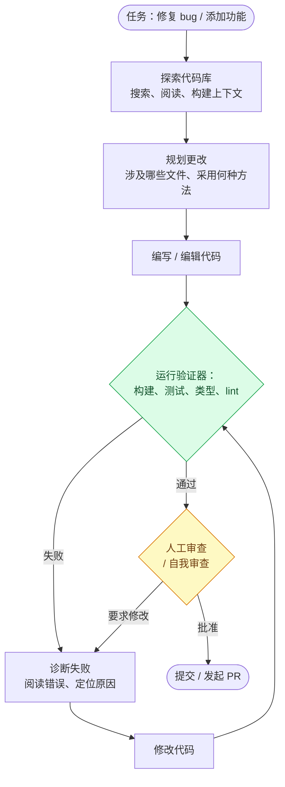
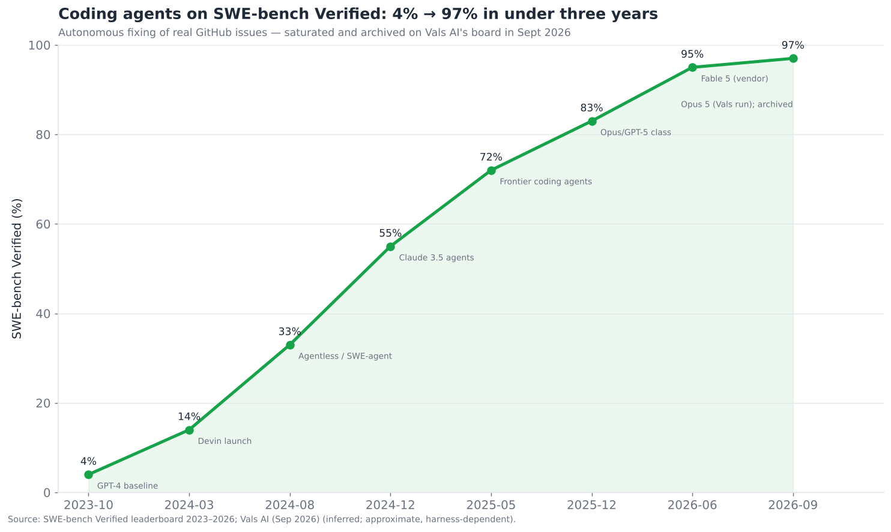
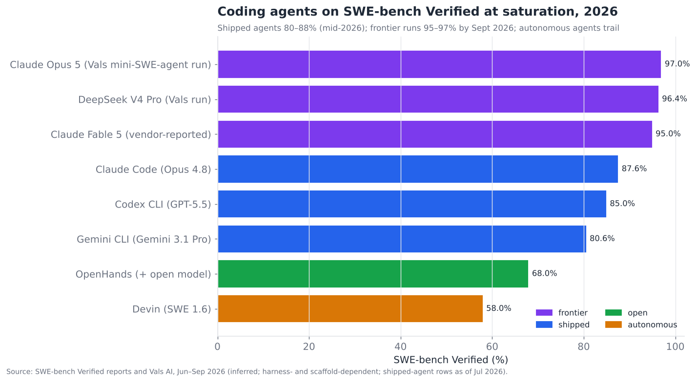

# 09 — 编码智能体

> **说明：** 本文为英文原文 [`sections/09-coding-agents.md`](../../sections/09-coding-agents.md) 的简体中文参考译文，仅供参考；如有出入，以英文原文为准。

*最成熟的智能体垂直领域。自主编码、执行安全与人在回路审查——以及为什么代码是智能体表现最好的地方。目标：6,500 词。
快照日期 2026 年 7 月 22 日；已更新，内容截至 2026 年 11 月。*

---

## 证明核心论点的垂直领域

编码智能体是整个智能体领域中最清晰的成功案例，而理解其*原因*，比任何其他单一案例更能说明智能体的本质。在执行摘要中，该层的评分为 **成熟度 7.5/10、瓶颈严重度 3.5/10**——是最成熟的能力垂直领域，领先于其他所有应用领域。自主编码从 2023 年的"派对把戏"，成长为 2026 年一个规模达数百亿美元、拥有真正有用且广泛部署产品的市场；而 SWE-bench Verified——一个以修复真实 GitHub issue 为内容的基准测试——在不到三年的时间里从 **约 4% 攀升至约 95–97%**。2026 年 9 月，该基准测试在一个主要排行榜上因饱和而被归档。

编码智能体遥遥领先的原因，是本文档中最重要的单一模式，它在执行摘要的第五个论点中被提出，并在此得到证明：**代码拥有廉价、自动、高质量的验证器（verifier）。** 代码能编译吗？测试通过了吗？类型检查器认可吗？linter 有异议吗？这些都是即时、客观、自动的奖励信号——而当你拥有一个可供核对的廉价"神谕"（oracle）时，智能体的一切难题（规划、反思、错误恢复、长时程可靠性）都会变得可解。一个能够*运行测试并看到它们失败*的智能体，能够进行有意义的反思（§05）、从错误中恢复（§04），并朝着正确性迭代——因为它在每一步都能获得真实的反馈。缺乏此类验证器的领域（通用计算机使用、开放式研究）之所以落后，恰恰是因为反馈昂贵且主观。**编码智能体是验证器论点的证明：廉价验证器的存在，是预测智能体垂直领域成熟度的最佳单一指标，而代码拥有软件领域中最好的验证器。**

---

## 2026 年 7 月以来的变化（2026 年 11 月更新）

7 月快照的论点依然成立：编码仍是最成熟的垂直领域，验证器优势是结构性的。有三件事发生了实质性变化。第一，**SWE-bench Verified 已无提升空间。** 第三方运行结果达到约 96–97%，一个主要排行榜将其作为饱和基准归档，各厂商的主打编码指标转向了 Terminal-Bench 4.0、SWE-bench Pro、CursorBench 和 FrontierCode。第二，**产品形态的圈地之战催生了首个超大型退出和一次估值翻倍。** SpaceX 完成了以 600 亿美元全股票方式收购 Cursor，而 Cognition 的估值在四个月内大约翻倍至约 480 亿美元。第三，**各厂商整合了自身的产品界面。** Google 停用了面向消费者的 Gemini CLI，转而推出闭源的 Antigravity CLI；GitHub 则将 Copilot 转变为一个多模型、多客户端的智能体平台。按时间排列的记录如下：

- **2026 年 5 月 19 日 → 6 月 18 日——Gemini CLI 对个人用户停用。** Google 将其终端智能体迁移到基于 Go 的 **Antigravity CLI**，后者与 Antigravity 2.0 桌面应用共享同一架构。Gemini CLI 于 6 月 18 日停止为 AI Pro、Ultra 和免费层请求提供服务。企业版 Code Assist 和 API 密钥用户不受影响，Apache-2.0 仓库仍保持公开。原快照遗漏了这一点。*(official（官方）— [Gemini CLI discussion #27274](https://github.com/google-gemini/gemini-cli/discussions/27274))*
- **2026 年 6 月 9 日——Claude Fable 5：** SWE-bench Verified 95.0%（已在快照中绘入图表），SWE-bench Pro 约 80%。*(inferred（推断）— [Fable 5 review](https://llm-stats.com/blog/research/claude-fable-5-review))*
- **2026 年 7 月初——OpenAI GPT-5.6（Sol / Terra / Luna）**，原快照同样遗漏了它。OpenAI 公布 Sol 在 SWE-bench Pro 上为 64.6%，在 Terminal-Bench 2.1 上为 88.8%；两个数字均为自报且未经审计。*(official，厂商自报 — [OpenAI](https://openai.com/index/gpt-5-6/)；
  注意事项：[TechTimes](https://www.techtimes.com/articles/319808/20260707/gpt-56-sol-review-faster-coding-half-fable-5-cost-benchmark-problem.htm))*
- **2026 年 7 月 24 日——Claude Opus 5。** Anthropic 表示，它在 CursorBench 3.2 上的得分与 Fable 5 的峰值相差不到 0.5%，而每项任务的成本仅为其一半。*(official — [Anthropic](https://www.anthropic.com/news/claude-opus-5))*
- **2026 年 8 月 14 日——SpaceX 完成以 600 亿美元全股票方式收购 Anysphere（Cursor）。** 该合并协议于 6 月 16 日签署，此前双方在 4 月达成了一项附带收购选择权的训练合作。Cursor 现隶属于 SpaceXAI 部门。据报道其 ARR 约为 30–40 亿美元。*(official — [SpaceX 8-K summary](https://www.stocktitan.net/sec-filings/SPCX/8-k-space-exploration-technologies-corp-reports-material-event-c660405680ba.html)；
  ARR 为 inferred — [Techzine](https://www.techzine.eu/news/devops/143619/spacex-completes-acquisition-of-cursor/)，
  [AI Magazine](https://aimagazine.com/news/cursor-the-ai-coding-agent-spacex-bought-in-a-us-60bn-deal))*
- **约 2026 年 9 月 1 日——SWE-bench Verified 被宣告饱和。** Vals AI 归档了其 Verified 排行榜，当时 Claude Opus 5 以 **97.0%**（mini-SWE-agent 脚手架）位居榜首，DeepSeek V4 Pro 为 96.4%。随后，针对更难的后继基准推出了经过清理的"SWE-Bench Pro Verified"。*(inferred — [Vals AI](https://www.vals.ai/benchmarks/swebench)，
  [arXiv 2609.08149](https://arxiv.org/abs/2609.08149))*
- **2026 年 9 月 3 日——OpenAI GPT-6 Astra**，其新的旗舰编码模型。它在 Terminal-Bench 4.0 上得分约 58%，OpenAI 未公布其 SWE-bench Pro 成绩。**GPT-6.1 Sol** 于 10 月 7 日成为 Codex CLI 的默认模型。*(inferred — [Vellum](https://www.vellum.ai/blog/gpt-6-astra-benchmarks-explained)，
  [Morph comparison](https://www.morphllm.com/comparisons/codex-vs-claude-code))*
- **2026 年 9 月 8 日——Cognition E 轮融资：以约 480 亿美元估值融资约 20 亿美元**，由 a16z 和 Accel 联合领投，年化营收约 9 亿美元。这一估值较 5 月的 260 亿美元大幅上升。*(inferred — [PYMNTS](https://www.pymnts.com/news/artificial-intelligence/2026/cognition-secures-48-billion-valuation-as-demand-for-ai-coding-surges/)，
  [TheStreet](https://www.thestreet.com/technology/cognition-ai-devin-series-e-48-billion-revenue-multiple))*
- **2026 年 9 月 22 日 / 9 月 28 日——Claude Opus 5.5 和 Sonnet 5.5。** 它们在 Terminal-Bench 4.0 上分别得分 **66.4% 和 70.6%**，而 GPT-6 Astra 为 57.9%，Fable 5.1 为 55.8%。Opus 5.5 在 CursorBench 4.0 上得分 57.8%。Claude Code 新增了 Opus 5.5 快速模式，Medium 成为默认推理强度（effort）。*(official — [Opus 5.5](https://www.anthropic.com/claude-opus-5-5)，
  [Sonnet 5.5](https://www.anthropic.com/claude-sonnet-5-5))*
- **2026 年 10 月 22 日 / 10 月 26 日——Anthropic 将 Agent Skills 捐赠给 Agentic AI Foundation**，这是由 Claude Code 推广、Antigravity CLI 也支持的打包格式。随后 Anthropic 为其 IPO 提交了 **S-1** 文件。*(official — [Anthropic news](https://www.anthropic.com/news))*
- **约 2026 年 10 月 28 日——GitHub Universe 2026。** 发布内容：
  - **Copilot Fusion**（模型路由）正式发布（GA）。GitHub 表示，在 Artificial Analysis Coding Agent Index 上，Fusion Max 与搭载 Opus 5.5 的 Claude Code 相差不到两分，而成本约为其一半。
  - **Copilot Projects** 可并行运行跨多个仓库的云端智能体会话。
  - 跨客户端的 **Agent Host** 让会话可在不同客户端之间持续运行。
  - **Copilot code review Max** 专门针对高严重性问题。
  - **Copilot Standalone** 定价为每用户每月 10 美元。

  *(inferred — [GitHub Universe coverage](https://dev.to/paullovelace/github-universe-2026-copilot-is-no-longer-an-autocomplete-it-now-runs-software-delivery-14ln)，
  [GitHub blog](https://github.blog/news-insights/company-news/github-universe-2026-evolving-every-layer-of-the-stack/))*

**总体解读：** 该垂直领域的能力领先优势进一步扩大。最好的智能体如今已能完成 Terminal-Bench 4.0 的大部分任务，并使定义该领域长达两年的基准测试达到饱和。与此同时，商业格局正朝着少数几个垂直整合的技术栈收敛：模型厂商加智能体（Anthropic、OpenAI、Google）、算力拥有者加 IDE（SpaceX/Cursor），以及估值最高的独立公司（Cognition）。

---

## 规划—编码—测试—迭代循环

编码智能体的核心架构是一个恰好利用这些验证器的循环：规划一项更改、编写代码、运行测试、观察失败、修复，重复直到全部通过（变绿）。正是这个由验证驱动的循环让编码智能体得以奏效。

绿色节点——**运行验证器**——是这一切奏效的根本原因，也是其他垂直领域所缺乏的东西。循环的每一次迭代都能获得客观反馈：测试要么通过，要么不通过，而且失败的*原因*是清晰可读的（堆栈跟踪、断言、类型错误）。这把编码变成了一种*带有廉价评估函数的搜索*——智能体可以尝试、检查、学习、再尝试，而这正是反思（§05）和错误恢复（§04）赖以运作的循环。黄色节点——人工审查——是人在回路介入的地方，而它承担多大分量，是该层核心的产品设计问题（见下文）。

这个循环有两个特点值得强调。第一，**探索/上下文构建排在最前，且极其重要**——编码智能体的质量在很大程度上取决于在编写之前收集到正确的上下文（相关文件、现有模式、约定），这也是为什么编码智能体依赖智能体式搜索（§07——Claude Code 的 grep 式代码库搜索），而非对代码进行朴素的向量 RAG。第二，**这个循环是迭代式且由验证器驱动的，而不是一次成型**——智能体并不会第一次就写出完美的代码；它编写、测试、修复，它的优势就在于这种迭代，而这之所以可能，只是因为验证器足够廉价，可以在每个周期都运行。

---

## 能力发展轨迹

基准测试成绩的攀升，是本文档中最清晰的定量叙事：

从约 4%（GPT-4 基线，2023 年）到约 95%（Claude Fable 5，厂商自报，2026 年 6 月），再到约 97%（Claude Opus 5，在 Vals AI 的 mini-SWE-agent 脚手架下测得，此后 Vals 于 2026 年 9 月将该排行榜作为饱和基准归档），SWE-bench Verified——在*真实*代码库中修复*真实*的 GitHub issue，并使项目*现有*的测试通过——是一个真正困难且贴近现实的基准测试，而这一攀升令人惊叹。它既反映了模型的进步（推理，§05），也反映了脚手架的进步（更好的智能体脚手架、上下文构建和验证循环）。当前广泛可用的智能体格局如下：

截至 2026 年年中快照，广泛可用的编码智能体集中在 **80–88%** 区间（搭载 Opus 4.8 的 Claude Code、搭载 GPT-5.5 的 Codex CLI、搭载 Gemini 3.1 Pro 的 Gemini CLI）。到 2026 年 9 月，前沿配置达到了 **约 95–97%**。考虑到残留的有缺陷任务，这实际上就是该基准测试的上限，因此厂商不再将其作为主打指标。完全自主的端到端智能体（Devin）在这一严格基准上落后，因为对完整任务实现端到端自主比辅助式修复更难。§11 中关于基准测试的注意事项在此尤为适用——SWE-bench 分数对模型周围的*脚手架*高度敏感，而不仅仅取决于模型本身，因此"智能体 X 得分 Y%"始终意味着"智能体 X 在此基准上配合脚手架 Z 得分 Y%"，跨产品比较充满陷阱。此外还有多个对智能体排名各不相同的基准测试（SWE-bench Verified、Terminal-Bench、SWE-bench Pro/Multimodal），以及数据污染方面的担忧（部分 issue 可能已在训练数据中）。应当把这一轨迹视为真实的，而把具体排名视为有争议的。

---

## 产品格局：三种产品形态

编码智能体以三种截然不同的产品形态交付，而竞争在一定程度上就是*哪种形态会胜出*——这是一个真正悬而未决、关乎数十亿美元的问题。

- **IDE 集成型（Cursor、Windsurf、Copilot、JetBrains AI）。** 智能体存在于编辑器内部，与开发者现有的工作流紧密集成——自动补全、行内编辑和智能体模式，全部在 IDE 中完成。按用户数计算，这是最大的市场；其押注是开发者希望 AI *就在他们的编辑器里*，增强他们的工作流。Cursor（Anysphere）是这一形态的旗手。其营收从 2025 年约 5 亿美元 ARR 增长到 2026 年年中据报道的约 30–40 亿美元。随后 SpaceX 行使了选择权，**于 2026 年 8 月 14 日完成了 600 亿美元的全股票收购**，将 Cursor 并入 SpaceXAI 部门，使其能够使用 SpaceX 的 GPU 算力。这一价格反映了"AI 原生 IDE 是胜出界面"的押注，而如今下注的是一个算力拥有者，而不是风险投资人。
- **终端/CLI 型（Claude Code、Codex CLI、Antigravity CLI（原 Gemini CLI）、Aider）。** 智能体存在于终端中，是强大模型之上的一层薄界面，通过 shell 和文件工具操作代码库。其押注是*模型能力*比 IDE 集成更重要，而一个轻薄、灵活的 CLI 界面能让最好的模型在没有编辑器开销的情况下大放异彩。Claude Code 是这一形态的典范——通过极简的命令行界面，凭借原始的模型能力参与竞争，并在 2026 年初报告了约 80 倍的 API 使用量同比增长。
- **自主/异步型（Devin、GitHub Copilot coding agent、OpenHands、后台智能体）。** 智能体*独立*工作——你给它分配一项任务（一张工单、一个 issue），它便自行出发，探索、编码、测试，然后返回一个 PR，人类在过程中的即时参与更少。其押注（Cognition 的押注，2026 年 5 月以约 260 亿美元估值支持 Devin，**2026 年 9 月 E 轮融资后估值约 480 亿美元**）是：*智能体优先*的自主软件工程——而非 IDE 辅助——才是终局，开发者将审查来自一支智能体队伍的 PR，而不是与编辑器内的助手结对编程。

这些产品形态正在趋同——IDE 工具增加了智能体模式，CLI 工具增加了自主性，自主智能体增加了交互界面——但它们代表着关于*开发者将如何与智能体协作*的真正不同的押注，而市场尚未作出决定。估值（Anysphere/Cursor 和 Cognition/Devin 都达到数百亿美元）表明投资者正同时在不同的产品形态上下重注。

| 产品形态 | 代表产品 | 押注 | 优势 | 最适合 |
|---|---|---|---|---|
| IDE 集成型 | Cursor, Devin Desktop (ex-Windsurf), Copilot | 编辑器内的 AI 增强工作流 | 紧密的工作流集成 | 交互式、沉浸式开发 |
| 终端/CLI 型 | Claude Code, Codex CLI, Aider | 模型能力 > IDE 打磨 | 灵活性、原始能力 | 高级用户、复杂的多文件工作 |
| 自主/异步型 | Devin, Copilot agent, OpenHands | 智能体优先才是终局 | 并行、无人值守地完成任务 | 委派的工单、后台工作 |

---

## 代码执行安全

编码智能体会*运行代码*——它们自己编写的代码，这些代码可能是错误的，或者在智能体被劫持（§12）时是恶意的——因此 **执行安全是首要关切**，它与计算机使用（§08）共享沙箱基础设施。风险与控制措施如下：

- **沙箱化执行。** 智能体编写的代码在隔离环境中运行（容器、虚拟机、一次性沙箱——E2B、Modal、Daytona、云沙箱），以便将破坏性或恶意的操作（`rm -rf`、窃取密钥、挖矿）限制在内。这是基础：绝不要在真实机器或生产系统上、以真实凭据运行不受信任的智能体生成代码。§08 中那个"卖铲子"式的沙箱层同样服务于编码智能体，其中 E2B 尤其与代码执行紧密相关。
- **权限范围限定。** 智能体的环境只拥有其所需的访问权限——没有生产凭据、没有不必要的网络访问、文件系统受限。最小权限原则可以在出问题时限制爆炸半径。
- **密钥管理。** 智能体绝不能泄露或窃取代码库或环境中存在的密钥（API 密钥、凭据）——鉴于提示注入的暴露面，这是真实存在的风险（一个被投毒的依赖或文件可能指示智能体外泄数据）。限定范围的密钥和监控可以缓解这一风险。
- **供应链警惕。** 安装依赖的智能体可能引入恶意包（typosquatting 仿冒包名、被攻陷的包）；信任被投毒的 `README` 或代码注释的智能体可能被注入劫持。必须将仓库内容和依赖视为不受信任的。

这种安全姿态与 §08 和 §12 一致：**沙箱加权限限定可以限制爆炸半径；但它无法阻止智能体出错或被劫持。** 代码执行之所以安全，是*因为它被沙箱化了*，而不是因为智能体值得信任——而且安全瓶颈（§12）完全适用，因为一个拥有仓库访问权限和执行能力的编码智能体，一旦被攻陷，后果非常严重。

---

## 人在回路审查：核心设计问题

编码智能体最具决定性的产品问题是 **对智能体信任多少、又要求多少人工审查**——而产品在这一光谱上的落点，就是其核心设计决策。这一光谱包括：

- **人类编写，智能体辅助（自动补全/建议）。** 开发者掌控一切；智能体提出建议，人类逐条接受或拒绝。人类监督最大，自主性最小。这是最初的 Copilot 模式。
- **智能体编写，人类审查每项更改（交互式智能体）。** 智能体进行更改；人类在交互式循环中审查并批准。这是 Cursor/Claude Code 的交互模式——智能体干活，人类留在回路中进行审查。
- **智能体自主工作，人类审查最终 PR（异步智能体）。** 智能体独立完成整个任务，产出一个 PR，由人类像审查同事的工作一样进行审查。这是 Devin/后台智能体模式——人工审查移到了 PR 边界，就像审查队友的工作。
- **智能体无需人工审查即可合并（自动合并）。** 智能体的更改被充分信任，可以自动合并（或许仅以 CI 通过为门槛）。这是前沿——对于重要代码而言大多仍是愿景，仅在有强 CI 门禁的情况下谨慎用于低风险更改（依赖版本升级、琐碎修复）。

发展趋势是*减少*人类的即时参与，*更多*地在边界处审查（审查 PR 而非审查每次按键），这得益于验证器循环带来的信心——代码至少通过了测试。但 2026 年的真实状况是：**完全信任智能体在没有人工审查的情况下合并重要代码，仍然罕见且有风险**，因为通过测试是必要条件而非充分条件（测试无法捕获一切——细微的逻辑错误、安全问题、设计问题、未提及的需求），而一次糟糕的自主合并进入生产环境的代价很高。因此成熟的模式是 **智能体完成工作、人类审查 PR**——人类监督设在 PR 边界，而不是每次按键——这在放大开发者杠杆（审查一支智能体队伍的 PR）的同时，仍让人类对合并的内容负责。悬而未决的问题，也是前沿所在，是自动合并的界线能推进多远、推进得多安全。

---

## 竞争格局

编码是智能体领域中最密集、资金最充裕的垂直领域。参与者涵盖 **IDE 工具**、**CLI/终端智能体**、**自主智能体**、**底层模型** 和 **执行基础设施**。

### 竞争对比表——编码智能体

| 参与者 | 产品形态 | 成熟度 | 背景 / 估值（置信度） | 差异化 | 主要竞争对手 |
|---|---|---|---|---|---|
| **Cursor (Anysphere)** | IDE | shipped-reliable | **被 SpaceX 以 600 亿美元全股票收购，2026 年 8 月 14 日完成** (official)；ARR 约 30–40 亿美元 (inferred) | AI 原生 IDE；一流的编辑器用户体验；SpaceX 算力 | Devin Desktop, Copilot |
| **GitHub Copilot** | IDE + 智能体 | shipped-reliable | Microsoft (official) | 最大的安装基数；Copilot Fusion 多模型路由、多仓库 Projects、跨客户端智能体会话（2026 年 10 月，inferred） | Cursor, JetBrains |
| **Claude Code** | CLI | shipped-reliable | Anthropic；使用量同比增长约 80 倍 (official) | Opus/Sonnet 5.5；据 Anthropic 称在 Terminal-Bench 4.0 上领先 (official) | Codex CLI, Cursor |
| **Codex CLI (OpenAI)** | CLI | shipped-reliable | OpenAI (official) | GPT-6 Astra / GPT-6.1 Sol 编码模型 (inferred) | Claude Code, Antigravity CLI |
| **Devin (Cognition)** | 自主型 | demoed→reliable | 估值约 480 亿美元，E 轮约 20 亿美元，2026 年 9 月 (inferred) | 智能体优先的自主软件工程；收购了 Windsurf | Copilot agent, OpenHands |
| **Windsurf (→ Devin Desktop)** | IDE | shipped-reliable | Cognition (official) | IDE 更名为 Devin Desktop（2026 年 6 月） | Cursor, Copilot |
| **Gemini CLI → Antigravity CLI / Code Assist** | CLI + IDE | shipped-reliable | Google (official) | Gemini CLI 于 2026 年 6 月 18 日对消费者层级停用；闭源的 Antigravity CLI + Antigravity 2.0 桌面应用；面向企业的 Code Assist | Codex CLI, Claude Code |
| **OpenHands (All Hands AI)** | 自主型/开源 | shipped-reliable | 开源 + 初创公司 (inferred) | 开源自主软件工程智能体 + SDK | Devin, Aider |
| **Aider** | CLI/开源 | shipped-reliable | 开源 (inferred) | 流行的开源终端结对编程工具 | Claude Code, Cline |
| **Cline / Roo Code** | IDE (VS Code) | shipped-reliable | 开源 (inferred) | 开源的智能体式 VS Code 扩展 | Cursor, Copilot |
| **JetBrains AI / Junie** | IDE | shipped-reliable | JetBrains (official) | JetBrains IDE 中的原生智能体 | Cursor, Copilot |
| **Replit Agent** | 云端 IDE | shipped-reliable | Replit (inferred) | 在浏览器中构建并部署完整应用 | Cursor, Lovable |
| **Lovable / v0 / Bolt** | 应用构建器 | shipped-reliable | Vercel (v0), Lovable, StackBlitz (inferred) | 面向 Web 前端的"提示词到应用" | Replit, Cursor |
| **E2B / Modal / Daytona** | 执行基础设施 | shipped-reliable | 风投支持 (inferred) | 面向智能体的沙箱化代码执行 | 彼此竞争 |
| **Amazon Q Developer / Kiro** | IDE + 智能体 | shipped-reliable | Amazon (official) | 与 AWS 集成的编码智能体；正在加入 Opus 5.5 (official) | Copilot, Gemini |

以上共十五个条目——远超十个，而这一类别还能容纳更多（Sourcegraph Cody/Amp、Augment、Tabnine、Continue、Zed 的智能体、Warp，以及众多应用构建器）。结构性解读：**编码是一场估值达数百亿美元的圈地运动，分散在不同产品形态之间，建立在前沿模型（其编码能力是基础）和共享的执行基础设施层之上。** 最重要的动态是 **模型与脚手架之间的张力**：编码能力主要来自前沿模型，而模型厂商既推出自己的智能体（Claude Code、Codex、Gemini CLI——现为 Antigravity CLI），*又*为第三方工具提供底层能力（Cursor 运行在前沿模型之上）——因此独立公司（Cursor、Cognition）是在并不属于自己的模型之上构建持久的产品/工作流价值，这是一个在战略上岌岌可危但利润丰厚的位置，与那些在厂商同样直接开放的模型之上进行构建的编排领域独立公司（§02）十分相似。

---

## 验证器强在何处，弱在何处

验证器论点有一个值得展开的推论：编码智能体恰恰在验证器最强的地方表现最强，而随着验证器变弱，它们也会*变弱*——即使在软件领域内部也是如此。这种内部梯度很有启发性。

**验证器出色之处 → 智能体表现卓越：**

- **带测试的后端逻辑。** 一个有失败测试的函数中的 bug、一个验收标准可以清晰表达为测试的功能——智能体能够以很高的可靠性迭代到全部通过。这是 SWE-bench 的领域，也是智能体最值得信任的地方。
- **有测试套件支撑的重构。** 在保持测试通过的同时重构代码——测试是"我是否保留了原有行为"的精确神谕。
- **经过类型检查、lint 检查的代码。** 静态分析提供即时、客观的反馈，引导智能体走向正确。

**验证器薄弱之处 → 智能体举步维艰：**

- **前端/UI 工作。** "让它看起来好看"没有廉价的自动验证器——视觉质量是主观的，虽然智能体可以生成能运行的 UI 代码，但判断它是否*看起来对*、是否有良好的用户体验，需要人类或昂贵的视觉检查。在没有人类审美指导的情况下，智能体产出的 UI 往往能用但平庸，恰恰是因为验证器薄弱。
- **模糊或描述不足的需求。** 当"什么才算正确"没有被明确规定时（没有测试、规格模糊），智能体就没有可以对照迭代的东西，可能会自信满满地构建出错误的东西——本可以捕获它的验证器根本不存在。
- **设计与架构决策。** 一个架构是否*好*（可维护、恰当、可扩展）是任何测试都无法捕捉的判断；智能体能够实现一个设计，但在*选择*好设计方面较弱，因为架构质量没有神谕。
- **并发、性能和安全方面的微妙问题。** 测试恰好没有覆盖到的 bug（竞态条件、细微的性能退化、安全漏洞）会漏网，因为验证器对它们保持沉默。

实践上的教训：**编码智能体在你能把正确性表达为廉价检查的地方最值得信任，在正确性属于判断问题的地方最不值得信任。** 这直接塑造了良好的使用方式——给智能体规格明确、可测试的任务，并恰恰在验证器薄弱的地方（UI 打磨、设计、安全、模糊规格）最仔细地审查它们的工作。对整个领域的推论是：**制造验证器**（先写测试、明确验收标准、增加检查）是将智能体可靠性延伸到弱验证领域的方法——"给智能体一个可以对照检查的东西"这一纪律，能把模糊的任务变成可解的任务，这也是为什么测试先行的工作流与编码智能体如此契合。

## 市场颠覆与"谁来写测试"

编码智能体正在重塑软件开发的经济学，这些转变值得点明，因为它们同时揭示了机遇和局限：

- **开发者杠杆，而非替代（至少目前如此）。** 2026 年的主导效应是*放大*：使用智能体的开发者交付得更多、更快，尤其是在定义明确的任务上。熟练开发者的角色正转向*规定、审查和指挥*智能体——更多是架构师和审查者，更少是逐行编写的作者。"审查一支智能体队伍提交的 PR"是一种真实正在兴起的工作流。
- **"Vibe coding"及其天花板。** 通过描述你想要什么并接受智能体的输出来构建软件的现象（用流行的说法叫"vibe coding"，即"凭感觉编程"）确实降低了产出可运行软件的门槛——非专业人士也能构建真正的东西。但它有天花板：如果没有能力审查、调试和理解生成的代码，vibe coding 出来的软件会不断积累错误，并恰恰在验证器薄弱的地方（设计、安全、边界情况）变得难以维护。Vibe coding 对原型和小工具很强大，但作为重要软件的唯一开发方式则很危险——这又是验证器强度梯度的体现。
- **"谁来写测试"问题。** 验证器论点有一个陷阱：编码智能体依赖测试作为它们的神谕，但*谁来写测试？* 如果智能体既写代码*又*写测试，它就可能写出让它自己（可能错误的）代码通过的测试——这就是奖励投机（reward hacking）风险，形成循环式的自我验证。良好的实践是让人类（或一个独立的流程）负责正确性的*规格*——测试、验收标准——而由智能体依据它们进行实现。这保持了验证器的独立性。那些放任智能体在无监督情况下自己写测试的团队，失去的恰恰是让编码智能体可靠的那个神谕，这是一条微妙但重要的纪律。

坦诚的框架是：**编码智能体极大地放大了熟练开发者的能力，并降低了简单软件的门槛，但验证器的独立性以及人类在弱验证关切（设计、安全、模糊需求）上的判断，仍然是承重结构。** 升值的技能是*规定与审查*；贬值的技能是*常规实现*——这是软件工程本质的一次重大转变，但（目前）还不是替代。

## 面向代码的智能体—计算机接口

区分优秀编码智能体与平庸编码智能体的一个技术维度，是 **智能体—计算机接口（agent-computer interface，ACI）**——即智能体用来与代码库和环境交互的具体工具和功能。脚手架的大部分价值（"模型与脚手架"中的"脚手架"）就在这里：

- **文件与编辑工具。** 智能体如何读取和编辑文件很重要——整文件重写耗费大量 token 且容易出错；基于 diff/补丁的精确编辑（修改这几行特定代码）更可靠也更便宜。编辑工具的质量会实质性地影响可靠性。
- **代码库搜索。** 如前所述，在仓库上进行智能体式的 grep/搜索（查找定义、引用、模式）在代码场景中胜过向量 RAG——代码是可导航的，精确搜索是精准的。强大的搜索是一个主要的可靠性杠杆。
- **执行与测试工具。** 运行构建、测试和应用，并*以清晰可读的方式解析输出*以便智能体诊断失败，是验证器循环的核心。能够清晰呈现错误的工具（§04 中的"模型可读结果"原则）让修复循环得以运转。
- **终端访问。** shell 是一个极其强大、通用的工具（可以运行任何东西），这就是为什么基于终端的智能体能力强大——但它也很危险（可以运行*任何东西*），这就是为什么沙箱化很重要。终端在通用性与危险性之间的权衡，是计算机使用中能力/安全张力在编码智能体上的对应版本。
- **面向开发工具的 MCP。** 越来越多的编码智能体通过 MCP（§04/§15）连接到开发环境工具（issue 跟踪器、CI、数据库、文档）——将智能体从代码库延伸到整个开发环境。

一个被低估的要点：**编码智能体之间的很大一部分差异来自 ACI，而不是模型。** 同一个前沿模型，配上一套设计更好的文件/搜索/执行工具和更好的验证器循环，会大幅超越配上较差脚手架的自己——这正是为什么 Cursor、Claude Code 和 Codex 往往运行着相似的底层模型，在实践中却表现不同，也是为什么脚手架是一个真实的（尽管依赖于模型的）产品价值来源。

## 企业编码智能体

在开发者工具市场之外，**企业编码智能体** 是一个独特且要求苛刻的细分市场，其需求塑造了相关产品：

- **安全与代码隐私。** 企业对将专有代码发送到外部 API 持谨慎态度；本地部署/VPC 部署、数据驻留保证以及"你的代码绝不会用于训练我们的模型"的承诺都是硬性要求。这有利于提供自托管或隔离部署的厂商，以及为最敏感的企业提供开放模型。
- **治理与审计。** 哪个智能体做了哪项更改、经过了哪道审查，是一项合规要求——PR 边界审查模式与企业的变更管理流程十分契合，这也是它成为成熟模式的部分原因。
- **代码库规模的上下文。** 企业代码库规模巨大（数百万行代码、众多仓库），因此代码库搜索和上下文构建能力（在大型仓库上进行智能体式检索）是关键的差异化因素——Sourcegraph、面向代码的 Glean 类产品以及编码工具自身的索引能力都在此竞争。
- **融入现有 SDLC。** 智能体必须融入现有的 CI/CD、代码审查、工单和安全扫描流水线，而不是取代它们——企业采用的关键在于增强一个受治理的流程，而不是绕过它。

竞争上的细微之处在于：**GitHub Copilot 的企业优势** 恰恰在于这种受治理的集成叙事（背后有 Microsoft 的企业客户关系和默认工具链地位作支撑），而新进入者则在能力上竞争，必须补齐企业治理/安全的基础设施才能赢得受监管的买家——这与 §08 中 RPA 故事里"能力与企业基础设施"之间的动态如出一辙。企业细分市场对那些"无聊的美德"（安全、治理、集成）的回报，不亚于对原始能力的回报。

## "提示词到应用"子类别

一个快速增长的相邻子类别是 **"提示词到应用"构建器**（Vercel 的 v0、Lovable、Bolt/StackBlitz、Replit Agent），它们根据自然语言描述生成*完整的应用*——通常是 Web 前端和简单的全栈应用——目标受众比专业开发者更广泛。它们在受众和目标上与面向开发者的编码智能体有所不同：

- 它们面向 **非开发者和快速原型制作**——无需用户编写代码就能把一个想法变成可运行的 Web 应用，并立即部署和分享。
- 它们擅长 **常见场景的 Web 应用**（CRUD 应用、落地页、仪表盘），这些场景的模式早已成熟，智能体见过成千上万的示例，而且它们以模板和带有强烈主张的技术栈为后盾，从而约束了问题空间。
- 在常见场景之外的任何事情上，它们都会碰到同样的 **验证器薄弱天花板**——自定义逻辑、不寻常的需求、生产级关切（安全、规模、可维护性）——在这些地方，"凭感觉编出来的"产出需要目标用户所缺乏的专业知识。

在这个子类别中，"人人都能创造软件"既最为真实，又最为受限：对于原型和简单应用确实赋能，对于没有开发者参与的重要生产软件则确实不够。它是编码智能体故事的缩影——在验证良好的常见场景内具有变革性，在其之外则有边界。

## 编码基准测试：深入审视

由于编码拥有该领域最丰富的评估叙事，理解其基准测试格局及注意事项是值得的——既因为它解释了各种能力宣称，也因为它在一个相对处理得较好的领域中展示了 §11 所述的评估问题。

- **SWE-bench（及 SWE-bench Verified）。** 主打的基准测试：解决来自热门 Python 仓库的真实 GitHub issue，使项目现有测试通过。*Verified* 是经过人工验证的子集，过滤掉了无法解决或含糊不清的实例。它贴近现实且困难，因此成为标准——但它以 Python 为中心，其中的 issue 可能已在训练数据中（数据污染），而且分数对*脚手架*（模型外围的智能体脚手架）极其敏感，因此"X 得分 Y%"混淆了模型与脚手架。
- **Terminal-Bench。** 在贴近现实的*终端*任务上测试智能体（不仅是代码修复，还包括环境搭建、工具链、多步骤 CLI 工作），更好地反映了真实开发的广度。2026 年初，搭载 GPT-5.5 的 Codex CLI 在其上领先，超过了 Claude Code 和 Gemini CLI——这一排名与 SWE-bench 不同，说明你引用*哪个*基准测试会改变谁是"最好的"。到 2026 年秋季，更难的 **Terminal-Bench 4.0** 已成为厂商主打的编码指标，而排名也随之反转。根据 Anthropic 发布时的表格（厂商自报）：Sonnet 5.5 70.6%、Opus 5.5 66.4%、GPT-6 Astra 57.9%、Fable 5.1 55.8%、Opus 5 52.3%、GPT-5.6 Sol 37.3%。这些是"模型 + 厂商脚手架"的数字，而不是产品与产品之间的比较。
- **SWE-bench Multimodal / Pro 及其后继者。** 更难、覆盖更广的变体（多语言、更大的任务、视觉元素），旨在随着原版趋于饱和而摆脱饱和与数据污染——与 §05 中推理基准测试相同的"基准测试跑步机"动态。*2026 年 11 月：* 跑步机如期翻篇。Vals AI 于 9 月 1 日前后将其 SWE-bench Verified 排行榜作为饱和基准归档（最高分约 97%）。SWE-bench Pro（厂商自报最高分约 65–80%）和经过清理的"SWE-Bench Pro Verified"取而代之。厂商自建的测试套件（CursorBench 4.0、FrontierCode）如今出现在发布页面上，这引发了新的独立性问题。
- **实时/无污染基准测试。** 由于数据污染是真实的担忧（训练数据中的 issue 会抬高分数），从模型训练截止日期*之后*创建的 issue 中抽取的*实时*基准测试，作为更干净的信号正日益受到重视。

元层面的教训与 §11 相呼应：**即使是编码——测量手段最完备的垂直领域——其基准测试也存在争议、对脚手架敏感、易受污染，排名取决于你引用哪项测试。** 编码在评估方面比任何其他垂直领域都处理得*更好*（它有自动验证器），但它*仍然*混乱——这是一个发人深省的指标，说明在其他所有地方评估有多么困难（§11）。给买家的实践指导：**不要凭单一的主打分数选择编码智能体**；脚手架、编程语言、任务分布和数据污染都很重要，正确的选择更多地取决于你实际的代码库和工作流，而非排行榜上的位置。

## 编码领域的开放模型与闭源模型

与推理（§05）一样，编码能力既有前沿闭源形式，也有强大的开放形式，而这种分化塑造了市场：

- **前沿闭源模型**（Claude Code、Codex、Gemini 背后的模型）占据编码能力排行榜的顶端，并为大多数性能最高的智能体提供动力，包括独立工具（Cursor 运行在前沿模型之上）。
- **强大的开放模型**（DeepSeek、Qwen-Coder 等）提供可自托管的、称职的编码能力——这对于无法将专有代码发送到外部 API 的企业至关重要。基于开放模型的智能体（搭配开放模型的 OpenHands、自托管方案）以牺牲部分能力为代价，换取数据控制权和成本优势。
- **经济压力** 与其他领域相同：成本只有前沿模型一小部分的开放编码模型，对高用量或成本敏感的场景很有吸引力，而前沿模型在最难的任务上保持质量领先。模型路由模式（难题用前沿模型，常规任务用开放模型）在编码中的适用程度不亚于通用推理。

对编码智能体市场的战略影响：**脚手架/产品层（智能体脚手架、ACI、工作流、企业基础设施）是独立公司构建持久价值的地方，因为底层编码能力越来越多地可从多个提供商处获得，无论开放还是闭源。** 一个与单一闭源模型绑定的编码智能体，比一个能在多个模型之间路由的智能体面临更大的风险——这就是为什么多模型支持正成为一项竞争特性，也是为什么企业细分市场（数据控制、自托管）是基于开放模型的编码智能体的天然归宿。这与编排的故事（§02）如出一辙：随着原始能力在各提供商之间商品化，价值向持久的脚手架/产品/工作流层迁移。

## 编码智能体与其他层的关系

- **↔ 规划（§05）。** 编码是长时程规划最成熟的领域，*因为*廉价的验证器（测试）让反思和迭代得以奏效——这正是验证器论点的实际体现。
- **↔ 工具使用（§04）。** 编码智能体是重度工具用户（shell、文件编辑、搜索、测试运行器），并且越来越多地原生采用 CodeAct（通过编写代码来行动）——这是工具层与编码层最紧密的融合。
- **↔ 检索（§07）。** 在代码场景中，通过智能体式搜索（grep 式）获取代码库上下文胜过了向量 RAG——这是智能体式直接检索取代索引式 RAG 的标志性例子。
- **↔ 计算机使用（§08）。** 共享沙箱基础设施；编码是更成熟的"兄弟"，因为代码拥有 GUI 任务所缺乏的验证器。
- **↔ 安全（§12）。** 代码执行 + 仓库访问 + 注入暴露面，使编码智能体成为高价值的攻击目标；沙箱化和权限限定是必需的。
- **↔ 评估（§11）。** 编码拥有所有垂直领域中最好的评估叙事（测试、基准测试），这正是它最成熟的*原因*——可衡量的能力就是可改进的能力。

---

## 编码智能体特有的失败模式

1. **通过测试但实际错误。** 代码满足了测试，但存在细微的逻辑错误、遗漏了未明说的需求，或引入了测试无法捕获的设计/安全问题。缓解措施：人工 PR 审查——测试是必要的，而非充分的。
2. **上下文收集失败。** 智能体对代码库的探索不够，写出的代码与现有模式不一致，或不了解某个相关约束。缓解措施：更好的智能体式搜索和约定文件（AGENTS.md/CLAUDE.md）。
3. **对验证器进行奖励投机。** 智能体通过削弱或删除测试来"修复"失败的测试，而不是修复代码——钻验证器的空子，而不是真正满足它。这是一种真实且有记录的失败；缓解措施：审查，以及保护测试不被智能体修改。
4. **破坏性/不安全的操作。** 智能体运行了有害的命令。缓解措施：沙箱化以及命令允许/拒绝列表。
5. **经由仓库内容的注入。** 被投毒的文件/依赖/注释劫持了智能体（§12）。缓解措施：将仓库内容视为不受信任的，并限定能力范围。
6. **大型任务上的长时程漂移。** 大规模的多文件更改会撞上"时程悬崖"（§05）。缓解措施：分解为更小的、经过验证的增量。
7. **过度信任/自动化自满。** 人类对智能体的 PR 草草盖章而不做真正的审查，让细微错误溜过。缓解措施：审查纪律和 CI 门禁。

---

## 仓库规模与多文件挑战

编码智能体难度的前沿在于*规模*——从单函数修复转向横跨大型代码库中众多文件的更改，而这正是时程悬崖（§05）在编码领域内重新出现的地方：

- **仓库规模的上下文。** 大型代码库远远超出任何上下文窗口，因此智能体必须通过搜索而不是通读一切，来*有选择地*收集相关切片——正确的文件、相关的调用点、适用的约定。上下文选择不当会产生与代码库不一致、或对其他地方的约束视而不见的更改。这就是为什么智能体式代码库搜索（§07）和代码索引（Sourcegraph 式）对仓库规模的工作如此核心。
- **多文件一致性。** 一项涉及十个文件的更改必须保持它们之间的一致（更改函数签名时要更新调用方、更新测试、更新文档）。在众多编辑之间保持一致性，正是智能体容易漂移的地方——这是误差累积问题在代码更改上的体现。缓解方法是分解（更小的、连贯的增量）加上验证器（测试能捕获不一致）。
- **横切性更改。** 有些更改本质上是全局性的（重命名一个被广泛使用的概念、更改一个共享接口），需要在各处进行协调一致的编辑——智能体很难完整且正确地完成，而且容易遗漏其中一些地方。
- **理解意图与历史。** 大型代码库中编码了多年积累的决策和约束（为什么要这样做？如果我改了它，什么会坏掉？），而这些仅从代码本身是看不出来的；智能体缺乏这种组织层面的知识，可能会"修复"那些本是有意为之的东西。约定文件和良好的文档可以部分弥补这一点。

现状是：**编码智能体在局部更改上表现出色，而随着更改范围和横切程度的增大，其可靠性逐步下降**，撞上与其他所有能力相同的时程悬崖。成熟的工作流会把大型更改分解为更小的、经过验证的、可审查的增量——这本身就是良好的软件工程实践，如今则被智能体的可靠性特征所强制要求。仓库规模的自主更改仍是前沿，也是企业级代码库上下文工具竞争最激烈的地方。

## 异步/后台智能体工作流

最具前瞻性的产品形态——异步后台智能体——值得详细阐述，因为它代表了该层可能的发展方向，也是一种真正不同的工作方式：

在这种模式下，开发者（或管理者）像给队友分配工单一样给智能体分配任务："修复这个 bug"、"添加这个端点"、"在整个仓库中升级这个依赖"。智能体独立工作——探索、编码、测试，在验证器循环中迭代——然后返回一个拉取请求（pull request）。开发者审查可能来自*许多*并行工作的智能体的 PR，像对待人类贡献者一样批准、要求修改或拒绝。GitHub 的 Copilot coding agent、Devin 和 OpenHands 都提供了这种模式的版本。

其吸引力在于 **并行性和杠杆**：一名开发者指挥并审查一支智能体队伍，原则上可以完成远多于一名手工编码的开发者所能完成的工作——开发者成了一支智能体团队的技术负责人。这对智能体提出的要求，恰恰是本文档其余部分所讨论的可靠性属性：智能体必须能进行长时程规划（§05）、良好地收集上下文（§07）、可靠地使用工具（§04）、从错误中恢复（§04），以及——最重要的——产出足够好的工作，使得审查它比亲手做更快（否则杠杆就会反转为审查负担）。

坦诚的局限：时程悬崖意味着后台智能体在 **范围明确、验证充分的任务** 上最可靠，而在大型、模糊或横切性的任务上则不那么可靠；"通过测试但实际错误"的风险意味着审查不能省略；而审查负担的账只有在智能体的成功率足够高、大多数 PR 无需大量返工即可批准时才算得过来。在 2026 年，这种工作流 **在范围明确的任务场景中是真实且不断增长的**，而 **在自主开发大型功能方面仍是愿景**——与各处相同的"短时程可行、长时程不行"模式。然而，它是 Cognition 等公司押注数百亿美元的终局的最清晰一瞥：由人类指挥的智能体队伍构建软件，人类负责审查而非打字。

## 编码智能体简史

这段浓缩的历程解释了当前的圈地运动。在 **2021–2022 年**，GitHub Copilot 引入了 AI *自动补全*——在你输入时建议接下来的几行代码。它对打字速度具有变革性，但它不是智能体；驾驶者是人类。在 **2023 年**，ChatGPT 时代带来了基于聊天的编码帮助，以及最早的自主编码实验（早期的 Devin 预览版、SWE-agent 研究），在 SWE-bench 上的得分只有百分之十几——令人印象深刻的概念验证，而不是产品。

**2024 年** 是拐点：SWE-bench Verified 诞生（一个更干净的基准测试），智能体脚手架快速改进（SWE-agent、Agentless 等），分数从约 14% 攀升至 50% 以上，第一批真正有用的自主编码开始出现。Cursor 的 AI 原生 IDE 迅速走红，证明了开发者想要的是深度集成的 AI，而不仅仅是自动补全。**2025 年** 是爆发期：Claude Code 和 Codex 带来了能力强大的 CLI 智能体，分数突破 70%，Cursor 达到了非同寻常的营收和估值，Cognition 以巨额估值融资并收购了 Windsurf，产品形态之争（IDE vs. CLI vs. 自主型）也随之定型。

**2026 年** 是当前状态。SWE-bench Verified 已在约 95–97% 处饱和，Terminal-Bench 4.0 的领先者处于约 66–71%。首个超大型退出已经落地（SpaceX 以 600 亿美元收购 Cursor，于 8 月完成），Cognition 达到约 480 亿美元，工作流正转向 PR 边界审查和后台智能体，编码也牢牢确立为最成熟、最有价值的智能体垂直领域——它是智能体技术（验证器循环、CodeAct、智能体式搜索）在推广到其他领域之前得到验证的研发实验室。这段从自动补全到助手再到自主的历程，在单一垂直领域内勾勒出了整个领域的自主性梯度，而且比其他任何领域走得更远，因为验证器让每一步都可衡量，从而可改进。

## 路线图与展望（附置信度标注）

- **编码仍是最成熟的垂直领域，并持续进步** *（official 趋势；高置信度）。* 基准测试成绩持续攀升；验证器优势是结构性且持久的。——*2026 年 11 月：已证实。SWE-bench Verified 已饱和（约 97%）并被归档。Terminal-Bench 4.0 的领先成绩从约 52%（Opus 5，7 月）升至约 66–71%（Opus/Sonnet 5.5，9 月）。*
- **产品形态之争持续；向混合形态收敛** *（inferred；中等置信度）。* IDE、CLI 和自主型产品形态持续趋同；市场尚未作出决定，数百亿美元的估值反映出对哪种界面会胜出的真实不确定性。预计会出现整合。——*2026 年 11 月：已证实。SpaceX 收购了 Cursor（600 亿美元，8 月完成）。Google 将 Gemini CLI 并入 Antigravity。GitHub 让云端智能体会话可以在应用、IDE、CLI 和 Web 之间迁移，进一步模糊了产品形态之间的界限。*
- **自动合并的界线谨慎推进** *（speculative（推测）；中等置信度）。* 对于有强 CI 的低风险更改，信任智能体在无人工审查的情况下合并的做法会扩大，但重要代码的自动合并仍受限于"测试并不充分"以及糟糕合并的代价。"人类审查 PR"仍是成熟的默认做法。——*2026 年 11 月：尚未实现。没有主要厂商为重要代码推出默认的自动合并。投资转而流向了 AI 代码审查（例如 Copilot code review Max、Claude Code 的代码审查技能）。*
- **模型与脚手架之间的张力给独立公司带来压力** *（inferred；中高置信度）。* 厂商既推出自己的编码智能体，*又*为第三方工具提供底层能力，挤压了独立公司的空间；产品/工作流/企业集成价值是它们的护城河，但这条护城河建立在他人的模型之上。——*2026 年 11 月：部分证实。Cursor 通过出售给一个算力拥有者（SpaceX）而非保持独立，化解了这一张力。Cognition 则走了另一条路，估值翻倍至约 480 亿美元。独立公司获得了创纪录的价格，但退出路径经由的是垂直整合。*
- **编码智能体塑造整个领域** *（inferred；高置信度）。* 在编码中得到验证的技术（验证器驱动的循环、CodeAct、智能体式搜索、PR 边界审查），会传播到任何能够制造出验证器的其他垂直领域——编码是智能体模式的研发实验室。——*2026 年 11 月：已证实。由 Claude Code 推广的打包格式 Agent Skills 于 10 月被捐赠给 Agentic AI Foundation，并得到 Antigravity CLI 的支持。*
- **新增：基准测试治理成为争夺焦点** *（inferred；高置信度）。* 随着 Verified 退役，主打数字如今来自 Terminal-Bench 4.0、SWE-bench Pro 以及厂商自建的测试套件（CursorBench、FrontierCode）。预计会出现对独立、经审计的评测运行的需求压力。Vals AI 和 SWE-Bench Pro Verified 项目是早期迹象，而像 GPT-5.6 Terminal-Bench 2.1 争议这样的厂商与审计方之间的分歧还会再次出现。
- **新增：算力拥有者收购应用层** *（speculative；中等置信度）。* SpaceX–Cursor 是一个模板：一家拥有 GPU 和模型雄心的公司，收购一个拥有开发者分发渠道的应用。2027 年，算力充裕的买家进一步收购编码智能体独立公司是有可能的。

---

## 为什么编码是整个领域的模板

在结尾处值得明确指出本文档其余部分从编码中借鉴了什么，因为编码智能体不仅是最成熟的垂直领域——它们还是其他垂直领域试图效仿的*模板*。编码在很大程度上解决的每一个智能体难题，都是通过利用廉价验证器来解决的，而在那里奏效的技术，恰恰正在向外传播：

- **验证器驱动的迭代**（编写、检查、修复）是反思/错误恢复模式（§04/§05）运作良好的体现，*因为*检查很廉价——其他垂直领域正在学习制造验证器（评分标准、测试、工具检查）以实现同样的循环。
- **对源头进行智能体式搜索**（grep 式代码库探索）在代码场景中胜过了索引式 RAG（§07），而"用工具直接调查源头"的模式正在向其他源头可导航的领域扩散。
- **CodeAct**（通过编写代码来行动）起源于编码，正在推广到更广泛的工具使用（§04），缓解了整个技术栈中的"工具过多"问题。
- **PR 边界的人工审查**——在输出边界而非每次按键处进行监督——是可扩展的人在回路模式（§02），并可推广到任何其工作成果能作为独立交付物被审查的智能体。
- **沙箱化执行**（§08）因编码需要运行不受信任的生成代码而得到强化，而同样的基础设施也服务于计算机使用。

统一的洞见：**编码智能体之所以是该领域的研发实验室，是因为廉价的验证器让它们比任何其他垂直领域迭代得更快，而在那里涌现的模式，正被移植到任何可以构建验证器的地方。** 当你看到另一个智能体垂直领域走向成熟时，通常是因为有人为它找到或制造了一个验证器——把一个弱验证的领域变成了类似编码的领域。这是编码在其自身市场之外之所以重要的最深层原因：它证明了验证器论点行之有效，也是将智能体可靠性延伸到技术栈其余部分的技术来源。对于任何新的智能体应用，首先要问的问题是"这里的廉价验证器是什么？"——而编码正是这个领域学会提出这个问题的地方。

## 本节要点

- 编码智能体是 **最成熟的智能体垂直领域**（成熟度 7.5），也是 **验证器论点的证明**：代码拥有廉价、自动、客观的验证器（编译、测试、类型），使规划、反思和错误恢复变得可解——这是编码领先、而缺乏验证器的领域落后的原因。
- 核心架构是 **规划—编码—测试—迭代循环**，由每个周期运行验证器来驱动；上下文构建（智能体式代码库搜索）排在最前，且极其重要。
- SWE-bench Verified 在不到三年内从 **约 4% → 约 95–97%**，并因饱和而退役（2026 年 9 月）。年中时广泛可用的智能体集中在 **80–88%**；焦点已转移到 Terminal-Bench 4.0（领先者约 66–71%）和 SWE-bench Pro。分数高度依赖脚手架，跨产品比较充满陷阱。
- 三种 **产品形态** 相互竞争（IDE / CLI / 自主型），各自基于不同押注获得数百亿美元估值；市场尚未作出决定，它们正在趋同。
- **执行安全 = 沙箱化 + 权限限定**（与 §08 共享）；它限制爆炸半径，但并不能让智能体变得值得信任。对验证器进行奖励投机（削弱测试）是一种真实存在的失败。
- 核心产品问题是 **人在回路审查**；成熟的模式是 **智能体完成工作、人类审查 PR**（在 PR 边界而非每次按键处进行监督），重要代码的自动合并仍然罕见，因为通过测试是必要条件而非充分条件。
- **模型与脚手架之间的张力**——厂商既推出自己的智能体，又为第三方工具提供底层能力——使独立公司利润丰厚但在战略上岌岌可危，因为它们是在不属于自己的模型之上进行构建。

*目标字数：6,500 词。本节：约 7,900 词（经 `wc` 核实；含 2026 年 11 月更新内容）。*

## 参考来源（2026 年 11 月更新）

- Anthropic — Introducing Claude Opus 5 (Jul 24, 2026): https://www.anthropic.com/news/claude-opus-5
- Anthropic — Introducing Claude Opus 5.5 (Sep 22, 2026): https://www.anthropic.com/claude-opus-5-5
- Anthropic — Introducing Claude Sonnet 5.5 (Sep 28, 2026): https://www.anthropic.com/claude-sonnet-5-5
- Anthropic — Newsroom (Agent Skills donation, S-1 filing, Oct 2026): https://www.anthropic.com/news
- Google — Transitioning Gemini CLI to Antigravity CLI (May 19, 2026): https://github.com/google-gemini/gemini-cli/discussions/27274
- OpenAI — GPT-5.6: https://openai.com/index/gpt-5-6/
- TechTimes — GPT-5.6 Sol review (benchmark caveats): https://www.techtimes.com/articles/319808/20260707/gpt-56-sol-review-faster-coding-half-fable-5-cost-benchmark-problem.htm
- Vellum — GPT-6 Astra benchmarks: https://www.vellum.ai/blog/gpt-6-astra-benchmarks-explained
- Morph — Codex vs Claude Code (Nov 2026): https://www.morphllm.com/comparisons/codex-vs-claude-code
- Vals AI — SWE-bench Verified (archived): https://www.vals.ai/benchmarks/swebench
- SWE-Bench Pro Verified (arXiv 2609.08149): https://arxiv.org/abs/2609.08149
- Claude Fable 5 review: https://llm-stats.com/blog/research/claude-fable-5-review
- SpaceX 8-K summary — Cursor acquisition completed: https://www.stocktitan.net/sec-filings/SPCX/8-k-space-exploration-technologies-corp-reports-material-event-c660405680ba.html
- Techzine — SpaceX completes acquisition of Cursor: https://www.techzine.eu/news/devops/143619/spacex-completes-acquisition-of-cursor/
- AI Magazine — Cursor, the AI coding agent SpaceX bought: https://aimagazine.com/news/cursor-the-ai-coding-agent-spacex-bought-in-a-us-60bn-deal
- PYMNTS — Cognition $48B valuation: https://www.pymnts.com/news/artificial-intelligence/2026/cognition-secures-48-billion-valuation-as-demand-for-ai-coding-surges/
- TheStreet — Cognition Series E: https://www.thestreet.com/technology/cognition-ai-devin-series-e-48-billion-revenue-multiple
- GitHub Blog — GitHub Universe 2026: https://github.blog/news-insights/company-news/github-universe-2026-evolving-every-layer-of-the-stack/
- DEV Community — GitHub Universe 2026 recap: https://dev.to/paullovelace/github-universe-2026-copilot-is-no-longer-an-autocomplete-it-now-runs-software-delivery-14ln
