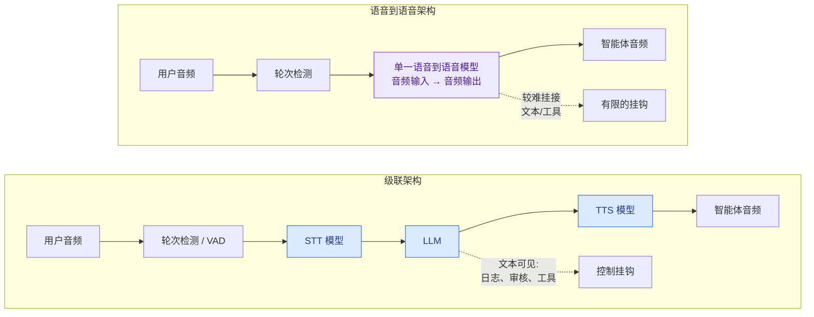
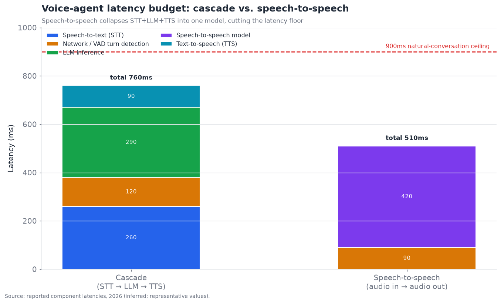
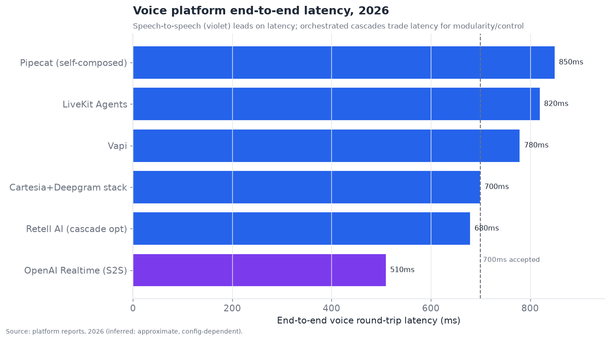

# 10 — 语音与多模态智能体

> **说明：** 本文为英文原文 [`sections/10-voice-multimodal-agents.md`](../../sections/10-voice-multimodal-agents.md) 的简体中文参考译文，仅供参考；如有出入，以英文原文为准。

*可以与之对话的智能体。实时语音架构、多模态输入/输出，以及支配一切的严苛延迟约束。目标篇幅：6,000 词。内容截至 2026 年 11 月（基于 2026 年 7 月 22 日的快照更新）。*

---

## 以毫秒为产品的一层

语音智能体之所以是一门独立的工程学科，是因为它引入了一个其他层都没有如此严峻地面对过的约束：**实时延迟。** 一个需要五秒才能回应的文本智能体只是略显恼人；而一个需要五秒才能回应的语音智能体则是*坏掉的*——人类对话依赖亚秒级的轮流发言，违背这种节奏的语音智能体，无论其内容多好，都会显得不自然、令人沮丧且机械化。执行摘要对这一层的评分为 **成熟度 6.0/10、瓶颈严重度 6.0/10**——比那些深层瓶颈（记忆、安全）更成熟，因为核心流水线已经可用，但受制于毫不留情的延迟预算，这让一切都变得更难。

语音也是大多数人真正会*亲身体验*到的第一种智能体界面——通过客服热线、日程安排助手，以及越来越多的消费级设备——这使它成为公众形成"AI 智能体到底行不行"直觉的那一层。一个在延迟或打断上磕磕绊绊的语音智能体，比一个笨拙的文本智能体造成更大的声誉损害，因为这种失败是即时的、听得见的、并且带有强烈情绪色彩的。这抬高了把工程做对的风险，也正是这一层尽管核心流水线原则上已被充分理解、却仍吸引着如此激烈平台竞争的部分原因。

决定性的数字：**自然对话要求端到端往返延迟低于约 900ms，普遍认为低于 700ms 为良好，低于 500ms 为优秀。** 这个预算——从用户停止说话的那一刻到智能体开始说话的那一刻——必须容纳以下全部环节：检测到用户已说完、理解用户所说的内容、构思回应，以及开始把它说出来。语音智能体中的每一项架构决策都源于要把自己塞进这个预算之内，而这一层的整个工程故事就是与时钟的搏斗。

---

## 2026 年 7 月以来的变化（2026 年 11 月更新）

7 月快照之后的四个月并没有改变这一层的"物理规律"。延迟预算没变，级联与 S2S 之间的权衡也没变。改变的是**语音到语音（speech-to-speech）前沿所处的位置**。三件事同时发生。**全双工（full-duplex）**模型从研究走进了付费 API（OpenAI 的 GPT-Live-1），Block 还展示了一个不依赖文本的全双工模型（Dessa）。**具备推理能力的 S2S** 成为常态：GPT-Realtime-2.x 提供推理强度控制，Gemini 3.8 Live 推出了"Extended Thinking"变体。最后，**语音层价格下降**到了旧的全栈价格区间之下。这些变化削弱了级联架构的两项传统优势：工具与推理控制，以及成本。它们也使编排平台面临的战略问题更加尖锐。在融资方面，语音基础设施从"资金充裕"变成了出现多家独角兽，ElevenLabs 估值达到 220 亿美元。下面的日志还补充了 7 月快照遗漏的 2026 年 1 月至 7 月的重要事项。置信度标签遵循 §17：*official（官方）* 指厂商公告，在可访问时链接到一手来源，否则链接到相关报道；*inferred（推断）* 指单一来源或分析师推导得出。

- **2026 年 1 月 13 日——Deepgram 以 13 亿美元估值完成 1.3 亿美元 C 轮融资**（由 AVP 领投），并收购餐厅语音初创公司 OfOne *(official)* ——
  [Deepgram](https://deepgram.com/learn/press-release-deepgram-raises-series-c)。
- **2026 年 1 月 22 日——LiveKit 以 10 亿美元估值完成 1 亿美元 C 轮融资**（由 Index Ventures 领投）。其定位是 ChatGPT 语音背后的传输引擎 *(official)* ——
  [新闻稿](https://fortune.com/press-releases/livekit-raises-100m-1b-valuation-voice-first-computing-2026-01-22)。
- **2026 年 2 月——ElevenLabs 以 110 亿美元估值完成 5 亿美元 D 轮融资** *(inferred；多家媒体报道)* ——
  [Creati.ai](https://creati.ai/ai-news/2026-02-04/elevenlabs-raises-500m-at-11b-valuation-tripling-value)。
- **2026 年 3 月——Google 发布 Gemini 3.1 Flash Live（预览版）。** 这是 Google 迄今质量最高的音频模型，为消费级的 Gemini Live 和 Search Live 提供支持 *(official)* ——
  [Google 博客](https://blog.google/innovation-and-ai/models-and-research/gemini-models/gemini-3-1-flash-live/)。
- **2026 年 5 月 7 日——OpenAI 发布 GPT-Realtime-2、GPT-Realtime-Translate 和 GPT-Realtime-Whisper。** OpenAI 称 GPT-Realtime-2 是首个具备 GPT-5 级推理能力的 API 语音模型，推理强度可在 minimal 到 xhigh 之间设置 *(official；经由报道)* —— [eWeek](https://www.eweek.com/fr/news/openai-gpt-realtime-2-voice-agents/)。
- **2026 年 5 月 12 日——Vapi 完成 5,000 万美元 B 轮融资，并宣布通话量达 10 亿次** *(official)* ——
  [GlobeNewswire](https://www.globenewswire.com/news-release/2026/05/12/3292882/0/en/vapi-raises-50m-series-b-as-it-reaches-1-billion-calls-powering-the-next-generation-of-enterprise-voice-ai.html)。
- **2026 年 5 月——Amazon Nova 2 Sonic 更新**，提升了语音生成质量。Nova 2 Sonic 本身于 2025 年 12 月发布 *(official)* ——
  [AWS 发布说明](https://docs.aws.amazon.com/nova/latest/nova2-userguide/release-notes.html)。
- **2026 年 7 月 6 日——gpt-realtime-2.1 与 gpt-realtime-2.1-mini**，p95 延迟降低 ≥25%
  *(official)* ——
  [OpenAI 社区](https://community.openai.com/t/new-realtime-models-on-the-api-gpt-realtime-2-1-and-gpt-realtime-2-1-mini/1385896)。
- **2026 年 9 月 10 日——GPT-Live-1 登陆 API。** 这是一个运行在新路由 `/v1/live/sessions` 上的**全双工**语音模型。语音层收费 **$0.05/分钟**，按秒计费，后端模型与工具使用另行计费。它不接受图像或视频输入 *(official)* ——
  [OpenAI 文档](https://developers.openai.com/api/docs/models/gpt-live-1.md)，
  [Unite.AI](https://www.unite.ai/openais-gpt-live-1-arrives-in-the-api-at-0-05-per-minute/)。
  Retell 和 Pipecat 迅速加入了集成 *(official)* ——
  [Retell 文档](https://docs.retellai.com/build/gpt-live)。
- **2026 年 9 月 15 日——Gemini 3.8 Live 与 3.8 Live Extended Thinking。** 两者均为音频到音频模型，支持**在模型持续说话的同时进行异步函数调用**。标价约为音频输入 ~$0.005/分钟、音频输出 ~$0.018/分钟 *(official)* ——
  [Google 博客](https://blog.google/innovation-and-ai/technology/developers-tools/build-real-time-voice-applications-gemini-audio/)。
  一份第三方指南称旧版 Live 预览版将于 11 月 17 日下线 *(inferred)* ——
  [Developers Digest](https://www.developersdigest.tech/blog/gemini-3-8-live-extended-thinking-release-guide-2026)。
- **2026 年 9 月 15–17 日——Dreamforce：Agentforce Voice 新增六种语言**（西班牙语、意大利语、德语、葡萄牙语、日语、加拿大法语）*(inferred；会议回顾)* ——
  [Cyntexa](https://cyntexa.com/blog/dreamforce-2026-highlights/)。
- **2026 年 9 月 30 日——ElevenLabs 以 220 亿美元估值完成 3 亿美元员工股份要约收购**，约为 2 月价格的 2 倍，由 Wellington 和 T. Rowe Price 领投 *(official；公司声明)* ——
  [Billboard](https://www.billboard.com/pro/elevenlabs-ai-startup-valued-22-billion-tender-offer/)。
  11 月 3 日，CEO 表示将从 2028 年开始筹备 IPO *(inferred)* ——
  [PYMNTS](https://pymnts.com/news/investment-tracker/ipo/2026/elevenlabs-ceo-eyes-2028-ipo-prep-voice-ai-firm)。
- **2026 年 10 月 14 日——xAI 发布 Grok Voice 3.0**，一款托管式 S2S 模型，价格约 ~$0.08/分钟。xAI 声称其在 Artificial Analysis 的 S2S 指数上排名第一 *(inferred；经由聚合站转述的厂商说法)* ——
  [DevX](https://www.devx.com/artificial-intelligence-ai/what-is-grok-voice-3-0-xai-speech-to-speech-model/)。
- **2026 年 10 月 24 日——Block 发布 Dessa**，一款仅以对话音频训练、未经文本预训练的全双工 S2S 模型。Block 称它可在本地运行。目前只有安全研究人员可以访问，Block 尚未公布任何基准测试结果 *(official；厂商演示)* ——
  [TechCrunch](https://techcrunch.com/2026/10/24/blocks-new-voice-model-sounds-eerily-human/)。

**总体解读：** S2S 在这四个月里取得的进展超过了此前一整年，**全双工**如今已成为前沿对话质量的门槛。级联架构剩下的优势是可检查的文本、可挑选同类最佳组件，以及电话通信方面的成熟度。这些优势是真实的，但比 7 月时更窄了。

---

## 两种架构：级联 vs. 语音到语音

这一层最根本的架构分野——也是理解这一层最重要的一点——在于**级联**（或称"流水线"）架构与**语音到语音**（原生，或称"S2S"）架构之间。

**级联**架构串联三个独立模型：**语音转文本（STT）**将用户音频转写为文本 → **LLM** 处理文本并生成文本回应 → **文本转语音（TTS）**将回应合成为音频。这是传统的模块化方法。它的优势在于*控制力与灵活性*：你可以替换任何组件、检查每个阶段的文本（这对日志记录、内容审核、工具使用至关重要）、为每项工作选用最佳模型，并把系统当作离散部件来推理。它的劣势是*延迟*（三次顺序的模型调用，再加上在 STT 完成定稿之前等待检测用户说完）以及*副语言信息的丢失*（转成文本会丢掉语气、情绪和重音——LLM 看到的是"我没事"，却听不出这句话是带着怒气说的）。

**语音到语音**使用单一模型，直接输入音频、输出音频，中间没有文本环节。OpenAI 的 Realtime API 让这种方式流行起来。当前这一代包括 GPT-Realtime-2.x 和全双工的 GPT-Live-1（2026 年 9 月），以及 Google 的 Gemini 3.8 Live、Amazon Nova 2 Sonic 和 xAI Grok Voice 3.0。它的优势在于*更低的延迟*（无需等待 STT 定稿，没有 TTS 启动延迟——一个模型取代三个顺序模型）和*更丰富的韵律*（模型*听得到*情绪、也*表达得出*情绪，因为它从不丢弃音频中的副语言信息）。它的劣势在于*更少的控制力和可检查性*（没有可以干净地用于记录日志、审核或挂接工具调用的文本阶段）以及*较低的成熟度*（一种较新的方法，可调节的旋钮更少）。2026 年这一代模型缩小了第二个差距。推理强度设置（GPT-Realtime-2）以及在模型继续说话时运行的异步工具调用（Gemini 3.8 Live）恰恰是 S2S 在 2025 年所缺少的旋钮。

延迟上的后果是具体而决定性的：

语音到语音把 STT + LLM + TTS 的顺序链条压缩进一个模型，大幅降低了延迟下限——图中显示一个有代表性的级联方案约为 ~760ms，而语音到语音路径约为 ~510ms。这一差距正是"可接受"与"优秀"之间的差别，也是语音到语音在延迟敏感的对话式智能体中日益占据上风的原因。

但 2026 年的现实**并非**语音到语音的完胜。级联架构在控制力、可检查性和组件选择上的优势，对于必须记录对话、审核内容、可靠调用工具并与业务系统集成的*生产级*智能体而言极为重要——因此许多生产级语音智能体仍以级联为基础，并通过流式处理和阶段重叠（见下文）进行激进优化以满足延迟预算。坦诚地说：**语音到语音在延迟和自然度上领先；级联在控制力和生产集成上领先；两者都可行，选择取决于对具体用例而言，原始的对话延迟/质量与生产控制哪个更重要。** 混合方案为 S2S 提供文本旁路通道，用于日志记录和工具调用。它们在 2026 年年中还处于"新兴"阶段，如今已成为厂商 API 的默认形态。例如，GPT-Live-1 将其语音层与开发者自选的后端模型和工具分开计费 *(official)*。架构界线正从 S2S 一侧变得模糊。

---

## 流式处理与重叠：级联架构如何与时钟搏斗

级联架构的延迟问题可以通过一组流式处理技术得到缓解，这些技术才是生产级语音智能体真正的工程功夫，理解它们就能解释级联为何仍具竞争力：

- **流式 STT。** 不要等用户说完——在用户说话时就增量转写，这样当用户停下时，转写几乎已经完成。现代流式 STT（Deepgram Nova 级等）的定稿时间远低于 300ms。
- **流式 LLM。** 不要等完整回应——一开始生成就逐个输出 token，这样 TTS 可以在第一句话上就开始工作，而其余部分仍在生成。
- **流式 TTS。** 不要等完整文本——在第一个片段上就合成并开始播放音频（对于 Cartesia Sonic 级这样的优质 TTS，首音频延迟低于 100ms），让用户几乎立即听到回应的开头。
- **阶段重叠。** 关键技巧：让各阶段*并发*运行而非顺序运行——STT 还在为用户话语的结尾定稿时，LLM 已经在处理开头；TTS 在朗读 LLM 第一句话时，LLM 正在生成第二句。以这种方式对级联进行流水线化，可以隐藏大部分顺序延迟。
- **轮次检测 / VAD。** 判断*用户何时说完*（语音活动检测 + 语义轮次检测）看似简单实则至关重要——过早结束轮次会打断用户；过晚则会增加冷场。良好的轮次检测（越来越多地基于语义——理解*想法*是否已完整，而不仅仅是音频是否停止）是一项主要的差异化因素，也是常见的故障点。

这些技术让优化良好的级联方案尽管使用三个模型，仍能达到端到端低于 700ms，这正是级联依然具有竞争力的原因。平台对比展示了各系统的落点：

语音到语音（OpenAI Realtime）在延迟上领先；编排式级联（Retell、Vapi、Cartesia+Deepgram 组合栈）以部分延迟换取模块化和控制力；基于框架自行组合的技术栈（LiveKit Agents、Pipecat）则以更多延迟换取最大的灵活性。所有系统都聚集在 700–850ms 区间——对大多数用例而言"足够好"——而语音到语音正向低于 500ms 的"优秀"前沿推进。（*2026 年 11 月注：* 该图反映的是 2026 年年中的配置。OpenAI 报告 gpt-realtime-2.1 的 p95 延迟降低了 ≥25%，而 GPT-Live-1 等全双工模型改变了"往返"的含义，因为它们在说话的同时也在聆听。我们尚未重新进行基准测试，因此图中 S2S 的柱形很可能偏保守 *(inferred)*。）

---

## 打断处理与对话动态

除了延迟，区分自然语音智能体与机械语音智能体的关键在于**对话动态**——其中首要的是**打断处理（barge-in，插话）。** 人类之间不断地相互打断；一个无法被打断的语音智能体（继续盖过用户说话，或忽略打断）会让人觉得它坏掉了。处理插话需要：检测到用户在智能体说话时开始讲话、*立即停止智能体的语音*、丢弃被打断的回应，并处理用户的插话——这一切都要实时完成。这很难（它需要全双工音频和快速检测），也是平台之间的一项主要差异化因素。2026 年下半年出现了**原生全双工模型**，它们可以同时聆听和说话，而不是在基于轮次的模型之上模拟插话。GPT-Live-1 已通过 API 提供，而 Block 的 Dessa 仅限研究访问。原生全双工模型是迄今为止对这一问题最直接的攻克 *(official；质量声明由厂商报告)*。

相关的对话动态挑战：

- **反馈语（backchanneling）。** 人类会发出"嗯嗯""是的""对"来表示在听；不这样做的智能体，或把用户的反馈语误认为是要接过话轮的智能体，会显得不自然。
- **话轮转换时机。** 话轮之间的自然间隔是几百毫秒；太快显得咄咄逼人，太慢显得迟钝。把握好节奏既是延迟预算的一部分，也是自然度的一部分。
- **不流畅与自我修正。** 真实的语音中有"呃"、重新开头和更正；智能体必须正确处理用户说出"发给 John——不对，等一下，发给 Jane"这样的话。
- **情绪与韵律。** 检测用户的情绪状态（沮丧、困惑）并以恰当的语气回应——在这方面，语音到语音相对于级联具有结构性优势（它能听出并表达情绪），而级联会在文本瓶颈中丢弃情绪。

2026 年的状态：**对于优秀的实现而言，延迟问题已基本解决（低于 700ms），自然度的前沿已转移到对话动态**——打断、时机、情绪和话轮转换——这些正是平台之间差异如今最能被听出来的地方。一个语音智能体即使达到了延迟预算，如果对打断和韵律处理不佳，仍会显得机械，这就是为什么这些动态因素、而非原始延迟，正日益成为竞争的主战场。

---

## 语音之外的多模态智能体

语音是对延迟最敏感的多模态场景，但"多模态智能体"涵盖的范围更广——能够处理**图像、视频和音频作为输入和/或输出**的智能体，而不仅仅是文本。更广泛的多模态图景：

- **视觉输入**是最成熟、使用最广泛的非文本模态——能够看懂图像、文档、图表和截图的智能体（为计算机使用 §08、文档检索 §07 和多模态推理 §05 提供输入）。这已达到生产就绪水平，并在快速改进。
- **语音之外的音频输入**——理解非语音音频（声音、音乐、语调）——正在兴起，主要与专门应用相关。
- **视频输入**——理解视频流——处于更早期阶段；实时视频理解（观看直播画面并采取行动）已有演示，但延迟和成本都很高，大多处于从研究到早期应用的阶段。
- **作为智能体输出的图像/视频生成**——产出视觉成果（图表、图像、编辑过的媒体）的智能体——是一项独特的能力，越来越多地被集成为智能体可以调用的工具。

统一的趋势是走向**原生多模态模型**——在一个模型中处理文本、图像、音频以及（越来越多的）视频的单一模型，而不是把各自针对特定模态的模型拼接在一起。这与语音中的级联 vs. 原生之争是同一种张力的泛化：原生多模态模型延迟更低、信息更丰富（它们不会在模态边界处丢失信息），但比由专门模型组成的流水线更难控制和检查。随着模型的改进，发展方向是走向原生多模态，而在控制力和组件选择很重要的地方，流水线仍将存在。

具体就*智能体*用途而言，影响最大的多模态能力是**视觉输入**（它支撑着计算机使用、文档和屏幕理解等垂直领域）和**实时语音**（它支撑着对话式智能体）——其他能力还处于更早期阶段。并且正如 §05 所指出的，多模态*感知*往往是比多模态*推理*更薄弱的环节——智能体能够很好地对其准确感知到的内容进行推理，因此在感知杂乱屏幕、嘈杂音频和复杂文档方面的改进，会直接提升建立在其上的智能体垂直领域。

---

## 竞争格局

语音/多模态是一个分层的市场：**基础模型提供商**（原生语音到语音和多模态模型）、**组件提供商**（STT、TTS、专用组件）、**编排平台**（组合并运行语音智能体），以及**应用/垂直领域参与者**（面向特定行业的语音智能体）。这个市场参与者密集、资金充裕。

### 竞争对比表——语音与多模态智能体

| 参与者 | 类别 | 成熟度 | 角色 | 值得关注（置信度） | 差异化优势 | 竞争对手 |
|---|---|---|---|---|---|---|
| **OpenAI Realtime API / GPT-Live** | 模型（S2S） | shipped-reliable | 语音到语音模型 | GPT-Realtime-2.1；全双工 GPT-Live-1，语音层 $0.05/分钟，2026 年 9 月（official） | 具备推理能力的原生 S2S；全双工 | Google、xAI、级联技术栈 |
| **ElevenLabs** | TTS + 平台 | shipped-reliable | 语音质量 + 智能体技术栈 | 要约收购估值 220 亿美元，2026 年 9 月（official） | 同类最佳的音色；多语言；捆绑智能体 | Cartesia、PlayHT |
| **Deepgram** | STT（+ TTS） | shipped-reliable | 流式 STT | Nova/Flux STT；以 13 亿美元估值完成 1.3 亿美元 C 轮，2026 年 1 月（official） | 快速、准确的流式 STT | AssemblyAI、Whisper |
| **Cartesia** | TTS | shipped-reliable | 低延迟 TTS | Sonic Turbo TTS（inferred） | 极低的首音频延迟 | ElevenLabs、PlayHT |
| **Vapi** | 编排 | shipped-reliable | 语音智能体平台 | 5,000 万美元 B 轮；10 亿次通话，2026 年 5 月（official） | 模块化，可替换任意组件 | Retell、Bland |
| **Retell AI** | 编排 | shipped-reliable | 语音智能体平台 | HIPAA、亚秒级（inferred）；GPT-Live 集成（official） | 开箱即用的合规 + 低延迟 | Vapi、Bland |
| **Bland AI** | 编排 | shipped-reliable | 大规模外呼语音 | 拨号器规模（inferred） | 外呼通话基础设施 | Vapi、Retell |
| **LiveKit** | 基础设施/框架 | shipped-reliable | 实时传输 + 智能体 | 以 10 亿美元估值完成 1 亿美元 C 轮，2026 年 1 月（official） | 实时媒体基础设施 + Agents 框架 | Daily/Pipecat |
| **Pipecat (Daily)** | 开源框架 | shipped-reliable | 组合语音流水线 | 开源（official） | 开放、灵活的语音智能体框架 | LiveKit Agents |
| **Google (Gemini Live)** | 模型 | shipped-reliable | 原生多模态 + 语音 | Gemini 3.1 Flash Live → 3.8 Live / Extended Thinking，2026 年 9 月（official） | 原生多模态（含视频）；说话时可异步调用工具 | OpenAI、Amazon |
| **AssemblyAI** | STT | shipped-reliable | 语音理解 | STT + 音频智能（inferred） | 带丰富音频分析的 STT | Deepgram、Whisper |
| **PlayHT / Rime / 其他** | TTS | shipped-reliable | 语音合成 | 音色多样（inferred） | 小众/垂直领域音色 | Cartesia、ElevenLabs |
| **Synthflow / 类 Bland 无代码平台** | 无代码平台 | shipped-reliable | 可视化语音智能体构建器 | 无代码（inferred） | 面向非开发者的语音智能体 | Retell、Vapi |
| **Amazon Nova 2 Sonic** | 模型（S2S） | shipped-reliable | 语音到语音 | Nova 2 Sonic，2025 年 12 月；2026 年 5 月更新（official） | 与 AWS 集成的语音 | OpenAI Realtime、Google |
| **Sierra** | 垂直平台 | shipped-reliable | 客户体验语音/聊天智能体 | 以 158 亿美元估值完成 9.5 亿美元 E 轮，2026 年 5 月（official） | 企业客户体验智能体 | Decagon、厂商客户体验产品 |
| **xAI Grok Voice** *(新)* | 模型（S2S） | shipped-reliable | 语音到语音 API | Grok Voice 3.0，2026 年 10 月，约 ~$0.08/分钟（inferred） | 厂商声称的 S2S 基准测试最高分 | OpenAI、Google |
| **Block Dessa** *(新)* | 模型（全双工 S2S） | research-only | 无文本的对话模型 | 2026 年 10 月发布；仅限研究访问（official） | 纯音频训练；可本地运行 | GPT-Live、Sesame |

以上共十七个条目——远超十个——涵盖模型、组件、编排和垂直应用。结构性解读：**这个市场是一个技术栈**——底层是基础模型（S2S 和多模态），中间是同类最佳的 STT/TTS 组件，再往上是把它们组合成可运行智能体的编排平台（Vapi、Retell、Bland、LiveKit、Pipecat），顶层是垂直应用（面向客户体验的 Sierra、Decagon）。2026 年推荐的生产模式通常是*组合式技术栈*（例如 Deepgram STT + Cartesia TTS + 一个快速 LLM + Retell 编排），而不是单一厂商——因为在延迟/质量/成本的前沿上，同类最佳组件胜过任何一家厂商的全栈方案，尽管单一厂商的 S2S 选项（OpenAI Realtime、Gemini Live）以牺牲部分这类优势换取简洁性和更低的延迟。到 2026 年 11 月，编排平台也开始把新的 S2S 模型当作*组件*来对待。Retell 和 Pipecat 都在 GPT-Live 发布后数周内推出了集成 *(official)*。因此，"组合式技术栈 vs. 单一厂商 S2S"正在演变为"围绕本季度最佳模型进行编排"。

---

## 生产级语音：电话通信与真实世界音频的现实

基准测试中的延迟数字假设的是干净的条件；**生产级语音智能体运行在电话线路上和嘈杂的真实世界音频中**，这引入了一整层被实验室数字掩盖的难度。这正是许多语音智能体部署栽跟头的地方，值得详细说明，因为它区分了"在演示中能用"与"在真实电话中能用"：

- **电话通信会降低音频质量。** 电话通话（尤其是 PSTN）带宽低、经过压缩、采样率为 8kHz——远不如 STT 模型偏好的干净 16–48kHz 音频。在电话音频上转写准确率会下降，整个流水线都必须为此调优。专注于电话通信的语音平台（外呼领域的 Bland、Retell、Vapi）在这方面投入巨大。
- **网络抖动和丢包**会在模型延迟之上再增加延迟和音频瑕疵——实时媒体传输（WebRTC，这正是 LiveKit 和 Daily/Pipecat 作为*基础设施*之所以重要的原因）是一个真正的工程问题，而不只是事后才考虑的事情。
- **真实世界的噪声、口音和行话。** 背景噪声、多样的口音、领域特定术语（药品名称、产品 SKU、地址）以及多人说话都会降低 STT 的效果，而这些恰恰是精心整理的基准测试最干净、生产环境最混乱的地方。领域调优的 STT 以及对关键信息的确认（回读拼写一个名字、确认一个号码）是必要的缓解措施。
- **在真实语音上判断话语终点（endpointing）。** 判断一个在糟糕电话线路上的真人何时说完了自己的想法——要穿过停顿、不流畅和噪声——比在干净音频上难得多，而一个糟糕的终点判断（打断用户或反应迟滞）是最容易被听出来的失败。

生产层面的教训：**语音智能体演示与语音智能体产品之间的差距，很大程度上就在于处理混乱音频、电话通信和话语终点判断的工程工作**——这是专门的编排平台（Vapi、Retell、Bland）之所以存在、要去处理的那些不起眼的可靠性工作。直接基于原始模型构建语音的团队往往低估了这一点，结果交付的东西在办公室里能用，在来自嘈杂环境的真实客户来电中却失败了。这是 §07"数据摄取决定上限"和 §08"真实网站充满敌意"在语音领域的对应——真实世界比基准测试更难，而生产价值就在于应对这一点。

## 语音智能体的经济学

语音智能体有一种独特的成本结构，它决定了语音智能体被部署在哪里：

- **按分钟计价。** 语音通常按对话分钟数计价（捆绑了 STT + LLM + TTS + 编排 + 电话通信），全栈价格通常在 **$0.05–$0.15/分钟** 区间（ElevenLabs 的捆绑方案约为 $0.08–$0.12/分钟，具有代表性）。这与文本智能体按 token 计价的经济模型有根本不同，它使语音智能体的成本*按每通电话可预测*，但*在规模化时相当可观*（一个处理数百万分钟通话的呼叫中心）。*2026 年 11 月：* 仅模型层就在大幅降价。GPT-Live-1 的语音层标价为 $0.05/分钟，另加后端模型费用；Gemini 3.8 Live 的音频输入与输出合计标价约为 $0.023/分钟 *(官方标价)*。模型成本在捆绑价格中的占比正在缩小，因此利润和差异化正转向电话通信、编排和可靠性。
- **成本/质量/延迟三难困境。** 更便宜的组件（更小的 LLM、更便宜的 TTS）降低了成本，但会危及质量和延迟；最好的组件成本更高。推荐的生产技术栈（像 GPT-5 mini 或 Gemini Flash 这样快速的小型 LLM + 高效的 STT/TTS）是为了既满足延迟预算*又*控制成本而选择的——在实时路径上，你通常负担不起一个大型、缓慢、昂贵的推理模型。
- **关键路径上的推理问题。** 由于大型推理模型会撑爆延迟预算，语音智能体在实时轮次中使用*快速*模型，并把繁重的推理移出关键路径（预先计算，或交给较慢的后台进程）——即 §05 中的"快前端、慢后端"拆分。这限制了实时语音智能体在当下能有多"聪明"，这是一项真实的局限：语音智能体在对话上很快，但其推理深度往往不及一个有余裕去思考的文本智能体。*2026 年 11 月：* 这一约束正在放松，但尚未消失。GPT-Realtime-2 在 S2S 模型内部提供了可调节的推理强度。Gemini 3.8 Live Extended Thinking 及其异步工具调用让模型可以在较慢工作运行时继续说话。两者实际上都把"慢后端"移到了语音模型的轮次*之内* *(official)*。
- **投资回报集中在高流量、替代人工的用例中。** 语音智能体最具经济意义的场景是替代或增强高流量的人工电话工作（客服分流、预约安排、外呼资质筛选），在这些场景中，按分钟计算的成本远低于人工替代方案——这就是为什么客户体验和高度依赖电话通信的垂直领域是商业重心所在。

## 企业语音：客户体验与垂直领域智能体

语音智能体最大的商业应用是**客户体验（CX）**——客服、服务和销售电话——一批参与者专门瞄准这一领域，将这一层与企业平台（§14）连接起来：

- **Sierra**（由 Bret Taylor 联合创立）和 **Decagon** 是值得关注的企业客户体验智能体公司，它们为品牌构建端到端处理客户交互的语音与聊天智能体，并具备受监管的客户体验所需的企业治理、集成和可靠性。它们基于"AI 智能体将处理很大一部分客户交互"这一论点完成了大额融资。Decagon 于 2026 年 1 月以 45 亿美元估值融资 2.5 亿美元。Sierra 于 2026 年 5 月以 158 亿美元估值融资 9.5 亿美元 *(official)*。老牌厂商也在加速进入：Agentforce Voice 在 Dreamforce 2026 上新增了六种语言 *(inferred)*。
- **垂直领域专业化**很重要，因为客户体验有其领域要求：医疗保健语音智能体需要符合 HIPAA（Retell 开箱即用的 HIPAA 合规是一个卖点），金融服务需要符合其合规体系，而每个垂直领域都有自己的话术脚本、集成和监管约束。
- **转接人工的要求。** 企业语音智能体在达到能力极限时（来电者情绪激动、请求超出范围、需要做出高风险决策）必须平滑地升级给人工——这是以*转接给真人坐席*形式体现的人在回路模式（§02），它既是客户体验智能体的一项核心能力，也是一项信任要求（客户必须能够联系到真人）。

企业语音的现状：**客户体验语音智能体正从试点走向生产，适用于范围明确、高流量的交互**（一线客服、预约安排、订单状态查询、资质筛选），而长尾中那些复杂、情绪化或高风险的交互仍然转给人工——这与"短周期任务可行、长周期与复杂任务不行"的模式相同，只是体现在客户服务中。这是商业上较为成熟的智能体应用之一，恰恰因为其用例范围明确，而且投资回报（相对于人工处理电话的成本）清晰可见。

## 语音的安全、信任与伦理维度

语音引发的安全和伦理问题比文本更尖锐，因为人的声音以文本所不具备的方式承载着信任、情绪和身份：

- **披露。** 语音智能体是否应该披露自己是 AI？越来越多的答案是肯定的——无论是在伦理上，还是在某些司法管辖区的法律上（要求在通话中披露 AI 身份的法规正在出现）。一个在不披露的情况下令人信服地冒充人类的智能体具有操纵性，而语音智能体变得越自然，这个问题就越尖锐。
- **声音克隆与同意。** 克隆特定个人声音的技术（ElevenLabs 及其他公司）强大而危险——它既能实现正当用途（一个人为自己的智能体使用自己的声音），也能被滥用（冒充、欺诈、深度伪造语音诈骗）。同意、水印以及合成语音的身份验证都是当前活跃的关注点，而基于语音的欺诈（使用克隆声音的诈骗电话）是一个真实且日益增长的威胁，身份层（§13）乃至更广泛的社会都在努力应对。
- **情绪操纵。** 一个能读懂并回应情绪的语音智能体可以建立融洽关系——也可以利用这种关系。在销售或说服场景中，一个在情绪上具有说服力的智能体会引发文本机器人所不会引发的操纵担忧，因为语音的情绪带宽更高。
- **无障碍与包容性。** 反过来，语音智能体具有真正的无障碍价值（对于无法打字或更喜欢说话的用户），而在各种口音、语言和言语差异上都把语音做好是一个包容性问题——在非标准语音上表现不佳会把用户排斥在外。

正在形成的伦理立场是：**披露 AI 身份、获得声音克隆的同意、为合成语音加水印，并防范情绪操纵**——但相关工具和监管尚不成熟，而滥用的可能性（尤其是语音欺诈）是一个严重且未得到充分应对的风险，并随着语音智能体变得更自然、更普及而增长。这是能力（自然、富有情绪、可克隆的声音）领先于防护措施的一个领域。

## 评估语音智能体

语音智能体的评估是多维度的，比文本评估（§11）更难，因为你衡量的不只是说了*什么*，还包括对话进行得*如何*：

- **任务成功率**——智能体是否完成了目标（完成预约、回答问题、解决问题）？这是底线指标，但它忽略了对话质量。
- **延迟指标**——端到端往返延迟及其组成部分（STT、LLM、TTS、轮次检测）——可衡量且至关重要，因为违反延迟预算是最常见的失败。
- **对话质量**——自然度、打断处理、恰当的话轮转换、语气——客观衡量要困难得多，通常需要人工评估或专门模型，而"尽管达到了延迟要求却仍显机械"的问题就存在于此。
- **转写准确率**——在实际音频条件下（电话、噪声、口音）的 STT 词错误率，它从上游决定了一切。
- **升级恰当性**——智能体是否在应该转接人工时转接，并且在不应该转接时没有转接？这是一项关键的客户体验指标。

方法论与技术栈的其余部分一致：**在真实的音频条件下，衡量任务成功率和延迟（客观指标），以及对话质量（更难，通常由人工评判）**——并且关键是要在*真实的电话/嘈杂音频*上而非干净的录音室音频上进行评估，因为那才是生产环境所在。和其他所有地方一样，你无法改进你无法衡量的语音智能体质量，而语音多维度、部分主观的质量使得诚实的衡量尤其困难——这是 §11 评估瓶颈的又一个实例，并因实时多模态的复杂性而更加尖锐。

## 语音智能体简史

这段历程解释了当前的拐点。**2024 年之前**，语音智能体是 IVR（"账单问题请按 1"）和脆弱的脚本式语音机器人的天下——令人沮丧、僵化，且普遍不受欢迎，因为底层的语音和语言技术无法处理自然对话。级联架构那时就已存在，但缓慢且机械。

**2024 年**带来了两项转变：STT/TTS 质量大幅跃升（Whisper 级 STT、接近人类水平的神经 TTS），以及——至关重要的——**OpenAI 的 Realtime API 推出了生产级语音到语音**，证明了单一模型能够以自然的韵律进行近乎实时的对话。这重新定义了语音智能体的可能形态，从脚本式 IVR 走向真正的对话。一波编排平台（Vapi、Retell、Bland）和组件提供商（Cartesia、Deepgram 的较新模型）涌现出来，让生产级语音智能体变得可以构建。

**2025 年**是生产规模化之年：对于优秀的实现，延迟降到了自然度阈值以下，电话通信集成走向成熟，企业客户体验智能体（Sierra、Decagon）完成大额融资并投入部署，级联 vs. S2S 的架构之争也逐渐明朗。**2026 年**是当前状态：对于优秀的技术栈，延迟问题已基本解决，前沿转向对话动态和自然度，原生多模态不断推进，语音已确立为高流量面向客户用例的主流智能体界面——与此同时，安全/伦理问题（披露、克隆、操纵）恰恰在技术变得令人信服之际变得紧迫。这段从令人厌恶的 IVR 到真正对话的历程，是日常生活中较为显眼的智能体驱动变革之一，而它的商业扩张仍处于早期。2026 年下半年又翻开了新的一章。全双工 S2S 进入了公开 API（GPT-Live-1，9 月）。具备推理能力的语音模型成为标配（GPT-Realtime-2.x、Gemini 3.8 Live）。估值被大幅重估，ElevenLabs 达到 220 亿美元，Deepgram 和 LiveKit 均超过 10 亿美元。

## 语音/多模态与其他层的关系

- **↔ 记忆（§03）。** 语音严格的延迟预算排除了在关键路径上进行缓慢的记忆查找——记忆必须预先获取或保存在快速的工作记忆中，这从上层约束了记忆架构。
- **↔ 规划/推理（§05）。** 推理密集的规划无法在亚秒级的轮次预算内完成；"快速反应式前端、缓慢审慎式后端"的拆分（用快速模型处理实时轮次，把较重的推理移出关键路径）是语音特有的模式。
- **↔ 工具使用（§04）。** 语音智能体会调用工具（查询订单、预约），但工具延迟会吃掉预算——需要快速的工具或异步处理（在工具运行时说"我帮您查一下"）。
- **↔ 计算机使用 / 多模态推理（§05、§08）。** 视觉输入支撑着屏幕理解和文档工作；感知质量决定了这些垂直领域的上限。
- **↔ 企业平台（§14）。** 面向客户服务/客户体验的语音智能体是一项主要的企业智能体应用（Sierra、Decagon 以及各类客户体验平台），将这一层与 §14 连接起来。

---

## 语音/多模态特有的失败模式

1. **违反延迟预算。** 总往返时间超过约 900ms；对话让人感觉坏掉了。
   缓解措施：流式处理、阶段重叠、S2S、快速组件。
2. **轮次检测错误。** 打断用户（轮次结束过早）或出现冷场（结束过晚）。
   缓解措施：语义轮次检测。
3. **打断处理失败。** 智能体盖过用户说话或忽略插话。缓解措施：全双工音频和快速打断检测。
4. **韵律丢失（级联）。** 情绪/语气在文本瓶颈中被丢弃，导致回应不合时宜、缺乏共情。缓解措施：S2S 或具备情绪感知的组件。
5. **STT 错误层层累积。** 转写错误（口音、噪声、行话）会污染下游的一切。缓解措施：领域调优的 STT 和对关键信息的确认。
6. **工具延迟造成停滞。** 缓慢的工具调用造成冷场。缓解措施：异步处理，并在等待时给出口头确认。
7. **多模态感知错误。** 误读图像/文档/屏幕（§05/§08）。缓解措施：更好的感知能力和验证。

---

## 端侧与边缘语音

一个值得关注的新兴维度是**端侧语音处理**——在用户设备本地而非云端运行部分或全部语音流水线。其动机是延迟、隐私和成本：

- **延迟。** 本地处理消除了到云端的网络往返，这是在模型延迟之外纯粹的延迟节省——对于低于 500ms 的前沿可能具有决定性意义。唤醒词检测和语音活动检测已经普遍在端侧运行。
- **隐私。** 在本地处理语音（从不把音频发送到云端）是一项强有力的隐私保障，对敏感场景和合规都很有价值。端侧 STT 意味着原始音频永远不会离开设备。
- **成本与离线。** 本地处理避免了按分钟计费的云成本，并能离线工作——这对嵌入式和消费级设备很重要。

约束在于**端侧模型更小、能力更弱**，不如云端模型，因此这是用能力换取延迟/隐私/成本。正在形成的模式是*混合式*：在端侧运行延迟关键、隐私敏感的部分（唤醒词、VAD，有时还包括 STT），在云端进行繁重的推理——或者用一个能力不错的小型端侧模型处理常见情况，遇到困难情况再升级到云端。随着端侧模型的改进和硬件（手机、笔记本电脑和专用设备中的 NPU）的进步，更多的语音流水线将移到本地，这将进一步推进延迟前沿，并解决云端语音引发的隐私顾虑。这比云端语音更早期，但是一个有意义的方向，尤其是对消费级硬件和隐私敏感的垂直领域。一个风向标：Block 称其全双工 Dessa 模型（2026 年 10 月）可以在本地以快于实时的速度运行。这将把一个前沿级的对话模型带到边缘端，但这一说法尚未经过验证，因为目前既没有公开访问也没有基准测试结果 *(官方声明；未经验证)*。

## 实时视频与具身智能体

多模态智能体的前沿正向**实时视频理解**和**具身智能体**延伸——在物理世界或流式视觉世界中实时感知并行动的智能体。这是这一层中最早期、最接近研究的部分，但值得梳理：

- **实时视频输入**——智能体观看实时摄像头画面或屏幕共享并作出回应（Gemini Live 的视频模式是一个早期的生产示例）——可以支持视觉辅助（"我在看的是什么？"）、实时监控，以及更丰富的计算机使用（把屏幕当作视频来观看，而不是离散的截图）等用例。它对延迟和算力的要求很高，目前演示多于大规模部署。截至 2026 年 11 月，前沿语音模型在视觉是否应纳入语音模型这一点上存在分歧。Gemini 3.1 Flash Live 及其后续版本被定位为语音*与视觉*模型。GPT-Live-1 只接受音频和文本，不接受图像或视频输入 *(official)*。
- **具身/机器人智能体**——控制实体机器人、通过摄像头和传感器感知并通过执行器行动的智能体——是一个独特且困难得多的领域（真实世界的物理规律、安全、实时控制），大部分超出了本文档的软件智能体范畴，但随着同样的基础模型推理越来越多地驱动机器人动作，它正与本文的范畴趋于融合。视觉-语言-动作（VLA）模型路线就是二者之间的桥梁。
- **在这些领域中，延迟和安全的风险都在上升**：一个在物理世界中实时行动的视频/具身智能体，既面临比任何软件智能体都更严格的延迟约束（物理动态不会等待），也面临更高的安全风险（物理动作可能造成物理伤害）。

现状：**实时视频理解处于早期生产阶段（Gemini Live），具身智能体处于从研究到早期应用的阶段**，两者都受限于延迟、算力，以及——对于具身智能体而言——安全。它们是"多模态智能体"的最前沿，也是未来数年多模态能力发展的方向，但它们还不是主流的生产级智能体技术。它们在这里的意义在于其发展轨迹：同样的智能体架构（感知、推理、行动）正从文本延伸到语音、到视觉、到实时视频、再到物理具身，每一步的延迟和安全约束都在收紧。

## 语音：改变智能体设计的界面

最后谈一点语音为何在其自身垂直领域之外也很重要：**语音是最能迫使技术栈其余部分变快的界面**，而这种压力广泛地塑造着智能体设计。文本智能体可以掩盖延迟（用户等待、阅读、容忍一个加载动画）；语音智能体做不到——延迟会以冷场的形式被*听见*。这使语音成为对整个技术栈实时性能要求最高的集成测试，并催生出一些随后惠及其他智能体的架构模式：

- **"快速反应式前端、缓慢审慎式后端"**的拆分（§05）——用快速模型进行实时交互，把繁重的推理移出关键路径——因语音而变得更加明确，并适用于任何对延迟敏感的智能体。
- 对可能需要的上下文进行**预计算和缓存**（§07）是语音预算逼出来的做法，对任何交互式智能体都有帮助。
- **异步工具处理**（在工具运行时说"我帮您查一下"）是语音的必需品，可推广到任何调用慢速工具的智能体。
- **一切流式化**（在结果产生时就输出部分结果）是语音的要求，也能提升文本智能体的感知响应速度。

所以语音不仅仅是一种应用；它是实时智能体架构的*强制函数（forcing function）*，它所要求的技术会扩散到交互式智能体的方方面面。随着语音成为更常见的智能体界面，它的延迟纪律将抬高整个领域对响应速度的要求——正如编码（§09）是可靠性与验证的强制函数一样，语音是延迟与实时响应能力的强制函数。

## 路线图与展望（带置信度标签）

- **语音到语音在延迟敏感的对话中赢得份额** *(official 趋势；高置信度)。* 原生 S2S 模型在延迟和韵律上持续改进；在控制力/可检查性/组件选择很重要的地方，级联架构仍然存在，混合方案在两者之间架起桥梁。——*2026 年 11 月：已确认且正在加速。7 月至 10 月间推出了五款新的 S2S 模型：gpt-realtime-2.1、GPT-Live-1、Gemini 3.8 Live、Grok Voice 3.0 和 Dessa（预览）。*
- **前沿从延迟转向对话动态** *(inferred；高置信度)。* 对于优秀的实现，延迟问题已基本解决；打断处理、话轮转换、情绪和自然度是当前竞争的焦点。——*2026 年 11 月：已确认。全双工（GPT-Live-1、Dessa）是最新模型明确的卖点。*
- **原生多模态成为默认** *(inferred；中高置信度)。* 在控制力并非首要考虑的地方，处理文本/图像/音频/视频的单一模型将随着模型改进而取代拼接式流水线。——*2026 年 11 月：部分成立。Google 的 Live 模型是语音+视觉模型，但 OpenAI 的 GPT-Live-1 仅支持音频/文本。*
- **组合式同类最佳技术栈与单一厂商方案保持竞争力** *(inferred；中等置信度)。* 组合最佳组件的编排平台（Vapi、Retell、LiveKit、Pipecat）在与单一厂商 S2S 的竞争中守住阵地，尤其是在控制力和成本很重要的地方。——*2026 年 11 月：目前仍然成立。Vapi 宣布了 10 亿次通话和 5,000 万美元 B 轮融资，LiveKit 估值达到 10 亿美元，编排平台把新的 S2S 模型作为组件吸纳进来。模型层价格下降是值得关注的考验。*
- **语音智能体在面向客户的垂直领域规模化** *(inferred；高置信度)。* 随着延迟和自然度越过"可接受"门槛，客户体验、客服、预约安排和外呼应用（Sierra、Decagon、Bland）不断增长——语音成为这些用例的主流智能体界面。——*2026 年 11 月：资本流向印证了这一点。Sierra 估值 158 亿美元，Decagon 45 亿美元，ElevenLabs 220 亿美元；已披露的营收数据仍然很少。*
- **新增（2026 年 11 月）：到 2027 年底，全双工将成为高端语音智能体的基本门槛**
  *(speculative（推测）；中等置信度)。* 预计编排平台将开放双工会话，评估套件将增加重叠/反馈语指标。悬而未决的问题是双工流上的内容审核与日志记录。
- **新增（2026 年 11 月）：模型层价格压缩将使语音利润转向编排、电话通信和可靠性** *(inferred；中高置信度)。* S2S 语音层约 ~$0.02–0.08/分钟的标价，远低于 $0.05–0.15/分钟的全栈价格区间。

---

## 设计语音智能体：与文本相比有何不同

构建一个好的语音智能体并不是"把文本智能体放到电话线后面"——这种媒介改变了设计，其方式常常让把文本智能体移植到语音的团队栽跟头：

- **回应必须简短。** 文本用户会略读长回应；语音用户却必须实时*聆听*每一个字，而冗长的语音回应令人痛苦。语音智能体需要简洁、口语化的回应——一两句话，而不是一整段——这意味着提示词和整个交互设计都与文本不同。
- **没有视觉格式。** 语音无法使用项目符号、表格或链接；信息必须以对话方式按顺序传达，这限制了智能体通过语音能传递多少信息以及何种信息。复杂信息往往需要在语音之外配合一个视觉渠道（发送短信/电子邮件）。
- **确认与核实要说出来。** 关键细节（电话号码、日期、姓名）必须以语音方式确认（"那就是周二下午 3 点，对吗？"），因为没有屏幕可以显示它们，而且 STT 错误很常见——这是语音需要而文本不需要的设计模式。
- **智能体必须应对语音的混乱。** 打断、"呃"、说到一半的更正以及歧义在语音中司空见惯，必须得到妥善处理，而文本输入相对干净、经过斟酌。
- **个性与音色很重要。** 音色、语速和对话风格的选择是产品的一部分，其重要程度是文本语气所不及的——语音智能体*拥有一副嗓音*，而这副嗓音承载着品牌和信任。这是文本智能体所没有的设计领域（音色选择、人设）。

设计上的教训：**语音是一种独特的交互媒介，需要其自身的设计规范**——简洁的口语化回应、语音确认、对打断的容忍，以及经过深思熟虑的音色/人设选择——而不是一个外挂了语音的文本智能体。把语音当作"文本智能体 + TTS"的团队所做出的语音智能体，在技术上能用，在体验上却很差，因为它们忽视了人类处理口语交互与书面交互的方式有多么不同。最好的语音智能体从一开始就是*为*语音而设计的。

## 无障碍与包容性的必要性

这一点值得强调，而不应只是一个脚注：语音智能体具有真正的**无障碍**价值，把它们做好是一个包容性问题。语音界面服务于无法轻松打字或阅读的用户（运动或视觉障碍）、偏好说话的用户、双手被占用场景中的用户（开车、做饭），以及读写能力有限的用户。一个构建良好的语音智能体可以真正赋能这些用户——扩大能够获取数字服务的人群。

但另一面是，**糟糕的语音表现会把人排斥在外**：一个在非标准口音、方言、言语差异（口吃、非典型语音）或非主流语言上失败的智能体，实际上就把这些用户拒之门外。语音技术在历史上恰恰在这些人群上表现欠佳（带口音的语音、代表性不足的语言、非典型的言语模式），因此构建能在人类语音的多样性上*公平地*发挥作用的语音智能体，既是一项技术挑战，也是一项包容性责任。2026 年的状况参差不齐——语音智能体在主要语言的标准语音上表现良好，在边缘情况上则较差——而弥合这一差距既是伦理上的当务之急，也是一个市场机会（服务不足的人群规模庞大）。与安全问题一样，能力的进步快于公平覆盖方面的工作，包容性值得有意识地加以关注，而不应假设它会随着更好的模型自动到来。

## 本节要点

- 语音引入了一个其他层都没有如此严峻地面对过的约束：**实时延迟**——自然对话需要低于约 900ms 的往返时间（低于 700ms 为良好，低于 500ms 为优秀），每一项架构选择都服务于这个预算。
- 核心分野是**级联（STT→LLM→TTS：控制力、可检查性、组件选择）vs. 语音到语音（单一模型：更低延迟、更丰富的韵律、更少的控制）**——两者都可行，选择取决于延迟/自然度与生产控制哪个更重要；混合方案正在涌现。
- **对流水线进行流式化和阶段重叠**使级联保持竞争力（尽管有三个模型仍能低于 700ms）；良好的**轮次检测**是一个看似简单实则至关重要的差异化因素。
- **对于优秀的实现，延迟问题已基本解决；对话动态**（打断/插话、话轮转换时机、情绪/韵律）是自然度的新前沿。到 2026 年下半年，这一前沿变成了**全双工、具备推理能力的 S2S**（GPT-Live-1、Gemini 3.8 Live），模型层价格降至每分钟几美分的水平。
- 语音之外的多模态：**视觉输入已经成熟并支撑着关键垂直领域**（计算机使用、文档），视频还处于更早期阶段；趋势是**原生多模态模型**取代拼接式流水线，而且**感知往往是比推理更薄弱的环节**。
- 这个市场是一个**技术栈**（模型 / 组件 / 编排 / 垂直应用），在延迟/质量/成本前沿上，**组合式同类最佳技术栈**往往胜过单一厂商——尽管单一厂商的 S2S 以此换取了简洁性和最低的延迟。

- **生产级语音是一个电话通信/嘈杂音频的工程问题**（糟糕的电话音频、口音、话语终点判断）——这正是演示与产品之间的差距——而且**语音是一种独特的设计媒介**（简洁的口语化回应、语音确认、对打断的容忍、经过深思熟虑的音色/人设），而不是外挂了 TTS 的文本智能体。
- **语音是实时架构的强制函数**（快前端/慢后端、流式处理、异步工具），其技术惠及所有交互式智能体——同时它也带来尖锐的**安全/伦理**风险（AI 身份披露、声音克隆欺诈、情绪操纵）和**无障碍/包容性**责任，在这些方面，能力目前领先于防护措施和公平覆盖。

*目标篇幅：6,000 词。本节：2026 年 11 月更新后约 7,700 词，包括更新日志和参考来源列表（已通过 `wc` 验证）。*

## 参考来源（2026 年 11 月更新）

- Deepgram Series C press release — https://deepgram.com/learn/press-release-deepgram-raises-series-c
- TechCrunch, Deepgram $130M at $1.3B — https://techcrunch.com/2026/01/13/deepgram-raises-130m-at-1-3b-valuation-and-buys-a-yc-ai-startup
- LiveKit $100M / $1B press release — https://fortune.com/press-releases/livekit-raises-100m-1b-valuation-voice-first-computing-2026-01-22
- SiliconANGLE, LiveKit Series C — https://siliconangle.com/2026/01/22/livekit-raises-100m-1b-valuation-scale-real-time-ai-media-platform/
- Creati.ai, ElevenLabs Series D — https://creati.ai/ai-news/2026-02-04/elevenlabs-raises-500m-at-11b-valuation-tripling-value
- Billboard, ElevenLabs $22B tender — https://www.billboard.com/pro/elevenlabs-ai-startup-valued-22-billion-tender-offer/
- Unite.AI, ElevenLabs tender — https://www.unite.ai/elevenlabs-closes-300m-employee-tender-offer-at-22b-valuation/
- PYMNTS, ElevenLabs IPO timing — https://pymnts.com/news/investment-tracker/ipo/2026/elevenlabs-ceo-eyes-2028-ipo-prep-voice-ai-firm
- Google, Gemini 3.1 Flash Live — https://blog.google/innovation-and-ai/models-and-research/gemini-models/gemini-3-1-flash-live/
- Google, new Gemini audio models (3.8 Live) — https://blog.google/innovation-and-ai/technology/developers-tools/build-real-time-voice-applications-gemini-audio/
- Developers Digest, Gemini 3.8 Live guide — https://www.developersdigest.tech/blog/gemini-3-8-live-extended-thinking-release-guide-2026
- Google Cloud docs, Gemini 2.5 Flash Live API (GA/retirement dates) — https://docs.cloud.google.com/vertex-ai/generative-ai/docs/models/gemini/2-5-flash-live-api
- eWeek, GPT-Realtime-2 launch — https://www.eweek.com/fr/news/openai-gpt-realtime-2-voice-agents/
- OpenAI community, gpt-realtime-2.1 / 2.1-mini — https://community.openai.com/t/new-realtime-models-on-the-api-gpt-realtime-2-1-and-gpt-realtime-2-1-mini/1385896
- OpenAI docs, GPT-Live-1 — https://developers.openai.com/api/docs/models/gpt-live-1.md
- Unite.AI, GPT-Live-1 at $0.05/min — https://www.unite.ai/openais-gpt-live-1-arrives-in-the-api-at-0-05-per-minute/
- Retell docs, GPT-Live — https://docs.retellai.com/build/gpt-live
- Pipecat docs, OpenAI Live service — https://docs.pipecat.ai/api-reference/server/services/s2s/openai-live
- Vapi Series B (GlobeNewswire) — https://www.globenewswire.com/news-release/2026/05/12/3292882/0/en/vapi-raises-50m-series-b-as-it-reaches-1-billion-calls-powering-the-next-generation-of-enterprise-voice-ai.html
- AWS Nova 2 Sonic announcement — https://aws.amazon.com/about-aws/whats-new/2025/12/amazon-nova-2-sonic-real-time-conversational-ai
- AWS Nova 2 release notes — https://docs.aws.amazon.com/nova/latest/nova2-userguide/release-notes.html
- DevX, Grok Voice 3.0 — https://www.devx.com/artificial-intelligence-ai/what-is-grok-voice-3-0-xai-speech-to-speech-model/
- TechCrunch, Block Dessa — https://techcrunch.com/2026/10/24/blocks-new-voice-model-sounds-eerily-human/
- Cyntexa, Dreamforce 2026 highlights (Agentforce Voice languages) — https://cyntexa.com/blog/dreamforce-2026-highlights/
- Bloomberg, Decagon $4.5B — https://www.bloomberg.com/news/articles/2026-01-28/ai-customer-support-startup-decagon-valued-at-4-5-billion
- SiliconANGLE, Sierra Series E — https://siliconangle.com/?p=746652
