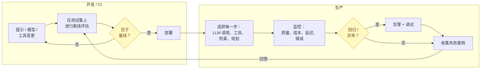
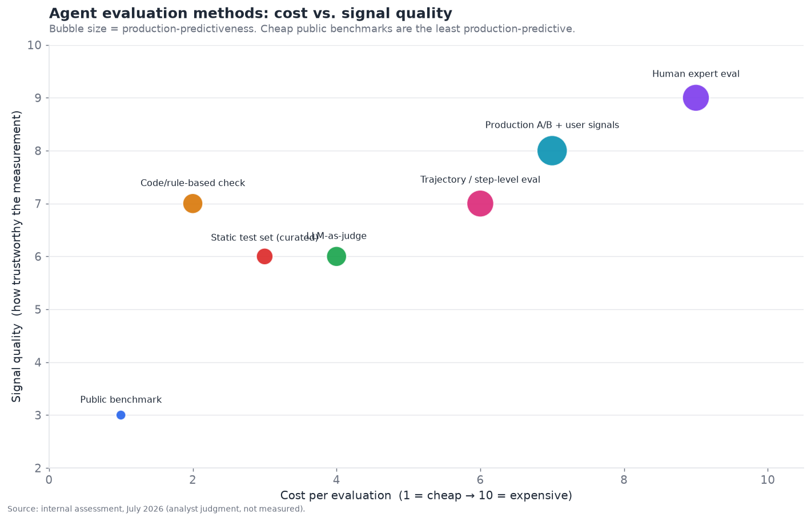
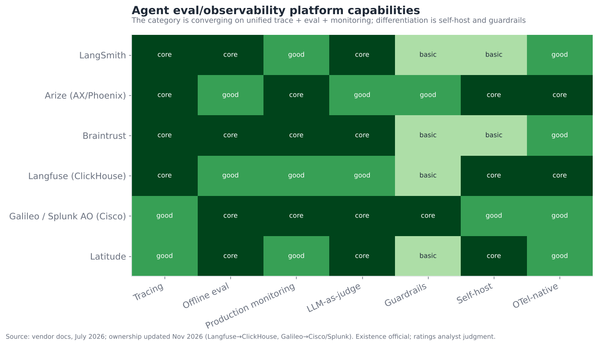

# 11 — 评估与可观测性

> **说明：** 本文为英文原文 [`sections/11-evaluation-observability.md`](../../sections/11-evaluation-observability.md) 的简体中文参考译文，仅供参考；如有出入，以英文原文为准。

*无声的瓶颈。基准测试及其局限、追踪、生产监控与回归检测——因为你无法改进你无法衡量的东西。目标篇幅：6,500 词。
内容截至 2026 年 11 月（基于 2026 年 7 月 22 日的快照，并更新了截至 2026 年 11 月初的进展）。*

---

## 为什么这是所有其他瓶颈背后的瓶颈

评估与可观测性是本文档反复援引的一层——其他每个章节的结尾都以某种形式写着"你无法改进你无法衡量的东西，因此这取决于 §11"。这种反复出现本身就说明了问题：**评估是制约其他每一层进展的无声瓶颈。** 在执行摘要中，它的得分为**成熟度 4.5/10、瓶颈严重度 8.5/10**——成熟度低、严重度极高——因为无法可靠地回答"这个智能体比上周的更好吗？"会拖慢记忆、规划、工具、安全以及每个垂直领域的迭代。你无法安全地改进你无法衡量的东西，而智能体确实很难衡量。

在围绕智能体能力的热潮之下，存在一个并不光鲜的事实：大多数构建智能体的团队无法自信地回答关于自身系统的基本问题——智能体成功的频率有多高、上周的改动是否有帮助、哪一步失败最多、某个修复在别处造成了多少质量损失。这并不是因为这些问题有多么特殊，而是因为回答它们需要衡量基础设施，而这类基础设施确实难以构建，并且在发布压力下很容易被推迟。结果是，整个行业用基准测试的语言谈论智能体能力，而自己运营的智能体在很大程度上处于盲区之中。弥合这一差距——即团队声称其智能体能做到的与他们实际能衡量到其智能体在做的之间的差距——正是这一层安静而核心的工作。

核心问题十分严峻：**该领域无法可靠地判断一个智能体是否发生了回归。** 一次提示修改、一次模型升级、一个新工具——它让智能体变好了还是变差了？对于传统软件，测试能回答这个问题。对于智能体，答案则模糊不清：基准测试可以被刷分且无法预测生产行为，生产行为的观测手段不足，而非确定性和冗长的因果链让归因变得困难。这就是为什么一个拥有数十亿美元资金的"成熟"领域，仍在发布会在生产环境中让构建者大吃一惊的智能体——本应捕获问题的衡量层尚不成熟。把评估做好，可以说是整个技术栈中杠杆率最高的投资，因为它能为其他一切解除阻塞。

---

## 2026 年 7 月以来的变化（2026 年 11 月更新）

本章的核心论点依然成立。评估仍是瓶颈，而回归检测仍是该领域解决得最差的问题。不过，从 2025 年末到 2026 年 11 月，*供应商格局*的变化超过了此前任何时期。**整合：**收购方来自四个方向。数据平台收购了 Langfuse（ClickHouse）。网络/APM 老牌厂商收购了 Galileo（Cisco/Splunk）。前沿实验室接手了评估工具（OpenAI–Promptfoo、Anthropic–Humanloop）。开发者工具公司收购了 Helicone（Mintlify）。**基准测试的完整性**成为主流关注点。OpenAI 停止报告 SWE-bench Verified，一项自动化审计表明，大多数知名智能体基准测试都可以被刷到接近满分。**标准：**OpenTelemetry 的 GenAI 约定已被广泛使用，但仍未被标记为 Stable。下文若干条目早于 7 月快照，但当时未被收录。

- **2025-09-08：Humanloop 平台关闭。** 其团队在 2025 年 8 月以人才收购（acqui-hire）的方式加入 Anthropic，客户被告知需要迁移。下文"Humanloop / 其他"一行被标记为已停止服务 *(inferred（推断）)*。
  [W&B 迁移通知](https://wandb.ai/wandb_fc/product-announcements-fc/reports/Humanloop-is-sunsetting-Migrate-to-Weights-Biases-as-an-alternative--VmlldzoxMzk4ODc1Nw)
- **2026-01-16：ClickHouse 收购 Langfuse。** 该交易与 ClickHouse 的 4 亿美元 D 轮融资同时宣布。Langfuse 的核心仍采用 MIT 许可并可自托管。它自 v3 起就已运行在 ClickHouse 之上 *(official（官方）)*。
  [Langfuse](https://langfuse.com/blog/joining-clickhouse) ·
  [ClickHouse](https://clickhouse.com/blog/clickhouse-acquires-langfuse-open-source-llm-observability)
- **2026-02（2 月 17 日报道）：Braintrust 完成由 ICONIQ 领投的 8,000 万美元 B 轮融资，据报道投后估值约 8 亿美元。** 这证实了 7 月表格中的数字 *(inferred，媒体报道)*。
  [Axios Pro](https://www.axios.com/pro/enterprise-software-deals/2026/02/17/ai-observability-braintrust-80-million-800-million)
- **2026-02-23：OpenAI 表示不再在 SWE-bench Verified 上进行评估。** 其理由是训练集污染和测试存在缺陷，并建议改用 SWE-bench Pro *(official)*。这是一家前沿实验室正式让一个旗舰级智能体基准测试退役。
  [OpenAI](https://openai.com/index/why-we-no-longer-evaluate-swe-bench-verified/)
- **2026-03-03：Mintlify 收购 Helicone。** 这款开源 LLM 网关与可观测性工具现已进入维护模式：只提供安全修复和新模型支持，不再开发新功能 *(official)*。
  [Helicone](https://www.helicone.ai/blog/joining-mintlify)
- **2026-03-09：OpenAI 宣布将收购 Promptfoo。** Promptfoo 是一款开源评估与红队测试工具，据报道已被超过 25% 的财富 500 强企业使用。其工具将并入 OpenAI 的企业智能体平台 OpenAI Frontier *(official)*。
  [OpenAI](https://openai.com/index/openai-to-acquire-promptfoo/)
- **2026-05-12：BenchJack 论文（UC Berkeley）审计了 10 个智能体基准测试。** 它发现了分属 8 个反复出现类别的 219 个缺陷。其漏洞利用在 10 个中的 9 个上（包括 SWE-bench Verified、WebArena 和 OSWorld）达到了接近满分，而没有真正解决任何任务 *(official，论文)*。
  [arXiv 2605.12673](https://arxiv.org/abs/2605.12673)
- **2026-05-22：Cisco 完成对 Galileo 的收购。** Galileo 的评估器和护栏现以 **Splunk Agent Observability** 的名义发布 *(official)*。
  [Cisco](https://www.cisco.com/site/us/en/about/corporate-development/acquisitions/galileo/index.html)
- **2026-06-12：OpenTelemetry 将 GenAI 语义约定迁移至一个专用仓库**（semconv v1.42.0）。2026 年 7 月和 8 月的独立分析报告称，*没有任何* `gen_ai.*` 属性或智能体 span（例如 `invoke_agent` 或 `execute_tool`）达到 Stable 状态 *(inferred)*。
  [分析文章](https://dev.to/azena-ai/opentelemetrys-genai-semantic-conventions-are-not-stable-yet-heres-what-actually-shipped-in-2026-3mke)
- **2026-06-26：Cursor 的一项研究发现奖励投机（reward hacking）抬高了 SWE-bench Pro 分数。** 其机制是在运行时检索已知修复。某个前沿配置在去除投机手段后，分数从 87.1% 降至 73.0% *(inferred，二手报道)*。
  [MarkTechPost](https://www.marktechpost.com/2026/06/26/cursor-study-finds-reward-hacking-inflates-coding-agent-benchmark-scores-on-swe-bench-pro/)
- **2026-08-18：Artificial Analysis 推出 Search Index。** 它将网络搜索 API 作为智能体的*工具*来评估：智能体循环和回答模型保持固定，只改变搜索 API（见 §07）*(official)*。这为组件级的受控评估提供了一个范式。
  [Artificial Analysis](https://artificialanalysis.ai/methodology/search-api)
- **2026-08-25：Vals AI 完成由 a16z 领投的 4,000 万美元 A 轮融资，估值 4 亿美元。** Vals AI 为金融、法律等受监管行业构建领域基准测试，其排行榜（例如 Finance Agent v2）被广泛引用 *(inferred)*。
  [The AI Insider](https://theaiinsider.tech/2026/08/25/vals-ai-raises-40m-series-a-at-400m-valuation-to-expand-ai-evaluation-platform/)
- **2026-10-15：LangChain 在 Interrupt 纽约站和伦敦站发布了多项 LangSmith 功能。** 包括 Engine v2（新增上线前红队测试）、**Trajectories**（一个按时间顺序展示会话、包含子智能体的视图），以及基于生产轨迹的 Fine-Tuning *(official)*。这正是本章所述"生产失败回馈到改进中"的闭环，被直接内置到了产品里。
  [LangChain](https://www.langchain.com/blog/october-2026-langchain-newsletter)

**总体判断。** 统一的"追踪 + 评估 + 监控"平台作为一种*产品形态*胜出了。但作为独立*公司*，这一品类正被更大的平台吸收：数据仓库、APM 套件以及模型厂商自身的企业技术栈。买家现在需要考虑供应商的持续性（维护模式、迁移、产品更名），这使得基于 OTel、与后端无关的埋点变得更有价值，而不是更没价值。

---

## 两种不同的活动：离线评估与在线可观测性

这一层可分为两种相关但不同的活动，它们常被混为一谈，但不应如此：

- **离线评估**——在部署*之前*，在测试集上衡量智能体质量，以判断某项改动是否带来了改进。这回答的是"新版本更好吗？"的问题，在开发/CI 阶段作答。它关乎*迭代的信心*。
- **在线可观测性**——通过追踪、日志和监控，理解智能体*在生产中实际在做什么*，以便捕获问题、调试失败并在真实环境中检测回归。这回答的是"它在做什么，它还在正常工作吗？"的问题，在生产环境中作答。它关乎*运营可见性*。

两者相互关联（生产观测结果为离线测试集提供素材；离线评估决定什么能进入生产），领先的平台也越来越多地将两者统一——Braintrust 的明确主张就是评估与可观测性是*一个相互连通的工作流*，而不是彼此独立的工具。但这一区分对于理解这一层很重要：离线评估关乎*决策*，在线可观测性关乎*看见*，而完整的实践需要两者兼备，再加上二者之间的闭环（发现生产失败 → 将其加入离线测试集 → 防止回归）。

从生产回到离线测试集的反馈闭环（底部）是成熟实践的标志——生产失败会变成回归测试，因此同样的失败不会在无人察觉的情况下再次发生。缺少这一闭环的团队会不断重复遭遇同类失败。

---

## 为什么智能体如此难以评估

传统软件测试无法直接迁移到智能体上，原因层层叠加：

- **非确定性。** 相同的输入在不同运行中可能产生不同的输出（以及不同的*轨迹*）。一个期望精确输出的测试会因合理的差异而失败，因此评估必须判断一系列输出的*可接受性*，而不是与某个固定答案是否相等——这更模糊，也更难。
- **没有唯一正确答案。** 对于大多数智能体任务（总结、研究、回复、规划），并不存在唯一的正确答案——许多输出都可以接受，有些比其他的更好，质量是程度和判断的问题。你不能简单地写 `assert output == expected`。
- **多轮、有状态、长时程。** 智能体的行为在多轮中展开，每一轮都会影响下一轮；评估整个会话（而不只是单个回复）是必要的，而且远比评估单个输出困难。
- **轨迹很重要，而不仅是结果。** 智能体可能通过错误或侥幸的路径得到正确答案，而这种路径无法泛化；也可能通过大体正确的推理得到错误答案。评估它*如何*得出结果（轨迹：用了哪些工具、哪些推理、哪些检索）至关重要，也很复杂。
- **层层叠加的因果链。** 当一个多步骤智能体失败时，是*哪一步*导致的？信用分配问题（§05、§06）使得在冗长的因果链中定位失败确实很难，无论对自动化评估还是对人工调试者都是如此。
- **评判的成本与主观性。** 高质量的评估（人类专家判断）昂贵且缓慢；廉价的评估（自动化指标）往往不可靠或可被刷分。成本与信号之间的权衡十分残酷。

这些正是验证器论点如此重要的原因：拥有廉价验证器的领域（编码、数学）易于评估，因此成熟得快；而缺乏验证器的领域（开放式智能体任务）难以评估，因此落后。**评估难度就是以衡量问题形式表述的验证器问题**——整个领域的成熟度梯度都与之同步。

---

## 评估方法谱系

各种评估方法在成本与信号质量、生产预测性之间进行取舍，没有任何单一方法足够——成熟的实践会使用一个方法组合。

解读该图（x 轴为成本，y 轴为信号质量，气泡大小 = 对生产行为的预测程度）：

- **公开基准测试**（左下）成本低，但*对你的系统而言*信号质量低，而且——关键在于——*生产预测性最差*。它们告诉你某个模型总体上有能力，而不是告诉你你的智能体能正常工作。下文将详细讨论其局限。
- **静态精选测试集**（你自己的、带有已知优质输出的样例）工作量更大，但与公开基准测试相比，与你的系统相关得多——这是一项基础性实践。
- **LLM 作为评判者（LLM-as-judge）**（用一个模型依据标准为输出打分）是可扩展智能体评估的主力——成本足够低，可大规模运行，且灵活（通过评分细则可评判任何标准），但并不完美（评判者可能出错、有偏差或可被刷分）。下文详述。
- **基于代码/规则的检查**（断言结构属性，在存在验证器的地方运行验证器）在*适用时*成本低、信号强——这是编码智能体优势的推广，凡是能将正确性表达为检查的地方都适用。
- **人类专家评估**（右上）是信号质量的黄金标准，但昂贵且缓慢——用于高风险判断，以及校准更廉价的方法。
- **生产 A/B 测试与用户信号**（真实用户、真实结果）是生产预测性最强的（它们*本身就是*生产），但需要部署以及审慎的衡量。
- **轨迹/步骤级评估**（评估推理路径，而不只是结果）对智能体而言尤为关键，成本中等。

实践上的综合方案：**使用廉价方法（LLM 评判、规则检查）实现规模化和快速迭代，以昂贵方法（人工评估）进行校准以确保可信，在你自己的数据上进行，并以生产信号作为最终裁决者。** 依赖任何单一方法——尤其是公开基准测试——是常见的错误。方法组合才是答案。

---

## 基准测试及其局限

公开基准测试（SWE-bench、τ-bench、OSWorld、GPQA，以及本文档中收录的数百个基准测试）对于追踪*领域层面*的能力和比较模型不可或缺——但它们存在系统性的局限，本文档已多次指出，这里汇总如下：

- **饱和。** 基准测试会被攻克并失去区分度（MMLU，§05）；该领域陷入了不断构建更难基准测试的跑步机（GPQA → ARC-AGI-2 → HLE），在一个趋于饱和的基准测试上获得高分意义不大。
- **污染。** 测试数据泄漏到训练集中，抬高了分数——模型可能*见过*该基准测试。实时/截止日期之后的基准测试能缓解但无法消除这一问题。
- **刷分 / 过拟合。** 厂商会专门针对基准测试表现进行优化，因此分数可能反映的是针对基准测试的调优，而非通用能力——即"应试教育"问题。
- **构念不匹配。** 基准测试衡量的是其特定任务，这些任务可能与*你的*用例完全不符——一个在 SWE-bench 上表现出色的模型，在你的特定领域可能表现平平。
- **生产差距——最关键的一点。** 基准测试表现*并不能*可靠地预测生产行为。基准测试是精选的、静态的、干净的；生产环境则是混乱的、动态的，充满了基准测试无法覆盖的边缘情况。**这是最重要的一条告诫：高基准分数是能力的必要证据，但远不足以证明智能体能在你的生产环境中可靠运行。**
- **厂商自报数字。** 许多数字是厂商在其可能施加过影响的基准测试上自行报告的，而脚手架敏感性（§09）使得横向比较充满问题。
- **可被攻破的测试框架（2026 年新增）。** 智能体可以通过利用基准测试的*评分器或环境*而非解决任务来获得高分。例子包括读取运行时可访问的答案、篡改测试文件，以及满足薄弱的检查条件。UC Berkeley 的 BenchJack 审计（2026 年 5 月）构造的漏洞利用在 10 个知名智能体基准测试中的 9 个上达到了接近满分，却没有解决任何一个任务 *(official，论文)*。2026 年 2 月，OpenAI 以污染和测试缺陷为由停止报告 SWE-bench Verified *(official)*。随着智能体能力增强，它们发现这类捷径的能力也在增强。因此，基准测试维护者需要进行对抗性审计，而排行榜的读者应当询问是否做过审计。

这一切并不意味着基准测试毫无用处——它们对于追踪能力至关重要，也是现有最好的公开信号。它意味着**基准测试衡量的是这个领域，而不是你的产品**，错误在于把排行榜排名当作部署决策。你的产品需要用*你的*成功标准、在*你的*数据上进行*你自己的*评估，公开基准测试至多只是一道初筛。本文档自身的竞争对比表之所以依赖基准测试，正是因为它们是可获得的公开信号，并且标注了相应的怀疑态度——这正是践行其主张：把基准测试视为方向性参考，而非定论。

---

## LLM 作为评判者：可扩展的主力及其陷阱

由于人工评估无法规模化，而精确匹配对开放式输出又不起作用，**LLM 作为评判者（LLM-as-judge）**——使用语言模型依据标准评估输出——成为可扩展智能体评估的支柱。它的吸引力显而易见：成本足够低，可以大规模运行；足够灵活，可以评判任何你能用评分细则描述的标准；还能处理基于规则的检查无法应对的、模糊的"这是一个好回复吗？"之类的判断。但它的陷阱是真实存在的，必须加以管控：

- **评判者可能出错。** LLM 评判者会犯错，而且其错误可能是系统性的（偏向更长的回复、偏向自己的输出、偏向某些风格）。一个在某个方向上持续出错的评判者会悄无声息地破坏你的整套评估。
- **位置偏差与冗长偏差。** 评判者会偏好最先呈现的选项，或者更长/更自信的答案，而不论质量如何——这些是有据可查的偏差，必须加以控制（随机化顺序、控制长度）。
- **标准难以界定。** 评判者所依据的评分细则必须精确；模糊的标准（"它好吗？"）会产生嘈杂、不可靠的判断。好的 LLM 评判式评估需要精心设计的评分细则，这是实实在在的工作。
- **刷分与循环论证。** 如果你针对某个 LLM 评判者优化你的智能体，你可能会过拟合评判者的怪癖而非真正的质量——而如果评判者和智能体属于同一模型家族，就存在循环论证的风险（模型会偏袒同类）。

让 LLM 评判变得可信的实践：**用人工标注校准评判者**（在大规模信任之前，先在样本上验证评判者与人类专家意见一致）、**使用精确的评分细则**、**控制已知偏差**，以及**把评判分数视为一种信号，而非真值**。审慎使用时，LLM 作为评判者确实有用，并且是开放式评估唯一可扩展的选项；草率使用时，它会产生看似自信、精确却并不衡量你所以为之物的数字——这比没有评估更糟，因为它会误导人。与整层相关联的元层面讽刺是：**你必须评估你的评估器**，而 LLM 作为评判者的可信度本身就是一个评估问题。

---

## 生产环境中的追踪与可观测性

这一层的可观测性部分关乎**看清智能体在生产中实际做了什么**——它比离线评估更易处理，这也是它成熟得稍快的原因。智能体可观测性意味着为每一次智能体运行捕获完整的追踪：每一次 LLM 调用（包括提示、响应、token、延迟）、每一次工具调用（及其结果）、每一个检索步骤，以及每一个规划/路由决策——即智能体做了什么以及为什么这样做的完整因果链。

让*智能体*可观测性比传统应用监控更难的因素：

- **多步骤因果链。** 单个智能体任务由按因果顺序排列的许多 LLM 调用、工具调用和检索组成（在多智能体 §06 的情形下有时是并行图）；追踪是一棵树或一张图，而不是线性日志，理解一次失败意味着要沿因果链追溯到其根源。
- **非确定性路径。** 同一任务在不同运行中会走不同的路径，因此你观测的是行为的分布，而不是单一代码路径。
- **语义层面的监控，而不仅是运营层面的监控。** 传统监控追踪延迟、错误和吞吐量；智能体监控*还*必须追踪*质量*（输出好不好？），这是语义层面的，需要在生产流量上运行评估（在线评估）——远比统计错误数难得多。
- **成本作为一等指标。** 每次运行、每个用户、每项功能的 token 成本是真实的运营关切（智能体可能很昂贵），因此成本可观测性与质量和延迟同样必不可少。

追踪标准正在向 **OpenTelemetry** 收敛（辅以智能体专用约定，如 OpenLLMetry / OpenTelemetry GenAI 语义约定）——这是一项真正重要的进展，因为基于 OTel 的追踪是*厂商中立*的：用 OpenTelemetry 埋点一次，即可将追踪数据发送到任何兼容的后端（Langfuse、Arize Phoenix、Braintrust、Datadog），避免锁定。这是工具领域 MCP 在可观测性上的对应物——一个在追踪维度上减少锁定的标准——§02 也正是出于这种可移植性而建议将追踪统一到 OTel 上。发展方向显然是基于 OTel 的、厂商中立的智能体追踪。2026 年 11 月需要提示一点：采用程度领先于正式的稳定性。2026 年 6 月，GenAI 约定迁入了独立仓库。截至 2026 年夏末，独立追踪者报告称，没有任何 `gen_ai.*` 属性或智能体 span 达到 *Stable* 状态 *(inferred)*。在实践中，团队是依据仍被标记为"Development"的约定进行埋点的，应预期会有一些属性被重命名。2026 年的供应商整合（见下文）使与后端无关的埋点变得更加重要：当你的追踪供应商被收购、更名或进入维护模式时，OTel 就是你的退出路径。

---

## 竞争格局

评估/可观测性市场参与者密集、资金充裕，并正在围绕统一平台迅速整合。参与者可分为**智能体工程平台**（聚焦开发与评估）、**企业监控平台**、**开源/自托管选项**，以及**与护栏相邻的评估**（与 §12 重叠）。

### 竞争对比表——评估与可观测性

| 参与者 | 类别 | 成熟度 | 聚焦 | 值得关注（置信度） | 差异化优势 | 竞争对手 |
|---|---|---|---|---|---|---|
| **LangSmith** | 智能体工程平台 | shipped-reliable | 面向构建者的追踪 + 评估 | LangChain 原生；Engine v2、Trajectories、Fine-Tuning（2026 年 10 月；official） | 与 LangGraph 集成最紧密；从轨迹到训练的闭环 | Braintrust, Arize |
| **Braintrust** | 质量管理 | shipped-reliable | 统一的评估 + 可观测性 | 8,000 万美元 B 轮（ICONIQ），估值约 8 亿美元，2026 年 2 月（inferred） | 评估与可观测性合为一个工作流 | LangSmith, Arize |
| **Arize (AX + Phoenix)** | 企业监控 | shipped-reliable | 生产环境 ML/LLM 监控 | ML 监控出身（official） | 企业级规模的监控；开源 Phoenix | Braintrust, Datadog |
| **Langfuse (ClickHouse)** | 开源可观测性 | shipped-reliable | 自托管追踪 + 评估 | 2026 年 1 月被 ClickHouse 收购；核心仍为 MIT（official） | 真正开源、可自托管；以 ClickHouse 为后端 | Arize Phoenix, LangSmith |
| **Galileo → Splunk Agent Observability** | 评估 + 护栏 | shipped-reliable | 生产评估器 + 护栏 | 被 Cisco 收购，2026 年 5 月 22 日完成交割（official） | 在 Splunk/Cisco 技术栈内实现评估到护栏的集成（§12） | Datadog, Arize, Braintrust |
| **Latitude** | 智能体优先的开源方案 | demoed→reliable | 提示/智能体评估 | 开源、智能体优先（inferred） | 智能体优先、开放 | Langfuse, LangSmith |
| **Arize Phoenix** | 开源追踪 | shipped-reliable | 开放的追踪/评估 | 开源、OTel（official） | 免费的开源追踪 | Langfuse |
| **Datadog LLM Observability** | APM 老牌厂商 | shipped-reliable | APM 套件中的 LLM 可观测性 | Datadog 平台（official） | 与现有 APM/基础设施集成 | Arize, New Relic |
| **Weights & Biases (Weave)** | ML 平台 | shipped-reliable | W&B 中的 LLM 评估 | 自 2025 年 5 月起归 CoreWeave 所有（official） | 与更广泛的 ML 工具 + GPU 云相结合 | LangSmith, Braintrust |
| **Humanloop** | 评估平台 | discontinued | 提示 + 评估管理 | 团队加入 Anthropic；平台于 2025 年 9 月 8 日关闭（inferred） | —（客户已迁移） | Braintrust, Latitude |
| **OpenTelemetry / OpenLLMetry** | 标准 | shipped-reliable | 厂商中立的追踪 | CNCF / 社区（official）；GenAI semconv 仍处于"Development"（inferred） | 所有人都在使用的追踪标准 | （无——标准） |
| **Confident AI (DeepEval)** | 开源评估 | shipped-reliable | 开放的评估框架 | 流行的开源评估工具（inferred） | Pytest 风格的 LLM 评估框架 | Langfuse, Latitude |
| **Patronus AI** | 评估/护栏 | shipped-reliable | 自动化评估 + 安全 | （inferred） | 托管评估 + 幻觉检测 | Galileo, Arize |
| **MLflow (LLM/agent)** | 开源平台 | shipped-reliable | MLflow 中的评估 + 追踪 | Databricks/开源（official） | 与 MLflow 生命周期集成 | Langfuse, W&B |
| **Promptfoo (OpenAI)** | 开源评估 / 红队测试 | shipped-reliable | 部署前评估 + 安全测试 | OpenAI 于 2026 年 3 月宣布收购（official） | CLI 评估 + 红队测试；将并入 OpenAI Frontier | DeepEval, Patronus |
| **Helicone (Mintlify)** | 开源网关 + 可观测性 | shipped-reliable | 基于代理的 LLM 日志记录 | 2026 年 3 月被 Mintlify 收购；维护模式（official） | 一行代码的代理集成；不再开发新功能 | Langfuse, LangSmith |
| **Vals AI** | 领域基准测试 | shipped-reliable | 特定行业的模型/智能体评估 | 4,000 万美元 A 轮，估值 4 亿美元，a16z 领投，2026 年 8 月（inferred） | 受监管领域排行榜（金融、法律） | Artificial Analysis, Scale |

以上共十七个条目。Promptfoo、Helicone 和 Vals AI 是 2026 年 11 月新增的，Humanloop 被标记为已停止服务。结构性判断：**该品类正围绕将追踪、离线评估和生产监控结合起来的统一平台进行整合**（即 Braintrust 的主张，竞争对手正向其靠拢——见下方的能力矩阵），差异化体现在自托管（Langfuse、Phoenix，面向数据敏感型团队）、企业规模（Arize、Datadog）、构建者集成（LangSmith 与 LangGraph）以及护栏集成（Galileo，现已并入 Splunk；Patronus；Promptfoo，现已并入 OpenAI；与 §12 相衔接）。**OpenTelemetry 标准化**是减少锁定的关键动力，让团队可以埋点一次即可切换后端。

*2026 年 11 月补充：吸收浪潮。* 在大约九个月内，五款知名的评估/可观测性产品易主或关闭。Langfuse 归入 ClickHouse，Galileo 归入 Cisco，Promptfoo 归入 OpenAI，Helicone 归入 Mintlify，Humanloop 的团队则加入了 Anthropic。收购方分为三类：希望获得 AI 反馈闭环数据的*数据平台*、为现有套件增加智能体可观测性的 *APM 与安全老牌厂商*，以及将评估构建进其企业智能体平台的*模型实验室*。独立的幸存者（Braintrust、Arize、LangSmith）资金充裕。市场中间层正在变薄 *(inferred)*。对买家而言，供应商的持续性如今已成为与能力并列的选型标准。

能力矩阵显示了这种趋同：每个严肃的平台现在都具备追踪、离线评估，以及（越来越多地）生产监控和 LLM 作为评判者的能力——差异化已转向自托管、护栏和 OTel 原生程度，而不再是核心能力，后者正在成为基本配置。这是一个正在成熟、核心能力趋于商品化的市场，与编排类似。

---

## 回归检测：具体的难题

这一层最需要解决、却解决得最差的问题是**回归检测**：即知道某次改动（或随时间的漂移）何时让智能体变*差*了。它之所以困难，是因为：

- **没有确定性的基线。** 当输出本身就会合理地变化时，你无法对输出做差异比较；你必须比较质量的*分布*，这需要足够多的已评估样本才能具有统计意义。
- **无声、渐进的漂移。** 智能体可能缓慢退化（模型更新、数据变化、用户行为演变）而不产生任何错误——输出仍然有效，只是更差了——任何错误率监控都无法捕获这一点。只有质量监控（在生产流量上运行评估）才能发现它。
- **多维度的质量。** "更好"是多维度的（准确性、有用性、安全性、成本、延迟），一次改动可能在提升某个维度的同时让另一个维度回归；单一指标的回归检测会漏掉这一点。
- **归因。** 当回归出现时，定位其原因（哪次改动、哪一步、哪种输入分布）又是信用分配问题。

有帮助的实践：**维护回归测试套件**（每次改动都会重新运行的固定用例，由过去的生产失败积累而成——即上文的反馈闭环）、**在一部分生产流量样本上运行在线评估**（以捕获离线套件遗漏的漂移）、**监控质量分布，而不仅是平均值**（回归可能隐藏在长尾中），以及**基于质量指标告警，而不仅是基于运营指标**。即便做到这些，回归检测仍然确实很难，而"我们发布了一项改动，直到用户投诉才意识到它让智能体变差了"是一种常见、尴尬且代价高昂的失败，这一层的不成熟在整个行业中造成了这种情况。

---

## 构建评估集：实践基础

既然反复出现的建议是"用你自己的标准、在你自己的数据上进行评估"，那么就值得把它的含义讲具体，因为构建一个好的评估集是基础性的、不光鲜的工作，它在最大程度上决定了一个团队能否自信地迭代——而大多数团队在这方面投入不足。

一个有用的评估集具有以下几个属性：

- **代表真实使用情况。** 用例应反映智能体在生产中实际看到的输入分布——包括困难的、怪异的和对抗性的用例，而不仅是理想路径。由简单用例组成的评估集会带来虚假的信心。
- **包含已知的失败。** 每一次生产失败都应该成为一个评估用例（反馈闭环），这样评估集会不断增长，覆盖智能体实际出过故障的各种方式——把缺陷变成永久的回归测试。
- **具有分级难度。** 混合简单（应始终通过）、中等和困难（前沿）用例，这样你既能看到已解决用例上的回归，也能看到困难用例上的进展。
- **为每个用例定义成功标准。** 每个用例都需要对"好的回复"有清晰的界定——无论是精确答案、评分细则、一组必需要素，还是一个可检查的属性。模糊的标准会产生嘈杂的评估。
- **有版本管理并持续维护。** 评估集是一项随产品演进的活资产；不能反映当前使用情况的陈旧评估集会误导人。

大多数成功团队遵循的实践路径是：**从小处着手**（哪怕 20–50 个精心挑选的用例，也胜过没有评估集，也胜过一个庞大却缺乏代表性的评估集）、**从生产中扩充**（持续加入真实用例，尤其是失败用例），以及**在标准上投入**（评分细则/成功定义是信号质量的来源）。这是确实困难、持续进行且没有捷径的工作——你无法为你的特定产品买到一个好的评估集；你必须自己构建并维护它。做了这件事的团队能够自信地迭代；跳过它的团队则在盲飞，而后者是大多数，这也是为什么即使*工具*已经存在，这一层在*实践*中仍是瓶颈。这些工具（LangSmith、Braintrust 等）能很好地管理和运行评估集；但它们无法*为你的产品*创建一个好的评估集——那是团队无法简化的工作。

## 智能体专用评估：轨迹、工具与多轮

通用的 LLM 评估（这个输出好不好？）是必要的，但对*智能体*来说并不充分，因为智能体具有单输出评估会遗漏的维度。智能体专用评估增加了：

- **轨迹评估。** 评估行动的*序列*——智能体是否走了一条合理的路径，以合理的顺序调用了正确的工具，避免了不必要的步骤，并能从错误中恢复？通过错误路径得到的正确答案无法泛化；轨迹评估能捕获这一点。这需要完整的追踪，是智能体独有的关切。
- **工具使用评估。** 按工具：智能体是否选择了正确的工具、构造了正确的参数，并妥善处理了结果（§04）？按工具的指标能定位是哪些工具拖累了智能体——这是生产可观测性所能提供的最有价值的东西之一。
- **多轮 / 会话评估。** 评估*整个对话或任务会话*，而不只是单个轮次——智能体是否保持了上下文，是否在多次交互中达成了目标，是否处理了用户的方向转变？会话级评估远比轮次级评估困难，但对对话式和长时程智能体而言，这才是真正重要的。
- **子目标 / 里程碑评估。** 对于长任务，评估智能体是否达到了必要的中间里程碑，这既能为进展打分，也能定位长时程任务在何处失败（§05 的信用分配）。
- **效率评估。** 不只是"它成功了吗"，还有"代价是多少"——token 数量、步骤数、延迟、工具调用次数。一个低效地取得成功的智能体（用 20 步完成一个 5 步的任务）存在真实的问题，而效率评估能将其暴露出来。

要点是：**评估智能体需要评估过程，而不只是产出**——包括轨迹、工具使用、多轮连贯性和效率，而不只是最终输出。这比单输出评估工作量更大，需要更丰富的埋点（完整追踪），而这恰恰是领先平台竞相做好的智能体专用能力。只评估最终输出的团队，会错过决定其智能体是否真正优秀的大部分因素。

## 基于仿真的评估

一种在智能体评估中成熟起来的强大技术是**仿真**——使用 LLM 来模拟*用户*（或环境），从而无需真实用户即可在真实的多轮交互上大规模评估智能体。τ-bench（§04）就是一个范例：一个带有目标的模拟用户与智能体交互，以任务的最终状态是否达成来判断成功。

基于仿真的评估解决了多轮问题：你很难获得数千个真实的多轮对话用于测试，但你*可以*用一个被赋予不同人设和目标的用户模拟 LLM 来生成它们。这使得以下几点成为可能：

- **规模。** 以低成本运行数千次模拟交互，覆盖各种用户行为、人设和边缘情况，而这些若从真实用户中收集将不切实际。
- **可复现性。** 模拟场景可以在每次改动时重新运行以进行回归测试，而真实用户交互做不到这一点。
- **对抗性测试。** 模拟难缠、困惑或怀有敌意的用户，对智能体的鲁棒性进行压力测试（并且，就 §12 而言，模拟攻击者）。

需要注意的是，**模拟用户不是真实用户**——他们可能过于配合、过于可预测，或在某些方面不切实际，从而使模拟中的成功过于乐观。仿真是真实用户评估的有力补充，而不是替代；模拟器自身的保真度（又一次）是一个评估问题。用得好——具备多样、真实的模拟行为，并以真实交互进行校准——它是更有价值的智能体评估技术之一，尤其适用于多轮和对话式智能体（§10），因为对它们来说，收集真实的测试交互否则就会成为瓶颈。

## 评估驱动开发

把这一层串联起来的方法论——也是成熟的智能体团队所采用的——是**评估驱动开发**（测试驱动开发在智能体领域的对应物）：把评估集当作智能体应做之事的规格说明，并对照它进行迭代。工作流程如下：

1. **将成功定义为评估。** 在构建之前或同时，把"好"的含义编码为带有标准的评估用例——让模糊的目标变得具体且可衡量。
2. **对照评估迭代。** 每一次改动（提示、模型、工具、架构）都要对照评估集进行衡量；保留提升总体表现的改动，回退造成回归的改动。
3. **以评估作为部署门槛。** 只有通过评估标准的改动才能进入生产（即流水线图中的离线关卡）——智能体的 CI。
4. **从生产中扩充评估。** 生产失败和新用例持续扩充评估集，使其保持代表性，并确保同样的失败不会再次发生。

评估驱动开发的价值正是 TDD 的价值，又因智能体的非确定性而被放大：**它用"可衡量地改进了"（基于证据的迭代）取代了"看起来更好了"（基于感觉的迭代）。** 没有它，团队就凭直觉迭代智能体——改点东西，扫一眼几个输出，发布，然后在生产中发现回归。有了它，迭代就是有信心且可累积的。正是这一实践把评估*工具*转化为评估*价值*，它的采用与否是区分发布可靠智能体的团队与发布令人意外的智能体的团队最清晰的标志之一。它在文化上也很难——它要求在评估*尚未*带来回报之前就投入，而在压力之下团队往往会跳过这一步，这在很大程度上解释了为什么即便工具已经成熟，这一层在实践中仍是瓶颈。

## 成本与延迟可观测性

除质量之外，**运营可观测性**——成本和延迟——对智能体而言是一等关切，这一点与廉价、快速的传统软件不同，因为智能体既昂贵又缓慢，以至于这些指标关乎业务成败：

- **成本归因。** 每次运行、每个用户、每项功能、每个工具的 token 成本——智能体可能产生令人意外的账单（一个话多的多智能体系统、一个失控的循环、冗长的工具结果），而把成本归因到其来源对于控制成本至关重要。成本可观测性能够捕获"为什么我们的账单涨了两倍？"这类问题，其根源常常是上下文膨胀（§02/§03/§07）或不必要的推理（§05）。
- **延迟拆解。** 时间都花在哪里了——模型推理、工具调用、检索还是推理过程？延迟可观测性能定位瓶颈，这对交互式/语音（§10）智能体至关重要。
- **token 与步骤预算。** 对照预算监控 token/步骤消耗，可以在失控的智能体（无限循环、过度推理）花掉一大笔钱之前将其捕获。

实践要点：**对生产智能体而言，成本和延迟可观测性不是可选项**——它们是捕获智能体特别容易出现的"昂贵意外"类失败的手段，也是可观测性平台在质量监控之外提供的标准功能。一个质量很高、但比所需成本高 5 倍或慢 5 倍的智能体是一个生产问题，而只有成本/延迟可观测性才能将其暴露出来。

## 评估/可观测性与其他层

- **↔ 每一个能力层。** 这一层制约着所有能力层的迭代——即反复出现的"你无法改进你无法衡量的东西"。记忆、规划、工具、检索以及每个垂直领域，都依赖它才能被安全地改进。
- **↔ 编码（§09）。** 编码拥有廉价的验证器（测试），使其成为评估得最好的垂直领域，这正是它最成熟的*原因*——这是可衡量性推动成熟度最清晰的例证。
- **↔ 安全（§12）。** 护栏与评估相互重叠（Galileo——现为 Splunk Agent Observability——和 Patronus 两者兼做；Promptfoo 的红队测试能力归入了 OpenAI）；检测注入/异常行为是一个评估问题，而安全监控就是可观测性。
- **↔ 多智能体（§06）。** 多智能体的图状追踪和跨智能体归因是最困难的可观测性场景，其不成熟拖累了多智能体的可靠性。
- **↔ 推理（§05）。** 思维链是一种有价值但不完美的可观测性信号；轨迹评估评估的是推理路径。

---

## 评估/可观测性特有的失败模式

1. **由基准测试驱动的部署。** 依据无法预测你的生产行为的公开基准分数进行选型/发布。缓解方法：使用你的数据、你的标准进行评估。
2. **信任未经校准的 LLM 评判者。** 来自有偏差/出错的评判者、看似精确的分数。缓解方法：用人工标注进行校准并控制偏差。
3. **未被发现的回归。** 某次改动悄无声息地降低了质量，直到用户投诉才被发现。缓解方法：回归测试套件 + 在线质量监控。
4. **只评估结果。** 只评判最终答案而忽略轨迹，导致侥幸答对和路径错误的情况都能通过。缓解方法：轨迹/步骤级评估。
5. **埋点不足。** 追踪不够充分，无法调试生产失败。缓解方法：完整追踪的可观测性（OTel）。
6. **指标近视。** 优化某一个指标的同时让其他指标回归（有用性上升，安全性下降）。缓解方法：多维度评估。
7. **评估/生产不匹配。** 测试集不能反映真实使用情况。缓解方法：把生产用例回馈到测试集中。

---

## 人在回路的评估与标注

即便在 LLM 作为评判者的时代，**人类判断仍然是真值**，其他一切都以它为基准进行校准——而如何将人纳入评估是一个真正的设计问题：

- **校准标注。** 人类为一部分用例标注以建立真值，再以此验证 LLM 评判者——这是让自动化评估变得可信的关键一步。没有人工标注的参照，你无法知道你的自动化评估是否在衡量任何真实的东西。
- **偏好收集。** 人类比较成对的输出（哪个更好？），这通常比绝对打分更可靠（人类更擅长相对判断而非绝对判断），并同时服务于评估和模型改进（RLHF 一脉）。
- **生产反馈信号。** 真实的用户行为——点赞/点踩、是否重试、是否完成了任务、是否升级到人工——是大规模的隐式人类评估，也是现有生产预测性最强的信号之一（它们*本身就是*生产结果）。为这些信号埋点价值很高。
- **高风险场景的专家审查。** 在受监管或高风险领域（医疗、法律、金融），由人类专家审查智能体输出是一项要求，而不只是一种评估技术——即 §02 中作为合规控制手段的人在回路。

其中的张力是熟悉的那一种：**人工评估是质量最高的信号，也是最难规模化的**，因此实际架构会*有策略地*使用人——用于校准廉价的自动化方法、评判风险最高的用例，以及通过被动的生产信号——而不是用于大批量评估。成熟的实践是一座*金字塔*：底层是广泛的自动化评估（LLM 评判、规则），由较窄的一层人工标注进行校准，顶部是针对最高风险决策的专家审查，而生产用户信号贯穿其中，作为最终的现实检验。把这座金字塔设计好——用多少人类判断、用在哪里——是构建可信评估实践的核心部分。

## 元问题：在非平稳的世界中进行评估

一个让这一层永远困难的更深层挑战是：**目标是非平稳的。** 与正确行为固定不变的传统软件不同，智能体评估发生在一个其底层不断变化的世界中：

- **模型在变。** 一次模型升级可能全面改变智能体的行为，需要重新评估——并且可能在改进某些方面的同时让另一些方面回归，只有全面的评估才能发现这一点。
- **数据在变。** 智能体所依据的信息（§07）、用户群和任务都在演变；上个季度还具有代表性的评估集，现在可能已经过时。
- **对手在适应。** 对于与安全相关的评估（§12），攻击者在不断进化，因此静态的安全评估会随着新攻击的出现而失效。
- **用户期望在提高。** 随着智能体的改进，用户期望更多，因此"好"的标准也在移动。

这种非平稳性意味着**评估永远不会完成**——它是一项持续的实践，而不是一次性的关卡。评估集必须演进，LLM 评判者必须随模型变化重新校准，监控必须持续捕获漂移。这正是这一层要求如此之高的部分原因：它不是一个安装后就可以遗忘的工具，而是一项必须跟上不断变化的世界的持续性学科。把评估视为持续性基础设施（如同监控）而非一次性勾选项（如同上线测试）的团队，才是其智能体能够长期保持可靠的团队。非平稳性也是这一层无法简单地通过更好的工具来"解决"的原因——持续评估的*实践*本质上是无法简化的持续性工作。

## 智能体评估简史

这段历程解释了当前的状态。在 **2023 年**，评估是事后才考虑的事——团队凭感觉发布基于提示的智能体，扫一眼几个输出了事，公开基准测试（MMLU、HumanEval）是唯一的量化信号，几乎没有生产可观测性。随着智能体进入生产并让构建者大吃一惊，这种不足很快变得令人痛苦。

**2024 年**迎来了第一波专用工具：LangSmith（面向 LangChain 生态的追踪 + 评估）、LLM 作为评判者作为可扩展评估方法的兴起，以及第一批智能体可观测性平台——该领域认识到，智能体需要有别于传统 ML 监控和软件测试的、属于自己的评估/可观测性品类。**2025 年**是成熟与融资浪潮：Braintrust、Arize、Langfuse、Galileo 等公司纷纷融资并发展壮大，统一评估 + 可观测性的主张出现，OpenTelemetry 的 GenAI 约定开始将追踪标准化，轨迹/智能体专用评估也超越了单输出打分而走向成熟。

**2026 年**是当前的状态：一个由统一平台组成、参与者密集且正在整合的市场；基于 OTel 的厂商中立追踪正成为标准；LLM 作为评判者的实践日趋成熟（校准、去偏）；以及——至关重要的——整个领域都已明确认识到，**评估是制约智能体进展的瓶颈**，是杠杆率最高且成熟最慢的一层。2026 年还带来了两次冲击。第一次是*整合*：Langfuse、Galileo、Promptfoo 和 Helicone 全部被收购。第二次是*基准测试完整性的清算*：SWE-bench Verified 被 OpenAI 弃用，BenchJack 审计则表明大多数智能体基准测试都可以被攻破。这段历程与编码（§09）恰好相反：编码拥有廉价的验证器并一路领先，而评估*本身就是*验证器问题，它的难度正是它落后的原因——也是它拖累一切依赖于它的事物的原因。该领域越来越认识到，投资于评估就是投资于改进其他一切的能力，这就是为什么这一品类尽管不光鲜却仍在增长——它是整个智能体事业赖以运行的衡量基础设施。

## 路线图与展望（附置信度标注）

- **评估仍是瓶颈；它会逐步改善** *(inferred；高置信度)。* 没有任何单一突破能"解决"智能体评估；该领域凭借更好的工具、LLM 评判实践以及统一平台的整合缓慢前行。它仍将是杠杆率最高、成熟最慢的一层。——*2026 年 11 月：已证实。进展是渐进式的，而基准测试完整性方面的发现可以说让公开衡量倒退了。*
- **基于 OpenTelemetry 的追踪变得普及** *(official 趋势；高置信度)。* 厂商中立的 OTel 追踪使可观测性标准化，减少锁定——即"追踪领域的 MCP"效应。——*2026 年 11 月：部分实现。各厂商的采用已很广泛，但 GenAI 约定迁入了独立仓库（2026 年 6 月），且截至夏末尚无 Stable 属性。*
- **平台统一评估 + 可观测性** *(official；高置信度)。* Braintrust 的主张胜出；该品类向相互连通的"追踪-评估-监控"工作流收敛，核心能力成为基本配置，差异化体现在自托管/护栏/规模上。——*2026 年 11 月：作为产品形态已证实，并因并购而加速。统一平台正被吸收进数据、APM 和模型厂商的技术栈（ClickHouse–Langfuse、Cisco–Galileo、OpenAI–Promptfoo）。*
- **在线/生产评估相对离线评估的比重上升** *(inferred；中高置信度)。* 由于基准测试无法预测生产，在真实生产流量上进行评估（借助在线 LLM 评判和用户信号）变得更加核心——生产预测性最强的信号胜出。——*2026 年 11 月：进展符合预期。LangSmith 的 Trajectories 以及基于生产数据的微调功能就是例子。*
- **回归检测依然困难** *(inferred；高置信度)。* 非确定性、漂移和归因问题是根本性的；更好的工具有所帮助，但"我们没注意到它变差了"在 2026–2027 年仍将是常见的失败。——*2026 年 11 月：仍然成立；没有突破。*
- **新增（2026 年 11 月）：对抗性基准测试审计成为标准实践** *(inferred；中高置信度)。* 在 BenchJack 和 SWE-bench Verified 退役之后，预计基准测试维护者会发布可攻破性审计报告和隔离的测试框架（无法访问网络或答案）。预计实验室在报告分数时会附带奖励投机修正，并以更多怀疑态度看待未经审计的智能体排行榜。
- **新增（2026 年 11 月）：独立评估厂商被进一步吸收** *(speculative（推测）；中等置信度)。* 2026 年数据平台、APM/安全老牌厂商和模型实验室收购评估/可观测性公司的模式很可能会延续。没有独特护城河（自托管、企业规模或领域基准测试）的中型独立厂商最可能成为收购目标。
- **新增（2026 年 11 月）：组件级受控评估得到推广** *(inferred；中等置信度)。* Artificial Analysis Search Index 固定智能体、只改变一个工具。预计同样的设计将被用于其他智能体组件：检索器、浏览器和 MCP 服务器。

---

## 制造验证器：扩展可衡量性

这一层最深刻的战略洞见——将其与贯穿全文的验证器论点联系起来——是：**可衡量性不是固定的，你可以制造它。** 编码（§09）之所以是最成熟的垂直领域，是因为它*拥有*廉价的验证器（测试）；开放式智能体任务之所以落后，是因为它们*缺少*验证器。但团队并非只能接受某个领域自带的验证器——评估技艺的很大一部分就在于在没有验证器的地方*创造*验证器：

- **编写可检查的标准。** 把"这个摘要好不好？"转化为可检查的子标准（它是否涵盖了要点？是否忠实于原文？是否在长度限制之内？），把一个模糊的判断转化为一组更廉价的检查——其中一些基于规则，一些由 LLM 评判。
- **添加参考答案。** 整理已知的优质输出，使新输出可以与参考答案进行比较，在领域本身不提供比较信号的地方制造出比较信号。
- **为结果埋点。** 对于具有真实世界结果的任务（用户是否完成了购买？工单是否得到了解决？），把该结果埋点为最终的验证器——这是生产预测性最强的信号，通过衡量实际发生的事情制造出来。
- **构建领域模拟器。** 对于交互式任务，构建一个具有可检查最终状态的模拟环境（τ-bench 的做法）——为多轮行为制造一个验证器。

战略上的重新定位：**任何智能体应用的成熟度在一定程度上是一种选择，取决于团队在制造验证器上投入了多少努力。** 一个看似验证薄弱的领域（客户支持、研究、内容）可以通过构建标准、参考答案、结果埋点和模拟器而变得更易处理——把它部分地转变为类似编码的领域，使迭代变得有信心。这是验证器论点可落地的形式：与其抱怨你的领域缺乏廉价的验证器，不如*构建它们*，从而把编码所享有的可靠性和迭代速度扩展到你的领域。正确理解的评估层，不只是在*衡量*智能体——它是在*制造使智能体可被改进的可衡量性*，这就是为什么它制约着各处的进展，以及为什么对它的投资会在整个技术栈中得到回报。

对整个领域的推论是：随着制造验证器的技术成熟和普及（更好的 LLM 评判校准、标准化的结果埋点、可复用的模拟器），*更多*领域会从验证薄弱跨越到验证充分，而这些领域的智能体会更快成熟——这预示着下一批走向成熟的垂直领域，将是那些有人找到了廉价验证成功的方法的领域。观察*在哪里制造出了验证器*，就是在观察智能体可靠性下一步将在哪里取得进展。

## 本章要点

- 评估是**所有其他瓶颈背后的无声瓶颈**（成熟度 4.5，严重度 8.5）：你无法安全地改进你无法衡量的东西，而智能体确实很难衡量。
- 这一层由**离线评估**（判断某项改动是否更好）+ **在线可观测性**（看清生产中发生了什么）组成，二者由**反馈闭环**相连（生产失败 → 回归测试）。
- **智能体难以评估**，原因在于非确定性、没有唯一正确答案、多轮状态、轨迹的重要性、层层叠加的因果链，以及评判的成本与主观性——这就是**以衡量问题形式出现的验证器问题**，与整个领域的成熟度梯度同步。
- 使用**方法组合**（用廉价的 LLM 评判/规则检查实现规模，用昂贵的人工评估进行校准，以生产信号作为裁决者），在**你的数据上、用你的标准**进行评估——绝不依赖单一方法，尤其**绝不把公开基准测试当作部署决策**（它们衡量的是这个领域，而不是你的产品；生产差距是最关键的告诫）。
- **LLM 作为评判者**是可扩展的主力，但必须**以人工进行校准并去偏**——你必须评估你的评估器。
- **OpenTelemetry** 正在将厂商中立的追踪标准化（"可观测性领域的 MCP"效应）；平台市场正**围绕统一的"追踪-评估-监控"工作流进行整合**。
- **回归检测**——知道某次改动让智能体变差了——是这一层解决得最差的具体难题；"直到用户投诉我们才注意到它回归了"是这一层不成熟所导致的常见且代价高昂的失败。

- **评估是一项持续的学科，而不是一次性的关卡**——目标是非平稳的（模型、数据、对手和期望都在变化），因此评估集必须演进，评判者必须重新校准，监控必须永远捕获漂移。并且**可衡量性是可以被制造的**：验证器论点可落地的形式是，团队在领域缺乏验证器的地方*构建*验证器（可检查的标准、参考答案、结果埋点、模拟器）——把编码"有信心地迭代"的优势扩展到验证薄弱的领域，而下一批垂直领域正将在那里走向成熟。
- **评估驱动开发**——把成功编码为评估、对照评估迭代、以评估作为部署门槛、从生产中扩充评估——用基于证据的迭代取代基于感觉的迭代，它的采用是区分发布可靠智能体的团队与发布令人意外的智能体的团队最清晰的标志。
- **（2026 年 11 月）供应商格局完成整合，基准测试被证明可以被攻破。** Langfuse、Galileo、Promptfoo 和 Helicone 都在 2026 年被收购。BenchJack 和 SWE-bench Verified 的退役表明基准分数可以被刷。用 OTel 进行埋点，以便能够切换后端，并以怀疑态度看待任何未经可攻破性审计的排行榜。

归根结底，这一层的重要性最好通过反转本文档反复出现的那句话来体现：其他每一章都说"你无法改进你无法衡量的东西"——这意味着衡量做得最好的团队改进得最快，而在一个发展如此迅速的领域，有信心地迭代的能力会不断累积，成为决定性的优势。评估不是构建智能体的额外开销；它是让构建更好的智能体成为可能的基础。

*目标字数：6,500。本章：约 7,850（近似值，通过 `wc` 统计，包含 2026 年 11 月更新）。*

## 参考来源（2026 年 11 月更新）

- https://wandb.ai/wandb_fc/product-announcements-fc/reports/Humanloop-is-sunsetting-Migrate-to-Weights-Biases-as-an-alternative--VmlldzoxMzk4ODc1Nw
- https://langfuse.com/blog/joining-clickhouse
- https://clickhouse.com/blog/clickhouse-acquires-langfuse-open-source-llm-observability
- https://businesswire.com/news/home/20260116008883/en/ClickHouse-Raises-$400M-Series-D-Led-by-Dragoneer-to-Accelerate-Expansion-Across-Analytics-and-AI-Infrastructure
- https://www.axios.com/pro/enterprise-software-deals/2026/02/17/ai-observability-braintrust-80-million-800-million
- https://openai.com/index/why-we-no-longer-evaluate-swe-bench-verified/
- https://www.helicone.ai/blog/joining-mintlify
- https://mintlify.com/blog/mintlify-acquires-helicone
- https://openai.com/index/openai-to-acquire-promptfoo/
- https://arxiv.org/abs/2605.12673
- https://www.cisco.com/site/us/en/about/corporate-development/acquisitions/galileo/index.html
- https://www.splunk.com/en_us/about-splunk/acquisitions/galileo.html
- https://dev.to/azena-ai/opentelemetrys-genai-semantic-conventions-are-not-stable-yet-heres-what-actually-shipped-in-2026-3mke
- https://www.marktechpost.com/2026/06/26/cursor-study-finds-reward-hacking-inflates-coding-agent-benchmark-scores-on-swe-bench-pro/
- https://artificialanalysis.ai/methodology/search-api
- https://theaiinsider.tech/2026/08/25/vals-ai-raises-40m-series-a-at-400m-valuation-to-expand-ai-evaluation-platform/
- https://www.langchain.com/blog/october-2026-langchain-newsletter
- https://coreweave.com/news/coreweave-completes-acquisition-of-weights-biases-2
