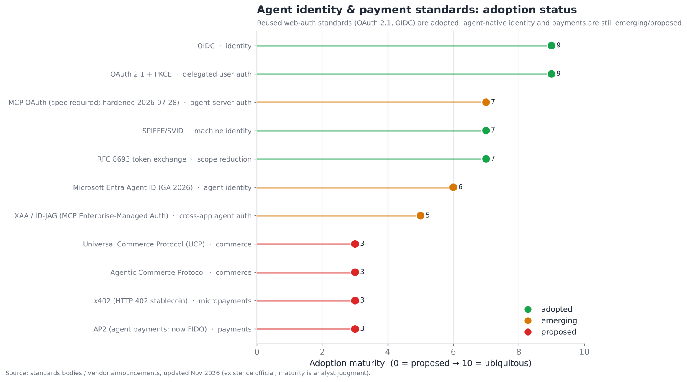
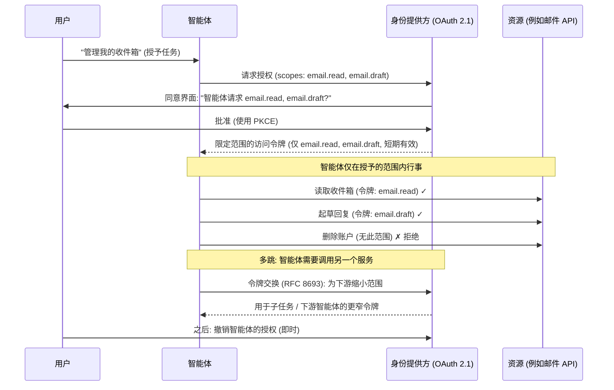
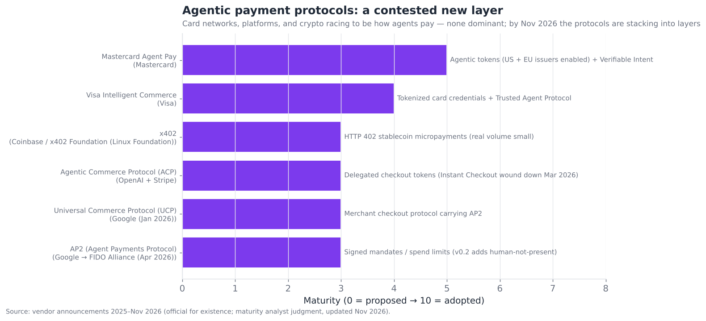

# 13 — 智能体身份与认证

> **说明：** 本文为英文原文 [`sections/13-agent-identity-authentication.md`](../../sections/13-agent-identity-authentication.md) 的简体中文参考译文，仅供参考；如有出入，以英文原文为准。

*智能体如何在不掌握你密码的情况下代表你行事。面向智能体的 OAuth、委托凭证、智能体支付，以及权限范围界定标准。目标篇幅：5,500 词。快照日期为 2026 年 7 月 22 日；已更新至 2026 年 11 月初的进展。*

---

## 一个正在实时被发明的问题

智能体身份与认证是整个技术栈中最不成熟的层之一——在执行摘要中，它的得分为**成熟度 3.0/10、争议度 8.0/10**，是*所有层中成熟度最低的*——因为它要解决的是一个两年前几乎不存在、如今正在实时被发明的问题：**智能体如何跨越众多系统代表你行事，而无需你把密码交给它——你又该如何界定、撤销和审计它被允许做的事情？**

这一层之所以滞后，原因颇具启发性。能力层（推理、编码、计算机使用）可以由单个实验室通过改进模型来推动。相比之下，身份本质上是一个*协调*问题——只有当智能体、身份提供方、被访问的资源，以及通常还有若干中间方，都就权限如何表示、委托和验证达成一致时，它才能运作。这需要独立各方之间的标准、采用与信任，而这天然是缓慢的——这也正是标准（§15）充满争议的原因。你无法单方面发明智能体身份；你必须让整个生态系统就此达成一致，而生态系统达成一致的速度很慢。这种对协调的依赖，叠加在一个真正全新的问题之上，就是为什么身份层尽管是影响最深远的层之一，却也是最不成熟的层。

这并非假想中的担忧；它是技术栈其余大部分内容的硬性约束。§04 指出，真实工具的难点在于认证，而不在于 API 调用本身。§06 将智能体身份/信任列为跨组织多智能体的关键制约因素。§12 将权限范围界定定为承重性的安全防御。所有这些都在此汇聚：**身份与授权，是"智能体在技术上能做到"转变为"智能体被允许去做，并且安全、可问责"的地方。**而坦率地说，现状是：该领域仍在用并非为智能体设计的 Web 认证标准拼装这一层，同时发明那些尚不存在的、智能体原生的组件。

---

## 2026 年 7 月以来的变化（2026 年 11 月更新）

自 7 月快照以来，这一层中身份这一半的进展快于支付那一半。跨应用委托获得了真正的标准化路径（IETF ID-JAG 授权许可，以"Enterprise-Managed Authorization"（企业托管授权）的形式应用于 MCP）。MCP 授权规范得到了加固。NIST 发布了智能体身份系统的设计原则，这是首个来自标准机构的此类文件。7 月下旬的短短几天内，身份与数据安全厂商相继宣布了总额约 12 亿美元的交易，收购智能体与非人类身份领域的初创公司。相比之下，智能体支付则显示出协议与实际落地之间的落差。OpenAI 早已（3 月）从聊天内结账中撤退，AP2 移交至标准机构，Google 在其之上叠加了一个商业协议（UCP），而 x402 尽管交易笔数的标题数字很大，真实的商业交易量依然微乎其微。7 月快照遗漏的条目已补入并加以标注。

- **2026 年 1 月（7 月版遗漏）** — Google 推出了 **Universal Commerce Protocol (UCP)**，这是一个开放的结账/商业协议，内置对 AP2、A2A 和 MCP 的支持。它位于 AP2 支付授权书（mandate）*之上* *(official（官方）；[Google Developers Blog](https://developers.googleblog.com/under-the-hood-universal-commerce-protocol-ucp/))*。
  CrowdStrike 同意收购授权厂商 **SGNL**（约 7.4 亿美元），以实现对人类、机器和智能体身份的上下文感知授权 *(official；[Business Wire](https://www.businesswire.com/news/home/20260107999523/en/CrowdStrike-to-Acquire-SGNL-to-Transform-Identity-Security-for-the-AI-Era/))*。
- **2026 年 2 月（遗漏）** — Palo Alto Networks 完成了对 **CyberArk** 约 250 亿美元的收购，主打面向智能体身份的特权访问控制 *(inferred（推断）；[TechInformed](https://techinformed.com/palo-alto-closes-cyberark-deal-adds-identity-pillar/))*。
  NIST 的 NCCoE 发布了概念文件 *Accelerating the Adoption of Software and AI Agent Identity and Authorization*（《加速软件与 AI 智能体身份及授权的采用》）*(official；[NIST CSRC](https://csrc.nist.gov/pubs/other/2026/02/05/accelerating-the-adoption-of-software-and-ai-agent/ipd))*。
- **2026 年 3 月（遗漏）** — 由于使用率低迷，OpenAI **逐步关停了 ChatGPT Instant Checkout**。ACP 的重心转向商户商品源（feed）与发现，商户保留自己的结账流程。2026 年 4 月的 ACP 规范快照新增了购物车/商品源/订单/认证资源以及 MCP 兼容性 *(inferred；[Digiday](https://digiday.com/marketing/shopify-says-purchases-are-coming-inside-chatgpt-through-agentic-storefronts-as-openai-retreats-on-instant-checkout/))*。
- **2026 年 4 月 28 日（遗漏）** — Google **将 AP2 捐赠给 FIDO Alliance**，并发布了 v0.2，新增在预设授权书范围内的"人不在场"（human-not-present）支付 *(inferred；[TokenPost](https://www.tokenpost.com/news/technology/45562))*。
- **2026 年 4 月—8 月** — **Microsoft Entra Agent ID 正式发布（GA）**（2026 年春季，与 Agent 365 捆绑）。面向智能体的 Conditional Access 与 ID Protection 于 2026 年 7—8 月在全球推出 *(official；[Microsoft Learn](https://learn.microsoft.com/en-za/entra/agent-id/whats-new-agent-id)，[MC1395007](https://mc.merill.net/message/MC1395007))*。
- **2026 年 6 月** — 基于 IETF ID-JAG 草案（Okta 以 Cross App Access 的名义推广）的 MCP **Enterprise-Managed Authorization** 扩展达到稳定状态。Auth0 与 Descope 在 8 月下旬至 9 月初推出了支持 *(inferred；[WorkOS](https://workos.com/blog/mcp-enterprise-managed-authorization-id-jag)，[Descope](https://www.descope.com/press-release/cross-app-access-xaa-support))*。
- **2026 年 7 月 28 日** — MCP 规范 **2026-07-28** 定稿。客户端必须在授权响应上校验 `iss` 参数（RFC 9207 混淆攻击防御），并将凭证绑定到签发它的授权服务器。刷新令牌与升级（step-up）范围规则得到澄清，且 Client ID Metadata Documents 优先于 Dynamic Client Registration *(official；[MCP blog](https://blog.modelcontextprotocol.io/posts/2026-07-28-release-candidate/)；DCR 弃用一说依据 [WorkOS](https://workos.com/blog/mcp-2026-spec-agent-authentication)，inferred)*。
- **2026 年 7 月下旬** — **Okta 同意收购 Permiso**（据报道约 2 亿美元），用于身份威胁检测。**Cyera 同意收购 Oasis Security**（约 10 亿美元），用于非人类身份与智能体访问管理 *(inferred；[TechCrunch](https://techcrunch.com/2026/07/30/okta-buys-ai-security-startup-permiso-source-says-for-about-200m/)，[The Next Web](https://thenextweb.com/news/cyera-oasis-security-1bn-ai-agent-identity-acquisition))*。
- **2026 年 9 月** — 在 **Oktane 2026** 上，Okta 发布了 **Agent SSO**，为支持 Cross App Access 的智能体提供一等身份，并纳入核心 SSO 套餐。它还扩展了 **Okta for AI Agents**（影子智能体发现、Agent Gateway）。SPIFFE 支持和智能体紧急停止开关（kill switch）是第四季度的目标 *(发布内容为 official，路线图为 inferred；[Okta](https://www.okta.com/newsroom/press-releases/okta-brings-first-class-identity-to-ai-agents-with-agent-sso/)，[Forrester](https://www.forrester.com/blogs/oktane-2026-recap-okta-announces-a-unified-iam-control-plane-with-agent-governance-and-identity-details-remaining-unclear/))*。
  NIST 发布了 NCCoE 项目的意见汇总，并将其范围扩展至软件开发生命周期中的智能体 *(official；[NIST](https://www.nist.gov/news-events/news/2026/09/comments-software-and-agentic-ai-identity-concept-paper))*。
- **2026 年 10 月** — NIST 的 **"Design Tenets for Agent Identity Management Systems"**（《智能体身份管理系统设计原则》）提出了十条原则，包括为智能体设立独立的身份生命周期，以及在架构上将"智能体试图做什么"与"它被允许做什么"分离。NIST 指出，现行标准尚不能满足全部十条 *(official；[NIST](https://www.nist.gov/blogs/cybersecurity-insights/design-tenets-agent-identity-management-systems))*。
  Infisical 完成 4,000 万美元 B 轮融资，部分用于打造 **Agent Vault** 凭证代理 *(inferred；[Pomegra](https://pomegra.io/startups/infisical-raises-40m-at-600m-for-ai-agent-security-2026-2026-11-03))*。
  Visa 与腾讯签署了一项探索性的智能体商务合作 *(inferred；[PYMNTS](https://www.pymnts.com/partnerships/2026/visa-launches-agentic-commerce-partnership-with-tencent/))*。
- **截至 2026 年 11 月 4 日** — **x402** 现归属于一个由 Linux Foundation 托管的基金会，并获得 Cloudflare 与 AWS CloudFront 的边缘支持。Block 加入并贡献了 Lightning 支持。但分析人士估计，x402 超过 95% 的活动属于协议信令，其被追踪的月交易额已从约 2,900 万美元的峰值（2025 年 11 月）降至约 40 万美元（2026 年 10 月）*(inferred；[Yahoo Finance/CoinDesk](https://finance.yahoo.com/markets/crypto/articles/x402-foundation-activated-27-old-152440828.html)，[InfoQ](https://www.infoq.com/news/2026/07/cloudflare-aws-x402-micropayment/))*。
- **仍未改变** — 尚无任何智能体专用的 OAuth 草案被 IETF 工作组采纳。面向智能体的 OBO 草案已于 2026 年 2 月过期，而 draft-klrc-aiagent-auth（基于 WIMSE + OAuth 构建）仍是个人提交稿 *(inferred；[IETF](https://www.ietf.org/archive/id/draft-klrc-aiagent-auth-00.html))*。

---

## 为什么智能体打破了现有的身份模型

传统的身份与访问管理（IAM）假设存在两类行为主体：**人类**（以交互方式登录、证明自己是谁，并在会话中行事）和**机器/服务**（拥有自己的凭证，以固定权限自主行事）。智能体与这两类都不完全契合，而这种错配正是问题的根源：

- **智能体*代表*人类行事，但并不*作为*人类本身。**当你的智能体读取你的邮件时，它是在以你的权限行事，但它并不是你——你希望它拥有你的*部分*权限（读取这个收件箱），而不是*全部*权限（不能修改你的密码），并且只针对*这项任务*（而不是永久）。传统 IAM 没有一个清晰的原语来表达"以这个人的身份行事，但仅限这些权限、仅限这项任务"。
- **智能体会跨系统串联（多跳委托）。**你的智能体调用另一个服务的智能体，后者再调用第三方——权限必须在各跳之间正确传播，既不能让每一跳都以交互方式重新认证你，也不能过度授权。这个"多跳委托问题"确实很难，而且大体上尚未得到干净的解决。
- **智能体需要动态、细粒度、可撤销的权限范围。**与拥有固定权限的服务不同，智能体的合适权限因任务而异，应当最小化（§12 的最小权限原则），并可即时撤销。传统的粗粒度、静态权限并不适用。
- **智能体具有非确定性，且可被操纵。**持有凭证的智能体可能被劫持（§12）并滥用这些凭证——因此，对这些凭证能做什么进行*范围界定*是一项安全控制，而不仅仅是便利措施。这就是为什么 §12 与 §13 密不可分。

结果是：该领域正在改造为"人类授权应用"而构建的 Web 认证标准（OAuth、OIDC），把它们拉伸以适配智能体，并在拉伸不到的地方发明新组件（智能体身份、跨应用委托、智能体支付）。下图展示了这种划分。

*2026 年 11 月更新：MCP OAuth（在 2026-07-28 规范中得到加固）、Entra Agent ID（GA）和 XAA/ID-JAG（稳定的 MCP 扩展，三家 IdP 已推出支持）的位置上移；新增 UCP。分数为分析师判断（inferred）。*

规律很清楚：**被复用的 Web 认证基础（OAuth 2.1、OIDC）已被采用且稳固；智能体原生的组件（跨应用智能体访问、智能体身份、智能体支付）则处于新兴阶段或仅停留在提案阶段。**这一层正在通过把稳固的基础向上延伸到全新的、有争议的领域来构建。

---

## 两种委托模式：代表用户（on-behalf-of）与自主

关于智能体如何获得权限，该领域已汇聚为两种基本模式，而这一区分组织起了整个层：

- **代表用户（On-behalf-of，OBO）/ 委托式。**智能体*以某个特定人类的权限*行事，在任务期间继承该用户权限（的一个限定子集）。这是副驾驶（copilot）和助手类产品的默认模式——你的智能体*以你的身份*、在你授予的限度内做事。身份问题是："证明该人类已授权此智能体以这些权限范围代表其行事。"OAuth 委托（见下文）就是其机制。
- **自主 / 常驻身份。**智能体拥有*自己的*身份和权限集，独立于任何人类会话——它本身就是一个一等主体，类似服务账号，只不过对象是智能体。这适用于无需人在回路、持续运行的智能体（监控智能体、定时智能体）。身份问题是："智能体是独立的行为主体；对*它*进行认证和授权。"机器身份标准（SPIFFE/SVID、客户端凭证）适用于此。

许多真实系统两者兼用：一个智能体可能拥有常驻的自主身份，*同时*又在特定任务上代表特定用户（OBO）行事。这一区分对设计很重要，因为两者的安全与问责模型不同——OBO 将行为与某个人类绑定（问责清晰、权限继承、可随用户授权一并撤销），而自主智能体需要自己的治理（这个智能体归谁所有？谁为它负责？如何注销它？）。"自主智能体"作为一种一等身份类型的出现——Microsoft Entra Agent ID、Okta 和 Auth0 的智能体身份功能——是 2026 年的重要进展之一：**智能体正在成为企业 IAM 中的一等身份**，像人类和服务身份一样被治理、审计并进行生命周期管理。到 2026 年 11 月，这已是 GA，而非预览。Entra Agent ID 于 2026 年春季正式发布，面向智能体的 Conditional Access 与 ID Protection 于 7—8 月推出。Okta 的 Agent SSO（2026 年 9 月）在核心 SSO 套餐中为支持 XAA 的智能体提供了一等身份。

---

## 一个委托认证流程

OBO 委托的核心机制将 OAuth 2.1——Web 的授权标准——扩展到智能体。以下是一个具有代表性的、限定范围的委托式智能体认证流程：

承重性的特性，以及它们如何对应 §12 的安全原则：

- **限定范围的同意。**用户明确授予*特定、最小化*的权限范围（读取 + 起草，而不是删除，也不是整个账户）——即在授权层面的最小权限（§12）。同意界面让授权可见且经过深思熟虑。
- **短期、限定范围的令牌。**智能体获得的令牌仅限于所授予的范围且有效期很短，因此泄露的令牌权力有限并会过期——即爆炸半径限制。
- **PKCE 与 OAuth 2.1 加固。**现代 OAuth 安全机制（PKCE，MCP 的认证要求使用它）保护整个流程。
- **通过令牌交换缩小范围（RFC 8693）。**在多跳场景中，智能体可以把自己的令牌*交换*为一个*更窄*的令牌传递给下游——这样子智能体或下游服务获得的权限更少，从而将最小权限原则沿各跳传播。这是解决多跳委托问题的关键构件。
- **即时撤销。**用户可以随时撤销智能体的授权，切断其访问——这对控制和事件响应至关重要。

这一流程是智能体身份的成熟核心：**通过 OAuth 2.1 实现的限定范围、经同意、短期有效、可撤销的委托**，如今已被 MCP 规范要求用于远程服务器认证。2026-07-28 的 MCP 版本进一步加固了它：强制 `iss` 校验（RFC 9207 混淆攻击防御）、凭证绑定到签发它的授权服务器、RFC 9728 受保护资源发现，以及 Client ID Metadata Documents 优先于动态注册。它在单用户 OBO 场景中运作良好。它力不从心之处，恰恰是那些智能体原生的难点：跨组织的多跳、自主智能体身份，以及——最前沿的——支付。

---

## 多跳委托问题

OBO 模型中最难、尚未解决的部分是**多跳委托**：当你的智能体调用服务 B 的智能体，而后者又调用服务 C 时，你的权限如何在整条链上正确、最小化且可问责地传播？那些朴素的方法全都行不通：

- **把你的令牌沿链传递下去**会过度授权（C 拿到了你的完整令牌），而且不安全（你的令牌扩散到你无法控制的系统中）。
- **在每一跳重新认证你**是不可能的（子调用发生时你并不在场），而且违背了委托的初衷。
- **每个服务使用自己的身份**会失去与*你的*权限和问责之间的关联（C 以 B 的身份行事，而不是以"经由 B 的你"的身份行事，从而破坏审计轨迹）。

新兴的解决方案扩展了 OAuth：**令牌交换（RFC 8693）**为每一跳签发逐步收窄的令牌；以及——2026 年值得关注的进展——**Okta 的 Cross App Access (XAA)** 协议（与 Auth0 共同构建），它标准化了一个应用的智能体如何安全地调用另一个应用的数据，*而无需在每一跳都进行单独的交互式凭证交换*，同时保留限定范围的权限和审计。这正是这一层所需要的那种智能体原生标准，它的出现意义重大。截至 2026 年 11 月，它已有了具体的标准化路径：IETF **Identity Assertion JWT Authorization Grant (ID-JAG)** 草案同时支撑着 Okta 的 XAA 和 MCP **Enterprise-Managed Authorization** 扩展（自 2026 年 6 月起稳定），Auth0 与 Descope 也在 9 月前推出了支持。它仍是草案而非 RFC，仍处于*新兴*而非已被采用的状态，因此多跳问题依然是这一层真正困难、悬而未决的挑战之一。跨组织的多跳（§06 中跨组织多智能体的愿景）则更难，因为它涉及跨越组织边界的信任，而不仅仅是技术层面的委托。

---

## 智能体支付与商务

这一层的前沿——也是整个智能体技术栈中争议最大的新子层之一——是**智能体支付**：智能体如何在授权限额内安全地代表你为商品和服务付款。这很重要，因为能够*进行交易*（购买、订阅、为服务付费、向其他智能体付款）的智能体会释放巨大的价值（自主商务、智能体之间的经济体），也带来巨大的风险（一个能花你钱的智能体，一旦出错后果严重，尤其是考虑到 §12 中的注入问题）。

各提案共有的核心设计要求是：**智能体只应在明确、可验证的授权限额内进行交易**——你授权一个特定的金额、商户或用途，而智能体（即使被劫持）也无法超出该授权书。相互竞争的提案如下：

*2026 年 11 月更新：新增 UCP。ACP 下调（Instant Checkout 已关停），Mastercard 上调（美国 + 欧盟发卡行已启用）。成熟度分数为分析师判断（inferred）。*

- **AP2 (Agent Payments Protocol)** — 由 Google 发起（联合各支付网络），使用经签名的*授权书*（mandate），以密码学方式界定智能体被授权的支出（金额、商户、条件），从而让智能体出示可验证的授权，而不是持有你完整的支付凭证。它在 §06 中作为互操作技术栈的支付层被介绍过。2026 年 4 月，Google **将 AP2 捐赠给 FIDO Alliance**，并发布了带有"人不在场"授权书的 v0.2。
- **Universal Commerce Protocol (UCP)** — Google 的开放商务/结账协议（2026 年 1 月）。它承载 AP2 用于支付授权，并提供 A2A/MCP 绑定，如今是 Google 技术栈中面向商户的一层（Universal Cart，于 I/O 2026 发布）。据报道 Mastercard 已表示支持。
- **Agentic Commerce Protocol (ACP)** — OpenAI + Stripe，通过委托支付令牌实现智能体驱动的结账（注意：*这个* ACP 与 §06 中 AGNTCY 的 Agent Communication Protocol 不同——一次不幸的名称撞车）。它推出的初衷是在受控的结账流程中支持由智能体发起的购买，但在 **2026 年 3 月，由于使用率低迷，OpenAI 逐步关停了 ChatGPT Instant Checkout**。此后 ACP 的重心转向商户商品源与发现，商户保留自己的结账流程；2026 年 4 月的规范新增了 MCP 兼容性。Stripe 的 Shared Payment Tokens 仍是其中的委托凭证组件。
- **x402** — Coinbase 复活了长期闲置的 HTTP 402 "Payment Required" 状态码，用于*稳定币小额支付*，使智能体（及服务）能够用加密货币按请求付费——在传统银行卡通道过于笨重的智能体间支付和 API 小额支付场景中颇具吸引力。它现由 Linux Foundation 托管的 x402 Foundation 治理，获得 Cloudflare 与 AWS CloudFront 的边缘支持，以及（2026 年 11 月）Block 的 Lightning 支持。不过分析人士警告，大多数链上"交易"属于协议信令，真实的商业交易量很小且在下降。
- **卡组织方案** — Visa Intelligent Commerce 与 Mastercard Agent Pay，由卡组织签发*令牌化的、智能体专属的凭证*并附带支出控制，将现有的支付通道和信任基础设施引入智能体商务。Mastercard 称自 2025 年底起所有美国持卡人均已启用，到 2026 年年中欧洲发卡行已在网络层面启用，另外还有与 Google 共建的"Verifiable Intent"信任层。Visa 与 OpenAI 建立了合作（2026 年 6 月），并通过基于 Cloudflare Web Bot Auth 的 Trusted Agent Protocol 实现智能体签名，但它在 2026 年 9 月表示 Intelligent Commerce 仍在部署中。

竞争态势是一场真正的圈地运动：**卡组织（Visa、Mastercard）、平台（OpenAI/Stripe、Google）和加密货币（Coinbase）都在争夺成为智能体付款的方式**，目前还没有哪一方占据主导。这与其他领域的标准之争（§15）如出一辙——来自不同权力中心的多个可信提案，没有明确的赢家，最终可能整合或共存。赌注很高，因为支付是智能体自主性与真金白银相遇的地方，而安全要求（即使面对被劫持的智能体也能守住的授权限额）十分严苛。这个子层牢牢处于**提案到新兴**阶段——有真实的提案和真实的支持者，但生产环境采用极少——它也是最受关注的前沿之一，因为智能体商务是一个巨大的潜在市场，其前提是把信任和授权做对。*2026 年 11 月的解读：*2026 年的洗牌更多是把这个领域按层级梳理开来，而不是选出了赢家。授权/授权书（AP2，现归 FIDO；Mastercard Verifiable Intent）、商户/结账协议（UCP、ACP）、边缘处的智能体识别（Visa TAP / Web Bot Auth）以及结算通道（银行卡令牌、x402）越来越多地叠加在一起，而非正面竞争。旗舰级的消费者结账产品（ChatGPT Instant Checkout）因转化不足而下线，这提醒我们：需求——而不仅仅是信任——同样是一道门槛。

---

## 竞争与标准格局

智能体身份横跨**身份提供方**（为智能体改造 IAM）、**智能体认证专业厂商**、**标准机构**和**支付提供方**。在这一层，传统巨头（Okta、Microsoft、卡组织）占据强势地位，因为身份和支付是高度依赖信任、有利于既有巨头的领域——但智能体原生的初创公司也在开辟空间。

### 竞争 / 标准一览表 — 智能体身份与认证

| 参与者 | 类别 | 成熟度 | 关注点 | 值得关注（置信度） | 差异化 | 竞争对手 |
|---|---|---|---|---|---|---|
| **Okta / Auth0** | 身份提供方 | shipped-reliable | 委托式智能体认证 | Cross App Access (XAA)；Auth for GenAI；Agent SSO + Okta for AI Agents（2026 年 9 月）；收购 Permiso（据报道约 2 亿美元，2026 年 7 月）(official) | 跨应用智能体委托；令牌保管库；智能体网关 | Microsoft Entra, WorkOS |
| **Microsoft Entra Agent ID** | 身份提供方 | shipped-reliable | 智能体作为一等身份 | 2026 年春季随 Agent 365 GA；面向智能体的 Conditional Access/ID Protection 于 2026 年 7—8 月 GA (official) | 在企业 IAM 中治理智能体 | Okta, Google |
| **CyberArk (Palo Alto Networks)** | PAM / 身份安全 | shipped-reliable | 智能体身份的特权访问 | 约 250 亿美元收购于 2026 年 2 月完成 (inferred) | 将每个智能体视为特权身份 | Okta, SailPoint |
| **Oasis Security (Cyera)** | NHI / 智能体身份 | shipped-reliable | 非人类与智能体访问治理 | Cyera 以约 10 亿美元收购，2026 年 7 月 (inferred) | NHI 发现 + 智能体访问管理 | Astrix (Cisco), Entro (SailPoint) |
| **SGNL (CrowdStrike)** | 授权 | shipped-reliable | 上下文感知的运行时授权 | 约 7.4 亿美元收购于 2026 年 1 月宣布 (official) | 面向人类/机器/智能体的零常驻特权 | Okta, CyberArk |
| **WorkOS** | 身份基础设施 | shipped-reliable | 面向 AI 应用的认证基础设施 | 多跳委托相关工作 (inferred) | 开发者优先的智能体认证基础设施 | Stytch, Descope |
| **Stytch** | 认证基础设施 | shipped-reliable | 智能体/用户认证 | 智能体认证功能 (inferred) | 嵌入式智能体 + 用户认证 | WorkOS, Descope |
| **Descope** | 认证基础设施 | shipped-reliable | 智能体认证流程 | 智能体身份；2026 年 9 月支持 XAA / ID-JAG (official) | 基于流程的智能体认证 | Stytch, WorkOS |
| **Arcade.dev** | 工具认证 | shipped-reliable | 按用户的工具 OAuth | 以认证为中心的工具平台 (inferred) | 面向智能体工具的委托认证（§04） | Composio, 原生 OAuth |
| **OAuth 2.1 / OIDC** | 标准 | shipped-reliable | 委托授权 | IETF；MCP 强制要求，在 MCP 2026-07-28 中加固（iss 校验、签发方绑定）(official) | 其他一切所扩展的基础 | （无——标准） |
| **ID-JAG / MCP Enterprise-Managed Authorization** | 标准 | demoed-brittle | 跨应用智能体委托 | IETF 草案；MCP 扩展于 2026 年 6 月稳定；Okta、Auth0、Descope 支持 (inferred) | 由 IdP 中介的智能体访问，无需逐个应用同意 | RFC 8693 令牌交换 |
| **NIST NCCoE agent identity project** | 标准/指南 | research-only | 参考架构 | 2026 年 2 月概念文件；2026 年 10 月十条设计原则 (official) | 中立的政府级智能体 IAM 基线 | （无——指南） |
| **SPIFFE/SVID** | 标准 | shipped-reliable | 机器身份 | CNCF (official) | 工作负载/智能体机器身份 | client-credentials |
| **AP2** | 支付标准 | demoed-brittle | 智能体支付 | Google + 支付网络；捐赠给 FIDO Alliance，v0.2，2026 年 4 月 (inferred) | 经签名的支出授权书 | ACP, 卡组织方案 |
| **Universal Commerce Protocol (UCP)** | 商务标准 | demoed-brittle | 智能体结账/商务 | Google，2026 年 1 月；承载 AP2 (official) | 带 A2A/MCP 绑定的面向商户协议 | ACP |
| **Agentic Commerce Protocol** | 支付标准 | demoed-brittle | 智能体结账 | OpenAI + Stripe (official)；ChatGPT Instant Checkout 于 2026 年 3 月关停 (inferred) | 委托结账令牌；现以商品源/发现为主 | AP2/UCP, x402 |
| **x402** | 支付标准 | demoed-brittle | 加密货币小额支付 | Coinbase；x402 Foundation（Linux Foundation）；Cloudflare/AWS 边缘 (inferred) | HTTP 402 稳定币支付 | AP2, 卡组织方案 |
| **Visa Intelligent Commerce** | 支付网络 | demoed-brittle | 智能体银行卡凭证 | Visa (official)；2026 年 6 月与 OpenAI 合作，2026 年 9 月仍在部署 (inferred) | 令牌化的智能体银行卡凭证 + Trusted Agent Protocol | Mastercard, ACP |
| **Mastercard Agent Pay** | 支付网络 | demoed-brittle | 智能体支付 | Mastercard (official)；美国持卡人与欧盟发卡行已启用；Verifiable Intent (inferred) | 基于银行卡通道的 Agent Pay 令牌 | Visa, ACP |
| **Stripe (agent tooling)** | 支付平台 | shipped-reliable | 智能体商务基础设施 | Stripe 智能体工具 + ACP (official) | 面向智能体的开发者支付基础设施 | 卡组织 |

经过 2026 年 11 月的更新，表中共有二十个条目，涵盖身份提供方、身份安全领域的收购方、认证基础设施初创公司、标准以及支付提供方。结构性解读是：**身份领域有利于既有巨头（Okta、Microsoft、卡组织领先，因为信任天然偏向既有巨头），智能体原生初创公司（WorkOS、Stytch、Descope、Arcade）构建开发者基础设施，而支付子层则是一场全新的、充满争议的圈地运动。**整个层都还处于早期——基础稳固（OAuth/OIDC），智能体原生扩展正在兴起（XAA、Entra Agent ID），支付则刚刚起步——这正是执行摘要所描绘的成熟度 3.0、高争议度的图景。2026 年为这幅图景增添的是**整合**。Palo Alto/CyberArk、CrowdStrike/SGNL、SailPoint/Entro、Cisco/Astrix（据报道）、Okta/Permiso 以及 Cyera/Oasis 都在大约十个月内收购了智能体或非人类身份能力，因此既有巨头的优势正通过收购得到强化。

---

## 非人类身份的爆炸式增长

一个在企业安全圈中日益流行的框架是：智能体正在加速**非人类身份（NHI）的爆炸式增长**。企业中的机器/服务身份（API 密钥、服务账号、工作负载身份）本就多于人类身份，而智能体使这一数量急剧倍增——每一个智能体、每一个子智能体，都是一个必须被开通、限定范围、保护、监控和注销的非人类身份。这带来了规模化的治理挑战：

- **蔓延。**一家部署智能体的大型企业可能迅速积累起成千上万个智能体身份，每个都带有凭证和权限——如果不加管理，这将是治理和攻击面上的噩梦（持有有效凭证的孤儿智能体、权限过大的智能体、无人监控的智能体）。
- **生命周期管理。**智能体需要完整的身份生命周期——以最小权限开通、轮换凭证、监控使用情况，并在退役时*注销*。孤儿凭证是经典的安全隐患，而智能体让"成为孤儿"变得很容易（启动一个智能体，然后忘了它）。
- **所有权与问责。**每个智能体身份都应有一个对其负责的人类或团队所有者——谁部署了它、它行为不当时谁负责。没有明确所有者、不受治理的智能体既是安全漏洞，也是问责缺口。
- **可见性。**安全团队需要*看到*环境中所有的智能体身份、它们能访问什么、正在做什么——这正是 NHI 治理工具（以及如今 Okta、Microsoft Entra 和专业 NHI 厂商中的智能体身份功能）所要解决的发现问题。

对企业的启示是：**智能体身份治理正在成为 IAM 中一门独立的学科**，其驱动力正是智能体引发的 NHI 爆炸。在此布局的厂商——向智能体延伸的身份领域巨头，加上非人类身份专业厂商——正在解决一个真实且不断扩大的问题：不仅是智能体*如何*认证（OAuth 机制），更是*企业如何在不失控的前提下治理由成千上万个智能体身份组成的群体*。这一治理层仍处于早期，但增长迅速，因为蔓延是真实存在的，相关事件（孤儿智能体或权限过大的智能体）也开始造成实际损害。2026 年的交易流就体现了这一点。NHI 专业厂商正被身份和安全平台吸收（Oasis 被 Cyera 以约 10 亿美元收购，Entro 被 SailPoint 收购，据报道 Astrix 被 Cisco 收购，Permiso 被 Okta 收购），而 Okta 如今已将影子智能体发现作为产品功能推出。

## 凭证保管库与密钥管理

智能体认证中一个核心的实用模式是**凭证保管库**（credential vaulting）——安全地存储智能体所需的凭证/令牌，并在使用时注入，而不是把它们嵌入智能体或其提示中。Auth0 的令牌保管库及类似功能就是这一模式的范例：

- **保管库持有真实凭证**（OAuth 令牌、智能体需要调用的服务的 API 密钥），智能体在使用时向保管库请求，且请求受范围限制并被审计——因此密钥永远不会存在于智能体的上下文中（提示注入可能从那里窃取它们，§12），也不会存在于代码中。
- **即时、限定范围的注入。**凭证仅为特定调用提供，范围最小化，且不被保留——从而限制暴露面。智能体从不"持有"宽泛的常驻凭证。
- **审计与撤销。**每次凭证使用都会被记录（谁/什么/何时），且访问可以被集中撤销——这正是原始的"直接给智能体一个 API 密钥"做法所缺乏的问责与控制。

这一模式也吸引了专门的产品：2026 年 10 月，密钥管理厂商 Infisical 完成 4,000 万美元 B 轮融资，部分用于构建一个"Agent Vault"代理，让智能体接触不到真实凭证（inferred）。

其安全价值与 §12 直接相关：**把凭证放在保管库中、远离智能体的上下文，可以限制被劫持的智能体能够窃取或滥用的东西**——注入攻击无法窃取智能体从未持有的凭证，也无法突破保管库所强制执行的范围。因此，凭证保管库既是一种认证便利模式（集中管理智能体的所有凭证），也是一种安全控制（最小化凭证暴露），对于接触多个需认证服务的生产级智能体而言，它是一项日趋成熟的最佳实践。它所取代的反模式是把 API 密钥直接嵌入智能体提示或代码中——这种做法至今仍令人沮丧地普遍。

## 智能体发现与可验证信任

要让智能体与*彼此*交互（§06 中多智能体、跨组织的愿景），它们不仅需要认证，还需要*发现并信任*对方——这比用户与智能体之间的认证更难：

- **发现。**智能体 A 如何找到具备所需能力的智能体，并确认它是合法的？A2A 的"Agent Card"（§06）会公布能力和端点，但*信任*被公布的智能体与找到它是两回事。
- **可验证的身份与凭证。**智能体应能*证明*自己是谁、被授权做什么——通过密码学身份（DID，即去中心化标识符，如 ANP 中所用）和可验证凭证（对智能体属性/权限的密码学签名证明）。这使得智能体 B 无需中心化权威即可验证智能体 A 的声明，从而实现跨组织信任。
- **声誉与证明。**除了身份之外，*信任*还需要某种声誉或第三方证明（该智能体由这个信誉良好的组织运营、过往表现良好）——这在智能体领域几乎不存在，而且是个难题（声誉系统可被操纵，而智能体又是新事物）。

现状是：**智能体之间的发现正在兴起（Agent Card），可验证的智能体身份尚处早期（DID、可验证凭证正在探索中），而智能体声誉/信任基本尚未解决。**这正是 §06 将身份/信任列为跨组织多智能体关键制约的原因——连接智能体的*管道*已经存在，但让它们安全地跨组织边界进行交易的*信任基础设施*尚不存在。构建这一信任基础设施——可验证身份、凭证、声誉以及围绕它们的治理——是制约更宏大的智能体经济愿景的深层未解难题之一，也是身份（§13）、多智能体（§06）和标准（§15）的交汇之处。

## 人与智能体之间的问责与审计

监管（§12）和企业治理使得这一维度至关重要：**当智能体行事时，谁来负责，又如何审计？**身份是问责的基础：

- **归因。**每一项智能体行为都应可归因——归于智能体本身、归于它所代表的人类（在 OBO 中），以及归于智能体的所有者。身份层提供了这种归因（授权该行为的令牌/身份），这是安全调查和问责的共同基础。
- **审计轨迹。**一份完整、防篡改的日志，记录智能体做了什么、凭谁的授权、出于什么原因（与 §11 的可观测性相关联），既是合规要求，也是问责的必需品。身份层提供了让审计有意义的"凭谁的授权"。
- **问责缺口。**对于*自主*智能体（并非代表某个特定人类行事）而言，问责问题确实悬而未决——如果自主智能体造成损害，所有者要承担责任吗？部署者呢？这与 §12 关于责任的讨论相关联，是一个开放的法律/治理问题，身份能部分解决它（通过确立所有权），但无法彻底解决。

原则是：**身份是智能体问责的基础**——你无法让智能体（或其所有者）为无法归因的行为负责，而没有身份就无法归因。这就是为什么身份层尽管尚不成熟，却是*值得信赖*的智能体（而不仅仅是*能用*的智能体）不可或缺的基础设施：正是它让智能体的行为可归因、可审计，并最终可治理。没有问责的智能体经济是站不住脚的，而问责建立在身份之上。

## 身份/认证与其他层的关系

- **↔ 安全（§12）。**权限范围界定——承重性的安全防御——*就是*这一层的授权那一半；§12 与 §13 密不可分。限定范围、可撤销、最小权限的智能体凭证，是限制被劫持智能体爆炸半径的手段。
- **↔ 工具使用（§04）。**真实工具的难点在于向第三方服务进行认证；工具认证平台（Arcade、Composio）位于 §04/§13 的交界处。
- **↔ 多智能体（§06）。**跨组织的智能体间信任需要智能体身份——这是跨组织多智能体的关键制约。多跳委托就是智能体之间的认证问题。
- **↔ 记忆（§03）。**按用户隔离记忆是一个授权问题（将记忆限定到正确的主体）；跨租户泄露是一种认证失败。
- **↔ 企业平台（§14）。**企业智能体治理（谁可以部署智能体、它们可以访问什么）建立在这一身份层之上；智能体生命周期管理就是面向智能体的 IAM。

---

## 身份/认证特有的失效模式

1. **授权过宽。**智能体获得的范围超出任务所需，扩大了爆炸半径。应对方法：采用最小权限的限定范围同意。
2. **凭证泄露/扩散。**令牌在系统间扩散（例如在多跳中传递完整令牌）。应对方法：通过令牌交换为下游生成更窄的令牌。
3. **多跳权限丢失。**权限未能在各跳之间正确传播（过度授权或审计中断）。应对方法：采用 XAA 式的跨应用委托和 RFC 8693。
4. **不可撤销/长期有效的访问。**无法迅速切断智能体的访问。应对方法：使用短期令牌和即时撤销。
5. **绕过支付授权。**被劫持的智能体超出支出限额。应对方法：在智能体之外（AP2 式）强制执行经签名的授权书/限额，而不是写在提示里。
6. **不受治理的自主智能体。**常驻智能体缺乏明确的所有权、生命周期或审计。应对方法：采用一等智能体身份治理（Entra Agent ID、Okta）。
7. **通过继承权限造成的混淆代理（confused deputy）。**智能体继承的权限被滥用（§12）。应对方法：范围界定 + 对重大后果操作设置把关。

---

## 作为经济行为主体的智能体

越过认证机制、展望这一层的发展方向，宏大的愿景是**智能体成为完整的经济行为主体**——一个不仅能代表你行事，还能半独立地*进行交易、订立合约并参与经济活动*的实体。这一愿景在很大程度上仍属推测，它要求整个身份/认证/支付层走向成熟：

- **智能体向智能体付款。**在多智能体经济中（§06），一个智能体为另一个智能体提供的服务（数据、计算、任务）付费——这需要智能体之间的支付（x402 的小额支付用例）、智能体身份（谁在向谁付款）以及信任（收款的智能体是否合法）。这是"智能体互联网"愿景的微观经济基础。
- **智能体作为自主采购者。**一个智能体在授权限额内自主购买实现目标所需之物（订阅某个 API、购买数据、预订某项服务）——这是智能体商务的最完整形态，需要能抵御 §12 注入风险的稳健支出授权书（AP2 式）。
- **拥有预算并承担问责的智能体。**一个在预算内运作、为其支出负责、可被审计的智能体——把智能体视为带有财务控制的半自主经济实体，这需要身份（谁的预算）、支付（如何花钱）和审计（花了什么）。

这些要求清楚地表明了这一层为何重要：**智能体经济完全建立在身份、授权、支付和问责之上**——恰恰就是这一层——而其中每一块都还处于早期。愿景引人入胜（自主智能体通过交易来实现目标，专业化智能体相互交易服务的经济体），而基础设施尚在萌芽（支付处于提案阶段，智能体身份正在兴起，智能体信任基本未解决）。这就是为什么智能体商务是最受关注却最不成熟的前沿之一：其*价值*可能极其巨大，而安全实现它所需的*信任基础设施*——也就是这一层——几乎尚未建成。智能体经济愿景与身份/支付/信任现实之间的差距，是整份文档中最大的"能力与基础设施"差距之一，而弥合它是一项多年工程，其进度取决于这一层的成熟。

## 智能体身份简史

这段发展历程解释了为什么这是最不成熟的一层。**2024 年之前**，智能体身份根本不是问题——早期的智能体要么使用开发者自己的凭证（硬编码的 API 密钥），要么在单个用户的会话中使用该用户的登录状态行事。当时并不存在区别于人类或开发者身份的"智能体身份"概念，因为智能体所做的事情、所跨越的系统、所代表的不同用户都还不够多，这个问题无关紧要。

**2024 年**，随着智能体获得工具并跨服务行事，这个问题浮出水面："智能体如何代表用户向 Gmail/Salesforce/数据库进行认证"变成了具体问题，各团队用存储的 OAuth 令牌和临时拼凑的委托方式来应付。多用户问题（一个智能体服务许多用户，每个用户各有权限）和多跳问题也随之出现。**2025 年**，这一层开始正规化：MCP 规范要求远程服务器使用 OAuth 2.1（使规范的委托认证成为标准要求），身份提供方（Okta、Auth0、Microsoft）开始将智能体视为一等身份，智能体认证初创公司（WorkOS、Stytch、Descope、Arcade）构建了开发者基础设施，而随着智能体商务日益逼近，支付网络和平台开始提出智能体支付标准（AP2、ACP、x402、Visa/Mastercard 方案）。

**2026 年**是当前状态：OAuth 基础稳固且已成为强制要求，智能体正在成为企业 IAM 中受治理的一等身份，跨应用委托（XAA）正在兴起，非人类身份治理挑战已得到认识，而智能体支付是一场充满争议的圈地运动。但这一层仍是最不成熟的——智能体原生的组件（多跳、跨组织信任、可验证的智能体身份、支付）处于新兴到提案阶段，尚未被采用。它的发展历程比其他任何层都更早期，因为问题本身最新：为*跨系统代表人类行事的智能体*提供身份，是一个真正全新的问题，而该领域正在 Web 认证基础之上实时地发明它。2026 年下半年带来了首份标准机构指南（NIST 的十条设计原则）、经过加固的 MCP 认证规范、一个稳定的跨应用委托扩展，以及一波身份厂商收购潮，但智能体原生的组件中仍没有一个成为被采纳的标准。它的不成熟正是它制约如此之多（§04、§06、§12）的原因，而它的成熟，是技术栈其余部分所追求的自主性、跨组织协作和商务的先决条件。

## 路线图与展望（附置信度标注）

- **OAuth 2.1 + OIDC 仍是委托认证的基础** *(official；高置信度)。*为智能体扩展的 Web 认证标准（MCP 强制要求的 OAuth、PKCE、令牌交换）是既定的基础；智能体原生标准在其之上构建。——*2026 年 11 月：已确认。MCP 2026-07-28 是收紧而非取代了 OAuth 配置。*
- **智能体成为一等企业身份** *(official 趋势；高置信度)。*智能体身份治理（Entra Agent ID、Okta/Auth0 智能体功能）走向成熟——智能体像其他主体一样拥有所有者、被限定范围、被审计并进行生命周期管理。——*2026 年 11 月：已确认。Entra Agent ID 已 GA，Okta 推出了 Agent SSO，NIST 的设计原则要求为智能体设立独立的身份生命周期。*
- **多跳与跨应用委托标准逐步形成** *(inferred；中等置信度)。*XAA 及类似方案解决常见场景下的多跳问题；跨组织多跳仍更困难，受制于跨组织信任。——*2026 年 11 月：部分实现。ID-JAG/Enterprise-Managed Authorization 在 MCP 中已稳定，并有三家 IdP 推出支持，但它是一种企业内部、由 IdP 中介的模式；尚无智能体专用的 OAuth 草案被 IETF 工作组采纳，跨组织委托则尚未触及。*
- **智能体支付缓慢且充满争议地走向整合** *(speculative（推测）；中等置信度)。*这场圈地运动（AP2、ACP、x402、卡组织方案）将在 2026—2027 年间收敛为少数几种幸存方案——很可能是卡组织的通道加上一两个平台/加密货币选项；随着对授权限额的信任建立起来，智能体商务将规模化。——*2026 年 11 月：尚未实现，而且格局正在变化。各协议正在分层叠加（AP2 授权书位于 UCP/ACP 结账之下，再经由银行卡或 x402 结算），而不是相互淘汰。AP2 移交 FIDO，OpenAI 的 Instant Checkout 下线，x402 的真实交易量微乎其微。卡组织看起来最为强势。*
- **身份/认证仍是逐步松动的关键制约** *(inferred；高置信度)。*随着智能体原生组件的成熟，更多自主性（尤其是跨组织和交易类）将可以安全实现——这一层的成熟是更宏大的多智能体和商务愿景的先决条件。——*2026 年 11 月：未变。*
- **新增（2026 年 11 月）：身份平台通过并购成为智能体控制平面** *(inferred；高置信度)。*在 2026 年的一系列交易（CyberArk、SGNL、Entro、Oasis、Permiso）之后，预计到 2027 年，智能体发现、紧急停止开关和运行时授权将被打包进 IAM 套件。这将挤压独立的 NHI 厂商。
- **新增（2026 年 11 月）：NIST 原则成为采购用语** *(speculative；中等置信度)。*NIST 的十条智能体 IAM 设计原则以及 NCCoE 演示项目（现已涵盖软件开发智能体），很可能在任何正式的 Special Publication 出台之前，就被美国联邦和受监管行业的要求所引用。
- **新增（2026 年 11 月）：智能体支付的焦点从"哪个协议"转向"谁来承担责任"** *(speculative；中等置信度)。*在授权书和智能体令牌已经可用的情况下，悬而未决的问题是由智能体发起的购买所涉及的争议、拒付和责任归属。卡组织规则（Visa、Mastercard）将比协议规范更早对此作出裁定。

---

## 细粒度授权：范围界定引擎

在 OAuth 委托流程之下，存在着智能体*具体*被允许做什么的问题——即**细粒度授权（FGA）**——这正是权限范围界定（§12 的承重性防御）落到实处的地方。粗粒度的 OAuth 范围（"email.read"）是一个起点，但真实的智能体授权往往需要更精细的控制：*这个*智能体可以在*这个*上下文中为*这个*用户读取*这些特定*记录，而不能读取其他记录。

相关技术大多改编自现代授权系统：

- **基于关系的访问控制（ReBAC）。**像 **OpenFGA**（CNCF，受 Google Zanzibar 启发）和 **Auth0 FGA** 这样的系统将权限建模为关系（"用户 X 可以查看文档 Y，因为 X 是拥有 Y 的团队 Z 的成员"），从而实现细粒度、上下文感知的授权决策。对智能体而言，这意味着智能体的访问可以被精确限定到其所代表的用户有权访问的资源，并按请求进行检查。
- **策略即代码。**像 **Cedar**（AWS 的授权语言）和 **OPA/Rego**（Open Policy Agent）这样的引擎将授权策略表达为代码，在决策时进行评估——让团队精确定义智能体在什么条件下可以做什么，并且无需重新部署即可修改。
- **权限感知的检索与行动。**将 FGA 接入智能体的行动，意味着每次工具调用和每次检索（§07）都会检查发起请求的主体的权限——因此智能体在物理上就无法检索或操作用户无权访问的资源。这就是权限感知检索要求（§07）和最小权限行动（§12）的实际实现方式：由一次 FGA 检查为每次访问把关。

对智能体的重要性在于：**细粒度授权是最小权限范围界定背后的执行机制**——正是它把"智能体只应访问其有权访问的内容"从一条原则变成在每次访问时都被检查的强制现实。随着智能体代表越来越多的用户作用于越来越多的资源，粗粒度范围变得不够用，FGA 变得必不可少——这就是为什么授权厂商（OpenFGA/Auth0 FGA、Cedar、OPA，以及 Oso 和 Permit.io 等专业厂商）越来越多地瞄准智能体用例。这里的成熟度好于支付子层（FGA 技术是真实存在的，并已在非智能体场景中被采用），但它*在智能体上的应用*——将 FGA 检查接入每一个智能体行动和检索——仍是新兴实践，尚非默认做法。不过，它是身份层中较易推进的部分之一，因为它建立在已经可用的授权技术之上；要做的是把它应用到智能体上，而不是从头发明。

## 本节要点

- 智能体身份/认证是**成熟度最低的层**（3.0）——一个正在实时被发明的问题：智能体如何跨系统代表你行事，无需你的密码，并拥有限定范围/可撤销/可审计的权限。它是 §04、§06 和 §12 共同指向的关键制约。
- **智能体打破了传统 IAM**——它们*代表*人类行事（而非作为人类本身）、跨系统串联（多跳）、需要动态的细粒度可撤销范围，并且可被操纵——因此该领域在扩展 Web 认证标准的同时，发明智能体原生的组件。
- 两种模式：**代表用户（委托式，继承限定范围的用户权限——副驾驶类）**和**自主（常驻智能体身份——持续运行的智能体）**；智能体正在成为**一等企业身份**。
- 成熟的核心是**限定范围、经同意、短期有效、可撤销的 OAuth 2.1 委托**（MCP 强制要求），直接对应 §12 的最小权限/爆炸半径原则；**多跳委托**（XAA、RFC 8693 令牌交换）则是困难的新兴前沿。
- **智能体支付**是一场充满争议的新圈地运动（AP2/Google，现归 FIDO；UCP/Google；Agentic Commerce Protocol/OpenAI+Stripe；x402/Coinbase；Visa/Mastercard 方案），所有方案都要求即使面对被劫持的智能体（§12）也能守住授权限额。它处于提案到新兴阶段，尚无赢家；到 2026 年末，各协议更多是在分层叠加而非相互竞争（OpenAI 从 Instant Checkout 撤退表明，需求同样是一道门槛）。
- 这一层**有利于既有巨头**（Okta、Microsoft、卡组织领先；智能体原生初创公司构建开发者基础设施），且处于**早期**——基础稳固、智能体原生扩展正在兴起、支付刚刚起步——它的成熟是实现宏大自主性的先决条件。
- **智能体作为经济行为主体**的愿景（智能体向智能体付款、自主采购、智能体预算）是整份文档中最大的"能力与基础设施"差距之一：潜在价值巨大，而安全实现它所需的信任/身份/支付基础设施——也就是这一层——几乎尚未建成，这使智能体商务成为最受关注却最不成熟的前沿。简而言之：智能体经济完全运行在这一层之上，而这一层又是所有层中完成度最低的，这使它稳步推进、依赖协调的成熟过程，成为未来几年悄然决定全局的主线之一。

- **细粒度授权**（ReBAC/OpenFGA、Cedar、OPA）是最小权限范围界定背后的执行机制——把"智能体只应访问其有权访问的内容"变成按请求强制执行的检查；它也是较易推进的部分之一，因为它建立在已经可用的授权技术之上。**凭证保管库**让密钥远离智能体的上下文（一项 §12 控制），而**身份是问责的基础**——你无法让智能体或其所有者为无法归因的行为负责。
- 这一层之所以滞后，是因为它是一个**协调问题**（许多独立方必须达成一致），并叠加在一个真正全新的问题之上——因此它成熟得很慢，而它的成熟是技术栈其余部分所追求的自主性、跨组织多智能体和智能体经济愿景的先决条件。

*目标篇幅：5,500 词。本节：2026 年 11 月更新后约 7,300 词（近似值，通过 `wc` 统计）。*

## 参考来源（2026 年 11 月更新）

- https://blog.modelcontextprotocol.io/posts/2026-07-28-release-candidate/
- https://workos.com/blog/mcp-2026-spec-agent-authentication
- https://workos.com/blog/mcp-enterprise-managed-authorization-id-jag
- https://www.descope.com/press-release/cross-app-access-xaa-support
- https://guptadeepak.com/ciam-compass/changelog/cross-app-access-converges-2026/
- https://csrc.nist.gov/pubs/other/2026/02/05/accelerating-the-adoption-of-software-and-ai-agent/ipd
- https://www.nist.gov/news-events/news/2026/09/comments-software-and-agentic-ai-identity-concept-paper
- https://www.nist.gov/blogs/cybersecurity-insights/design-tenets-agent-identity-management-systems
- https://www.ietf.org/archive/id/draft-klrc-aiagent-auth-00.html
- https://datatracker.ietf.org/doc/draft-oauth-ai-agents-on-behalf-of-user/
- https://learn.microsoft.com/en-za/entra/agent-id/whats-new-agent-id
- https://mc.merill.net/message/MC1395007
- https://www.okta.com/newsroom/press-releases/okta-brings-first-class-identity-to-ai-agents-with-agent-sso/
- https://www.forrester.com/blogs/oktane-2026-recap-okta-announces-a-unified-iam-control-plane-with-agent-governance-and-identity-details-remaining-unclear/
- https://techcrunch.com/2026/07/30/okta-buys-ai-security-startup-permiso-source-says-for-about-200m/
- https://thenextweb.com/news/cyera-oasis-security-1bn-ai-agent-identity-acquisition
- https://siliconangle.com/2026/06/15/sailpoint-acquires-ai-agent-security-startup-entro-reported-200m/
- https://www.businesswire.com/news/home/20260107999523/en/CrowdStrike-to-Acquire-SGNL-to-Transform-Identity-Security-for-the-AI-Era/
- https://techinformed.com/palo-alto-closes-cyberark-deal-adds-identity-pillar/
- https://pomegra.io/startups/infisical-raises-40m-at-600m-for-ai-agent-security-2026-2026-11-03
- https://developers.googleblog.com/under-the-hood-universal-commerce-protocol-ucp/
- https://www.tokenpost.com/news/technology/45562
- https://digiday.com/marketing/shopify-says-purchases-are-coming-inside-chatgpt-through-agentic-storefronts-as-openai-retreats-on-instant-checkout/
- https://usa.visa.com/about-visa/newsroom/press-releases.releaseId.22496.html
- https://www.pymnts.com/partnerships/2026/visa-launches-agentic-commerce-partnership-with-tencent/
- https://blog.cloudflare.com/secure-agentic-commerce/
- https://www.mastercard.com/us/en/news-and-trends/stories/2025/agentic-commerce-momentum.html
- https://finance.yahoo.com/markets/crypto/articles/x402-foundation-activated-27-old-152440828.html
- https://www.infoq.com/news/2026/07/cloudflare-aws-x402-micropayment/
