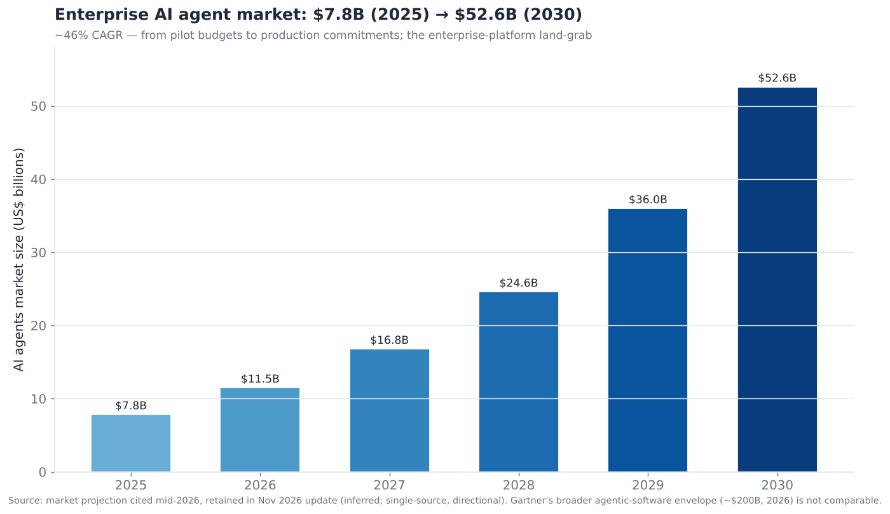
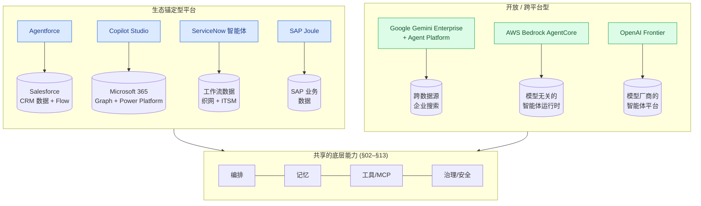
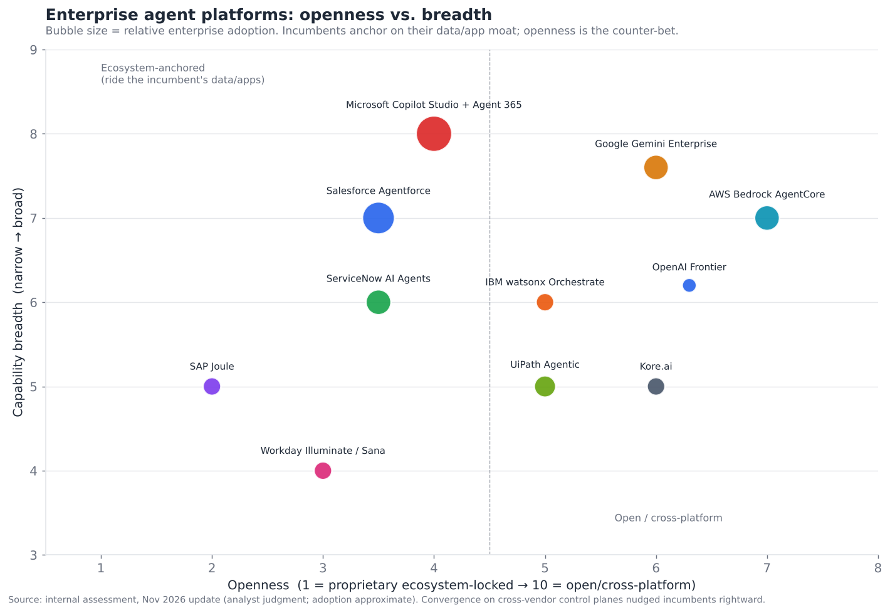

# 14 — 企业智能体平台

> **说明：** 本文为英文原文 [`sections/14-enterprise-agent-platforms.md`](../../sections/14-enterprise-agent-platforms.md) 的简体中文参考译文，仅供参考；如有出入，以英文原文为准。

*智能体与企业的交汇之处。Agentforce、Copilot Studio、ServiceNow 以及各类垂直平台——这一封装层把智能体技术转化为可部署的商业软件。
目标篇幅：6,500 词。内容截至 2026 年 11 月（基于 2026 年 7 月 22 日快照更新）。*

---

## 封装层

企业智能体平台并不像前面各节那样是一个*技术*层——它是一个*封装与分发*层：把底层技术（编排 §02、记忆 §03、工具 §04、检索 §07、护栏 §12、身份 §13）组装成面向企业的可部署商业软件，并由那些已经掌握企业数据和工作流的供应商来销售。在执行摘要中，这一层的评分为 **成熟度 6.0/10、竞争激烈度 7.0/10**——相当成熟（平台已发布并被采用），但竞争极其激烈（每一家企业软件老牌厂商都在争夺它）。2026 年的决定性事实是：**企业智能体 AI 已从试点预算转向生产承诺**，而平台供应商正在展开一场圈地运动，争当这些生产级智能体的栖身之所。

有必要讲清楚这一层*不是*什么：它不是硬核智能体技术被发明出来的地方。企业平台提供的每一项能力——推理、记忆、工具使用、检索、护栏——都来自下面各层，平台负责组装而非原创。平台所增加的是企业级的*外壳*：数据集成、治理、低代码可及性、合规与支持。这一区分之所以重要，是因为它同时解释了两件事：为什么老牌厂商（它们拥有的是数据和客户关系，而非更好的智能体技术）处于如此有利的位置；以及为什么这里的竞争是围绕分发和生态展开，而非围绕原始能力。这一层既是技术层，更是市场进入（go-to-market）层——而在企业软件领域，分发渠道和受信任的客户关系在历史上往往胜过更优越的技术，这正是老牌厂商在此最深层的结构性优势。

规模是真实的，并且在 2026 年持续增长。Salesforce 报告称，Agentforce 在 FY27 第二季度（截至 2026 年 7 月 31 日的季度）的 ARR **超过 15 亿美元**，同比增长超过 240%；Agentforce + Data 360 的合计 ARR 约为 **39 亿美元**。Agentforce 这一指标现在还计入了 Slackbot 和 Headless 360，因此与 2026 财年约 8 亿美元的数字或 FY27 第一季度的 12 亿美元并不可直接比较。该季度 Agentforce 还处理了 32 亿个“智能体工作单元”（Agentic Work Units）*（official（官方））*。Microsoft 报告称，Copilot Studio 已覆盖约 160,000 家组织、400,000+ 个自定义智能体（2026 年初）。到 2026 年 10 月，其 **Agent 365** 注册表已收录 **5,000 万+ 个智能体**，环比增长超过 30% *（official，财报电话会）*。ServiceNow 两次上调其 2026 年 AI-ACV 目标，从 10 亿美元上调至 **17 亿美元** *（official）*。在市场规模方面，有一项预测认为企业 AI 智能体市场将从约 78 亿美元（2025 年）增长至约 526 亿美元（2030 年），复合年增长率约 46%。据报道，Gartner 口径宽泛得多的“具备智能体能力的软件”市场在 2026 年约为 2,000 亿美元 *（inferred（推断）；来自对 Gartner 的二手报道；不可比较）*。这是增长最快的企业软件类别之一。老牌厂商（Salesforce、Microsoft、ServiceNow、Google、SAP、Amazon、Workday）都在竞相把现有的企业客户关系转化为智能体平台收入，而 OpenAI 的 Frontier（2026 年 2 月）也从模型一侧加入了这场竞争。

市场规模的走势（请将具体数字视为方向性的单一来源估计）反映了从试验到实质性投入的转变——这也是每一家企业软件供应商在 2025–2026 年间都围绕“智能体”重新定位的原因。本节要回答的战略问题是：*这些平台有何不同、谁在哪些领域胜出，以及根本性的自建与采购（build-vs-buy）和锁定动态*。

---

## 2026 年 7 月以来的变化（2026 年 11 月更新）

7 月的快照描述的是一场圈地运动。四个月后，这场圈地运动正在演变为一场**对控制平面的争夺**。每家主要供应商现在都在销售智能体*注册表、治理与可观测性*层，并试图让它成为管理*其他供应商*智能体的地方。Microsoft 有 Agent 365。ServiceNow 有 AI Control Tower，外加面向第三方智能体的“AI Passport”。Salesforce 现在可以编排来自 AWS、Azure 和 Google 的第三方智能体。Google 有 Gemini Enterprise Agent Platform。与此同时，老牌厂商在*模型*层也开放了。Agentforce 现在提供 Claude 和 Bedrock 模型目录，而 Workday 将 Sana 推送进 Copilot、Gemini Enterprise、Slack 和 Claude。收入披露显著增加，但指标定义不断变化，使得环比比较不可靠。本更新日志还补录了 7 月快照遗漏的 2 月至 7 月间的重要事项。标签遵循 §17：*official* 指供应商公告或监管文件，在可访问时链接至一手来源，否则链接至相关报道；*inferred* 指单一来源或分析师推导得出的信息。

- **2026 年 1 月 28 日——Decagon 完成 2.5 亿美元 D 轮融资，估值 45 亿美元**（Coatue、Index）
  *（official；经 Bloomberg）*——
  [Bloomberg](https://www.bloomberg.com/news/articles/2026-01-28/ai-customer-support-startup-decagon-valued-at-4-5-billion)。
- **2026 年 2 月 5 日——OpenAI 推出 Frontier**，一个供企业构建、部署和管理智能体的平台。它以有限可用的形式推出，未公布定价 *（official；经相关报道）*——
  [Constellation Research](https://www.constellationr.com/insights/news/openai-launches-openai-frontier-aims-be-ai-agent-orchestrator)。
- **2026 年 2 月——Google 报告 Gemini Enterprise 付费席位超过 800 万，覆盖 2,800+ 家公司**（2025 年第四季度财报电话会）*（official；经相关报道）*——
  [PYMNTS](https://www.pymnts.com/google/2026/alphabet-bets-185b-on-gemini-agentic-commerce-and-enterprise-ai/)。
- **2026 年 4 月 22 日——Vertex AI 更名为 Gemini Enterprise Agent Platform**（Google Cloud Next '26）。Agent Engine 更名为 Agent Runtime，Vertex AI Studio 更名为 Agent Studio *（official）*——
  [Google Cloud 发布说明](https://docs.cloud.google.com/gemini-enterprise-agent-platform/release-notes?hl=de)。
- **2026 年 5 月 1 日——Microsoft Agent 365 正式发布（GA）**，价格约为每用户每月 15 美元。**Microsoft 365 E7**（99 美元，捆绑 E5、Copilot 和 Agent 365）也同时推出 *（official；经相关报道）*——
  [The Register](https://www.theregister.com/2026/03/09/microsoft_adds_a_premium_tier/)。
- **2026 年 5 月 4 日——Sierra 完成 9.5 亿美元 E 轮融资，估值 158 亿美元**（Tiger Global、GV）*（official）*——
  [SiliconANGLE](https://siliconangle.com/?p=746652)。
- **2026 年 5 月——ServiceNow Knowledge 2026 将 AI Control Tower 扩展**为一个面向*任何*系统上 AI 的治理层（发现、治理、保护、观测、度量）*（official）*——
  [ServiceNow](https://s205.q4cdn.com/916135447/files/doc_news/ServiceNow-expands-AI-Control-Tower-to-discover-observe-govern-secure-and-measure-AI-deployed-across-any-system-in-the-enterprise-2026.pdf)。
- **2026 年 6 月 17 日——AWS Summit 纽约站。** AgentCore 新增运行时实例（持久化计算）和托管的网页搜索工具。AWS 还推出了 AWS Context，一个面向智能体的知识图谱 *（official）*——
  [AWS News Blog](https://aws.amazon.com/blogs/aws/top-announcements-of-the-aws-summit-in-new-york-2026/)。
  据报道，旧版 Bedrock Agents 已更名为“Agents Classic”，并自 7 月 30 日起不再接受新客户 *（inferred）*——
  [AWS Builder Center](https://builder.aws.com/content/3ItUUFljIPOutbUGruzDO3RX7Gw/amazon-bedrock-agentcore)。
- **2026 年 8 月 26 日——Salesforce FY27 第二季度。** 按扩大后的定义，Agentforce ARR 超过 15 亿美元，Agentforce + Data 360 ARR 约 39 亿美元。Agentforce 处理了 32 亿个智能体工作单元，环比增长 97% *（official）*——
  [TechMarketView](https://www.techmarketview.com/ukhotviews/archive/2026/08/27/salesforce-q2-keeps-agentforce-growth-story-moving)，
  [Pulse 2.0](https://pulse2.com/salesforce-net-income-jumps-87-as-agentforce-and-data-360-arr-surges-more-than-210-to-nearly-3-9-billion/)。
- **2026 年 9 月 15–17 日——Dreamforce** 发布了 21 项公告。其中包括长周期智能体（例如用于外呼销售的“Hunter”）、**Koa**（一个基于 NVIDIA Nemotron 的 CRM 推理模型，试点中）以及 Agentforce Coworker。Claude 可在 Atlas Reasoning Engine 中选用，完整的 Bedrock 模型目录被开放，Agentforce 可以编排第三方智能体 *（official 清单；细节推断自会后综述）*——
  [Salesforce](https://www.salesforce.com/blog/dreamforce-2026-announcements/)，
  [Cyntexa](https://cyntexa.com/blog/dreamforce-2026-highlights/)。
- **2026 年 9 月——AgentCore Evaluations 新增 TypeScript 框架**和技能评估器 *（official）*——
  [AgentCore 发布说明](https://docs.aws.amazon.com/bedrock-agentcore/latest/devguide/release-notes.md)。
- **2026 年第三季度——SAP 将 Joule 智能体改为按 AI Unit 消耗计费**（据报道每次智能体操作 0.02 个 AI Unit）。DSAG 用户组调查发现，只有约 3% 的 SAP 客户在生产中实际使用 SAP Business AI *（inferred）*——
  [Börse Express](https://www.boerse-express.com/news/articles/sap-aktie-nur-3-prozent-nutzen-joule-produktiv-903874)。
- **2026 年 10 月 13 日——Workday Rising。** Sana 成为 Workday 的统一入口，并在 Gemini Enterprise、Microsoft Copilot、Teams 和 Slack 中正式可用，Claude 中处于早期访问阶段。Workday 还新增了自动驾驶（autopilot）智能体和一个 Agent Harness *（official）*——
  [Workday](https://investor.workday.com/news-and-events/press-releases/news-details/2026/Workday-to-Bring-Sana-Everywhere-Employees-Work-Including-Claude-Gemini-Enterprise-Microsoft-Copilot-Slack-and-Teams/default.aspx)。
- **2026 年 10 月 28 日——ServiceNow 第三季度。** 2026 年 AI-ACV 目标上调至 17 亿美元，生产环境中的智能体 AI 消耗量年初至今增长超过 13 倍。ServiceNow 还推出了 Control Tower Alliance 和用于验证第一方和第三方智能体权限范围的 **AI Passport** *（official）*——
  [SEC 8-K](https://www.sec.gov/Archives/edgar/data/0001373715/000137371526000092/erq3fy26.htm)。
- **2026 年 10 月 28 日——Microsoft FY27 第一季度。** Agent 365 注册表突破 5,000 万个智能体（环比 +30%），E7 拥有“数百万”付费席位。Microsoft 未公布新的 Copilot 席位数；7 月的数字为超过 3,000 万 *（official，财报电话会）*——
  [Motley Fool 电话会实录](https://www.fool.com/earnings/call-transcripts/2026/10/29/microsoft-msft-q1-2027-earnings-call-transcript/)，
  [UC Today](https://uctoday.com/microsoft-q1-copilot-usage-jumps-seat-count-goes-missing)。
- **即将举行——Microsoft Ignite，2026 年 11 月 17–20 日**（旧金山）。截至撰写本文时，尚无 Ignite 2026 的相关公告 *（official 日期）*——
  [Moscone](https://moscone.com/events/microsoft-ignite-2026)。

---

## 核心价值主张及其代价

企业智能体平台销售的是一个极具吸引力的主张：**预先集成了企业数据和工作流、非开发人员也能构建、受治理且安全、数周内即可部署的智能体。** 这一价值是真实的：

- **数据/工作流集成。** 平台的智能体预先连接到供应商的数据和应用——Agentforce 连接 Salesforce CRM 数据，Copilot Studio 连接 Microsoft 365 和 Graph，ServiceNow 智能体连接 ITSM/工作流数据，SAP Joule 连接 SAP 的业务数据。这种集成是企业智能体中最难的部分，而平台开箱即用地提供了它。
- **低代码/无代码构建。** 业务用户（而不只是开发人员）可以在可视化构建器中构建智能体，大大扩展了能够部署智能体的人群——这是把“公民开发者”模式应用到了智能体上。
- **内置治理与安全。** 平台提供企业所需的权限管理（§13）、护栏（§12）、审计与合规，并与供应商现有的身份和治理体系集成——考虑到 §12/§13 自行实现有多难，这是一项重大的增值。
- **快速投产。** 预构建的模板和集成意味着常见用例只需 4–6 周即可投入生产，而定制开发则需要数月。

**代价是锁定。** 这些平台与供应商的生态系统深度绑定——如果你是 Salesforce 用户，Agentforce 最有价值；如果你是 Microsoft 用户，Copilot Studio 最有价值——而这种便利的代价是依赖该供应商的数据模型、定价和路线图。这是这一层的核心矛盾：**让平台有价值的生态集成，同样使其成为锁定的载体**，企业以可移植性换取价值实现速度。这是经典的企业软件交易，如今换成了智能体。

---

## 平台架构路径

企业平台在架构上的差异决定了它们各自擅长什么。下图对比了主流路径：

根本的分野在于**生态锚定型与开放/跨平台型**：

- **生态锚定型**（Agentforce、Copilot Studio、ServiceNow、SAP Joule、Workday）*在供应商的数据/应用护城河之上*构建智能体。它们的力量在于与企业已存放在该供应商系统中的数据深度集成；它们的局限在于其价值主要体现在该生态内部。这是占主导地位、采用率最高的路径，因为它利用了老牌厂商现有的企业地位。
- **开放/跨平台型**（Google Gemini Enterprise，前身为 Agentspace，以及 2026 年 4 月取代 Vertex AI 品牌的 Gemini Enterprise Agent Platform；AWS Bedrock AgentCore；以及自 2026 年 2 月起的 OpenAI Frontier）押注于成为*横跨*企业异构系统的智能体层，而不绑定于某一家应用供应商的数据。它们的力量在于中立性：可以与任何数据或模型协作。它们的挑战在于缺乏锚定型平台所拥有的内置数据护城河。

*2026 年 11 月注：*两大阵营之间的界线在 2026 年下半年变得模糊。锚定型供应商现在把自己定位为跨平台的*控制平面*。Agentforce 编排来自 AWS、Azure 和 Google 的第三方智能体。ServiceNow 的 AI Control Tower 治理“部署在任何系统上”的 AI，而 Agent 365 可登记在任何地方构建的智能体。它们也开放了模型：Claude 和 Bedrock 模型在 Agentforce 内运行，而 Workday 的 Sana 在 Copilot、Gemini Enterprise 和 Claude 内运行 *（official）*。

定位图按开放度与覆盖广度对各平台进行映射，气泡大小代表采用规模：

高采用率的平台聚集在生态锚定型（低开放度）区域，因为借助老牌厂商的数据/应用护城河是近期的制胜策略——企业会在数据和工作流已经所在的地方部署智能体。开放/跨平台的押注（Google、AWS）是面向那些希望拥有跨系统中立智能体层的企业的反制策略。在 2026 年 11 月更新中新增的 OpenAI Frontier 作为模型厂商入局者，也位于这一区域。这一反制策略仍然要与老牌厂商的集成优势相抗衡。这在更高一层上重现了 §02 中的编排动态：平台被夹在老牌厂商的数据护城河与开放可移植的替代方案之间。

---

## 主要平台

以下进一步考察领先的企业平台及其各自的定位：

- **Salesforce Agentforce。** 面向客户/CRM 的智能体领导者，与 Salesforce 数据、Flow 和 Data Cloud 深度集成。在以 CRM 数据为燃料的客户服务、销售和营销智能体方面最为强大。截至 FY27 第二季度（2026 年 8 月），Agentforce ARR 超过 15 亿美元，其定义现在包括 Slackbot 和 Headless 360；在 FY26 年末约为 8 亿美元。Agentforce + Data 360 ARR 约为 39 亿美元。基于消耗的定价（Flex Credits）体现了“智能体干活，按工作付费”的模式。Dreamforce 2026（9 月）新增了长周期智能体、Koa CRM 推理模型（试点），以及作为推理选项的 Claude 和 Bedrock 模型，同时支持第三方智能体编排 *（official/inferred）*。它的押注：面向客户的智能体应该属于 CRM，而 Salesforce 拥有 CRM。
- **Microsoft Copilot Studio。** 按采用率计覆盖面最广的平台（约 160,000 家组织、400,000+ 个智能体），借助 Microsoft 365 的普及度和 Power Platform 的低代码基础。在与 Microsoft Graph（邮件、文档、Teams）集成的面向员工的生产力和内部流程智能体方面最为强大。捆绑价格实惠（随 M365 Copilot 每用户每月 30 美元）。自 2026 年 5 月起，**Agent 365**（GA；单独购买约每用户每月 15 美元，或包含在 99 美元的 **M365 E7** 套件中）为在 Copilot Studio、Foundry 或第三方框架中构建的智能体提供注册表、治理和可观测性控制平面。其注册表到 2026 年 10 月已突破 5,000 万个智能体 *（official）*。它的押注：智能体存在于员工已经工作的地方（Microsoft 365），而 Microsoft 拥有那里。
- **ServiceNow AI Agents。** 工作流/IT 与员工服务领域的领导者，将智能体嵌入 ServiceNow 的工作流数据织网以及 ITSM/HR/客户工作流中，并通过 AI Control Tower 进行治理（2026 年 4 月的重组默认在各层级中嵌入 AI）。Control Tower 在 Knowledge 2026（5 月）上被扩展为可治理*任何*系统上的 AI，并在 10 月新增了 AI Passport 和 Control Tower Alliance。2026 年 AI-ACV 目标被上调至 17 亿美元 *（official）*。在 ServiceNow 掌控工作流的 IT/HR/员工服务自动化方面最为强大。它的押注：智能体属于工作流层，而 ServiceNow 拥有企业工作流。
- **SAP Joule。** SAP 原生的智能体层（Joule Assistants 编排跨财务、供应链、HR、客户体验的智能体），在运行 SAP 业务流程的企业中最为强大。Joule 智能体在 2026 年第三季度改为按 AI Unit 消耗计费。2026 年的一项 DSAG 调查发现，只有约 3% 的 SAP 客户在生产中实际使用 SAP Business AI，而 77% 的 AI 用户依赖 Copilot 等非 SAP 工具。这一尖锐的提醒表明，拥有数据并不保证拥有智能体 *（inferred）*。它的押注：智能体应当作用于 SAP 所拥有的 ERP/业务流程数据。
- **Google Gemini Enterprise（前身为 Agentspace）+ Gemini Enterprise Agent Platform。** 开放/跨平台的押注：横跨企业异构数据源的企业智能体与搜索，模型灵活且原生支持 A2A。2026 年 4 月，Google 将 Vertex AI 的智能体工具并入 Gemini Enterprise Agent Platform。Google 在 2026 年 2 月报告 Gemini Enterprise 付费席位超过 800 万 *（official）*。它的押注：企业需要一个横跨所有系统的中立智能体层，而不是绑定于单一应用供应商的智能体层。
- **AWS Bedrock AgentCore。** 模型无关的智能体运行时/基础设施押注：提供托管的运行时、记忆、身份和工具，让企业可以在 AWS 上使用任意模型构建和运行智能体。2026 年新增内容包括正式发布的脚手架（harness）、持久化运行时实例、托管网页搜索以及 TypeScript 评估。较早的 Bedrock Agents 产品正被逐步收缩为“Classic”*（official/inferred）*。它更偏基础设施而非封装好的应用；争夺的是“在我们的云上构建”的智能体工作负载。
- **OpenAI Frontier** *（本次更新新增）*。OpenAI 于 2026 年 2 月推出 Frontier，这是一个由模型厂商提供、供企业构建、部署和管理智能体的平台。它处于有限可用状态，定价未公开；相关报道中提到的早期用户包括 State Farm、Uber 和 Oracle *（official 发布；客户名单为推断）*。它的押注：前沿模型厂商可以直接拥有智能体层，同时绕过应用老牌厂商和云厂商。
- **Workday（Illuminate → Sana）、Adobe、Atlassian Rovo 及其他应用厂商**各自针对其特定数据构建智能体（Workday 针对 HR/财务，Adobe 针对创意，Atlassian 针对开发协作）。这就是“每一家企业应用厂商都针对自身数据添加智能体”的模式。此后，Workday 围绕收购来的 Sana 重建了前端，并且截至 2026 年 10 月，已将 Sana 分发*进入*竞争对手的界面：Copilot、Gemini Enterprise、Slack、Teams 和 Claude *（official）*。

反复出现的逻辑是：**每一家企业软件老牌厂商都在把现有的数据/工作流护城河转化为智能体平台**，押注智能体将存在于相关数据已经所在的地方。这正是这一层竞争如此激烈的原因——它不是一个市场，而是在*每一个*企业软件类别（CRM、生产力、ITSM、ERP、HR）中同时以智能体的方式重新开战，每家老牌厂商都在通过添加智能体来捍卫自己的地盘。

---

## 竞争格局

### 竞争对比表——企业智能体平台

| 平台 | 供应商 | 成熟度 | 锚点 / 重点 | 值得关注（置信度） | 差异化 | 竞争对手 |
|---|---|---|---|---|---|---|
| **Agentforce** | Salesforce | shipped-reliable | CRM / 面向客户 | Agentforce ARR 超过 15 亿美元（扩大后定义），FY27 第二季度（official） | CRM 数据 + 客户服务智能体；现已支持多模型（Claude、Bedrock） | Copilot Studio, ServiceNow |
| **Copilot Studio + Agent 365** | Microsoft | shipped-reliable | M365 / 面向员工 | 约 16 万家组织（2026 年初）；Agent 365 于 2026 年 5 月 GA，注册智能体 5,000 万+（official） | M365 普及度 + 低代码覆盖 + 智能体控制平面 | Agentforce, Google |
| **ServiceNow AI Agents** | ServiceNow | shipped-reliable | 工作流 / IT-HR 服务 | AI Control Tower + AI Passport；2026 年 AI-ACV 目标 17 亿美元（official） | 工作流数据织网 + 跨系统治理 | Copilot Studio, Agentforce |
| **SAP Joule** | SAP | shipped-reliable | ERP / 业务流程 | 30+ 个智能体，2,500+ 项 Joule 技能；AI Unit 计费（inferred） | SAP 业务数据原生智能体 | Microsoft, Workday |
| **Google Gemini Enterprise（原 Agentspace）/ Agent Platform** | Google | shipped-reliable | 跨数据源 / 开放 | 付费席位 800 万+（2026 年 2 月）；Vertex AI → Agent Platform，2026 年 4 月（official） | 中立的跨系统智能体层 | Copilot Studio, AWS |
| **AWS Bedrock AgentCore** | Amazon | shipped-reliable | 模型无关运行时 | 脚手架 GA、运行时实例，2026 年 6 月（official） | 在 AWS 上自建，任意模型 | Google, Azure |
| **OpenAI Frontier** *（新增）* | OpenAI | demoed-brittle | 模型厂商智能体平台 | 2026 年 2 月推出，有限可用（official） | 前沿模型厂商拥有智能体层 | Google, AWS, Microsoft |
| **Workday Illuminate / Sana** | Workday | shipped-reliable | HR / 财务 | Sana 作为统一入口；进入 Copilot、Gemini、Claude，2026 年 10 月（official） | HR/财务数据原生 | SAP, Microsoft |
| **IBM watsonx Orchestrate** | IBM | shipped-reliable | 企业多智能体 | IBM ACP 已并入 A2A（2025 年 8 月）；兼容 A2A（official） | 企业编排 + 治理 | ServiceNow, Microsoft |
| **UiPath Agentic Automation** | UiPath | shipped-reliable | 后台 / RPA+智能体 | RPA 装机基础（official） | 智能体 + 确定性 RPA 执行 | Automation Anywhere, MS |
| **Kore.ai** | Kore.ai | shipped-reliable | 客户体验 / 对话式 | 企业客户体验智能体（inferred） | 供应商中立的客户体验智能体平台 | Agentforce, Sierra |
| **Atlassian Rovo** | Atlassian | shipped-reliable | 开发/协作 | Rovo 智能体（official） | 横跨 Atlassian 工具的智能体 | Microsoft, Glean |
| **Adobe (AEP Agent Orchestrator)** | Adobe | shipped-reliable | 营销/创意 | Adobe 智能体（official） | 营销数据原生智能体 | Salesforce, Microsoft |
| **Sierra / Decagon** | 初创公司 | shipped-reliable | 客户体验（最佳单品） | Sierra 158 亿美元（2026 年 5 月）；Decagon 45 亿美元（2026 年 1 月）（official） | 供应商中立的高端客户体验智能体 | Agentforce, Kore.ai |
| **Dust / Glean-agents**（Sana 已被 Workday 收购） | 初创公司 | shipped-reliable | 跨应用员工智能体 | Glean ARR 约 3 亿美元，2026 年 5 月（inferred） | 中立的员工智能体平台 | Copilot Studio, Gemini Enterprise |
| **Cohere North / 垂直平台** | 多家 | demoed→reliable | 垂直/受监管行业 | （inferred） | 领域/受监管行业智能体平台 | 老牌厂商 |

以上共十六个条目——远超十个。结构性解读：**这一层由不断扩展护城河的企业软件老牌厂商主导，另有一批最佳单品（best-of-breed）初创公司（客户体验领域的 Sierra、Decagon；跨应用员工智能体领域的 Dust 和 Glean，Sana 现已被 Workday 吸收）押注中立性和质量能够胜过老牌厂商的集成。** 老牌厂商的优势在于数据/工作流护城河和既有客户关系；初创公司的优势在于跨平台、最佳单品，且不被锁定在某一供应商的生态中。两种押注都还在进行，而且市场足够大，可以容纳两者——老牌厂商默认赢得“针对我们自己数据的智能体”工作负载，而初创公司赢得“无论我们使用何种软件栈都要最好的智能体”以及跨系统的工作负载。

---

## 自建还是采购：核心的企业决策

企业在这一层面临的决定性战略问题是**自建还是采购**——在框架层（§02）上定制构建智能体，还是采购一个平台。权衡如下：

- **采购（平台）**——更快的价值实现（数周）、内置的数据集成与治理、低代码可及性、供应商支持——代价是锁定、随用量增长的按席位/按消耗定价，以及受限于供应商的模型和能力。最适合用例契合平台生态（你是 Salesforce 用户、要构建客户服务智能体）且速度比控制更重要的情形。
- **自建（基于框架定制）**——完全的控制、可移植性、最佳单品的模型/组件选择，且没有按席位收取的平台税——代价是需要自己构建集成、治理和安全（最难的部分）、更长的价值实现周期，以及需要工程人才。最适合需要差异化、控制、可移植性，或平台无法很好满足的用例。
- **混合**——现实中常见的答案：对标准的、契合生态的用例采购平台（快速、受治理），对差异化或跨系统的需求进行定制构建。大多数大型企业两者兼用。

关键的细微之处在于：**平台基于消耗的定价会在规模化时改变计算结果。** 让平台起步成本低廉的按工作计价（Agentforce Flex Credits、消耗模型）在高用量时会变得昂贵，此时定制构建（直接支付模型成本）可能更便宜——这就是经典的“采购起步、规模化后自建”的 SaaS 动态。因此，自建与采购的答案往往*会随时间变化*：先采购以快速证明价值，然后针对平台税和锁定开始显现的高用量、差异化工作负载评估自建。做得好的企业把它视为一个不断演进的组合决策（部分采购、部分自建），而不是一次性的二选一。

---

## 企业现实：治理、集成与变革管理

企业智能体平台与开发者工具的区别在于，它们必须应对企业部署的*纷乱现实*，而这些现实既是技术性的，也同样是组织性的：

- **治理与合规。** 企业需要控制哪些智能体可以访问哪些数据、审计一切（§11）、满足监管要求（§12），并管理智能体的生命周期（§13）——也就是平台所强调的 AI Control Tower 和治理层。这种治理往往正是企业选择采购平台而非自建的*原因*，因为自行实现很难。
- **与遗留系统的集成。** 真实的企业运行着异构的、往往是遗留的系统，把智能体连接到所有这些系统（通过连接器、MCP §04 或平台的集成层）是价值和难度的主要组成部分。平台预构建的连接器是关键卖点。
- **变革管理与采用。** 企业智能体部署中最难的部分往往*不是*技术，而是组织——让员工信任并使用智能体、围绕智能体重新设计流程，以及管理对员工队伍的影响。平台越来越多地捆绑采用工具和最佳实践，因为已部署但无人使用的智能体不会带来任何价值。
- **可靠性与人在回路的现实。** 企业智能体和所有智能体一样，会碰到底层技术的可靠性极限（§05、§08、§12），因此生产环境中的企业智能体大多是*半自主*的——在人工监督和升级机制下处理范围明确的任务，而不是完全自主运行。平台提供了这所需要的人在回路和升级机制。

企业现实检验：**企业智能体平台的价值既在于治理、集成和采用支持，也同样在于智能体能力本身**——因为能力来自所有人都能获取的共享底层技术（§02–§13），而*企业级封装*（治理、集成、合规、支持、变革管理）才是企业真正付费购买、且难以轻易自建的东西。这就是为什么拥有企业客户关系和治理/集成基础设施的老牌厂商，尽管并不比别人拥有更好的底层智能体技术，却依然处于有利位置。

---

## 客户体验智能体之战

竞争最激烈的单一企业智能体用例是**客户体验（CX）**——支持、服务和销售智能体——因为它有清晰的 ROI（在高用量下替代/增强昂贵的人工支持），并且直接触达客户。值得细看，因为它鲜明地展示了老牌厂商与最佳单品之间的动态：

- **老牌厂商的打法（Agentforce）。** Salesforce 押注客户体验智能体属于 CRM，因为客户数据、案例历史和工作流已经在那里——因此与 Salesforce Service Cloud 深度集成的 Agentforce，对于已经在使用 Salesforce 的数以百万计的企业来说是自然之选。集成就是护城河：你的智能体了解客户，因为 Salesforce 早已了解。
- **最佳单品的打法（Sierra、Decagon）。** Sierra（Bret Taylor 创立）和 Decagon 等初创公司押注：客户体验智能体足够难——也足够重要——值得一个*专门的、同类最佳*的平台，它供应商中立，可与企业运行的任何 CRM/系统集成。它们的卖点是更优越的智能体质量和客户体验领域的专业深度，而非老牌厂商的便利性。2026 年投资者对这一卖点大力押注。Decagon 在 1 月以 45 亿美元估值融资 2.5 亿美元，Sierra 在 5 月以 158 亿美元估值融资 9.5 亿美元。据报道，Sierra 到 2026 年初 ARR 达到 1.5 亿美元 *（inferred）*，仍比 Agentforce 的 ARR 低一个数量级。
- **对话式 AI 老牌厂商（Kore.ai，以及联络中心供应商——Genesys、NICE、Five9 等正在添加智能体的厂商）。** 现有的联络中心和对话式 AI 供应商用智能体扩展其平台，押注其联络中心集成和客户体验传统能够胜出。

客户体验之战展示了这一层的核心问题：**老牌厂商的数据集成（Agentforce）、最佳单品的质量（Sierra/Decagon）与客户体验专家的传统（联络中心供应商），哪一个会胜出？** 与大多数企业软件历史一样，可能的答案是*细分*：老牌厂商默认赢得“在我们现有平台上够用的智能体”这一多数市场，最佳单品赢得“客户体验是我们的差异化所在，我们要最好的”这一高端细分市场，而专业厂商则守住各自的利基市场。客户体验也是与 §10（语音）交汇之处——许多客户体验智能体就是语音智能体——这使它成为企业平台、语音和底层智能体技术的汇合点。客户体验 ROI 的规模和清晰度使其成为企业智能体整体的滩头阵地用例，这也是它最拥挤的原因。

## 垂直行业与受监管行业平台

在横向平台之外，一个不断增长的细分市场是**垂直行业和受监管行业的智能体平台**——为特定行业的数据、工作流、合规要求和领域知识而构建的智能体：

- **医疗健康。** 用于临床文档、患者互动、事先授权和行政工作流的智能体，需要符合 HIPAA、保证临床准确性，并与 EHR 系统（Epic、Cerner）集成。风险之高（患者安全、监管）和领域的特殊性使专门平台和深度领域合作更具优势。
- **金融服务。** 用于合规、反欺诈、客户服务和分析的智能体，需要满足该行业严格的监管、审计和准确性要求——并且出于数据敏感性，通常需要本地/私有部署。老牌厂商（提供金融服务产品）和专业厂商都在竞争。
- **法律。** 用于合同分析、研究和起草的智能体（Harvey 等），领域准确性、引用忠实度（§07）以及职业责任方面的顾虑都要求专业化——这是价值较高的垂直智能体市场之一。
- **其他垂直行业**——保险、制造、零售、政府——各自都在发展针对其数据、工作流和合规要求调优的专门智能体平台。

垂直行业的动态：**受监管和专业化行业青睐领域专用平台**（或对横向平台的深度定制部署），因为领域知识、合规和集成要求过于特殊，通用平台难以很好地满足。这为垂直领域专家（法律领域的 Harvey、医疗专用的智能体公司）在横向老牌厂商之外创造了空间——“垂直 SaaS”模式在智能体领域重演。价值最高的垂直智能体往往出现在专家劳动力昂贵且任务结构清晰的领域（法律研究、临床文档），这正是把验证器/ROI 逻辑（§09、§11）应用于行业垂直领域。

## “智能体洗白”与炒作和现实之间的落差

一项中立的评估必须正视企业智能体中**炒作与现实之间的落差**，因为“智能体洗白”（agent washing）——把现有的自动化或简单聊天机器人重新包装成“AI 智能体”——十分猖獗，企业难以将真正的智能体能力与营销区分开来：

- **重新包装问题。** 每一家企业软件供应商现在都把自己的功能称为“智能体”，无论它们是真正具备智能体特性（自主、使用工具、推理），还是只是换了名字的聊天机器人、RPA 或工作流自动化。这使市场难以评估——“我们有智能体”在不同供应商那里含义差别很大。
- **从试点到生产的落差。** 许多企业智能体项目是令人印象深刻的试点，却难以达到可靠的生产状态，撞上了本文档所梳理的可靠性极限（§05、§08、§12）。“在试点中演示过”与“在生产中可靠”之间的落差，正是大量企业失望之所在——在企业部署层面上，这与 demoed-brittle（已演示但脆弱）对比 shipped-reliable（已发布且可靠）的区分如出一辙。
- **ROI 怀疑。** 随着支出从试点预算转向生产承诺，企业越来越要求*可证明的 ROI*，而一些早期部署未能达到预期——导致 2026 年的采购姿态比 2024–2025 年的炒作期更加冷静、更以结果为导向。

现实检验的框架：**企业智能体对于范围明确、ROI 高、可接受监督的用例（客户体验分诊、IT/HR 服务、文档处理）确实有价值，而对于底层技术尚无法可靠完成的自主、高风险、长周期工作则被过度推销了。** 2026 年的企业买家比 2024 年的更有辨别力——要求证据、现实地界定范围，并区分真正的智能体能力与经过智能体洗白的营销。这种日益成熟的怀疑态度是健康的，并正推动市场走向诚实的、以结果为导向的部署。最终胜出的平台将是那些在现实用例上交付可衡量 ROI 的平台，而不是那些自主性宣传最大胆的平台。

## 衡量企业智能体的 ROI

随着市场从炒作走向问责，**衡量智能体 ROI** 变得至关重要，而它比看上去更难——这在业务层面上与评估瓶颈（§11）相连：

- **成本替代**——最清晰的 ROI：智能体处理以前需要人工完成的工作（被分流的支持工单、被处理的文档、被自动化的任务），并以人工替代方案的全额成本作为衡量基准。在任务高用量且定义明确时最为清晰。
- **生产力增强**——较难衡量：智能体让人更有生产力（客服代表在智能体辅助下处理更多案例，开发者借助编码智能体 §09 交付更多）。生产力提升是真实的，但较为分散，难以干净地归因。
- **质量与体验**——最难衡量：智能体提升服务质量、响应时间或客户体验，这些会间接影响收入/留存，难以单独剥离。
- **衡量挑战。** 将业务结果归因于智能体部署（而非其他因素）、核算全部成本（平台费用、集成、监督、失败），以及衡量质量/体验提升，确实很难——这是组织层面上的 §11 评估问题。严格衡量的企业能做出更好的部署决策；不这么做的企业则会被智能体洗白所迷惑，或在低 ROI 的用例上过度投资。

实用指导与 §11 相呼应：**基于真实的业务结果严格衡量智能体 ROI，核算包括监督和失败在内的全部成本，并从价值可衡量、定义明确的高 ROI 用例起步**——因为在智能体上取得成功的企业，是那些把它当作可衡量的商业投资、而非炒作驱动项目来对待的企业。在高用量、定义明确的任务上进行成本替代是最稳妥的起步 ROI；分散的生产力和体验收益是真实的，但更难在一开始就指望。

## 部署成熟度模型

采用智能体的企业会经历一条可识别的**成熟度曲线**，可用于定位一个组织所处的阶段：

1. **试验。** 试点和概念验证，探索智能体能做什么——演示令人印象深刻，生产有限。大多数企业在 2024–2025 年经历了这一阶段。
2. **单点方案。** 在人工监督下，针对特定的、范围明确的高 ROI 用例（客户体验分诊、IT 服务、文档处理）在生产中部署智能体——这是 2026 年的主流。
3. **流程整合。** *围绕*智能体重新设计业务流程（而不只是把智能体加到现有流程中），并配以治理、监控和变革管理——这是领先企业正在迈向的方向。
4. **智能体化运营。** 受治理、受监控的智能体集群在整个企业中集成，具备成熟的治理（AI Control Tower）、必要时的人工监督以及可衡量的 ROI——这是近期的理想状态，受制于本文档所跟踪的可靠性/安全/治理的成熟进程。

2026 年的大多数企业处于第 2 阶段（生产中的单点方案），正向第 3 阶段迈进——这就是为什么治理、集成和变革管理（第 3 阶段的关注点）是平台当前的重点。这一进程受制于底层技术（在安全 §12 和可靠性 §05/§08 限制自主性的情况下，无法实现智能体化运营），也受制于组织准备度（治理、流程再设计、员工队伍适应）。把一家企业定位在这条曲线上，可以明确它下一步需要什么——而诚实的评估是，第 4 阶段（广泛的智能体化运营）对大多数企业而言仍是理想，受制于制约整个领域的同一批瓶颈（安全、评估、可靠性、身份）。

## 企业平台与其他各层

- **↔ 编排（§02）。** 平台是面向非开发人员的低代码编排，构建在相同的图/工作流基础之上；它们在高一个抽象层级上与代码优先的框架竞争。
- **↔ 安全与身份（§12、§13）。** 治理、权限管理和合规是平台的核心价值；平台把艰难的 §12/§13 工作封装起来。
- **↔ 评估/可观测性（§11）。** 企业平台需要生产监控和治理（AI Control Tower）——§11 作为一项企业治理要求。
- **↔ 语音/客户体验（§10）。** 客户体验智能体（Agentforce、Sierra、Decagon、Kore.ai）横跨这一层与语音/多模态层。
- **↔ 标准（§15）。** 企业希望获得可移植性（避免锁定），这推动了即便在专有平台内部也要支持 MCP/A2A 的需求——标准是企业对冲平台锁定的手段。

---

## 企业平台特有的失败模式

1. **锁定之悔。** 对平台的深度依赖变得代价高昂/束手束脚。缓解措施：支持标准（MCP/A2A）并制定可移植性策略。
2. **消耗成本失控。** 按工作计价在高用量时出人意料地攀升。缓解措施：成本监控，并在规模化时重新评估自建与采购。
3. **集成缺口。** 平台无法很好地连接某个关键的遗留系统。缓解措施：在做出承诺之前评估连接器/MCP。
4. **采用失败。** 由于变革管理不善，智能体部署后无人使用。缓解措施：做好采用规划，而不只是技术部署。
5. **治理/合规缺口。** 平台的治理无法满足某项监管要求。缓解措施：预先进行合规评估。
6. **过度承诺的自主性。** 在技术只支持半自主的地方期望完全自主。缓解措施：现实地界定范围，并采用人在回路设计。
7. **能力天花板。** 平台的低代码模型无法表达所需的复杂行为。缓解措施：对复杂情形采用基于框架自建的混合方案。

---

## 记录系统与行动系统

有一个框架可以阐明这一层的战略利害：老牌厂商拥有企业的**记录系统**（system of record，即事实数据库——CRM、ERP、ITSM、HR），而智能体时代有可能引入一个新的**行动系统**（system of action）——即横跨这些记录系统*执行操作*的智能体层。战略问题在于*谁拥有行动系统*，而这对老牌厂商而言关乎存亡：

- **老牌厂商的押注**是：行动系统应当与记录系统*在一起*——你的 CRM 智能体属于 CRM，你的 ERP 智能体属于 ERP——因此老牌厂商把记录系统扩展为行动系统，以捍卫自身地位。这就是每家老牌厂商都在竞相添加智能体的原因：防止一个新的智能体层把它们去中介化。
- **颠覆者的押注**（Google Gemini Enterprise、OpenAI Frontier、最佳单品初创公司、跨应用平台）是：行动系统应当是位于记录系统之上的*中立层*——一个横跨所有记录系统进行编排的智能体层，由提供最佳跨系统智能体体验的一方拥有。如果这一押注胜出，老牌厂商的记录系统就会沦为新控制层*之下*的商品化数据源——这是一种战略威胁。
- **利害所在。** 谁拥有行动系统，谁就拥有完成工作的主要界面，并可能把记录系统降级为后端数据存储。这就是为什么老牌厂商投入如此之重、姿态如此防御——它们在防止自己从“工作发生的地方”被降级为“数据存放的地方”。这是每一次平台变迁中都会上演的同一种颠覆模式，如今轮到了智能体。

考虑到老牌厂商的实力和企业的惯性，可能的结果是**竞争中的共存**：老牌厂商成功地把以其数据为中心的工作负载扩展到行动系统（守住地盘），而一个中立的跨系统智能体层则会为真正跨系统的工作以及希望保持供应商中立的企业而出现。老牌厂商大体守住阵地，但无法垄断这一新层。这一框架解释了圈地运动为何如此激烈：这不只是一个新的产品类别，而是可能重新排定谁位于企业软件栈顶端的秩序，而老牌厂商正在奋力避免被挤下去。

## 员工队伍与组织维度

企业智能体带来的员工队伍影响会左右其采用，在完整的评估中不可忽视：

- **增强还是替代。** 近期占主导的模式是*增强*——智能体让员工更有生产力（处理例行工作，让人专注于判断/例外情况），而不是大规模替代。但对于高用量的例行岗位（一线支持、数据录入），替代的担忧是真实的，它既影响采用的伦理，也影响采用的内部政治。
- **变革管理与信任。** 员工必须信任并采用智能体，价值才能落地，而恐惧（对被替代、对错误、对陌生事物的恐惧）会阻碍采用。成功的部署会在变革管理上大力投入——让员工参与、展示增强而非替代，并审慎地重新设计岗位。技术部署往往比人的部署更容易。
- **新岗位。** 智能体部署会创造新岗位——智能体监督员/审核员（即人在回路，§02）、智能体运营，以及编码领域（§09）已预示的“管理一组智能体”的岗位。员工队伍正转向*指挥和监督*智能体，而不是直接从事例行工作。
- **组织准备度的门槛。** 除了技术之外，企业还必须在*组织上做好准备*——流程已重新设计、治理已就位、员工队伍已准备好——这往往才是决定智能体能以多快速度被采用的硬约束，甚至比技术更关键。上文的成熟度模型在组织层面与技术层面同样重要。

诚实的框架：**企业智能体的采用既是一项技术部署，也同样是一场组织变革**，平台也越来越认识到这一点，因而捆绑了变革管理、采用和治理支持。取得成功的企业把智能体视为一场社会技术变革（人、流程和技术一起），而不是一次软件上线——而员工队伍层面的影响，处理得好（增强、再培训、审慎的岗位再设计）还是处理得差（恐惧、抵触、搞砸的替代），在很大程度上决定了部署能否带来价值。在以技术为中心的分析中，这一人的维度很容易被低估，但它往往才是企业智能体成败的真正决定因素。

## 企业智能体平台简史

这段历程解释了当前的圈地运动。**2024 年之前**，企业“AI”指的是预测性机器学习、分析以及简单的聊天机器人/RPA——有用但不具备智能体特性，而且大多以单点方案的形式采购，或由数据科学团队自建。当时并不存在“智能体平台”这一类别。**2024 年**是转折点：随着 LLM 智能体证明了自己的能力，每一家企业软件老牌厂商都争先恐后地添加智能体——Salesforce 推出了 Agentforce，Microsoft 围绕智能体重新定位了 Copilot Studio，ServiceNow、SAP 和其他厂商紧随其后。这一类别诞生于老牌厂商抵御智能体颠覆、捍卫自身地盘的过程，最初的浪潮以发布公告和试点为主。

**2025 年**是建设期和炒作高峰：平台趋于成熟，采用从试点走向生产，最佳单品初创公司（Sierra、Decagon、Glean）凭借中立/高端的押注获得大额融资，“智能体”成为企业软件营销的主导主题（随之而来的是智能体洗白）。自建与采购、锁定之争逐渐明朗。**2026 年**是当前状态：企业智能体果断地从试点预算转向生产承诺（Agentforce 的 ARR、Copilot Studio 的采用数字），市场规模大且增长迅速，老牌厂商凭借数据护城河占据主导，最佳单品守住利基市场，消耗/结果定价不断普及，而且——重要的是——出现了一批更冷静、更关注 ROI、对智能体洗白持怀疑态度的买家。这段历程是经典的企业软件圈地运动被压缩进约两年：一个新类别出现，老牌厂商防守、颠覆者进攻，先是炒作随后冷静，最终趋向可衡量的生产部署。其独特之处在于*速度*和*广度*——被颠覆的不是某一个类别，而是*每一个*企业软件类别同时在添加智能体，这就是这一层如此拥挤和激烈的原因。**2026 年下半年**又出现了三个新特点。供应商从单纯披露收入转向披露*用量*（智能体工作单元、注册智能体数量、消耗倍数），并且不断重新定义这些指标。一场控制平面竞赛已经展开（Agent 365、AI Control Tower、Gemini Enterprise Agent Platform）。前沿模型厂商以 OpenAI Frontier 的形式直接入场。

## 智能体市场与生态打法

平台之争中一个新兴的维度是**智能体市场**（agent marketplace）——平台构建生态系统，让第三方（ISV、合作伙伴、企业自己的团队）发布预构建的智能体，供其他人发现、购买和部署。这复刻了曾让以往平台具有黏性的应用商店/应用交易所策略：

- **Salesforce 的 AgentExchange、Microsoft 的智能体市场、ServiceNow 的商店**等，让合作伙伴可以分发智能体，也让企业可以为常见用例找到预构建的智能体——通过生态扩展平台价值并加深锁定（为某一市场构建的智能体无法轻易迁移）。
- **生态飞轮。** 拥有大量优质智能体的市场会吸引更多企业，进而吸引更多智能体构建者，再吸引更多企业——这是经典的平台飞轮，如今用于智能体。拥有现成合作伙伴生态的老牌厂商（Salesforce 的 ISV 群体、Microsoft 的合作伙伴生态）在为智能体复制这一飞轮方面占得先机。
- **与标准之间的张力。** 市场天生是平台专属的（加深锁定），这与企业基于标准的可移植性诉求存在张力——因此各市场越来越多地支持 MCP/A2A，让市场中的智能体能够互操作，在生态锁定与可移植性需求之间取得平衡。

战略要点：**智能体市场是平台把产品转化为生态的方式**，把价值和黏性从平台自身的智能体扩展到整个第三方经济——而老牌厂商现有的合作伙伴生态为它们构建市场带来了又一项优势。这些市场究竟会变得真正有价值（如成功的应用商店），还是举步维艰（如许多企业软件市场那样），取决于第三方智能体能否交付足够的价值来维持飞轮运转，这一点仍有待观察。但*策略*本身——拥有市场、拥有生态、加深护城河——显然是平台圈地运动的一部分，也是老牌厂商利用既有合作伙伴关系的又一条战线。

*2026 年 11 月更新：*生态打法正在从*智能体市场*转向**智能体注册表与控制平面**。在这些地方，来自*任何*供应商的智能体都会被发现、授权、观测，并在必要时被终止。例子包括 Microsoft Agent 365 的注册表（5,000 万+ 个智能体）、ServiceNow 面向第三方智能体权限范围的 AI Passport，以及 Agentforce 的第三方智能体编排 *（official）*。应用厂商也在*通过*竞争对手的界面分发其智能体：Workday 将 Sana 推送进 Copilot、Gemini Enterprise、Slack 和 Claude。这表明，持久的锁定点可能更多在于治理注册表，而非应用商店 *（inferred）*。

## 路线图与展望（附置信度标签）

- **老牌厂商凭借数据/工作流护城河占据主导** *（official 趋势；高置信度）。* Salesforce、Microsoft、ServiceNow、SAP 及各应用厂商依托其现有的企业地位；智能体存在于数据所在之处，这有利于老牌厂商。——*2026 年 11 月：已在收入上得到证实。Agentforce ARR 超过 15 亿美元，ServiceNow 的 AI-ACV 目标为 17 亿美元，Agent 365 注册表收录 5,000 万+ 个智能体。一个保留意见：SAP 的 DSAG 调查表明，拥有数据并不保证智能体被采用。*
- **消耗/结果定价走向成熟** *（inferred；中高置信度）。* “按完成的工作付费”的定价（Flex Credits 及其后继方案）不断普及，使智能体经济学转向基于结果的模式——并推动规模化后自建的计算。——*2026 年 11 月：已证实。SAP 将 Joule 改为按 AI Unit 计费，Salesforce 现在报告智能体工作单元。然而 Microsoft 在此之上叠加了按用户收费的控制平面费用（Agent 365、E7），因此实际模式是“席位 + 消耗”的混合定价。*
- **标准支持成为企业的硬性要求** *（inferred；高置信度）。* 企业要求支持 MCP/A2A 以对冲锁定，因此即便是专有平台也在增加互操作性——标准是企业的可移植性保险。——*2026 年 11 月：已证实，并扩展到模型层面。Agentforce 增加了 Claude 和 Bedrock 模型以及第三方智能体编排，Workday 将 Sana 推送进竞争对手的界面。*
- **最佳单品初创公司守住中立/跨系统和高端利基市场** *（inferred；中等置信度）。* Sierra/Decagon（客户体验）、Glean/Dust（跨应用员工智能体）凭借中立性和质量与老牌厂商的集成相抗衡，尤其是在跨系统和追求同类最佳的需求上。——*2026 年 11 月：保持住了，且估值不菲（Sierra 158 亿美元，Decagon 45 亿美元）。Sana 被 Workday 吸收，展示了那些无法独立做大的公司的整合路径。*
- **2026–2027 年间，半自主仍是企业现实** *（inferred；高置信度）。* 可靠性和安全限制（§05、§08、§12）使企业智能体在关键工作上仍处于人工监督之下；平台的竞争在于让半自主运行既高效又受治理。——*2026 年 11 月：依然成立。即便如此，能够在数天或数周内持续追求目标的“长周期”智能体（Agentforce，Dreamforce 2026）正在进入试点。值得关注它们能否以有意义的自主性正式发布（GA）。*
- **新增（2026 年 11 月）：智能体控制平面成为 2027 年的主战场** *（inferred；中高置信度）。* 用于治理*任何*供应商智能体的注册表、身份、可观测性和紧急停止（kill-switch）层，如今已成为核心 SKU（Agent 365、AI Control Tower/AI Passport、Gemini Enterprise Agent Platform）。预计 Ignite（11 月 17–20 日）和 re:Invent（12 月初）将进一步扩展它们。预计独立的智能体治理初创公司将面临整合压力。
- **新增（2026 年 11 月）：模型厂商直接争夺企业智能体层** *（speculative（推测）；中等置信度）。* OpenAI Frontier 从有限可用走向全面可用，以及其定价，是 2027 年上半年值得关注的信号。问题在于老牌厂商是否会通过深化多模型中立性来回应，就像 Agentforce 对 Claude 和 Bedrock 所做的那样。

---

## 互操作性：企业对冲锁定的手段

有一个值得展开的动态，因为它塑造着整个这一层的未来：企业在以往的软件时代吸取了供应商锁定的惨痛教训，如今正积极地把**标准（MCP、A2A）作为对冲**智能体平台锁定的手段——而这正在重塑各平台的定位：

- **企业要求可移植性。** 被过去的锁定伤害过的成熟企业买家会问：“如果我更换平台，能否迁移我的智能体/工具/数据？”并且相较于完全专有的平台，更青睐支持开放标准的平台（工具层面的 MCP，§04/§15；智能体间层面的 A2A，§06）。标准支持正在成为一项采购要求。
- **平台以支持标准作为回应——但很谨慎。** 即便是生态锚定型的老牌厂商也在添加 MCP/A2A 支持（Google 原生支持 A2A；其他厂商添加 MCP 工具支持），因为拒绝支持会丢掉订单——同时仍然通过数据集成和工作流深度来设计黏性。结果是平台*在边缘可互操作*（工具、智能体间通信），*在核心具有黏性*（数据、工作流、治理）。企业在易于标准化的部分获得了可移植性，而在难以标准化的部分仍被锁定。
- **多平台现实。** 大型企业最终会运行*多个*智能体平台（客户体验用 Agentforce，生产力用 Copilot Studio，差异化需求用定制方案），并希望它们能够*互操作*——这推动了对跨平台智能体编排以及支撑它的标准的需求。没有任何单一平台能满足大型企业的全部需求，因此跨平台互操作成为一项真实的需求，而不仅仅是对冲锁定的手段。

战略含义：**标准（§15）充当了企业抵御平台锁定的保险**，而企业需求是推动即便是专有平台也走向互操作性的一股主要力量。这是一种健康的动态——它意味着锁定是有边界的（即便你的平台不可移植，你的工具和智能体间连接也是可移植的），并且把这一层与 §15 的标准故事直接联系起来：大规模采用智能体的企业是标准整合的主要*需求侧*驱动力，因为它们需要标准所提供的可移植性。拥抱这一点的平台（同时提供深度集成*和*基于标准的可移植性）能降低买家的锁定焦虑并赢得订单；抗拒它的平台则会在采购中遭遇阻力。

## 集成与连接器：不起眼的护城河

在智能体能力之下，企业平台价值的很大一部分——也是一条真正的竞争护城河——在于与企业系统**集成/连接器的广度和质量**，因为智能体的用处取决于它能触达哪些系统：

- **连接器广度。** 各平台比拼的是能开箱即用地连接多少企业系统（数据库、SaaS 应用、遗留系统）。一个无法触达存有相关数据的系统的智能体是无用的，因此预构建的连接器是一项关键增值，也是一条真正的护城河（构建和维护数百个连接器是艰难且持续的工作）。老牌厂商现有的集成生态（Salesforce 的 AppExchange、Microsoft 的连接器、MuleSoft 等）是一项实实在在的优势。
- **MCP 作为连接器标准。** MCP（§04/§15）正日益成为向智能体暴露企业系统的*标准*方式，而不断增长的 MCP 服务器生态（18,000+）意味着智能体可以通过一个通用协议连接更多系统——随着时间推移，这会部分地使连接器优势商品化，并为企业提供一条标准的集成路径，从而在集成维度上降低平台锁定。
- **数据准备度。** 即便有了连接器，智能体也需要底层企业数据是可访问、干净且已正确授权的（§07 的数据摄取问题，§13 在企业层面的权限感知访问）——而大量企业数据并不满足这些条件，使“数据准备度”成为制约企业智能体价值的常见门槛。那些不起眼的数据管道工作（§07 中的“摄取决定上限”）在企业规模上同样适用。

集成的现实：**企业智能体的价值受制于集成广度和数据准备度**——智能体能力只是入场券（共享的底层技术），而以正确的权限、用正确的数据触达正确的系统，才是艰难且值得构筑护城河的工作。这是老牌厂商（拥有现成的集成生态和数据）处于有利位置的又一个原因，也是不起眼的管道工作、而非炫目的智能体能力决定现实价值的又一个地方。MCP 的普及正在缓慢地使连接器层商品化，随着时间推移会侵蚀老牌厂商的这条护城河——这是一个值得关注的动态，因为如果支撑老牌厂商的连接器优势变成人人都有的标准，优势就可能转向中立的跨平台参与者。

## 本节要点

- 企业智能体平台是把智能体技术（§02–§13）转化为可部署、受治理的商业软件的**封装/分发层**（成熟度 6.0，竞争激烈度 7.0）——而企业智能体 AI 已经从**试点转向生产承诺**：Agentforce ARR 超过 15 亿美元（2026 年 8 月，扩大后的定义）、Copilot Studio 约 16 万家组织/40 万个智能体、Agent 365 注册表收录 5,000 万+ 个智能体，以及一个以约 46% 复合年增长率从约 80 亿美元增长到 530 亿美元的市场。
- 其价值在于**预集成的数据/工作流 + 低代码构建 + 内置治理 + 快速投产**；代价是**生态锁定**——创造价值的集成同时也制造了依赖。
- 架构上的分野是**生态锚定型**（Agentforce/CRM、Copilot Studio/M365、ServiceNow/工作流、SAP Joule/ERP——借助老牌厂商的数据护城河，采用率最高）与**开放/跨平台型**（Google Gemini Enterprise、AWS AgentCore、OpenAI Frontier——横跨各系统的中立层）。到 2026 年下半年，两大阵营正在向跨供应商的**智能体控制平面**趋同。
- **每一家企业软件老牌厂商都在把自己的数据/工作流护城河转化为智能体平台**——这一层是每一个企业软件类别同时以智能体方式重新开战。
- **自建还是采购**是核心决策：为速度/契合度/治理而采购，为控制/可移植性/差异化而自建，实践中则是混合——而且随着消耗定价开始显现成本，答案**会在规模化时改变**（采购起步，针对高用量的差异化工作负载自建）。
- 平台的真正价值既在于智能体能力（这是共享的底层技术），也同样在于**治理、集成和采用支持**——这有利于拥有企业客户关系的老牌厂商；**对标准（MCP/A2A）的支持是企业对冲锁定的手段**；而**在人工监督下的半自主**是生产中的现实。

- 更深层的战略较量是**记录系统与行动系统之争**——老牌厂商把数据护城河扩展到智能体中，以避免被降级为新的中立智能体层之下的后端数据存储；可能的结果是竞争中的共存。企业把**标准（MCP/A2A）作为对冲锁定的手段**，使标准支持成为一项采购要求，也使企业成为 §15 标准整合的关键需求侧驱动力。
- 价值受制于**集成广度和数据准备度**（这是不起眼的连接器/管道护城河，正被 MCP 缓慢商品化），而采用既是技术问题，也同样是**组织变革**（变革管理、员工队伍、流程再设计）——成熟度曲线从试验 → 单点方案 → 流程整合 → 智能体化运营，大多数企业处于“生产中的单点方案”阶段，而第 4 阶段仍受制于整个领域在安全/可靠性/身份方面的瓶颈。**智能体市场**是加深护城河的生态打法。

*目标篇幅：6,500 词。本节：2026 年 11 月更新后约 8,600 词（英文原文），包括更新日志和参考来源列表（经 `wc` 核实）。*

## 参考来源（2026 年 11 月更新）

- TechMarketView, Salesforce Q2 FY27 — https://www.techmarketview.com/ukhotviews/archive/2026/08/27/salesforce-q2-keeps-agentforce-growth-story-moving
- Pulse 2.0, Salesforce Q2 FY27 Agentforce + Data 360 ARR — https://pulse2.com/salesforce-net-income-jumps-87-as-agentforce-and-data-360-arr-surges-more-than-210-to-nearly-3-9-billion/
- Salesforce Q2 FY27 release (Seeking Alpha PR mirror) — https://seekingalpha.com/pr/20631301
- Nasdaq, Salesforce Q2 call highlights — https://www.nasdaq.com/articles/salesforce-q2-earnings-call-highlights
- Salesforce, 21 things announced at Dreamforce 2026 — https://www.salesforce.com/blog/dreamforce-2026-announcements/
- Cyntexa, Dreamforce 2026 highlights — https://cyntexa.com/blog/dreamforce-2026-highlights/
- Microsoft FY27 Q1 earnings call (investor page) — https://www.microsoft.com/en-us/investor/events/fy-2027/earnings-fy-2027-q1
- Motley Fool, Microsoft Q1 FY27 transcript — https://www.fool.com/earnings/call-transcripts/2026/10/29/microsoft-msft-q1-2027-earnings-call-transcript/
- UC Today, Copilot seats unreported in Q1 FY27 — https://uctoday.com/microsoft-q1-copilot-usage-jumps-seat-count-goes-missing
- The Register, Microsoft 365 E7 — https://www.theregister.com/2026/03/09/microsoft_adds_a_premium_tier/
- Let's Data Science, M365 E7 / Agent 365 — https://letsdatascience.com/news/microsoft-launches-e7-enterprise-ai-subscription-396f64d4
- Moscone Center, Microsoft Ignite 2026 dates — https://moscone.com/events/microsoft-ignite-2026
- ServiceNow Q3 2026 8-K — https://www.sec.gov/Archives/edgar/data/0001373715/000137371526000092/erq3fy26.htm
- ServiceNow, AI Control Tower expansion (Knowledge 2026) — https://s205.q4cdn.com/916135447/files/doc_news/ServiceNow-expands-AI-Control-Tower-to-discover-observe-govern-secure-and-measure-AI-deployed-across-any-system-in-the-enterprise-2026.pdf
- Google Cloud, Gemini Enterprise Agent Platform release notes — https://docs.cloud.google.com/gemini-enterprise-agent-platform/release-notes?hl=de
- HPCwire, Gemini Enterprise Agent Platform launch — https://www.hpcwire.com/aiwire/2026/04/23/google-unveils-gemini-enterprise-agent-platform/
- PYMNTS, Alphabet / Gemini Enterprise seats — https://www.pymnts.com/google/2026/alphabet-bets-185b-on-gemini-agentic-commerce-and-enterprise-ai/
- AWS, top announcements of AWS Summit New York 2026 — https://aws.amazon.com/blogs/aws/top-announcements-of-the-aws-summit-in-new-york-2026/
- AWS, AgentCore release notes — https://docs.aws.amazon.com/bedrock-agentcore/latest/devguide/release-notes.md
- AWS Builder Center, AgentCore overview (Agents Classic) — https://builder.aws.com/content/3ItUUFljIPOutbUGruzDO3RX7Gw/amazon-bedrock-agentcore
- Constellation Research, OpenAI Frontier launch — https://www.constellationr.com/insights/news/openai-launches-openai-frontier-aims-be-ai-agent-orchestrator
- PYMNTS, OpenAI Frontier — https://www.pymnts.com/news/artificial-intelligence/2026/openai-targets-enterprise-market-with-new-ai-agent-platform/
- Workday, Sana everywhere employees work (Oct 13, 2026) — https://investor.workday.com/news-and-events/press-releases/news-details/2026/Workday-to-Bring-Sana-Everywhere-Employees-Work-Including-Claude-Gemini-Enterprise-Microsoft-Copilot-Slack-and-Teams/default.aspx
- Constellation Research, Workday Rising 2026 — https://constellationr.com/insights/news/workday-makes-sana-its-interface-launches-agent-harness-decision-and-work
- Börse Express, DSAG survey on Joule usage — https://www.boerse-express.com/news/articles/sap-aktie-nur-3-prozent-nutzen-joule-produktiv-903874
- SiliconANGLE, Sierra $950M Series E — https://siliconangle.com/?p=746652
- Sierra, $100M ARR post — https://sierra.ai/uk/blog/100m-arr
- Bloomberg, Decagon $4.5B — https://www.bloomberg.com/news/articles/2026-01-28/ai-customer-support-startup-decagon-valued-at-4-5-billion
- Crypto Briefing, Glean $300M ARR — https://cryptobriefing.com/glean-300m-arr-enterprise-ai-growth/
- Hostinger, agentic AI statistics (Gartner spending figures, secondary) — https://www.hostinger.com/tutorials/?p=151992
