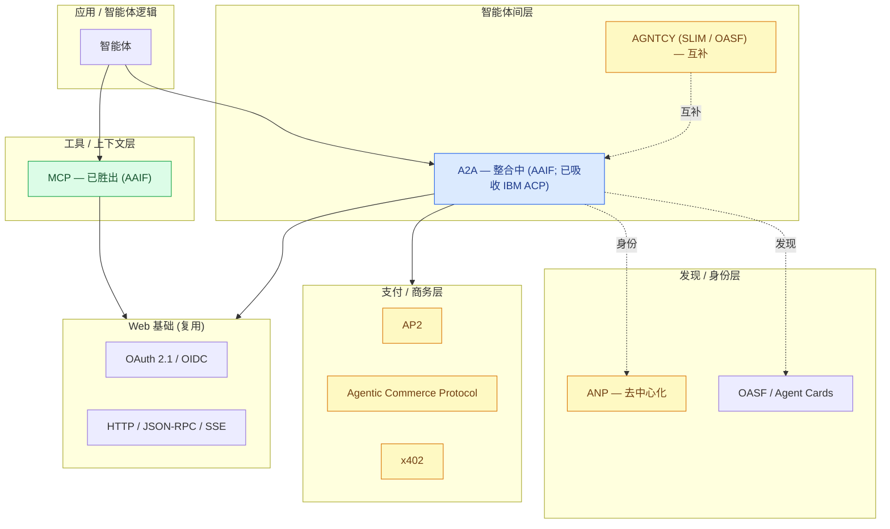
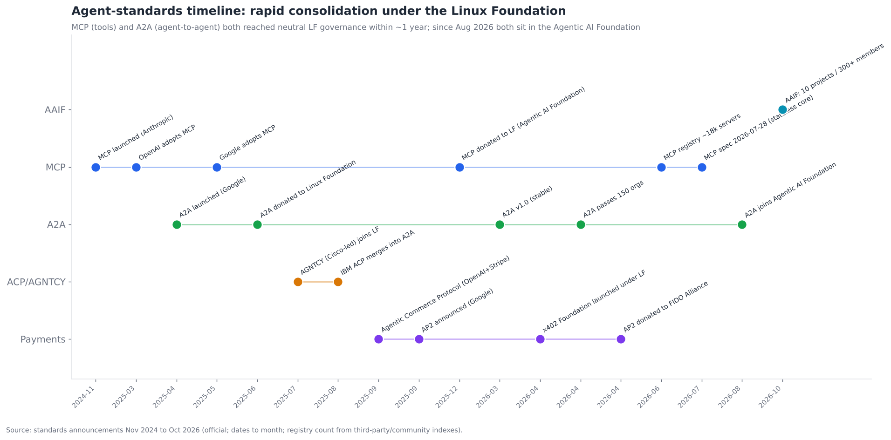
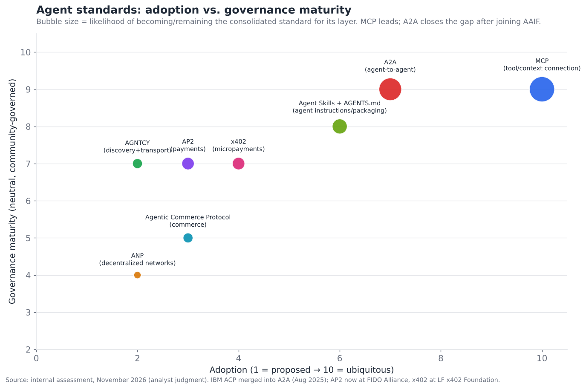

# 15 — 标准与互操作性格局

> **说明：** 本文为英文原文 [`sections/15-standards-interoperability.md`](../../sections/15-standards-interoperability.md) 的简体中文参考译文，仅供参考；如有出入，以英文原文为准。

*连接组织。MCP、A2A 及其竞争提案；整合路径；以及历史上的标准之争对其走向的启示。目标篇幅：6,500 词。内容截至 2026 年 11 月（基于 2026 年 7 月 22 日的快照更新）。*

---

## 智能体技术栈中最具影响力的元叙事

标准与互操作性并不是一个技术层，而是决定整个智能体生态系统走向凝聚还是分裂的**连接组织**——它也是该领域最具影响力的元叙事的主题。在执行摘要中，它的得分为**成熟度 4.0/10、争议度 9.0/10**——是整个技术栈中*争议最大*的维度，因为标准之争本质上是对控制权的争夺，而标准选错（或根本没有标准）会让构建在其上的一切陷入碎片化。

但本节的核心发现是乐观的，甚至有些出人意料：**智能体标准之争的整合速度远远快于历史上的标准之争。** MCP 从 Anthropic 的一项实验（2024 年末）发展为由 Linux Foundation 治理、获得 OpenAI、Google、Microsoft 和 AWS 支持的标准（截至 2025 年底），是计算史上最快的标准收敛之一——更接近 JSON 这类事实赢家的自然速度，而非委员会标准的缓慢推进。A2A 正沿着同一条路径前进，落后约一年——并且自 2026 年 8 月起已与 MCP 同处一个基金会。本节梳理整体格局，解释它*为何*整合得如此之快，审视真正仍未定局的竞争（残余的智能体间替代方案、支付领域的圈地争夺），并借助历史上的标准之争预测其最终落点。

为什么一份关于*技术*的文档要用整整一节来讨论*标准*？因为在多厂商生态中，标准并不是技术的注脚——它们决定了技术是组合成一个连贯的整体，还是碎裂成互不兼容的孤岛。一个每个能力层都很出色、却彼此无法互操作的智能体技术栈，其价值远低于各部分之和。标准决定了十五个出色的层是能够严丝合缝地拼接在一起，还是无法拼接。这就是为什么这个"非技术"层是本文档中战略意义最重要的层之一，也是为什么它异常快速、异常协作的整合对该领域而言是一个如此重要的好消息。

---

## 2026 年 7 月以来的变化（2026 年 11 月更新）

自 7 月 22 日快照以来的四个月，基本*证实*了本节的整合论点，并且在某些方面比预测的进展更快。MCP 发布了迄今规模最大的修订版，即为水平扩展的远程服务器而构建的无状态核心。A2A 进入了 Agentic AI Foundation（AAIF），因此工具层和智能体间层如今共享同一个中立的归属。AAIF 也从单一协议的归属地成长为一个广泛的伞形组织：十个托管项目、300 多家成员。快照还需要两处更正。第一，快照视为尚未定局的"A2A vs. ACP"之争，其实早在 2025 年 8 月就已了结，当时 IBM 的 Agent Communication Protocol 并入了 A2A。快照把 IBM 的 ACP 与另一个由 Cisco 主导的 AGNTCY 项目混为一谈。第二，支付协议早在 2026 年 4 月就已开始迁往中立归属，快照遗漏了这一变化。

**重大进展的日期日志：**

- **2025 年 8 月 29 日（快照遗漏）：IBM 的 ACP 并入 A2A**，归于 Linux Foundation 之下；ACP 团队停止了独立开发并发布了迁移路径 *(official（官方）)*
  （[LF AI & Data](https://lfaidata.foundation/?p=7689)）。
- **2026 年 2 月 17 日（遗漏）：NIST 的 CAISI 启动 AI Agent Standards Initiative**，其支柱包括行业主导的标准、开放协议以及智能体安全/身份 *(official)*
  （[NIST](https://www.nist.gov/news-events/news/2026/02/announcing-ai-agent-standards-initiative-interoperable-and-secure)）。
- **2026 年 3 月 12 日（遗漏）：A2A v1.0**，首个稳定版本（`tasks/list`、现代化的 OAuth 流程、gRPC 多租户）；v1.0.1 于 5 月 28 日跟进 *(official)*（[A2A releases](https://github.com/a2aproject/A2A/releases)）。
- **2026 年 4 月（遗漏）：支付协议走向中立。** **x402 Foundation** 在 Linux Foundation 之下成立，Coinbase 贡献了 x402，Cloudflare 和 Stripe 为共同开发者
  *(official)*（[Coinbase 文档](https://docs.cdp.coinbase.com/x402/support/x402-foundation)）。Google
  **将 AP2 捐赠给 FIDO Alliance**，同时捐赠的还有 Mastercard 的 Verifiable Intent，FIDO 随即组建了智能体认证和支付工作组 *(official)*
  （[Google](https://blog.google/products-and-platforms/platforms/google-pay/agent-payments-protocol-fido-alliance/)）。
- **2026 年 7 月 23 日：IETF 126（维也纳）**召开了一场以组建工作组为目标的智能体通信协议 BoF（`agentproto`），以及一场关于智能体发现的 BoF（DAWN）。关于此后是否已正式成立工作组，二手报道说法不一 *(inferred（推断）)*
  （[IETF 126 幻灯片](https://datatracker.ietf.org/meeting/126/materials/slides-126-agentproto-agentproto-03)）。
- **2026 年 7 月 28 日：MCP 规范 `2026-07-28` 定稿。** 它拥有无状态核心（initialize 握手和 `Mcp-Session-Id` 被废除，由每个请求的 `_meta` 取而代之）。Multi Round-Trip Requests 取代了服务器发起的 elicitation 和 sampling。它还增加了基于请求头的路由、可缓存的列表结果以及授权加固（RFC 9207 签发者校验；优先采用 Client ID Metadata Documents 而非 Dynamic Client Registration），外加一个正式的扩展框架（Tasks、MCP Apps、Enterprise-Managed Authorization）。Roots、Sampling、Logging 以及旧版 HTTP+SSE 传输被弃用，各有十二个月的过渡期。Tier-1 SDK 报告"每月下载量接近五亿次" *(official)*（[MCP 博客](https://blog.modelcontextprotocol.io/posts/2026-07-28/)）。
- **2026 年 8 月：AAIF 新增 57 家成员（共 247 家）**，包括 Alibaba、Visa 和 Wells Fargo *(official)*
  （[LF 新闻稿](https://www.linuxfoundation.org/press/agentic-ai-foundation-welcomes-57-new-members-gaining-major-financial-services-players-and-apac-leaders)）。
- **2026 年 8 月 17 日：A2A 作为托管项目加入 AAIF**，与 MCP、goose 和 AGENTS.md 并列。少数二手媒体给出的日期为 8 月 20 日 *(official)*（[AAIF](https://aaif.io/blog/a2a-joins-aaif)）。
- **2026 年 8 月 22 日：新的 MCP 路线图。** 它设定了五个未注明日期的优先事项：智能体消息原语（服务器发起的事件、将 Tasks 纳入核心规范）、HTTP 原生的传输统一、智能体身份与企业安全（DPoP、工作负载身份联合、ID-JAG，与 IETF OAuth 和 WIMSE 工作组协调）、改进的原语（面向大型工具目录的渐进式发现），以及 SDK 体验。一个 Server Card 工作组正在标准化 `.well-known` 发现机制
  *(official)*（[路线图文章](https://github.com/modelcontextprotocol/modelcontextprotocol/blob/main/blog/content/posts/2026-08-22-mcp-roadmap.md)）。
- **2026 年 9 月 9 日：Agent Router（前身为 Envoy AI Gateway）成为独立的 AAIF 项目**
  *(official)*（[Tetrate](https://tetrate.io/blog/agent-router-joins-aaif)）。
- **2026 年 10 月：x402 Foundation 任命执行董事（10 月 1 日）。** 一家追踪机构还报告称，Block 已加入该基金会并增加了对 Bitcoin Lightning 的支持。Fireblocks 另行报告称，x402 月交易量较 2025 年 12 月的峰值下降了约 92% *(inferred；来自追踪机构和分析师)*
  （[追踪机构](https://agenticplug.ai/current-state-of-agentic-commerce)）。
- **2026 年 10 月：MCP Registry 仍标注为预览版。** 第三方普查统计约有 43,000–47,500 个活跃服务器，而 2026 年年中社区索引的数量约为 18,000 个 *(inferred)*
  （[LocalCan 普查](https://www.localcan.com/blog/state-of-mcp-server-development)）。
- **2026 年 10 月 22 日：在 AGNTCon + MCPCon North America 大会上，AAIF 新增 Agent Skills（Anthropic）、Open Responses（OpenAI）、OpenEnv（Hugging Face）和 OpenSandbox（Alibaba）。** 托管项目由此达到 10 个，成员数突破 300 *(official)*
  （[LF 新闻稿](https://www.linuxfoundation.org/press/agentic-ai-foundation-announces-four-new-projects-agent-skills-open-responses-openenv-and-opensandbox)；
  [LF 新闻稿](https://www.linuxfoundation.org/press/agentic-ai-foundation-surpasses-300-members-in-less-than-one-year)）。
  相关报道称，大会议程的重心正从新的协议功能转向安全与身份 *(inferred)*（[InfoQ](https://www.infoq.com/news/2026/10/agntcon-mcpcon-2026/)）。

**净效应。** 工具层比 7 月时更加稳定。智能体间层已从"领先"转为"整合中"，因为其唯一的同层竞争者已并入 A2A，且 A2A 如今与 MCP 共享同一个基金会。支付层在商业上仍存在争夺，但现在已有中立的治理（AP2 归于 FIDO，x402 归于 Linux Foundation）。前沿已转移到智能体**身份**，MCP 的路线图、IETF 的 BoF 以及 NIST 的倡议都以此为目标。

---

## 再看分层的标准栈

§06 提出了一个关键洞见：智能体互操作标准构成一个由互补协议组成的*分层栈*，而不是一场赢家通吃的单一争夺。这一点值得作为组织框架重申，因为最常见的分析错误——把"MCP vs. A2A"当作竞争对手——正源于忽视了这一点。这些标准针对的是*不同的层*，并且大多可以*组合*：

解读颜色：**MCP 已*赢得*工具/上下文层**（绿色——已定局的事实标准）；**A2A 在智能体间层*处于领先***（蓝色——领跑者，但晚一年起步；IBM 的 ACP 已于 2025 年 8 月并入其中，而由 Cisco 主导的 AGNTCY 技术栈如今将其 SLIM 传输和 OASF 模式定位为互补而非竞争）；而**发现、身份和支付层仍*存在争夺***（黄色——多个提案并存，尚无赢家，不过 AP2 和 x402 现已有了中立归属）。整个技术栈建立在复用的 Web 基础之上（OAuth 2.1、HTTP、JSON-RPC、Server-Sent Events）——这些标准是对 Web 的*扩展*而非替代，这在很大程度上解释了它们为何被如此迅速地采用。

关键的重新定位：**并不存在单一的"那个智能体标准"——存在的是一个由各层特定标准组成、可以组合的栈，其中有些已定局，有些仍有争夺。** 真正有意思的问题在于各层*内部*（智能体间层的 A2A vs. ACP；支付之争），而非*跨层*之间，而且各层所处的成熟度阶段差异很大。

---

## MCP：胜出的标准

MCP（Model Context Protocol）是智能体领域最明确的标准成功案例，其发展轨迹就是范本。它由 Anthropic 于 2024 年 11 月推出，是一种用于将智能体连接到工具、数据资源和提示词的客户端-服务器协议，其被采用的速度令人惊讶：

- **2025 年 3 月：** OpenAI 在其 Agents SDK 中采用了 MCP——竞争对手采用其对手的协议，这是事实标准地位最强有力的信号。
- **2025 年全年：** Google、Microsoft、AWS 以及几乎所有严肃的智能体平台都采用了它。
- **2025 年 12 月：** Anthropic 将 MCP 捐赠给 **Linux Foundation**（归于 Agentic AI Foundation 之下），OpenAI 和 Block 为联合创始方，AWS、Google、Microsoft、Cloudflare、GitHub 和 Bloomberg 为支持成员——巩固了厂商中立的治理。
- **截至 2026 年年中：** 社区索引的 MCP 服务器约 18,000+ 个，SDK 月下载量达数千万次。
- **2026 年 7 月–11 月：** `2026-07-28` 规范使核心变为无状态。Tier-1 SDK（TypeScript、Python、Go、C#，Ruby 于 10 月 30 日晋升为 Tier 1）报告每月下载量接近五亿次 *(official)*。第三方普查统计官方注册中心中约有 43,000–47,500 个活跃服务器，而该注册中心仍处于预览阶段 *(inferred)*。

**MCP 为何能如此决定性地胜出：** 它解决了一个真实而普遍的痛点（每个智能体都需要连接工具，而每个人都在构建定制化的胶水代码）；它从一开始就*简单*且*开放*（一个基于熟悉的 Web 基础、规范清晰的协议）；它出自可信的来源，并且是被*免费赠出*而非受控的；以及——至关重要的是——一个竞争对手（OpenAI）很早就采用了它，这使它从"某个厂商的协议"转变为"那个标准"。OpenAI 一旦采用，其他所有人都不得不跟进，而网络效应（更多服务器 → 更有价值 → 更多采用）完成了剩下的工作。这是经典的事实标准动态（如 JSON、如 REST）——一个针对普遍问题的开放、简单的解决方案，被竞争对手采用，通过网络效应实现倾斜——只不过它在约 14 个月内而非数年内完成。

MCP 带来的战略启示：**通往标准的最快路径，是由一个可信的参与者免费赠出、并被竞争对手采用的开放、简单且真正有用的协议。** MCP 如今已是定局的基础设施——工具连接的问题已有答案——这就是为什么 §04 的工具层是整个技术栈中争议最少的一层。通常会让采用陷入停滞的"选哪个工具连接标准"的风险，已经根本不存在了。

---

## A2A：沿用范本，落后一年

A2A（Agent2Agent）正在高一层、晚一年地重复 MCP 的轨迹。它由 Google 于 2025 年 4 月推出，用于智能体间通信（通过 Agent Cards 进行能力发现、任务委派、结果交换），于 2025 年 6 月捐赠给 Linux Foundation，于 2025 年 8 月吸收了与之竞争的 IBM ACP，于 2026 年 3 月发布了首个稳定版本（v1.0），并在一周年之际获得了 150 多家组织的支持（包括 AWS、Cisco、IBM、Microsoft、Salesforce、SAP、ServiceNow）。**2026 年 8 月 17 日，它作为托管项目加入了 Agentic AI Foundation**，完成了 MCP 的治理范本 *(official)*。

A2A 是*领先的*智能体间标准，但还不是*已定局的*标准，其原因很能说明为什么智能体间层比工具层更难：

- **它更年轻。** 比 MCP 少了一年的采用和根基积累。
- **问题更难以规范化。** 智能体间交互涉及任务生命周期、发现和*信任*（§13），而不仅仅是调用/响应——其面比工具连接更大、更模糊，因此收敛自然更慢。
- **其同层竞争者已经消失，但它与 MCP 的边界正在变得模糊。** IBM 的 ACP 已并入 A2A（2025 年 8 月），AGNTCY 如今将自身定位为互补 *(inferred)*。与此同时，MCP 的路线图正朝着"智能体消息原语"（长时运行的 Tasks、服务器发起的事件）推进。剩下的开放问题与其说是"A2A vs. ACP"，不如说是带 Tasks 的 MCP 止于何处、A2A 又始于何处 *(inferred)*。

尽管如此，A2A 仍处于最有利的位置：Google 的支持、与 MCP 并列的 AAIF 治理、广泛的采用，以及让 MCP 胜出的同一套"开放、免费赠出、竞争对手采用"的动态。时间线图展示了这两条轨迹：

规律清晰无误——**MCP 和 A2A 都在约 1 年内完成了发布、获得竞争对手采用、并转入中立的 Linux Foundation 治理**，A2A 大约落后 MCP 一年。如果 A2A 完成这一范本（其轨迹表明如此），智能体间层将在 2026–2027 年间定局于 A2A，就像工具层定局于 MCP 一样。*2026 年 11 月：范本中的治理部分已经完成（两者均在 AAIF）；剩下的是采用深度，而这方面仍远远落后于 MCP。*

---

## 真正仍未定局的竞争

7 月快照指出了两场真正尚未定局的竞争。其中之一，A2A vs. ACP，事实上早已了结，下文对记录作出更正。另一场，支付之争，仍然悬而未决。

### 智能体间层的 A2A vs. ACP（已了结：合并）

该话题在 §06 中引入。7 月快照把两个不同的项目混在了"ACP"这一标签下。**ACP（Agent Communication Protocol）**是 IBM Research 基于 REST/HTTP 动词的智能体消息协议（源自 BeeAI 项目）。它才是 A2A 真正的同层竞争者，并于 **2025 年 8 月在 Linux Foundation 之下并入 A2A** *(official)*。**AGNTCY** 则是另一个由 Cisco 主导的联合体（创始成员为 Cisco、Dell、Google Cloud、Oracle、Red Hat；LangChain 和 LlamaIndex 是早期支持者）。它于 2025 年 7 月加入 Linux Foundation，带来了自己的 Agent Connect Protocol、OASF 智能体模式以及 SLIM 消息传输。AGNTCY 仍是 AAIF 之外一个独立的 LF 项目。它越来越多地将 OASF 和 SLIM 呈现为 A2A 的补充（OASF 与 Agent Cards 之间可以双向映射；SLIM 作为 A2A 之下的传输层），而非竞争者 *(inferred)*。更正后的对比如下：

| 维度 | A2A | ACP (IBM) | AGNTCY（Cisco 主导） |
|---|---|---|---|
| 起源 | Google | IBM Research (BeeAI) | AGNTCY 联合体 |
| 治理 | LF → **AAIF**（2026 年 8 月） | LF；**已并入 A2A**（2025 年 8 月） | Linux Foundation（独立项目） |
| 方法 | Task/Agent-Card 模型；v1.0（2026 年 3 月） | REST/HTTP 动词消息 | OASF 模式、SLIM 传输、Agent Connect Protocol |
| 支持者 | Google、AWS、Cisco、IBM、Microsoft、Salesforce、SAP、ServiceNow；150+ | IBM | Cisco、Dell、Google Cloud、Oracle、Red Hat |
| 采用情况 | 领先 | 已归档；提供迁移到 A2A 的指南 | 规模较小；基础设施细分领域 |
| 与 A2A 的关系 | — | 已被吸收 | 互补（发现/传输） |

快照预测的结果顺序是：(1) A2A 成为主导，ACP 的理念被吸收其中；(2) 在 LF 的管理下正式收敛；(3) 通过桥接稳定共存。实际发生的是 **(1) 和 (2)** 的结合。ACP 团队将其工作并入了 A2A，而共享的 Linux Foundation 治理确实促成了和解而非争斗。这正是该领域从过去的标准之战中吸取了教训，与预测一致，只是比快照所意识到的早了一年。

### 支付领域的圈地争夺

这是 §13 中引入的、争夺最激烈的新子层：AP2（Google）、Agentic Commerce Protocol（OpenAI+Stripe）、x402（Coinbase）以及卡组织的方案（Visa、Mastercard）都在竞相成为智能体支付的方式。这是一个真正完全开放的局面——来自不同权力中心（平台、卡组织、加密货币）的多个可信提案，没有明确的赢家，且利害攸关（智能体商务）。它是整个技术栈中*最*未定局的部分，也最有可能需要数年才能分出结果，最终很可能走向卡组织的支付通道外加一两种平台/加密货币方案共存的局面。

*2026 年 11 月更新：* 支付协议重复了走向中立治理的举动，尽管商业竞争仍在继续。2026 年 4 月，Google 将 **AP2 捐赠给 FIDO Alliance**，同时捐赠的还有 Mastercard 的 Verifiable Intent 框架，FIDO 随即组建了智能体认证和支付工作组 *(official)*。同样在 2026 年 4 月，**x402 迁入 Linux Foundation 之下新成立的 x402 Foundation**，由 Coinbase、Cloudflare 和 Stripe 共同开发，首批约 40 家成员包括 Google、Visa 和 Mastercard *(official)*。使用信号喜忧参半。分析师报告称 x402 月交易量远低于 2025 年末的峰值，而且这些计数无法显示其中有多少笔支付真正是由智能体发起的 *(inferred)*。Agentic Commerce Protocol 规范仍在 GitHub 上持续推进，而据报道 OpenAI 在 2026 年缩减了其 Instant Checkout 功能 *(inferred；二手报道在日期上说法不一)*。卡组织如今已身处中立机构*内部*（FIDO 的支付工作组；x402 Foundation 成员资格）。这支持了快照的判断，即卡组织通道将锚定最终结果。

标准对比图将所有标准按采用度与治理成熟度定位，气泡大小表示整合可能性：

MCP 独自位于右上角（高采用度、成熟的治理、几乎必然继续作为标准）；A2A 紧随其后，在加入 AAIF 后距离更近；AAIF 的 Agent Skills + AGENTS.md 组合作为面向智能体指令/打包的新进入者出现在中等采用度位置；而存在争夺的标准（AGNTCY、ANP、各支付协议）聚集在左侧（采用度处于萌芽期，整合前景不确定；AP2 和 x402 因获得中立归属而提高了治理得分）。这幅图讲述了完整的故事：**一个已定局的标准（MCP），一个正在整合的领跑者（A2A），以及一片存在争夺的前沿（发现、身份、支付）。**

---

## 为何整合如此之快？背后的力量

智能体标准的整合异常迅速，理解其*原因*既能解释现状，也能预测未来：

- **痛点普遍而尖锐。** 每个智能体构建者都同时面临同样的集成问题（连接工具、连接智能体），由此形成了对标准的巨大且一致的需求——这是快速收敛的前提条件。
- **参与者从历史中吸取了教训。** 这个行业经历过多场标准之战（浏览器大战、消息协议、容器格式），并且*深知*碎片化对所有人都有害——因此存在一种趋向收敛而非争斗的集体激励，这在争相转入中立的 Linux Foundation 治理中清晰可见。
- **开放且免费赠出胜过专有且受控。** 胜出的标准（MCP）是开放并被捐赠的，而非受控的——因为在多厂商的世界里，没有哪个厂商能够强推专有标准，而被竞争对手采用的开放标准才会胜出。厂商选择中立治理，是因为这是获得普遍采用的唯一途径。
- **网络效应倾斜得很快。** 一旦某个标准达到临界规模（OpenAI 采用后的 MCP），网络效应（更多服务器/智能体 → 更多价值 → 更多采用）就会使其迅速走向主导——这正是协议标准赢者通吃（或赢者得大头）的动态。
- **Web 基础可以复用。** 基于 OAuth、HTTP 和 JSON-RPC 构建，而非从零发明，极大地降低了采用成本——你是在扩展熟悉的 Web，而不是学习一种新范式。

综合来看：**一致的普遍需求 + 吸取历史教训 + 开放且免费赠出的协议 + 网络效应 + 可复用的基础 = 异常快速的整合。** 这就是为什么智能体标准的故事尽管是"争议最大"的维度，但在实践中，对于最重要的那些层（工具层，以及越来越多的智能体间层）而言，反而是*更为定局*的维度之一。

---

## 以历史上的标准之争为鉴

预测其走向的最佳方式，是审视历史上类似的标准之争，因为其中的规律会以相似的形式重现。几个先例分别揭示了不同的可能结局：

- **JSON vs. XML（凭借简洁成为事实赢家）。** JSON 在数据交换领域击败 XML，靠的不是委员会，而是*更简单*且*足够好*，在自然采用中逐渐成为默认选择。MCP 看起来就像 JSON——一个开放、简单、足够好的方案，通过自然采用胜出。*启示：简洁与开放胜过委员会式的复杂；最终胜出的智能体标准将是简单、开放的那些。*
- **REST vs. SOAP（简洁胜过企业级的分量）。** 在 Web API 领域，REST 凭借更简单、对开发者更友好，击败了更重量级、有企业背书的 SOAP。A2A 与 ACP 之争与此有相似之处。它以并入采用度更高的一方（2025 年 8 月）告终，而非旷日持久的争斗，这比 REST vs. SOAP 的结局来得更快。*启示：在智能体间层，开发者体验和采用势头同样会胜出，而共享治理可以缩短争斗过程。*
- **TCP/IP 与 Web（开放标准胜过专有网络）。** 开放的互联网协议击败了专有网络（AOL、CompuServe），因为开放胜出了。智能体标准的开放性（相对于任何厂商的专有智能体协议）是同样的动态。*启示：开放的智能体互操作栈会胜过任何厂商的围墙花园。*
- **浏览器大战（碎片化是痛苦的，标准机构有所帮助）。** 浏览器大战带来的痛苦催生了治理收敛的标准机构（W3C）——这与 Linux Foundation 在智能体标准中的角色如出一辙。*启示：中立治理是解决碎片化的方式，而这正是目前正在发生的事情。*
- **USB / 连接器标准（碎片化之后的整合）。** 物理连接器在整合到 USB（以及 USB-C）之前经历了碎片化。支付领域的圈地争夺可能会走类似的路——先经历一段标准相互竞争的时期，然后才整合。*启示：存在争夺的层（支付）很可能会先碎片化再整合，所需时间比工具层更长。*

历史给出的综合预测是：**工具层（MCP）已经经历了它的 JSON 时刻并已定局；智能体间层（A2A）正在经历它的 REST-vs-SOAP 时刻，并很可能在中立治理下定局于更简单、采用度更高的选项；而支付层将经历 USB 式的先碎片化后整合的时期，耗时最长。** 贯穿始终的主线是：*开放、简单、中立治理的标准会胜出*，而这正是所有智能体标准前进的方向。

---

## 竞争/标准对比表

### 对比表——智能体互操作性标准

| 标准 | 层 | 状态 | 治理 | 支持者（置信度） | 可能结局 | 历史类比 |
|---|---|---|---|---|---|---|
| **MCP** | 工具/上下文 | **已胜出** | LF Agentic AI Foundation | Anthropic、OpenAI、Google、MS、AWS；规范 `2026-07-28` (official) | 已定局的标准 | JSON |
| **A2A** | 智能体间 | 领先 → 整合中 | LF Agentic AI Foundation（自 2026 年 8 月） | Google、AWS、Cisco、IBM、MS、Salesforce、SAP、ServiceNow，150+ (official) | 很可能定局；v1.0 已发布 | REST |
| **ACP (IBM)** | 智能体间 | **已并入 A2A（2025 年 8 月）** | Linux Foundation | IBM (official) | 已并入 A2A；仓库已归档 | 类 SOAP |
| **ANP** | 去中心化发现 | 萌芽中 | 社区 | 开放社区 (inferred) | 细分领域（去中心化愿景） | — |
| **AGNTCY (OASF / SLIM / Agent Connect)** | 发现/身份/传输 | 萌芽中 | Linux Foundation（AAIF 之外） | Cisco、Dell、Google Cloud、Oracle、Red Hat (official) | 补充 A2A Cards；传输细分领域 (inferred) | — |
| **AP2** | 支付 | 提案阶段 (v0.2) | FIDO Alliance（自 2026 年 4 月） | Google、Mastercard、支付网络 (official) | 存在争夺；部分采用 | — |
| **Agentic Commerce Protocol** | 商务 | 提案阶段 | OpenAI+Stripe | OpenAI、Stripe (official) | 存在争夺；结账细分领域；ChatGPT 结账功能已缩减 (inferred) | — |
| **x402** | 微支付 | 提案阶段 | x402 Foundation（LF，自 2026 年 4 月） | Coinbase、Cloudflare、Stripe、Google、Visa、Mastercard (official) | 加密货币/智能体间细分领域 | — |
| **Visa/Mastercard 方案** | 支付 | 提案阶段 | 卡组织 | Visa、Mastercard (official) | 很可能赢得卡组织通道支付 | — |
| **OAuth 2.1 / OIDC** | 认证基础 | 已采用 | IETF | 普遍 (official) | 已定局的基础 | HTTP 认证 |
| **AGUI / 智能体-UI 协议** | 智能体-UI | 萌芽中 | 社区 | 多方 (inferred) | 早期；与 MCP Apps 扩展有重叠 | — |
| **Agent Skills + AGENTS.md** | 智能体指令/打包 | 萌芽中 → 已采用 | LF Agentic AI Foundation | Anthropic、OpenAI、编码智能体厂商 (official) | 部分填补智能体定义缺口 | — |
| **Open Responses** | 模型 API | 萌芽中 | LF Agentic AI Foundation（2026 年 10 月） | OpenAI (official) | 可移植的模型调用接口 | — |
| **WebMCP** | 智能体到网页 | 草案（Chrome 源试用） | W3C Web ML Community Group | Google、Microsoft 编辑 (inferred) | 早期；浏览器端工具暴露 | — |
| **IETF agentproto / DAWN** | 智能体通信 / 发现 | BoF 阶段（2026 年 7 月） | IETF | 多厂商 (inferred) | 不确定；可能将 A2A/MCP 相邻的部分正式化 | — |

这是横跨技术栈各层的十五个不同标准/提案——远超十个——处于差异很大的成熟度阶段（其中之一，IBM 的 ACP，如今已被合并）。贯穿其中的主线是：**基础层和工具层已定局（OAuth、MCP），智能体间层正在整合（A2A，现已与 MCP 同处 AAIF，并吸收了 ACP），而发现/身份/支付层是存在争夺的前沿**——这正是一个日趋成熟但尚不完整的标准栈所特有的"下层定局、上层争夺"格局。

---

## MCP 机制：胜出的标准实际规定了什么

理解 *MCP 究竟是什么*，有助于说明它为何胜出，以及一个好的智能体标准应当是什么样子。MCP 是一种客户端-服务器协议（基于 JSON-RPC 构建，传输方式包括用于本地的 stdio 和用于远程的 Streamable HTTP；旧版 HTTP+SSE 传输已在 `2026-07-28` 规范中被弃用），其中**服务器暴露能力，客户端（智能体）消费能力。** 它定义了三个核心原语：

- **Tools（工具）**——智能体可以调用的函数（即 §04 中的函数调用），通过 JSON Schema 定义暴露。这是使用最广泛的原语，也是 MCP 被称为"工具连接标准"的原因。
- **Resources（资源）**——智能体可以读取的数据（文件、数据库记录、文档）——一种为智能体提供上下文/数据访问的标准化方式（与 §07 的检索相关联）。
- **Prompts（提示词）**——服务器可以提供的可复用提示词模板，使服务器能够提供经过测试的交互模式。

让它胜出的设计优点在这种简洁中一览无余：**它是一个构建在熟悉基础（JSON-RPC、HTTP）之上的小型、规范清晰的协议，解决了一个普遍问题（将智能体连接到工具/数据），且不对智能体的内部实现强加任何主张。** 服务器作者只需暴露一次工具，*任何* MCP 客户端都能使用它；智能体构建者只需支持一次 MCP，*任何* MCP 服务器都能工作。这种清晰的分离——服务器不了解客户端，客户端也不了解服务器的内部实现——正是生态系统得以成立的原因（截至 2026 年年中有 18,000+ 个服务器，据第三方统计截至 2026 年 10 月注册中心条目约有 43,000–47,500 个，任何智能体都可使用）。这与让 A2A 适用于智能体的架构优点（跨越清晰接口的不透明性）相同，也与让 Web 协议胜出的优点相同。

MCP 在 2026 年值得注意的演进：该协议增加了**远程服务器支持**，并配有完善的 **OAuth 2.1 认证**（§13）、**流式传输**（HTTP/SSE）以及 **elicitation**（服务器请求输入）——从一个本地优先的开发者协议成长为生产级的远程基础设施。为远程服务器引入强制 OAuth，是将 MCP 与身份层（§13）联系起来、并使其可在企业中部署的关键。这种成熟——从一个巧妙的本地协议，到受治理、经过认证、支持远程的生产基础设施——是它得以整合的部分原因：它成长得足够快，足以在真实部署中获得信任。

**`2026-07-28` 修订版（2026 年 7 月 28 日）是这一成熟过程中最大的一步** *(official)*。核心变为**无状态**。`initialize` 握手和 `Mcp-Session-Id` 请求头被移除，每个请求在 `_meta` 中携带其协议版本、客户端身份和能力，并提供一个可选的 `server/discover` 调用。因此，远程服务器可以部署在普通负载均衡器之后，而无需粘性会话。原先需要保持打开流的服务器发起请求（elicitation、sampling、roots）被 **Multi Round-Trip Requests** 取代：服务器回复"需要输入"，客户端携带输入重试。Streamable HTTP 请求携带 `Mcp-Method` 和 `Mcp-Name` 请求头，用于网关路由。列表结果可缓存（`ttlMs`）。授权得到了加固：按 RFC 9207 进行签发者校验、凭证与其签发者绑定、优先采用 Client ID Metadata Documents，并弃用 Dynamic Client Registration。一个**正式的扩展框架**现在容纳了 Tasks（长时运行的工作）、MCP Apps（交互式 UI）和 Enterprise-Managed Authorization。Roots、Sampling 和 Logging 依据新的十二个月弃用政策被弃用。有两点在战略上很重要。第一，MCP 现在是为**云规模、以网关为前端的部署**而设计的。第二，它正在发展**智能体原语**（Tasks，以及 2026 年 8 月路线图上的服务器发起事件），逐步逼近 A2A 的领地，因此 MCP/A2A 的边界值得关注 *(inferred)*。

## "拥抱-扩展"风险与一致性

从数十年标准历史中得到的一个现实风险，是**拥抱-扩展-消灭**（embrace-extend-extinguish）——某个厂商名义上采用一项标准，却加入使其碎片化的专有扩展，或以不兼容的方式实现它，以致"支持 MCP"在不同厂商那里意味着不同的东西。这就是"徒有其名的标准"式失败，而且随着采用范围扩大，这是一个真实存在的风险：

- **风险。** 随着越来越多的厂商实现 MCP/A2A，不兼容的实现或专有扩展可能会让名义上的标准碎片化——人人都声称支持，但互操作性在实践中却会失效。这种情况以前就曾毁掉过名义标准的价值。
- **缓解措施。** 维护规范标准文本的中立治理（Linux Foundation）、**一致性测试**（验证各实现确实能够互操作）以及强有力的参考实现，可以降低这一风险。Linux Foundation 的管理在一定程度上*正是为了*通过保持规范的权威性和多厂商属性来防止"拥抱-扩展"。*2026 年 11 月：* MCP 现在运行一套依据一致性测试打分的正式 SDK 分级体系。例如，Ruby SDK 于 2026 年 10 月 30 日达到 Tier 1，在两个计分的规范版本上均达到 100% 一致性 *(official)*。MCP 还拥有一个正式的扩展框架，为厂商的新增内容提供了一个受认可的位置，而不必分叉。
- **抵消力量。** 采用标准的全部*意义*就在于互操作性，因此厂商有动力*不*去使其碎片化（碎片化会违背他们采用它的初衷）。使标准有价值的网络效应，同样也会惩罚使其碎片化的行为。

评估结论：**"拥抱-扩展"是一个真实但可控的风险，受到中立治理、一致性工作以及厂商自身对互操作性的利益的制约。** 这些标准迁入了真正的多厂商 Linux Foundation 治理（而非留在单一厂商的控制之下），这是最强有力的结构性防御——一个真正由多方治理的标准，很难被某一方俘获或碎片化。这也是中立治理这一步如此重要的关键原因：它不只是表面功夫，而是在标准规模扩大时保护其完整性的机制。

## 其他层的标准

在工具/智能体间/支付这一技术栈之外，其他层也有各自值得梳理的标准化故事，因为"智能体标准"的范围比 MCP/A2A 更广：

- **可观测性：OpenTelemetry**（§11）。追踪/可观测性层正在以 OpenTelemetry（及其 GenAI 语义约定 / OpenLLMetry）为标准——这一厂商中立的追踪标准，在可观测性领域扮演着与 MCP 在工具领域相同的降低锁定的角色。这是一项重要却较少被讨论的标准化，它让团队只需埋点一次即可切换后端。
- **智能体定义：开放的缺口**（§02）。智能体的*内部*定义——图、提示词、状态模式——*没有*标准，因此智能体无法在不同框架间移植。这是真正剩余的锁定缺口，而是否会出现一个声明式的智能体定义标准（考虑到 MCP/A2A 的先例和企业需求）是 2027 年的一个开放问题。A2A 的 Agent Cards 标准化了智能体的*接口*，但没有标准化其*实现*。*2026 年 11 月：* 这一缺口在边缘处已有所收窄。AAIF 现在托管着 **AGENTS.md**（仓库级智能体指令），以及自 2026 年 10 月 22 日起的 **Agent Skills**（Anthropic 用于可复用指令和资源的打包格式）和 **Open Responses**（OpenAI 的可互操作模型 API 规范）*(official)*。这些共同使智能体的*指令、技能和模型调用*变得可移植。编排图和状态模式仍然不可移植。
- **记忆：没有标准**（§03）。记忆没有可移植性标准——你无法在不同系统之间导出/导入智能体的记忆——而且厂商有动力反对这种标准。这是一个开放的缺口，短期内不太可能被填补。（*2026 年 11 月：* 一个 W3C AI Agent Memory Interoperability Community Group 于 2026 年 6 月成立。社区组不产出 W3C 推荐标准，因此这只是一个早期信号，而非标准 *(inferred)*。）
- **评估：萌芽中的惯例**（§11）。评估正在围绕通用基准测试和 LLM 评审实践非正式地标准化，可观测性那一半则围绕 OpenTelemetry，但尚无正式的评估标准。
- **智能体-UI：萌芽中**（AG-UI 及类似协议）。关于智能体如何向用户呈现界面的协议仍处于早期。MCP 的 **MCP Apps** 扩展（来自 MCP 服务器的交互式 UI）将这一层的一部分纳入了 MCP 的范畴 *(official)*。
- **智能体到 Web：萌芽中（WebMCP）。** WebMCP 让网页可以向浏览器内的智能体暴露工具。截至 2026 年 10 月，它是 W3C Web Machine Learning CG 中的一份社区组报告草案，并有 Chrome 源试用；其他浏览器尚未作出承诺 *(inferred)*。
- **智能体环境与沙箱：新近纳入治理。** OpenEnv（Hugging Face；训练和评估环境）和 OpenSandbox（Alibaba；托管执行环境）于 2026 年 10 月 22 日加入 AAIF *(official)*。现在称其中任何一个为标准都为时过早。

跨层的规律是：**接口清晰且痛点普遍的层完成了标准化（工具/MCP、可观测性/OTel、智能体间/A2A），而接口模糊或存在厂商锁定激励的层（智能体定义、记忆）则没有。** 标准化遵循与其他一切相同的可处理性逻辑——清晰的接口 + 普遍的痛点 + 没有强烈的锁定激励 = 实现标准化；接口模糊或存在锁定激励 = 无法标准化。这可以预测哪些层接下来会标准化（那些正在形成清晰接口和共同痛点的层），哪些不会（那些厂商能从锁定中获利的层）。

## 厂商权力与地缘政治维度

标准从来都不是纯技术性的——它们是对*权力与控制*的争夺——而智能体标准的故事也有一个值得揭示的权力维度：

- **谁控制标准，谁就塑造生态系统。** 一个厂商的协议成为标准，它就获得了对整个生态系统方向的影响力。这就是为什么厂商既*希望*自己的协议胜出，*又*接受中立治理（控制一个被俘获的标准，价值不如一个由自己帮助塑造、被广泛采用的中立标准）。
- **中立治理的交易。** 厂商将其协议（来自 Anthropic 的 MCP、来自 Google 的 A2A）捐赠给中立治理，是因为在多厂商的世界里，专有标准无法获得普遍采用——与其拥有一个没有竞争对手愿意碰的专有标准，不如去塑造一个人人都采用的中立标准。这是一种理性的权力计算，而非利他主义，也正是整合得以发生的原因。
- **地缘政治层面。** 与所有关键基础设施标准一样，这里也存在地缘政治维度——不同地区/阵营可能偏好不同的标准或治理方式，智能体基础设施（与其他关键技术一样）可能出现一定程度的区域性碎片化。Linux Foundation 国际中立的定位对此有所帮助，但广义上的 AI 地缘政治最终可能会波及智能体标准。这在 2026 年更多是潜在的而非显性的，但随着智能体成为关键基础设施，值得关注。*2026 年 11 月：* 迄今为止的信号指向参与而非碎片化。Alibaba 于 2026 年 8 月以 Gold 会员身份加入 AAIF，并于 10 月贡献了 OpenSandbox，Ant Group 则在 10 月的那批新成员中以 Gold 级别加入 *(official)*。与此同时，美国政府的渠道是 NIST 的 AI Agent Standards Initiative，它与行业主导的协议*合作*，而非与之竞争 *(official)*。
- **开源与专有之间的主线。** 智能体标准的开放性是 AI 领域更广泛的开放/封闭动态的一部分——开放标准与开放模型（§05）一样，会分散权力并抵制单一厂商控制，这就是为什么除了一心想垄断的玩家之外，所有人都青睐它们。没有哪个厂商强大到足以强推专有的智能体标准，因此开放是必然胜出的。

权力层面的解读：**向开放、中立治理的标准快速整合，反映出没有任何单一厂商能够主导智能体生态系统，因此所有人都理性地选择了开放标准，而非他们无法强制推行的专有控制。** 这是一种多厂商均衡，恰好产生了一个好的结果（开放的互操作性）——由竞争动态而非善意所驱动。这一均衡能否维持，取决于是否会有某个玩家强大到足以背离并转向专有控制，而当前的竞争格局使这种情况不太可能发生。

## 什么可能使整合脱轨

为了平衡起见，以下是可能使这一乐观整合叙事*脱轨*的情景：

- **主导玩家背离。** 如果某个厂商变得足够强大，能够强推专有标准并抛弃中立标准，整合就可能破裂。目前不太可能（没有哪个厂商有如此主导地位），但如果竞争格局发生变化，也并非不可能。
- **某个存在争夺的层永久碎片化。** 如果 A2A/ACP *没有*收敛，或者支付领域长期碎片化，这些层就会保持分裂——这会带来真实的摩擦，不过仅限于这些层（工具层是安全的）。（*2026 年 11 月：* A2A/ACP 确实已经收敛；支付仍是现实的风险。）
- **MCP 与 A2A 重叠。** 随着 MCP 加入 Tasks 和服务器发起的事件，"智能体调用工具"与"智能体委派给另一个智能体"之间的边界可能会模糊，形成重复的功能。共享的 AAIF 治理使得和解比争斗更有可能 *(speculative（推测）)*。
- **安全故障使某个标准声誉受损。** 如果 MCP 工具投毒或智能体杀伤链（§12）导致了标准无法应对的重大事件，信任可能会受到侵蚀——安全加固可以缓解这一点，但鉴于 §12 中尚未解决的问题，这是一个真实的风险。
- **底层技术发生转变。** 如果智能体范式发生根本性转变（例如 §04 的 CodeAct 使逐个工具的连接变得不那么核心），那么为当今范式构建的标准可能会部分过时——标准总是面临被范式转变超越的风险。
- **治理失灵。** 如果中立治理变得迟缓或被俘获，标准可能会停滞或碎片化——Linux Foundation 的过往记录可以缓解这一点，但对于委员会治理的标准而言，这始终是一种风险。

平衡的评估：**整合是真实且迅速的，但并非板上钉钉**——它依赖于竞争均衡、中立治理以及持续的一致性，而这些在原则上都可能被打破。基准情景强烈倾向于持续整合（推动它的力量强大且方向一致），但风险足够真实，以至于"标准已经永远定局"的说法会显得过于自信。最可能的扰动不在工具层（MCP 是安全的），而在于存在争夺的层（如果收敛失败的智能体间层，以及支付层）比预期更长时间地保持分裂。

## 标准与其他层的关系

- **↔ 工具使用（§04）。** MCP *就是*工具连接标准；§04 的低争议度正是 MCP 胜出的结果。
- **↔ 多智能体（§06）。** A2A（已吸收 IBM 的 ACP）是智能体间标准；§06 的协调就在其上进行。
- **↔ 身份（§13）。** OAuth 基础、智能体身份以及支付标准位于 §13/§15 的边界。
- **↔ 企业平台（§14）。** 企业将标准支持作为对冲锁定的手段而提出要求，使其成为整合的关键需求侧驱动力。
- **↔ 编排（§02）。** 将工具（MCP）和智能体边界（A2A）标准化，可以减少框架锁定——这正是 §02 所推荐的可移植性。

---

## 标准特有的失效模式与风险

1. **存在争夺的层发生碎片化。** 支付领域的碎片化会伤害所有人（这一风险在智能体间层的版本已随 ACP 并入 A2A 而消退）。可通过推动收敛的中立治理来缓解：自 2026 年 4 月起，AP2 归于 FIDO，x402 归于 Linux Foundation。
2. **过早锁定在一个失败的标准上。** 押注了一个最终没有胜出的标准。可通过支持中立治理的领跑者（MCP、A2A）来缓解。
3. **徒有其名的标准。** 一个被厂商以不兼容方式实现的"标准"（拥抱-扩展）。可通过一致性测试和中立治理来缓解。
4. **治理被俘获。** 某个厂商俘获了一个名义上中立的标准。可通过真正的多厂商 Linux Foundation 治理来缓解。
5. **标准中的安全缺口。** 未能充分应对安全问题的标准（MCP 工具投毒，§12）会造成生态系统范围的风险。可通过对标准进行安全加固来缓解。
6. **智能体内部定义的缺口。** 智能体的内部定义（§02）没有标准——真正的锁定仍存在于此。这是一个开放的缺口。

---

## 实践指南：现在应采用哪些标准

拨开分析的迷雾，对于构建智能体的团队而言，实际问题是*今天应采用哪些标准*，而答案已经足够清晰，可以直接给出：

- **在工具/数据连接上采用 MCP——毫无疑问。** MCP 已经胜出；将你的工具标准化到 MCP 上，可以使它们在不同框架和模型间可移植（§02），并将你接入一个拥有数万个服务器的生态系统。没有理由不这么做，这是价值最高的单项标准决策。这是已定局的基础设施——放心在其上构建。*2026 年 11 月：* 新的远程服务器应以 `2026-07-28` 修订版为目标。请在各自十二个月的过渡期内，规划从已弃用的 HTTP+SSE 传输、Dynamic Client Registration 以及 Roots/Sampling/Logging 迁移出去。
- **在智能体间边界上采用 A2A——略加谨慎。** A2A 是智能体间层的领跑者，在跨智能体/跨组织边界上采用它是正确的押注。如今需要谨慎的是该层的边缘（与 MCP Tasks 的重叠、身份），而非某个竞争协议，因为 ACP 已并入 A2A。押注 A2A 的风险很低（v1.0 稳定、由 AAIF 治理、被广泛采用）。注意 v1.0 破坏了与 v0.3 的兼容性，因此请固定并测试版本。替代方案（不采用任何标准）更糟糕。
- **在可观测性上采用 OpenTelemetry——毫无疑问。** 将追踪标准化到 OTel（§11）上，使你的可观测性在切换后端后依然可用——这与 MCP 是同一套可移植性逻辑，只是应用于可观测性。方向已定，采用即可。
- **在认证上使用 OAuth 2.1——它是基础。** 身份层（§13）构建在 OAuth 2.1 之上；使用它（MCP 本来就要求远程服务器使用它）。
- **在支付标准上保持观望。** 支付层尚未定局；除非你现在确实需要智能体支付，否则等待整合可以避免押错。如果必须采用，鉴于既有的信任基础，卡组织方案（Visa/Mastercard）是卡组织通道支付最稳妥的选择。请关注 FIDO Alliance 的支付工作组（AP2 + Verifiable Intent），它如今将 Google、Mastercard 和 Visa 聚集在同一个场合。
- **在智能体定义上接受锁定——暂时如此。** 智能体内部定义（§02）没有标准，因此框架选择仍然具有黏性；可以通过保持工具（MCP）、智能体边界（A2A）和追踪（OTel）的可移植性来缓解，使*框架*成为唯一的锁定点。在合适的情况下，还可以将指令放在 AGENTS.md 中，将可复用能力放在 Agent Skills 中（截至 2026 年 11 月两者都由 AAIF 托管），使智能体定义中可移植的部分不断扩大。

一句话的实践要点：**今天就将 MCP（工具）、A2A（智能体间）、OTel（可观测性）和 OAuth 2.1（认证）作为标准——它们已经足够定局，可以在其上构建——并接受智能体定义和支付暂时仍不可移植。** 这是贯穿 §02、§11、§14 以及本节的具体可移植性策略——也是整个标准故事中可付诸行动的核心：在已定局的标准上构建，对未定局的标准进行对冲，并将具有黏性的框架决策隔离在可移植接口之后。

## "智能体互联网"的标准愿景

这些标准所能实现的最宏大愿景是**"智能体互联网"**——一个开放的生态系统，其中任何地方的智能体都能像 Web 服务器服务任意客户端那样自由地发现、通信、交易与协作。§06 将其标记为引人入胜但仍属愿景；在这里值得梳理一下要实现它需要哪些标准走向成熟，因为这能厘清哪些已经建成、哪些仍然缺失：

- **通信（基本就绪）。** A2A（以 AGNTCY 的 SLIM 作为可选传输）提供了智能体间通信——让智能体对话的管道。这一层成熟得很好。
- **发现（萌芽中）。** Agent Cards（A2A）、OASF 和 ANP 提供能力发现——即智能体如何找到彼此。这一层正在萌芽，尤其是在企业/联邦场景中；开放的去中心化场景（ANP）则更早期。*2026 年 11 月：* MCP 的 Server Card 工作组（`.well-known` 服务器元数据）和 IETF 的 DAWN 发现 BoF 正在将发现机制拉向 Web 原生惯例 *(official / inferred)*。
- **身份与信任（缺口所在）。** 跨组织的可验证智能体身份与信任（§13）是困难且基本缺失的一环——管道已经存在，但信任基础设施（可验证凭证、信誉）尚不存在。正如 §06 和 §13 都强调的那样，这是起决定作用的缺口。*2026 年 11 月：* 它现在是每个主要场合的明确优先事项。例如 MCP 路线图中的智能体身份事项（DPoP、工作负载身份联合、与 IETF WIMSE 的协调）、NIST CAISI 的身份与授权工作、FIDO 的智能体认证工作组，以及 W3C 关于智能体身份的社区组。相关活动很多，但尚无成型的标准。
- **支付（存在争夺/早期）。** 智能体间支付（x402、AP2）提供了经济基础——存在争夺且处于早期，但正在发展。
- **治理与安全（缺失）。** 用于治理、保护（§12）以及问责一个开放智能体网络的框架基本不存在——而鉴于 §12 中尚未解决的安全问题，开放的智能体网络是一个严重的风险面。

评估结论与 §06 一致：**智能体互联网的通信和发现标准正在成熟，但信任、身份、支付以及治理/安全这一基础尚未成熟——因此开放的智能体互联网仍属愿景，其瓶颈恰恰卡在最不成熟的那些层上（身份 §13、安全 §12）。** 标准正在打下基础（"智能体的 TCP/IP"正在构建之中），但完整的愿景需要尚不存在的信任和安全层。近期的现实是信任边界内的*联邦式*智能体互操作（以标准作为管道，以人工协商的信任作为基础），而开放的、无需许可的版本则是一个更长期的方向，标准使其成为可能，但仅凭标准本身无法实现。对于智能体互联网而言，标准是必要条件而非充分条件——信任基础设施才是更难、也更缺失的另一半。

## 智能体标准简史

一段浓缩的历史可以解释这种惊人的速度。**2024 年末之前**，没有任何智能体标准——每个智能体构建者都以定制方式连接工具和集成，而随着智能体激增，这种碎片化带来的痛苦与日俱增。**2024 年 11 月**是分水岭：Anthropic 推出了 MCP，为普遍存在的工具连接问题提出了一个开放标准。它本可能被忽视（毕竟只是某一家厂商的协议），但它所解决的痛点是真实而普遍的。

**2025 年初至年中**是倾斜点：OpenAI 采用了 MCP（3 月）——竞争对手采用其对手的协议，这一信号使 MCP 从提案转变为事实标准——Google、Microsoft 和 AWS 随后跟进。与此同时，Google 推出了面向智能体间层的 A2A（4 月），MCP 和 A2A 都开始走向中立治理（A2A 于 6 月进入 Linux Foundation；由 Cisco 主导的 AGNTCY 技术栈于 7 月进入 LF；IBM 的竞争协议 ACP 于 8 月并入 A2A）。整个行业意识到碎片化会伤害所有人，于是争相拥抱开放、中立治理的标准。**2025 年末**使之得以巩固：MCP 被捐赠给 Linux Foundation 新成立的 Agentic AI Foundation（12 月），获得 OpenAI、Google、Microsoft 和 AWS 的支持——在工具层上形成了近乎完全的行业共识——与此同时，随着智能体商务的临近，支付之争（AP2、Agentic Commerce Protocol、x402）拉开了序幕。

**2026 年**是当前状态。MCP 已经定局：数万个服务器、普遍的支持，以及无状态的 `2026-07-28` 核心。A2A 发布了 v1.0（3 月），并加入了 MCP 所在的 Agentic AI Foundation（8 月）。到 10 月，AAIF 已发展到十个项目和 300 多家成员。支付迁往了中立归属（AP2 归于 FIDO，x402 归于 Linux Foundation 旗下的一个基金会），但在商业上仍存在争夺。政府和正式机构也已入场，包括 NIST 的倡议（2 月）和 IETF 的 BoF（7 月）。开放、中立治理、分层栈这一总体格局已牢固确立。这段历程是计算史上最快、最具协作性的标准整合之一——由一致的普遍需求以及行业来之不易的认识（标准之战会伤害所有人）所驱动。这是一个罕见的案例：这个"争议最大"的维度在实践中却在最重要的层上达成了异常迅速的共识——因为每个人都需要它，而且每个人都知道争斗会比收敛更糟糕。出乎意料的是，标准的故事反而是本文档中更为*乐观*的故事之一：连接组织正在比它所连接的能力层和信任层更快地凝聚在一起。

## 路线图与展望（带置信度标注）

- **MCP 仍是已定局的工具标准** *(official；置信度非常高)。* 工具连接的问题已有答案；MCP 已是基础设施。——*2026 年 11 月：已证实；无状态的 `2026-07-28` 修订版和每月约五亿次的 Tier-1 SDK 下载量进一步加深了锁定。*
- **A2A 将使智能体间层定局，很可能吸收 ACP 或与之共存** *(inferred；置信度高)。* A2A 将在 2026–2027 年间完成 MCP 的范本；在 LF 治理下与 ACP 收敛比爆发战争更有可能。——*2026 年 11 月：基本证实。IBM 的 ACP 早已并入 A2A（2025 年 8 月），而 A2A 已加入 MCP 所在的 AAIF（2026 年 8 月）。采用深度仍落后于 MCP。*
- **支付先碎片化，再缓慢整合** *(speculative；置信度中等)。* AP2/ACP/x402/卡组织之争将在数年时间里逐步分出结果，走向卡组织通道 + 一两种平台/加密货币方案——即 USB 式的先碎片化后整合。——*2026 年 11 月：部分证实。治理已经整合（AP2 归于 FIDO，x402 Foundation 归于 LF），但商业竞争尚未分出结果。*
- **可能出现智能体定义可移植性标准** *(speculative；置信度中低)。* 鉴于 MCP/A2A 的先例以及企业对摆脱锁定的需求，§02 中智能体内部定义的缺口（真正的锁定）可能会在 2027 年前吸引出一项标准——但目前尚无明确的赢家。——*2026 年 11 月：部分证实。AGENTS.md 和 Agent Skills（AAIF）标准化了指令和技能；图和状态的可移植性尚未得到解决。*
- **标准的安全加固成为优先事项** *(inferred；置信度中高)。* 随着 MCP 工具投毒和智能体杀伤链（§12）变得具体，针对它们加固标准正成为日益重要的关注点。——*2026 年 11 月：已证实。MCP 的授权加固已在 `2026-07-28` 中发布，智能体身份已被列为路线图中的优先事项；据报道，10 月的 AAIF 大会以安全和身份为中心。*
- **开放的智能体互操作栈趋于稳固** *(inferred；置信度高)。* 总体方向——一个扩展 Web 的、开放、中立治理的分层标准栈——已经确定；它是让多厂商智能体生态系统凝聚而非碎片化的连接组织。——*2026 年 11 月：已证实；AAIF 托管 10 个项目，拥有 300 多家成员。*
- **新增（2026 年 11 月）：MCP/A2A 的边界成为下一个互操作设计问题** *(speculative；置信度中等)。* MCP 的 Tasks 和服务器发起的事件与 A2A 的长时运行任务模型存在重叠。预计 2027 年会出现 AAIF 层面的指导或桥接工作，而非争斗。
- **新增（2026 年 11 月）：针对智能体身份和发现的正式机构标准** *(inferred；置信度中等)。* IETF（`agentproto`/DAWN、WIMSE）、NIST CAISI 和 FIDO 都在研究智能体身份和发现。首批规范性产出很可能在 2027 年出现，而且更有可能是对 MCP/A2A 进行*配置规范（profile）*，而非取而代之。

---

## 更深层的启示：标准作为协调技术

退一步看，智能体标准的故事揭示了整个领域如何进步的一个重要道理。标准是**协调技术**——它们让相互独立的各方在没有中央控制的情况下基于共享的基础进行构建——而它们的成熟遵循着一种不同于能力（§05）或产品（§09）成熟的逻辑。当一个实验室训练出更好的模型时，能力就会提升；而一项标准只有在*生态系统达成一致*时才会成熟，这需要一致的激励、可信的中立治理，以及足够多的共同痛点，以克服各方想要自己控制标准的诱惑。

这就是为什么标准的故事既是"争议最大"的维度，又在实践中是整合最快的维度之一：争议大，是因为标准本质上是权力之争；整合快，是因为协调激励恰好高度一致（普遍的痛点、无人能够主导的多厂商均衡、对历史教训的吸取）。当这些条件成立时——普遍一致的需求、没有主导玩家、可信的中立治理——标准就会快速整合（MCP）。当这些条件不成立时——接口模糊、存在厂商锁定激励，或真正的多方权力之争——标准就会滞后（智能体定义、记忆、支付）。支配每一层的可处理性逻辑同样支配着标准：**在协调容易的地方（清晰的接口、一致的激励、没有占主导地位的背离者），标准会整合；在协调困难的地方，标准会滞后。**

这对解读该领域其余部分的启示是：**关注协调条件，以预测接下来会出现哪些标准。** 一个正在形成清晰接口、具有普遍痛点且没有强烈锁定激励的层（就像工具层那样）将会标准化；一个接口模糊或厂商能从锁定中获利的层（记忆、智能体定义）将抵制标准化，直到这些条件发生变化。标准栈将持续从协调最容易的层向协调最困难的层逐步填充——这预示着可观测性（OTel，容易）和智能体间（A2A，较容易）会先于智能体定义和记忆（困难，有利于锁定）实现定局。

## 标准与生态系统的形态

最后，标准*塑造着整个智能体生态系统的竞争结构*，这就是为什么它们的重要性超出了其技术角色。开放、分层、中立治理的标准栈具有深远的结构性影响：

- **它使连接层商品化**，因此价值向上（流向智能体逻辑、产品和数据）和向下（流向模型和基础设施）迁移，而不是被连接层所攫取——没有人拥有"智能体如何连接"，这防止了连接层的垄断。
- **它减少了锁定**，这有利于最佳组件组装（挑选最好的工具、最好的智能体、最好的模型，通过标准连接起来），而非单一厂商的技术栈——这对买方有利，也是企业（§14）将标准作为锁定对冲手段而大力倡导的原因。
- **它使生态系统能够比任何一家厂商都大**，因为开放标准让长尾参与者（数万个 MCP 服务器、数千名智能体构建者）都能做出贡献——让生态系统有价值的网络效应，正是*因为*它的开放才成为可能。
- **它将竞争转移到价值真正所在之处**——模型能力、产品/工作流价值、数据和信任——而不是去控制专有的管道。与由某一家厂商掌控连接组织的世界相比，这对生态系统和买方都更为健康。

结构层面的解读：**开放的标准栈，正是智能体生态系统成为一个多厂商生态系统而非单一厂商平台的原因**——而这种结构比任何单项技术都更能决定价值在何处累积、整个领域如何竞争。标准不仅仅是管道；它们是智能体经济的宪制结构，决定了它是一个开放市场而非围墙花园。这一宪制结构能够如此快速、如此开放地形成，是整个智能体故事中更具影响力、也更被低估的进展之一——它恰好在生态系统本可能走向专有化的形成期，将其引上了开放的轨道。

## 本节要点

- 标准是**争议最大的维度**（争议度 9.0），但整合得**异常之快**——MCP 在约 14 个月内从实验成长为 Linux Foundation 标准，更接近 JSON 的自然速度，而非委员会的缓慢推进。
- 这些标准构成一个**分层、互补的栈**，而非单一赢家：**MCP *赢得了*工具层**，**A2A *领先于*智能体间层**（落后 MCP 一年；它于 2025 年吸收了 IBM 的 ACP，并于 2026 年 8 月加入 MCP 所在的 AAIF），而**发现/支付是存在争夺的前沿**——"MCP vs. A2A"的框架是一种范畴错误。
- **快速整合**由以下因素驱动：一致的普遍需求、对历史教训的吸取（碎片化伤害所有人 → 中立治理）、开放且免费赠出的协议胜过专有协议、网络效应，以及可复用的 Web 基础（OAuth/HTTP/JSON-RPC）。
- **历史预示了结局**：MCP 已经历了它的 *JSON 时刻*（已定局）；A2A 正在经历它的 *REST-vs-SOAP 时刻*（在中立治理下，更简单/采用度更高的一方胜出）；支付将经历 *USB 式的先碎片化后整合*（最慢）。贯穿始终的主线是：**开放、简单、中立治理的标准会胜出。**
- 快照中的 **A2A vs. ACP** 之争早已了结（IBM 的 ACP 于 2025 年 8 月并入 A2A；AGNTCY 是互补的），因此真正仍未定局的竞争是**支付领域的圈地争夺**（AP2/ACP/x402/卡组织——现已进入 FIDO 和 LF 这些中立归属，但商业上的结果还需数年），而**智能体身份**则是每个标准场合都在瞄准的新前沿。
- **企业推动整合**（标准作为锁定对冲手段，§14）；真正剩余的锁定缺口是**智能体内部定义**（§02），AGENTS.md 和 Agent Skills（AAIF）如今已覆盖指令和技能，但编排图和状态仍无任何标准覆盖。

- **在实践中，现在就采用**：MCP（工具）、A2A（智能体间，略加谨慎）、OpenTelemetry（可观测性）和 OAuth 2.1（认证）——它们已经足够定局，可以在其上构建；对支付保持观望，并接受智能体内部定义（§02）和记忆（§03）仍不可移植，因为它们模糊的接口和锁定激励抵制着标准化。
- **标准是协调技术**，只有在*生态系统达成一致*时才会成熟——因此在协调容易的地方（普遍的痛点、没有占主导地位的背离者、中立治理：MCP）它们整合得很快，而在协调困难的地方（锁定激励：智能体定义、记忆）则会滞后。而且它们**塑造着生态系统的结构**：开放、分层、中立治理的栈，*正是*智能体经济成为开放的多厂商市场而非围墙花园的原因——这可以说是整个智能体故事中最具影响力、也最被低估的进展，它在本可能走向专有化的形成期被确定下来。在一个大多数层都是瓶颈或争夺之地的领域里，标准层是罕见的、持久且具结构性的好消息——连接组织以开放且快速的方式凝聚在一起，而这恰恰是本文档中其他一切最终能够凝聚成一个可工作、可互操作的智能体技术栈、而非一组厂商孤岛的前提条件。

标准层的结论：它是本文档中唯一一个发展轨迹明确且在结构上积极向好的地方，在这里，整个领域的集体行为——选择开放、中立、分层的标准，而非专有控制——已经在很大程度上为最重要的那些层决定了一个好的结局。

*目标字数：6,500 词。本节：约 9,100 词（经 `wc` 核实；包含 2026 年 11 月更新）。*

## 参考来源（2026 年 11 月更新）

- MCP blog — The 2026-07-28 Specification: https://blog.modelcontextprotocol.io/posts/2026-07-28/
- MCP blog index (Ruby SDK Tier 1, Oct 30, 2026; registry launch Sep 2025): https://blog.modelcontextprotocol.io/
- MCP — The New MCP Roadmap (Aug 22, 2026): https://github.com/modelcontextprotocol/modelcontextprotocol/blob/main/blog/content/posts/2026-08-22-mcp-roadmap.md
- MCP specification release 2026-07-28: https://github.com/modelcontextprotocol/specification/releases/tag/2026-07-28
- A2A releases (v1.0.0 Mar 12, 2026; v1.0.1 May 28, 2026): https://github.com/a2aproject/A2A/releases
- AAIF — A2A joins AAIF's open agentic stack (Aug 17, 2026): https://aaif.io/blog/a2a-joins-aaif
- Linux Foundation — A2A surpasses 150 organizations (Apr 2026): https://www.linuxfoundation.org/press/a2a-protocol-surpasses-150-organizations-lands-in-major-cloud-platforms-and-sees-enterprise-production-use-in-first-year
- Linux Foundation — AAIF welcomes 57 new members (Aug 2026): https://www.linuxfoundation.org/press/agentic-ai-foundation-welcomes-57-new-members-gaining-major-financial-services-players-and-apac-leaders
- Linux Foundation — AAIF announces Agent Skills, Open Responses, OpenEnv, OpenSandbox (Oct 22, 2026): https://www.linuxfoundation.org/press/agentic-ai-foundation-announces-four-new-projects-agent-skills-open-responses-openenv-and-opensandbox
- Linux Foundation — AAIF surpasses 300 members: https://www.linuxfoundation.org/press/agentic-ai-foundation-surpasses-300-members-in-less-than-one-year
- Linux Foundation — AAIF 2026 events program (AGNTCon + MCPCon): https://www.linuxfoundation.org/press/agentic-ai-foundation-announces-global-2026-events-program-anchored-by-agntcon-mcpcon-north-america-and-europe
- InfoQ — AGNTCon + MCPCon 2026 coverage: https://www.infoq.com/news/2026/10/agntcon-mcpcon-2026/
- Tetrate — Agent Router joins AAIF (Sep 2026): https://tetrate.io/blog/agent-router-joins-aaif
- LF AI & Data — ACP joins forces with A2A (Aug 29, 2025): https://lfaidata.foundation/?p=7689
- AGNTCY project proposal / status: https://github.com/aaif/project-proposals/issues/57 ; https://agntcy.org/changelog
- Google — AP2 donated to the FIDO Alliance (Apr 2026): https://blog.google/products-and-platforms/platforms/google-pay/agent-payments-protocol-fido-alliance/
- FIDO Alliance — AP2 donation: https://fidoalliance.org/google-donates-agent-payments-protocol-to-fido-alliance/
- Coinbase — x402 Foundation: https://docs.cdp.coinbase.com/x402/support/x402-foundation
- Linux Foundation — x402 Foundation launch: https://www.linuxfoundation.org/press/linux-foundation-is-launching-the-x402-foundation-and-welcoming-the-contribution-of-the-x402-protocol
- State of Agentic Commerce tracker (x402 governance/usage, Oct 2026): https://agenticplug.ai/current-state-of-agentic-commerce
- NIST — AI Agent Standards Initiative (Feb 17, 2026): https://www.nist.gov/news-events/news/2026/02/announcing-ai-agent-standards-initiative-interoperable-and-secure
- IETF 126 agentproto BoF materials: https://datatracker.ietf.org/meeting/126/materials/slides-126-agentproto-agentproto-03
- IETF 126 BoFs overview: https://www.ietf.org/blog/ietf126-bofs/
- W3C AI Agent Protocol Community Group list archive: https://lists.w3.org/Archives/Public/public-agentprotocol/
- W3C proposed AI Agent Memory Interoperability CG: https://lists.w3.org/Archives/Public/public-dataspaces/2026May/0005.html
- WebMCP status overview (secondary): https://dev.to/ai-agent-economy/webmcp-in-2026-which-browsers-support-navigatormodelcontext-complete-compatibility-status-1oe4
- LocalCan — State of MCP server development (Oct 2026 registry census): https://www.localcan.com/blog/state-of-mcp-server-development
