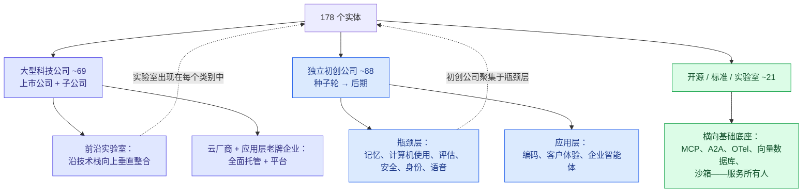
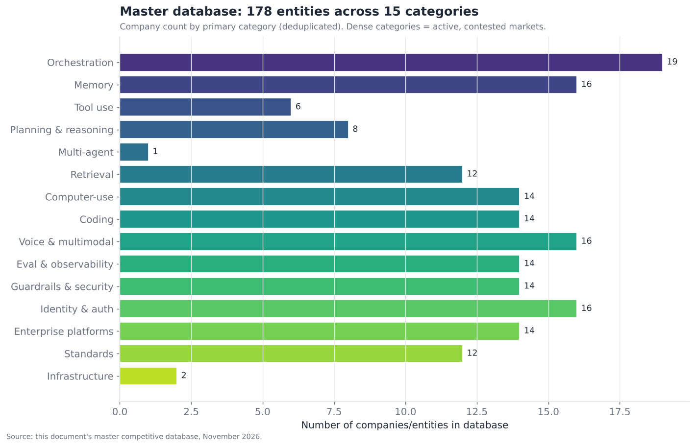
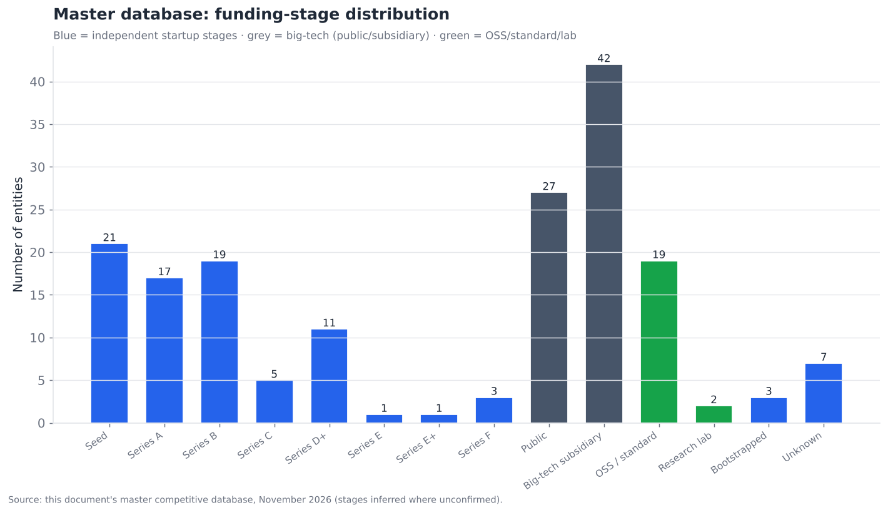

# 16 — 竞争格局总数据库

> **说明：** 本文为英文原文 [`sections/16-master-competitive-database.md`](../../sections/16-master-competitive-database.md) 的简体中文参考译文，仅供参考；如有出入，以英文原文为准。

*核心参考成果。本文档中出现的每一家公司和实体的合并、去重总表——横跨 15 个类别共 178 个条目（2026 年 7 月快照中为 149 个；2026 年 11 月更新）——外加汇总分析。目标篇幅：
4,000 词 + 合并总表。*

---

## 本节是什么

这是本文档其余部分最终汇入的参考成果。第 01–15 节中提及的每一家公司、产品、标准和研究项目都已在此合并为一张表，每个实体按其**主要**类别各占一行，并已去重。结果是**横跨 15 个技术类别的 178 个不同实体**——轻松超过 100+ 的目标，并构成了截至 2026 年 11 月智能体技术竞争格局的一张相当完整的地图。

该表还以独立的机器可读 CSV 形式导出，位于
[`assets/data/master_competitive_database.csv`](../../assets/data/master_competitive_database.csv)，其模式（schema）记录在 [`assets/data/SCHEMA.md`](../../assets/data/SCHEMA.md) 中，因此可以通过程序进行筛选、排序和复用。每个条目都包含全文统一使用的字段：**公司、类别、成熟度**（shipped-reliable（已发布且可靠）/ demoed-brittle（已演示但脆弱）/ research-only（仅限研究））、**融资阶段、主要支持方、差异化优势、主要竞争对手**以及**来源置信度**（official（官方）/ inferred（推断）/ speculative（推测），依据 §17 中的方法论）。

有两点注意事项需要预先说明，因为它们决定了应如何解读本表。第一，**这是一个按月变化的领域在 2026 年 11 月的快照**——融资阶段、所有权乃至公司是否存在都变化很快（此处的 AI 安全公司中有三家在过去两年内被收购，§12）。第二，**"主要类别"的归类是一种简化**——许多实体横跨多个类别（向量数据库既属于记忆*也*属于检索；前沿实验室触及每一层；UiPath 既是计算机使用*也*是企业平台）。每个实体被放在其最具代表性的类别中，并在正文中交叉引用；CSV 中"每行单一类别"的规则是一种务实的去重选择，并不意味着这些公司只做一件事。

---

## 2026 年 7 月以来的变化（2026 年 11 月更新）

数据库根据各节的 2026 年 11 月更新（§02–§15）重新构建。净变化：**149 → 178
个实体**——新增 30 个，原地修改 73 行，删除 1 个。

- **已删除：** *ACP (AGNTCY)*。7 月快照混淆了两件事：IBM 的 Agent Communication
  Protocol（ACP）**已于 2025 年 8 月并入 A2A** *(official)*，而由 Cisco 牵头的 AGNTCY 是一个独立的
  Linux Foundation 项目（OASF 智能体模式 + SLIM 传输层），与 A2A 互补。AGNTCY/OASF 保留其独立的一行；ACP 那一行已删除。
- **已记录的所有权变更** *（除另有说明外均为 official）*：Cursor → SpaceX（600 亿美元，2026 年 8 月 14 日完成交割）；Langfuse → ClickHouse；Galileo → Cisco（Splunk Agent Observability）；Promptfoo → OpenAI；
  Helicone → Mintlify；Tavily → Nebius；Manus → Meta；CyberArk → Palo Alto Networks；SGNL → CrowdStrike；
  Entro → SailPoint；已宣布：Permiso → Okta、Oasis → Cyera、Dreadnode 和 Fiddler → CrowdStrike
  *（尚未完成者为 inferred）*。AutoGen 予以保留，但标注为**已归档**（已被 Microsoft Agent
  Framework 取代）。
- **重要新增：** Claude Managed Agents、Deep Agents (LangChain)、Agno、Supermemory、Hindsight
  （编排/记忆）；Moonshot AI (Kimi)（推理）；Parallel Web Systems、Vals AI（检索/评估）；
  Claude in Chrome、Google Antigravity（计算机使用/编码）；xAI Grok Voice、Block Dessa（语音）；
  OpenAI Frontier（企业）；CrowdStrike Falcon AI security、Obsidian Security、Rein Security、
  Dreadnode（安全）；Universal Commerce Protocol、CyberArk、Oasis、SGNL、Permiso、Entro（身份）；
  AGENTS.md、Agent Skills、Open Responses、Agent Router、WebMCP（标准）。
- **大多数现有行的字段已刷新**：估值（如 Cognition 约 480 亿美元、Sierra 158 亿美元、
  ElevenLabs 220 亿美元要约收购估值、Exa 22 亿美元）、产品版本（MCP `2026-07-28`、A2A v1.0、ADK 2.0、GPT-6、
  Claude 5.x、Gemini 4），以及治理归属（MCP 和 A2A 归入 Agentic AI Foundation；AP2 归入
  FIDO Alliance；x402 归入 x402 Foundation）。
- **更正：** CrewAI 和 LlamaIndex 的融资数字在 7 月版本中被高估，已在 §02 中更正；
  Harvey 的无效阶段标签已规范化。

下文的结构性解读已基于 178 行数据重新计算；7 月得出的主要规律全部成立，其中两条（边缘地带的整合；实验室和云厂商无处不在）还进一步增强。

---

## 格局的形态

在看表之前，先看形态。数据库中的 178 个实体呈现出一个可辨识的结构——一个由大型科技巨头和独立专业公司构成的双层市场，所有参与者之下是横向贯穿的基础设施和标准：

以下两张汇总图表对 178 个实体的数据库中的这一结构进行了量化。

**密度反映了竞争激烈程度和商业机会。** 最拥挤的类别——编排（19）、记忆（16）、语音/多模态（16）、身份/认证（16），以及一组各为 14 的类别（计算机使用、编码、评估、安全、企业）——要么是正在商品化的圈地市场（编排、编码），要么是吸引大量专业新进入者和收购方的瓶颈（记忆、身份、安全、评估）。身份/认证自 7 月以来增长最快（10 → 16），由非人类身份领域的收购潮推动（§13）。本数据库中较稀疏的类别——工具使用（6）、规划与推理（8）、多智能体（1）、标准（12）——之所以稀疏，原因恰恰*相反*，值得加以区分：

- **工具使用和规划与推理之所以稀疏，是因为它们由模型掌控。** 这些能力存在于前沿模型之中（§04、§05），因此不存在大规模的独立公司市场——这里的"公司"就是模型实验室（统一计入规划与推理类别），外加一层薄薄的专业工具。
- **多智能体之所以稀疏（1），是因为它是一种*模式*，而非产品类别。** 其参与者是编排框架和标准（A2A、AGNTCY），已计入这些类别——多智能体协调由 §02 的框架基于 §15 的标准来实现，而不是由专门的"多智能体公司"实现。
- **标准（12）之所以稀疏，是因为标准天然就少**——人们并不希望有很多相互竞争的标准（那意味着碎片化）；这里的稀疏正是*目标*所在。

因此，类别密度并不是一个单一含义的信号——密集可能意味着"正在商品化的热门市场"（编排），也可能意味着"吸引新进入者的瓶颈"（记忆）；稀疏可能意味着"由模型掌控"（工具使用）、"是模式而非产品"（多智能体）或"按设计就应稀少"（标准）。这一分布反映了整篇文档的核心论点：价值和竞争集中在脚手架层（记忆、编排、计算机使用、编码、企业），而由模型掌控的层（推理、工具使用）几乎没有独立参与者。

融资分布揭示了市场的**双层结构**。在 178 个实体中：

- **约 69 个是大型科技公司（上市公司或大型科技公司的子公司）**（较 7 月的约 53 个有所增加，主要是因为收购将初创公司变成了子公司）——包括前沿实验室（作为子公司或资金雄厚的独立公司）、云服务提供商以及企业软件领域的老牌企业。它们主导着由模型掌控的层（§04、§05）、厂商 SDK 编排（§02）、企业平台（§14），并越来越多地主导着每一层的托管版本。
- **约 88 个是独立初创公司**，覆盖从种子轮到后期的各阶段——集中在瓶颈层和应用层（记忆、计算机使用、编码、语音、评估、安全、身份），在这些领域，专业化为专注型公司创造了空间。
- **约 21 个是开源项目、标准或研究实验室**——包括开源框架、标准（MCP、A2A、OTel）和学术研究项目。

阶段分布（种子轮 21 个、A 轮 17 个、B 轮 19 个，此后各阶段逐渐减少）表明这是一个**年轻、以早期阶段为主的市场**——大多数独立智能体公司处于种子轮到 B 轮之间，反映出这一类别形成之晚（这些公司中的大多数在 2023 年之前要么不存在，要么并不做智能体）。少数处于极后期、估值极高的公司（Cursor/Anysphere、Cognition、前沿实验室）与大量早期初创公司并存，这正是一个快速形成、资本涌入的新市场的典型形态。

---

## 如何解读成熟度和置信度列

关于数据库*标签*的两个结构性事实在分析上很重要。

**成熟度严重偏向 shipped-reliable（178 个中有 145 个）。** 这看起来可能显得该领域比本文档所论证的更为成熟——但它反映的是一种选择效应和一个标注上的细微差别。数据库收录的是*存在并已发布的公司/产品*，因此大多数自然都是"已发布"的。这里的成熟度标签关注的是*产品是否已全面可用并在其声明的范围内正常工作*，而不是*底层能力层*是否已被解决。一个记忆产品可以是 shipped-reliable 的（Mem0 如其宣传般工作），而记忆*层*仍是未解决的瓶颈（§03）——因为产品可靠地完成了其有限的任务，但这项有限的任务并不能解决那些困难的开放问题。因此，**产品层面的"shipped-reliable"与能力层层面的"瓶颈"是并存的**，把 145 个 shipped-reliable 的计数解读为"该领域已被解决"将是一种范畴错误。耐人寻味的是，demoed-brittle 条目（31 个）恰好集中在瓶颈层——计算机使用、部分智能体支付、较新的智能体安全和多智能体进入者——在这些领域，即便是产品本身也仍然脆弱。

**置信度为 official 的有 111 个，为 inferred 的有 67 个。** official 条目有厂商公告或文档作为依据；inferred 条目则依赖媒体报道、招聘信息，或在无法获得官方确认时的合理推断——主要涉及融资细节、部分采用方说法以及较新/较小的初创公司。根据 §17 的方法论，**inferred 条目应被视为方向正确但未经证实**，尤其是融资阶段和支持方字段，其不确定性高于类别/差异化优势字段。最终数据库中没有任何条目被标注为 speculative——speculative 级别的说法保留在各节正文中（路线图预测），而不放入参考表，因为参考表旨在成为一份事实快照。

---

## 合并总表

完整的 178 个实体数据库，按主要类别分组，每组内按字母顺序排列。这是核心参考成果；同样的数据以机器可读形式存在于导出的 CSV 中。

### 编排框架（§02）

| 公司 / 实体 | 成熟度 | 阶段 | 主要支持方 | 差异化优势 | 主要竞争对手 | 置信度 |
|---|---|---|---|---|---|---|
| **Agno** | shipped | unknown | unknown | 极简抽象、快速的多模态智能体（前身为 Phidata）；2026 年 8 月发布 3.0 | Pydantic AI;CrewAI | inf |
| **AutoGen** | shipped | subsidiary | Microsoft | 2026 年 10 月已归档（不再提供缺陷/安全修复）；已被 MS Agent Framework 取代 | CrewAI;MS Agent Framework | off |
| **AWS Strands / Bedrock Agents** | shipped | public | Amazon | 与 AWS Bedrock 深度集成的托管智能体运行时 | Google ADK;MS Agent Framework | off |
| **Claude Agent SDK** | shipped | subsidiary | Anthropic | 经 Claude Code 实战检验；MCP/工具使用能力强；可与托管的 Claude Managed Agents 搭配使用 | OpenAI Agents SDK;LangGraph | off |
| **Claude Managed Agents** | demoed | subsidiary | Anthropic | 托管智能体运行时（2026 年 4 月公测），带沙箱和记忆存储；服务器端运行的动态多智能体工作流（2026 年 10 月） | Google Agent Runtime;Azure Foundry Agent Service;LangSmith Deployment | off |
| **CrewAI** | shipped | series-a | Insight Partners;boldstart;Craft Ventures | 角色/团队（crew）隐喻；搭建多智能体演示的最快路径 | AutoGen;LangGraph | off |
| **Deep Agents (LangChain)** | demoed | series-b | IVP;Sequoia;Benchmark;CapitalG | 基于 LangGraph 的开箱即用智能体脚手架：文件系统；子智能体；技能；长期记忆（1.0 之前） | Claude Agent SDK;OpenAI Agents SDK | off |
| **DSPy** | demoed | research-lab | Stanford | 针对指标编译/优化提示词，而非手工调优 | LangChain;Pydantic AI | inf |
| **Google ADK** | shipped | subsidiary | Google | ADK 2.0（2026 年 5 月）图式 Workflow 引擎，支持可从检查点恢复的人在回路；原生支持 Gemini Enterprise Agent Platform 和 A2A | MS Agent Framework;LangGraph | off |
| **Haystack (deepset)** | shipped | series-b | unknown | Haystack 3.0（2026 年 7 月）：面向 RAG 的显式管道和智能体工作流 | LlamaIndex;LangChain | off |
| **LangChain** | shipped | series-b | IVP;Sequoia;Benchmark;CapitalG | 最大的智能体生态系统和最广的集成覆盖 | LlamaIndex;vendor SDKs | off |
| **LangGraph** | shipped | series-b | IVP;Sequoia;Benchmark;CapitalG | 持久化、带检查点的图执行；LangSmith Deployment 运行时（前身为 LangGraph Platform），含 BYOC | MS Agent Framework;Google ADK;CrewAI | off |
| **LlamaIndex** | shipped | series-a | unknown | 以数据/RAG 为先，提供智能体式文档工作流 | LangChain;Haystack | off |
| **Mastra** | shipped | seed | unknown | TypeScript 原生的完整编排框架；自 2026 年 1 月起为稳定的 1.0 版 | Vercel AI SDK;LangGraph.js | off |
| **Microsoft Agent Framework** | shipped | subsidiary | Microsoft | AutoGen 继任者，与 Semantic Kernel 合并；Azure 原生持久化执行；每周发布（2026 年 10 月为 v1.24） | LangGraph;Google ADK | off |
| **OpenAI Agents SDK** | shipped | subsidiary | OpenAI | 随 GPT 模型一同提供；原生沙箱 + 模型原生脚手架（2026 年 4 月）；仍处于 1.0 之前 | Claude Agent SDK;LangGraph | off |
| **Pydantic AI** | shipped | seed | unknown | 类型安全的 Python 智能体；V2（2026 年 6 月）提供可组合能力 + 脚手架包 | LangGraph;LlamaIndex | off |
| **Semantic Kernel** | shipped | subsidiary | Microsoft | 企业级 .NET 传统；正统一并入 MS Agent Framework | MS Agent Framework | off |
| **Vercel AI SDK** | shipped | series-e | Accel;GV;Notable Capital | 面向 TypeScript Web 嵌入式智能体的默认轻量客户端 | Mastra;Genkit | off |

### 记忆系统（§03）

| 公司 / 实体 | 成熟度 | 阶段 | 主要支持方 | 差异化优势 | 主要竞争对手 | 置信度 |
|---|---|---|---|---|---|---|
| **Anthropic Memory Tool** | shipped | subsidiary | Anthropic | 透明的文件式记忆 + 上下文编辑；Managed Agents 记忆存储；Dreams 离线整合（研究预览） | OpenAI memory;Vertex Memory Bank | off |
| **AWS AgentCore Memory** | shipped | public | Amazon | 与 Mem0 合作的托管记忆；情景（反思）策略；流式长期记忆通知 | Vertex Memory Bank;Azure | off |
| **Chroma** | shipped | series-a | unknown | 对开发者友好的嵌入式向量存储 | Qdrant;Weaviate | off |
| **Cognee** | demoed | seed | unknown | 受治理的全组织记忆控制平面（ECL 管道）；2026 年 4 月发布 1.0 | Zep;Mem0 | inf |
| **Hindsight (Vectorize)** | demoed | unknown | Vectorize | 发布开放的 Agent Memory Benchmark（AMB）的智能体记忆系统 | Mem0;Zep;Letta | inf |
| **LangMem** | shipped | series-b | IVP;Sequoia | LangGraph 原生记忆 SDK；自 2025 年 10 月以来无新版本，重心转向 Deep Agents 记忆 | Mem0;Zep | inf |
| **Letta** | shipped | seed | Felicis | 记忆优先的有状态智能体；操作系统式核心/归档分页；Letta Code 记忆优先编码智能体 | Mem0;LangMem | off |
| **Mem0** | shipped | series-a | Basis Set Ventures;Kindred Ventures;Peak XV;Y Combinator | 即插即用的提取式事实记忆；v2 算法（2026 年 4 月）厂商自报在约 7K token 下 LoCoMo 92.5 / LongMemEval 94.4；AWS 提供方 | Zep;LangMem;Letta | off |
| **OpenAI Memory** | shipped | subsidiary | OpenAI | ChatGPT 后台用户画像；2026 年 6 月重建，支持可审阅的记忆并向免费层推广；仅限项目的记忆 | Anthropic Memory Tool;Google | off |
| **Pinecone** | shipped | series-b | Andreessen Horowitz;ICONIQ | 托管向量数据库底座，正向上拓展至记忆 | Weaviate;Qdrant | off |
| **Qdrant** | shipped | series-b | Advance Venture Partners;Spark Capital;Unusual Ventures;Bosch Ventures | 高性能开源向量数据库 | Weaviate;Pinecone | inf |
| **Redis (Agent Memory)** | shipped | public | Redis | 亚毫秒级 KV 加向量，用于低延迟工作记忆 | Pinecone;pgvector | off |
| **Supermemory** | demoed | seed | Susa Ventures;Browder Capital;SF1.vc | 从非结构化数据构建知识图谱的通用记忆 API | Mem0;Zep | off |
| **Vertex Memory Bank** | shipped | subsidiary | Google | 更名为 Agent Platform Memory Bank（2026 年 4 月）；记忆档案于 2026 年 7 月 GA；TTL 过期与修订 | AWS AgentCore Memory;OpenAI | off |
| **Weaviate** | shipped | series-b | Index Ventures;Battery | 具备智能体记忆功能的开源向量数据库 | Pinecone;Qdrant | off |
| **Zep** | shipped | seed | Y Combinator | 双时态知识图谱（Graphiti）；重新定位为上下文工程平台（SDK 4.0，2026 年 10 月） | Mem0;Cognee | off |

### 工具使用与函数调用（§04）

| 公司 / 实体 | 成熟度 | 阶段 | 主要支持方 | 差异化优势 | 主要竞争对手 | 置信度 |
|---|---|---|---|---|---|---|
| **Arcade.dev** | shipped | seed | unknown | 支持按用户委托 OAuth 的工具调用 | Composio;native MCP | inf |
| **Composio** | shipped | seed | unknown | 面向 250+ 应用的托管、已认证工具集成 | Arcade.dev;Pipedream | inf |
| **Instructor** | shipped | open-source-project | community | Python 风格的"验证并重试"结构化提取 | Outlines;Pydantic AI | off |
| **Outlines** | shipped | open-source-project | community | 保证结构有效的语法约束解码 | XGrammar;llguidance | off |
| **Pipedream** | shipped | series-a | unknown | 以 MCP 工具形式提供的数千个应用连接器 | Composio;Zapier | off |
| **Zapier (MCP)** | shipped | bootstrapped | unknown | 通过 MCP 桥接给智能体的海量集成目录 | Pipedream;Composio | off |

### 规划与推理（§05）

| 公司 / 实体 | 成熟度 | 阶段 | 主要支持方 | 差异化优势 | 主要竞争对手 | 置信度 |
|---|---|---|---|---|---|---|
| **Anthropic** | shipped | series-f | Google;Amazon;Lightspeed | 始终开启、带努力程度等级的自适应思考（Fable 5.1、Opus 5.5）；推理能力可迁移到长时程智能体任务 | OpenAI;Google DeepMind | off |
| **DeepSeek** | shipped | bootstrapped | High-Flyer | 低成本开放权重推理；R 系列已并入 V4，提供思考/非思考模式 | Qwen;Moonshot AI (Kimi) | inf |
| **Google DeepMind** | shipped | subsidiary | Alphabet | Gemini 4 Argon（2026 年 10 月 GA）长时程推理；AlphaProof/搜索传统 | OpenAI;Anthropic | inf |
| **Meta (Llama)** | shipped | public | Meta | 开放权重生态系统，外加首个闭源权重前沿模型（Muse Wonder，2026 年 10 月） | Qwen;DeepSeek;OpenAI | inf |
| **Moonshot AI (Kimi)** | shipped | unknown | unknown | 开放权重的智能体推理模型；Kimi K3.1 Pro API 于 2026 年 10 月 23 日发布 | DeepSeek;Qwen (Alibaba) | inf |
| **OpenAI** | shipped | series-e+ | Microsoft;Thrive;SoftBank | 测试时计算的先驱；GPT-6 Astra/Sol/Luna（2026 年 9 月），支持分级努力程度和子模型"ultra"模式 | Anthropic;Google DeepMind | inf |
| **Qwen (Alibaba)** | shipped | public | Alibaba | 开放权重的 Qwen3.6 中端模型，外加闭源权重的 Qwen3.7-Max 智能体旗舰 | DeepSeek;Moonshot AI (Kimi) | inf |
| **xAI** | shipped | series-d+ | Valor;a16z;Sequoia | 采用自我博弈和链式验证的 Grok 推理 | OpenAI;Google DeepMind | inf |

### 多智能体协调（§06）

| 公司 / 实体 | 成熟度 | 阶段 | 主要支持方 | 差异化优势 | 主要竞争对手 | 置信度 |
|---|---|---|---|---|---|---|
| **IBM watsonx Orchestrate / BeeAI** | shipped | public | IBM | 企业多智能体编排；IBM 的 ACP 已并入 A2A（2025 年 8 月） | MS Agent Framework;Google ADK | off |

### 检索与知识接地（§07）

| 公司 / 实体 | 成熟度 | 阶段 | 主要支持方 | 差异化优势 | 主要竞争对手 | 置信度 |
|---|---|---|---|---|---|---|
| **Cohere** | shipped | series-d+ | Inovia;NVIDIA;Salesforce | 企业级重排序和多模态嵌入（Embed 5 Pro/Fast 共享空间；Rerank 4） | Voyage AI;OpenAI;Google | off |
| **Contextual AI** | shipped | series-a | Greycroft;Bain Capital Ventures;Lightspeed | 企业级有事实依据的 RAG 平台；CEO 及 20 余名员工于 2026 年 5 月通过"授权加招聘"交易转入 Google DeepMind（独立发展前景不明） | Vectara;Glean | inf |
| **Elastic** | shipped | public | Elastic NV | 成熟的 BM25+向量混合搜索基础设施 | OpenSearch;vector DBs | off |
| **Exa** | shipped | series-c | Andreessen Horowitz;Benchmark;Lightspeed;NEA | 面向智能体的神经网络 Web 索引和搜索 API（2026 年 5 月估值 22 亿美元；2026 年 10 月发布 Exa 3.0） | Parallel Web Systems;Perplexity;Tavily | off |
| **Glean** | shipped | series-f | Kleiner Perkins;Sequoia;Coatue | 覆盖整个工作场景的企业搜索和知识图谱，并配备智能体 | Vectara;Onyx | off |
| **Neo4j** | shipped | series-f | Eurazeo;GV | 支撑图 RAG 的图数据库 | Microsoft GraphRAG | off |
| **Onyx (Danswer)** | shipped | seed | Y Combinator | 开源、可自托管的企业搜索与 RAG | Glean;Vectara | inf |
| **Parallel Web Systems** | shipped | series-b | Sequoia;Kleiner Perkins;Index Ventures;Khosla Ventures | 专为智能体打造的 Web 搜索、提取和深度研究 Task API（2026 年 4 月估值 20 亿美元） | Exa;Perplexity;Tavily | inf |
| **Perplexity** | shipped | series-d+ | IVP;NEA;NVIDIA | 通过 Search API 提供自有 Web 索引，外加多模型 Agent API（Sonar 聊天补全于 2026 年 9 月停用） | Exa;Parallel Web Systems;vendor web search | off |
| **Tavily** | shipped | subsidiary | Nebius | 面向智能体的搜索与提取 Web API；被 Nebius 收购（2026 年 2 月宣布） | Exa;Parallel Web Systems;Brave Search API | off |
| **Vectara** | shipped | series-a | unknown | 具备幻觉抑制能力的托管式 RAG 即服务 | Contextual AI;Onyx | off |
| **Voyage AI** | shipped | subsidiary | MongoDB | 领域嵌入和重排序模型；Voyage 4 系列，含开放权重 nano 版和数据库内自动嵌入 | Cohere;OpenAI | off |

### 计算机使用与浏览器智能体（§08）

| 公司 / 实体 | 成熟度 | 阶段 | 主要支持方 | 差异化优势 | 主要竞争对手 | 置信度 |
|---|---|---|---|---|---|---|
| **Amazon Nova Act** | demoed | public | Amazon | 与 AWS 集成的浏览器动作模型和 SDK | OpenAI CUA;Google Mariner | off |
| **Anchor Browser / Scrapybara** | shipped | seed | unknown | 隔离的智能体浏览器和计算机沙箱 | Browserbase | inf |
| **Anthropic Computer Use** | demoed | subsidiary | Anthropic | 领先的 OSWorld 分数：Fable 5 在 OSWorld-Verified 上达 85.0%；Opus 5.5 在 OSWorld 2.1 上达 81.8%（部分） | OpenAI Operator;Gemini in Chrome | off |
| **Browser Use** | shipped | seed | Y Combinator | 流行的开源 DOM+视觉浏览器自动化库 | Stagehand;Skyvern | inf |
| **Browserbase** | shipped | series-b | Kleiner Perkins;CRV | 面向智能体的大规模托管无头浏览器沙箱 | Anchor Browser;Scrapybara | inf |
| **Claude in Chrome** | demoed | subsidiary | Anthropic | 在用户已登录的 Chrome 中执行操作的浏览器内智能体扩展；2026 年 8 月在付费套餐中 GA，带逐操作安全分类器 | Gemini in Chrome;Perplexity Comet | inf |
| **Google Project Mariner** | demoed | subsidiary | Google | 独立版 Mariner 于 2026 年 5 月退役；其导航技术栈现为 Gemini Agent 和 Chrome 自动浏览提供支持 | Claude in Chrome;Perplexity Comet | inf |
| **H Company (Runner H)** | demoed | seed | Accel;UiPath;Eurazeo | 高效的小型 Web 动作模型（欧洲） | Simular;OpenAI | inf |
| **Manus** | demoed | subsidiary | Meta | 爆火的自主通用智能体；被 Meta 收购（2025 年 12 月，据报道超过 20 亿美元），正整合进 Meta AI | OpenAI Operator;Anthropic | off |
| **OpenAI Operator / CUA** | demoed | subsidiary | OpenAI | 智能体浏览已并入 ChatGPT 桌面应用、云端浏览器和 Chrome 扩展；Atlas 浏览器于 2026 年 8 月 9 日停止 | Anthropic Computer Use;Gemini in Chrome | off |
| **Perplexity Comet** | demoed | series-d+ | IVP;NEA;NVIDIA | 硕果仅存的主要独立智能体浏览器，在用户的已认证上下文中运行 | Gemini in Chrome;Claude in Chrome | inf |
| **Simular** | demoed | seed | unknown | 开放框架；首个超越 OSWorld 人类基线；Sai 声称取得 OSWorld 2.0 最高部分分数（73%，2026 年 8 月） | Anthropic;H Company | off |
| **Skyvern** | demoed | seed | Y Combinator | 视觉+DOM 的 Web 工作流和表单自动化 | Browser Use;Reworkd | inf |
| **UiPath** | shipped | public | UiPath | 企业 RPA 老牌企业，正转向智能体自动化 | Automation Anywhere;Microsoft Power Automate | off |

### 编码智能体（§09）

| 公司 / 实体 | 成熟度 | 阶段 | 主要支持方 | 差异化优势 | 主要竞争对手 | 置信度 |
|---|---|---|---|---|---|---|
| **Aider** | shipped | open-source-project | community | 流行的开源终端结对编程工具 | Claude Code;Cline | off |
| **Amazon Q Developer / Kiro** | shipped | public | Amazon | 与 AWS 集成的编码智能体 | GitHub Copilot;Gemini | off |
| **Claude Code** | shipped | subsidiary | Anthropic | 通过轻量 CLI 使用 Opus/Sonnet 5.5，具备智能体式代码库搜索；据 Anthropic 称在 Terminal-Bench 4.0 上领先（2026 年 9 月） | Codex CLI;Cursor;GitHub Copilot | off |
| **Cline / Roo Code** | shipped | open-source-project | community | 开源的智能体式 VS Code 扩展 | Cursor;GitHub Copilot | inf |
| **Codex CLI** | shipped | subsidiary | OpenAI | 通过 CLI 使用 GPT-6 Astra / GPT-6.1 Sol 编码模型 | Claude Code;Google Antigravity (CLI + 2.0 desktop) | inf |
| **Cognition (Devin)** | demoed | series-d+ | a16z;Accel;Founders Fund;General Catalyst;8VC | 智能体优先的自主软件工程，外加 Devin Desktop（前身为 Windsurf）；约 480 亿美元 E 轮（2026 年 9 月） | GitHub Copilot agent;OpenHands;Cursor | inf |
| **Cursor (Anysphere)** | shipped | subsidiary | SpaceX (SpaceXAI) | AI 原生 IDE；被 SpaceX 以 600 亿美元全股票收购（2026 年 8 月 14 日完成交割）；ARR 约 30–40 亿美元 | GitHub Copilot;Devin Desktop | off |
| **Gemini Code Assist / CLI** | shipped | subsidiary | Google | Gemini CLI 于 2026 年 6 月 18 日对消费者层级退役，改用闭源的 Antigravity CLI；Code Assist 继续面向企业提供 | Codex CLI;Claude Code | off |
| **GitHub Copilot** | shipped | subsidiary | Microsoft | 最大的安装基数；Copilot Fusion 多模型路由、多仓库 Projects 以及跨客户端云端智能体会话（Universe，2026 年 10 月） | Cursor;Claude Code | inf |
| **Google Antigravity (CLI + 2.0 desktop)** | shipped | subsidiary | Google | Google 统一的智能体优先编码界面：基于 Go 的 Antigravity CLI（支持后台工作流）加 Antigravity 2.0 桌面版 | Claude Code;Codex CLI;Cursor | off |
| **JetBrains AI / Junie** | shipped | bootstrapped | JetBrains | JetBrains IDE 中的原生智能体 | Cursor;Copilot | off |
| **Lovable** | shipped | series-a | Accel | 从提示词生成 Web 前端应用的构建工具 | v0;Bolt | inf |
| **OpenHands (All Hands AI)** | shipped | seed | unknown | 开源自主软件工程智能体及 SDK | Devin;Aider | inf |
| **Replit Agent** | shipped | series-b | a16z;Coatue | 在浏览器中构建并部署完整应用 | Lovable;Cursor | inf |

### 语音与多模态智能体（§10）

| 公司 / 实体 | 成熟度 | 阶段 | 主要支持方 | 差异化优势 | 主要竞争对手 | 置信度 |
|---|---|---|---|---|---|---|
| **Amazon Nova Sonic** | shipped | public | Amazon | Nova 2 Sonic（2025 年 12 月发布，2026 年 5 月更新）：与 AWS 集成的语音到语音模型 | OpenAI Realtime;Google | off |
| **AssemblyAI** | shipped | series-c | Accel;Insight | 具备丰富音频智能的语音转文本 | Deepgram;Whisper | off |
| **Bland AI** | shipped | series-a | Emergence;Scale angels | 大规模外呼语音通话 | Vapi;Retell AI | inf |
| **Block Dessa** | research | public | Block | 仅用对话音频训练的全双工 S2S 模型；声称支持本地推理；仅开放研究访问（2026 年 10 月） | OpenAI Realtime API;Sesame | off |
| **Cartesia** | shipped | series-a | Index Ventures;Lightspeed | 首段音频延迟极低的 TTS | ElevenLabs;PlayHT | inf |
| **Decagon** | shipped | series-d+ | a16z;Accel;Coatue;Index Ventures | 面向企业的 AI 客户支持智能体；估值 45 亿美元（2026 年 1 月） | Sierra;Salesforce Agentforce | off |
| **Deepgram** | shipped | series-c | AVP;Tiger Global;In-Q-Tel;Y Combinator | 快速、准确的流式语音转文本；估值 13 亿美元（2026 年 1 月） | AssemblyAI;Whisper | off |
| **ElevenLabs** | shipped | series-d+ | a16z;ICONIQ;Sequoia;Wellington;T. Rowe Price | 一流的语音质量和多语言 TTS，并配有智能体技术栈；要约收购估值 220 亿美元（2026 年 9 月） | Cartesia;PlayHT | off |
| **Google Gemini Live** | shipped | subsidiary | Google | Gemini 3.8 Live / Extended Thinking（2026 年 9 月）：语音+视觉 S2S，可在说话时进行异步工具调用 | OpenAI Realtime;Amazon | off |
| **LiveKit** | shipped | series-c | Index Ventures;Altimeter;Redpoint;Salesforce Ventures | 实时 WebRTC 媒体基础设施加 Agents 框架；估值 10 亿美元（2026 年 1 月） | Daily/Pipecat | off |
| **OpenAI Realtime API** | shipped | subsidiary | OpenAI | 具备推理能力的原生 S2S（GPT-Realtime-2.1），外加全双工 GPT-Live-1 API（2026 年 9 月，语音层 $0.05/分钟） | Google Gemini Live;Amazon Nova Sonic;xAI Grok Voice | off |
| **Pipecat (Daily)** | shipped | series-b | unknown | 开源语音智能体管道框架 | LiveKit Agents | off |
| **Retell AI** | shipped | seed | Y Combinator | 符合 HIPAA、低延迟的语音智能体编排 | Vapi;Bland AI | inf |
| **Sierra** | shipped | series-d+ | Sequoia;Benchmark;Tiger Global;GV | 企业客户体验语音和聊天智能体；估值 158 亿美元（2026 年 5 月） | Decagon;Salesforce Agentforce | off |
| **Vapi** | shipped | series-b | Peak XV;Bessemer;Abstract | 模块化、多提供商的语音智能体编排平台；累计 10 亿次通话（2026 年 5 月） | Retell AI;Bland AI | off |
| **xAI Grok Voice** | shipped | unknown | xAI | 托管语音到语音 API（Grok Voice 3.0，2026 年 10 月，约 $0.08/分钟）；厂商声称在 S2S 基准测试中排名第一 | OpenAI Realtime API;Google Gemini Live | inf |

### 评估与可观测性（§11）

| 公司 / 实体 | 成熟度 | 阶段 | 主要支持方 | 差异化优势 | 主要竞争对手 | 置信度 |
|---|---|---|---|---|---|---|
| **ARC Prize / Epoch AI** | shipped | research-lab | unknown | 构建前沿推理基准测试（ARC-AGI/FrontierMath） | internal evals | off |
| **Arize AI** | shipped | series-c | TCV;Battery | 企业级规模的 LLM/智能体生产监控；开源 Phoenix | Braintrust;Datadog | off |
| **Braintrust** | shipped | series-b | ICONIQ;a16z;Greylock | 将评估和可观测性统一为一个质量管理工作流 | LangSmith;Arize | inf |
| **Confident AI (DeepEval)** | shipped | seed | Y Combinator | Pytest 风格的开源 LLM 评估框架 | Langfuse;Latitude | inf |
| **Datadog LLM Observability** | shipped | public | Datadog | 集成到现有 APM 套件中的 LLM 可观测性 | Arize;New Relic | off |
| **Galileo** | shipped | subsidiary | Cisco | 生产环境评估器加护栏，现为 Splunk Agent Observability（收购于 2026 年 5 月完成） | Datadog;Arize;Braintrust | off |
| **Helicone** | shipped | subsidiary | Mintlify | 基于代理的 LLM 网关和日志记录；被 Mintlify 收购（2026 年 3 月）后进入维护模式 | Langfuse;LangSmith | off |
| **Langfuse** | shipped | subsidiary | ClickHouse | 开源（MIT 核心）、可自托管、OTel 原生的追踪与评估；2026 年 1 月被 ClickHouse 收购 | Arize Phoenix;LangSmith | off |
| **LangSmith** | shipped | series-b | IVP;Sequoia;Benchmark | 面向构建者、与 LangGraph 集成最紧密的追踪与评估 | Braintrust;Arize | off |
| **Latitude** | demoed | seed | Y Combinator | 智能体优先的开源评估 | Langfuse;LangSmith | inf |
| **Patronus AI** | shipped | series-a | Lightspeed;Datadog | 自动化评估和幻觉/安全检测 | Galileo;Arize | inf |
| **Promptfoo** | shipped | subsidiary | OpenAI | 开源评估和红队测试 CLI；正并入 OpenAI Frontier（收购于 2026 年 3 月宣布） | Confident AI (DeepEval);Patronus AI | off |
| **Vals AI** | shipped | series-a | Andreessen Horowitz | 面向受监管领域的行业专属模型与智能体基准测试 | Artificial Analysis;Scale AI | inf |
| **Weights & Biases (Weave)** | shipped | subsidiary | CoreWeave | 与更广泛的 W&B 机器学习平台及 CoreWeave 云绑定的 LLM 评估 | LangSmith;Braintrust | off |

### 护栏、安全与安保（§12）

| 公司 / 实体 | 成熟度 | 阶段 | 主要支持方 | 差异化优势 | 主要竞争对手 | 置信度 |
|---|---|---|---|---|---|---|
| **CrowdStrike Falcon AI security** | shipped | public | CrowdStrike | 终端安全老牌企业的 AI 检测/响应，带智能体紧急停止开关（Pangea；Fiddler 和 Dreadnode 待完成） | Palo Alto Prisma AIRS;Cisco AI Defense | off |
| **Dreadnode** | demoed | unknown | CrowdStrike (acquisition pending) | 部署前的 AI/智能体攻击性测试（2026 年 11 月正被 CrowdStrike 收购） | Mindgard;Promptfoo;garak | off |
| **Guardrails AI** | shipped | seed | Zetta;GV | 开放、可组合的输出与策略护栏 | NeMo Guardrails;LLM Guard | inf |
| **HiddenLayer** | shipped | series-b | M12;Ten Eleven | 以模型为中心的 AI 威胁检测与响应 | Protect AI;Lakera | inf |
| **Lakera** | shipped | subsidiary | Check Point | 运行时提示注入防护和策略护栏 | Palo Alto Prisma AIRS;HiddenLayer | off |
| **Mindgard** | shipped | seed | unknown | 持续的自动化 AI 红队测试 | Lakera;garak | inf |
| **NeMo Guardrails** | shipped | subsidiary | NVIDIA | 可编程的开源护栏框架 | Guardrails AI;LLM Guard | off |
| **Obsidian Security** | shipped | series-d+ | Crescent Cove Advisors | SaaS 和 AI 智能体安全态势与威胁检测（2026 年 8 月估值 11 亿美元） | Zenity;Wiz | off |
| **Protect AI** | shipped | subsidiary | Palo Alto Networks | MLSecOps 与 AI 安全生命周期（现为 Prisma AIRS） | Robust Intelligence;HiddenLayer | off |
| **Rein Security** | demoed | series-a | Glilot Capital;Sienna Venture Capital | 保护企业自建的 AI 智能体并拦截攻击性智能体 | Zenity;Straiker | off |
| **Robust Intelligence** | shipped | subsidiary | Cisco | AI 防火墙与验证（现为 Cisco AI Defense） | Protect AI;Lakera | off |
| **Straiker** | demoed | seed | unknown | 全链路智能体运行时安全与遥测 | Zenity;Lakera | inf |
| **Wiz** | shipped | public | Google | 云安全中的 AI 安全态势管理 | Palo Alto;Orca | off |
| **Zenity** | shipped | series-b | Intel Capital;DTCP | 面向企业智能体和 Copilot 的安全与治理 | Wiz;Straiker | inf |

### 身份与认证（§13）

| 公司 / 实体 | 成熟度 | 阶段 | 主要支持方 | 差异化优势 | 主要竞争对手 | 置信度 |
|---|---|---|---|---|---|---|
| **Agentic Commerce Protocol** | demoed | subsidiary | OpenAI;Stripe | 委托结账令牌；在 ChatGPT Instant Checkout 逐步关停（2026 年 3 月）后重新聚焦于商户数据源 | AP2;Universal Commerce Protocol;x402 | inf |
| **AP2 (Agent Payments Protocol)** | demoed | open-source-project | Google;FIDO Alliance | 用于智能体支付的签名支出授权（已捐赠给 FIDO Alliance；v0.2 支持人不在场场景） | Agentic Commerce Protocol;x402 | inf |
| **CyberArk** | shipped | subsidiary | Palo Alto Networks | 扩展到智能体身份的特权访问管理 | Okta / Auth0;SailPoint | inf |
| **Descope** | shipped | series-a | Lightspeed;GGV | 基于流程的智能体认证 | Stytch;WorkOS | inf |
| **Entro Security** | shipped | subsidiary | SailPoint | 非人类身份（NHI）及 AI 智能体的密钥/身份安全 | Oasis Security;Astrix | inf |
| **Mastercard Agent Pay** | demoed | public | Mastercard | 基于银行卡通道的 Agent Pay 令牌（已为美国和欧盟发卡机构启用），配合 Verifiable Intent | Visa;ACP | inf |
| **Microsoft Entra Agent ID** | shipped | subsidiary | Microsoft | 将智能体作为受治理的一等身份（2026 年 GA；面向智能体的条件访问） | Okta;Google | off |
| **Oasis Security** | shipped | unknown | Cyera (acquisition announced Jul 2026) | 非人类身份和 AI 智能体访问治理 | Astrix;Entro Security | inf |
| **Okta / Auth0** | shipped | public | Okta | Cross App Access（ID-JAG）加 Agent SSO 和智能体网关；正在收购 Permiso | Microsoft Entra;WorkOS | off |
| **Permiso** | shipped | unknown | Okta (acquisition announced Jul 2026) | 覆盖人类/NHI/智能体身份的身份威胁检测与响应 | Oasis Security;CrowdStrike | inf |
| **SGNL** | shipped | subsidiary | CrowdStrike | 面向人类/机器/智能体身份的上下文感知运行时授权 | Okta / Auth0;CyberArk | off |
| **Stytch** | shipped | series-b | Coatue;Benchmark | 嵌入式智能体与用户认证 | WorkOS;Descope | inf |
| **Universal Commerce Protocol** | demoed | open-source-project | Google | 承载 AP2 并提供 A2A/MCP 绑定的智能体结账/商务协议 | Agentic Commerce Protocol;AP2 (Agent Payments Protocol) | off |
| **Visa Intelligent Commerce** | demoed | public | Visa | 带支出控制的令牌化智能体银行卡凭证 | Mastercard Agent Pay;ACP | off |
| **WorkOS** | shipped | series-b | Sequoia;a16z | 面向 AI 应用和智能体、开发者优先的认证基础设施 | Stytch;Descope | inf |
| **x402** | demoed | open-source-project | Coinbase;Cloudflare;Linux Foundation | x402 Foundation 治理下的 HTTP 402 稳定币微支付（实际商业交易量很小） | AP2;card networks | inf |

### 企业智能体平台（§14）

| 公司 / 实体 | 成熟度 | 阶段 | 主要支持方 | 差异化优势 | 主要竞争对手 | 置信度 |
|---|---|---|---|---|---|---|
| **Adobe AEP Agent Orchestrator** | shipped | public | Adobe | 营销/创意数据原生的智能体 | Salesforce;Microsoft | off |
| **Atlassian Rovo** | shipped | public | Atlassian | 横跨开发/协作工具的智能体 | Microsoft;Glean | off |
| **AWS Bedrock AgentCore** | shipped | public | Amazon | 模型无关的托管企业智能体运行时（脚手架 GA、运行时实例、评估）；旧版 Bedrock Agents 已移至 Classic | Google Gemini Enterprise;Azure | off |
| **Dust** | shipped | series-a | Sequoia | 中立的跨应用员工智能体平台 | Glean;Copilot Studio | inf |
| **Google Agentspace / Gemini Enterprise** | shipped | subsidiary | Google | 开放的跨系统企业智能体层；A2A 原生；Vertex AI 已并入 Gemini Enterprise Agent Platform（2026 年 4 月）；800 万+ 付费席位 | Copilot Studio;AWS;OpenAI Frontier | off |
| **Harvey** | shipped | series-d+ | Sequoia;Kleiner Perkins;GV | 法律领域智能体平台 | Legora;incumbents | inf |
| **Kore.ai** | shipped | series-d+ | Vistara;NVIDIA | 厂商中立的企业客户体验/对话式智能体 | Agentforce;Sierra | inf |
| **Microsoft Copilot Studio** | shipped | public | Microsoft | 依托 M365 无处不在的低代码员工智能体（约 16 万个组织），外加 Agent 365 控制平面（2026 年 5 月 GA；5000 万+ 已注册智能体） | Agentforce;Google Gemini Enterprise | off |
| **OpenAI Frontier** | demoed | subsidiary | OpenAI | 模型厂商推出的企业平台，用于构建、部署和管理智能体（2026 年 2 月，有限提供） | Google Gemini Enterprise;AWS Bedrock AgentCore;Microsoft Copilot Studio | off |
| **Salesforce Agentforce** | shipped | public | Salesforce | CRM 原生的面向客户智能体；Agentforce ARR 超过 15 亿美元（FY27 第二季度，口径扩大）；多模型，含 Claude 和 Bedrock | Microsoft Copilot Studio;ServiceNow;Sierra | off |
| **SAP Joule** | shipped | public | SAP | ERP/业务流程原生的智能体，以 AI Units 计费；据 2026 年 DSAG 调查，采用率滞后 | Microsoft;Workday | inf |
| **ServiceNow AI Agents** | shipped | public | ServiceNow | 基于工作流数据结构（workflow data fabric）的 IT/HR 服务智能体，配备跨系统 AI Control Tower 和 AI Passport；2026 年 AI ACV 目标 17 亿美元 | Copilot Studio;Agentforce | off |
| **UiPath Agentic Automation** | shipped | public | UiPath | 智能体加确定性 RPA 执行 | Automation Anywhere;Microsoft | off |
| **Workday Illuminate** | shipped | public | Workday | HR/财务数据原生的智能体，以 Sana 为入口，并分发到 Copilot、Gemini Enterprise、Slack 和 Claude 中 | SAP Joule;Microsoft | off |

### 标准与互操作性（§15）

| 公司 / 实体 | 成熟度 | 阶段 | 主要支持方 | 差异化优势 | 主要竞争对手 | 置信度 |
|---|---|---|---|---|---|---|
| **A2A (Agent2Agent)** | shipped | open-source-project | Linux Foundation (Agentic AI Foundation);Google;AWS;Microsoft;Salesforce;SAP;ServiceNow | 领先的智能体间标准；v1.0 稳定版（2026 年 3 月）；2026 年 8 月加入 AAIF；吸收了 IBM ACP | AGNTCY;ANP;MCP Tasks | off |
| **Agent Router (ex-Envoy AI Gateway)** | shipped | open-source-project | Linux Foundation (Agentic AI Foundation);Tetrate | 基于 Envoy 的 AI 网关，提供兼容 OpenAI 的模型 API 和 MCP 网关；自 2026 年 9 月起成为 AAIF 项目 | agentgateway;proprietary AI gateways | off |
| **Agent Skills** | shipped | open-source-project | Linux Foundation (Agentic AI Foundation);Anthropic | 可复用智能体指令和资源的可移植打包格式；2026 年 10 月贡献给 AAIF | AGENTS.md;framework-specific agent definitions | off |
| **AGENTS.md** | shipped | open-source-project | Linux Foundation (Agentic AI Foundation);OpenAI | 面向编码智能体的仓库级指令文件；AAIF 创始项目 | Agent Skills;vendor-specific rules files | off |
| **AGNTCY / OASF** | demoed | open-source-project | Linux Foundation;Cisco;Dell;Google Cloud;Oracle;Red Hat | OASF 智能体模式 + SLIM 安全消息传输；与 A2A Agent Cards 互补（AAIF 之外的独立 LF 项目） | A2A Agent Cards;ANP | inf |
| **ANP (Agent Network Protocol)** | research | open-source-project | open community | 基于 DID 的去中心化 P2P 智能体网络 | A2A | inf |
| **Linux Foundation (Agentic AI Foundation)** | shipped | open-source-project | Anthropic;OpenAI;Block;Google;Microsoft;AWS;300+ members | MCP 和 A2A 的中立归属地，另含 AGENTS.md；goose；agentgateway；Agent Router；Agent Skills；Open Responses；OpenEnv；OpenSandbox（共 10 个项目；2026 年 10 月） | vendor control;IETF;W3C community groups | off |
| **MCP (Model Context Protocol)** | shipped | open-source-project | Linux Foundation (Agentic AI Foundation);Anthropic;OpenAI;Google;Microsoft;AWS | 赢得了工具/上下文层；无状态的 2026-07-28 规范；Tier-1 SDK 月下载量约 5 亿次 | A2A (Tasks boundary) | off |
| **OAuth 2.1 / OIDC** | shipped | open-source-project | IETF | 被智能体复用的委托授权基础 | proprietary auth | off |
| **Open Responses** | demoed | open-source-project | Linux Foundation (Agentic AI Foundation);OpenAI | 面向智能体的可互操作模型 API 规范；2026 年 10 月贡献给 AAIF | vendor model APIs | off |
| **OpenTelemetry (GenAI)** | shipped | open-source-project | CNCF;community | 厂商中立的智能体追踪/可观测性标准 | vendor tracing | off |
| **WebMCP** | demoed | open-source-project | W3C Web Machine Learning CG;Google;Microsoft | 供网页向浏览器内智能体暴露工具的浏览器 API；Chrome 来源试用（origin trial） | MCP Apps;browser-automation agents | inf |

### 基础设施 / 运行时

| 公司 / 实体 | 成熟度 | 阶段 | 主要支持方 | 差异化优势 | 主要竞争对手 | 置信度 |
|---|---|---|---|---|---|---|
| **E2B** | shipped | series-a | unknown | 面向智能体的沙箱化代码执行环境 | Modal;Daytona;Browserbase | inf |
| **Modal** | shipped | series-a | Redpoint;a16z | 用于智能体代码执行的无服务器沙箱化计算 | E2B;Daytona | inf |

---

## 数据中的横向规律

纵览全部 178 个条目，会浮现出若干条各节视角未能充分揭示的规律。

**规律 1——前沿实验室无处不在。** Anthropic、OpenAI 和 Google（直接或通过其产品）几乎出现在每一个类别中——作为模型提供方（§05）、编排 SDK 厂商（§02）、记忆提供方（§03）、计算机使用和编码智能体（§08、§09）、语音模型（§10）以及安全/安保层（§12）。这种无处不在是最重要的单一结构性事实：**模型实验室并不局限于模型层；它们正沿着技术栈向上垂直整合**，在几乎每一层都推出第一方产品，从而在各个领域对独立公司形成压力。数据库清晰地展示了实验室如今直接触及技术栈的范围有多广。

**规律 2——云厂商是另一股无所不在的力量。** Microsoft、Amazon 和 Google（作为云服务提供商，有别于其模型业务）出现在编排、记忆、计算机使用/编码基础设施、企业平台和身份等领域——为每一层提供托管版本。在前沿实验室（向上垂直整合）和云厂商（全面托管）之间，**大型科技公司（约 69 个实体）构成了这张地图的引力中心**，而独立公司则环绕在巨头尚未商品化的专业细分领域中。

**规律 3——"卖铲人"悄然占据了有利位置。** 基础设施类实体——沙箱提供商（E2B、Modal、Daytona、Browserbase）、向量数据库底座（Pinecone、Weaviate、Qdrant）、标准（MCP、A2A、OTel）——在多个类别中反复出现，因为*无论哪些智能体胜出，所有人都需要它们*。这些是数据库中最持久的位置：它们无需押注赢家，就能从整个市场的增长中获利。尤其是沙箱层（服务于 §08 和 §09）和向量底座（服务于 §03 和 §07），属于跨类别的基础设施，而各节视角对其重视不足。

**规律 4——整合已在边缘地带发生。** 数据库记录了多起收购（安全领域的 Lakera→Check Point、Protect AI→Palo Alto、Robust Intelligence→Cisco，以及
2026 年 7 月以来的 SGNL→CrowdStrike、CyberArk→Palo Alto、Entro→SailPoint、Promptfoo→OpenAI、Langfuse→ClickHouse、
Galileo→Cisco、Tavily→Nebius、Cursor→SpaceX；
Windsurf→Cognition、Voyage→MongoDB），以及多个产品被并入平台（AutoGen 和 Semantic
Kernel 并入 MS Agent Framework）。**市场虽然年轻，但在老牌企业行动最快的层已开始整合**（安全并入主流安全厂商，框架并入厂商 SDK）——这表明部分类别正在走出碎片化阶段、走向成熟。

**规律 5——瓶颈层的初创公司最多；成熟层的老牌企业最多。** 记忆、计算机使用、评估、安全和身份——即瓶颈层——初创公司密集，因为尚未解决的问题为专注型新公司创造了空间。工具使用、推理以及（越来越多的）编排——即成熟/正在商品化的层——老牌企业密集，因为一旦某一层商品化，巨头的分发优势便占据主导。**初创公司与老牌企业在数据库中的分布本身就是一张成熟度地图**：跟着初创公司找瓶颈，跟着老牌企业找已商品化的层。

---

## 融资与价值的集中

关于*资金*在哪里，可以从融资字段中读出。数据库中最大的估值集中在两处：

- **前沿实验室**（Anthropic、OpenAI、xAI，以及作为 Alphabet 一部分的 Google/DeepMind）——迄今为止价值最高的实体，因为模型是其他一切赖以构建的基础。
- **突围的应用公司**——Cursor/Anysphere（编码；被 SpaceX 以 600 亿美元全股票收购，2026 年 8 月完成交割）、Cognition（编码，截至 2026 年 9 月约 480 亿美元，此前约 260 亿美元）、
  ElevenLabs（语音，220 亿美元要约收购估值）、Sierra（客户体验，158 亿美元）、Glean（企业搜索/智能体）、领先的客户体验公司（Sierra、Decagon），以及领先的独立框架/评估公司（LangChain、Braintrust）。

规律在于：**价值集中在模型层（基础）和应用层（最接近终端用户价值/收入），而中间层（本文档主要讨论的"脚手架"）获得的估值虽然真实但较小。** 这是典型的杠铃结构——基础层和应用层获取最多价值，介于两者之间的中间件虽然重要但估值不那么丰厚——这对独立公司具有战略含义：持久的独立价值要么是*深度*型的（一个真正困难的中间件问题，如持久化编排或时序记忆），要么是*广度*型的（一个拥有真实终端用户收入的应用，如编码或客户体验）。缺乏差异化的中间地带，正是厂商 SDK 和云厂商挤压最狠的地方。

**融资阶段偏向早期**（大多数独立公司处于种子轮到 B 轮）意味着这些价值中有很大一部分仍是*潜在*的——市场还足够早期，这些公司大多在押注尚未实现的未来，这也是估值波动剧烈、竞争格局在一年后将显著不同的原因。本数据库是一个仍在形成中的市场的快照，而非一个已定型的行业。

---

## 使用本数据库

使用本参考资料的实用指南：

- **针对某一层的竞争研究**：按 `category` 筛选 CSV 以获得该层的参与者，然后阅读相应章节（02–15）以了解条目背后的分析。
- **针对特定公司**：搜索 `company` 字段；`differentiator` 和 `main_competitors` 字段给出一句话定位，而覆盖其类别的章节提供深度分析。
- **用于融资/投资分析**：`funding_stage` 和 `key_backers` 字段支持按阶段或支持方筛选——请注意这些字段上特别存在的 inferred 置信度注意事项。
- **用于成熟度评估**：按 `maturity` 筛选，以区分 shipped-reliable 产品和 demoed-brittle 产品——请记住，产品成熟度 ≠ 能力层成熟度（一个已发布的产品可能位于瓶颈层中）。
- **用于重新生成**：汇总图表可通过 `python3 scripts/s16_charts.py` 从 CSV 重新生成，因此数据库始终是唯一事实来源，图表也与之保持一致。

本数据库被刻意构建为*唯一的*合并参考资料——把本文档关于"谁在做什么"的全部内容汇集到一个可筛选的地方——并且可重新生成、可复用，而非一份静态清单。它是六个月后（经过更新）最有可能仍然有用的成果，因为它是整个竞争分析的结构化、机器可读的提炼。

---

## 本数据库*未*涵盖的内容

坦诚说明本参考资料的局限：

- **它并不详尽。** 178 个实体是对整个格局的一个有力样本，而非全部参与者——智能体工具领域有数百家公司，本表收录的是分析中提及的重要且具代表性的公司，而非长尾。
- **它是快照，而非实时数据流。** 截至 2026 年 11 月；它会过时，尤其是融资和所有权字段。类别结构（存在哪些层、它们做什么）比具体公司数据过时得慢。
- **主要类别归类会丢失信息。** 跨多个类别的参与者被简化为一行；正文中的交叉引用部分弥补了这一点，但单看 CSV 会低估跨层公司的数量。
- **它不反映同一类别内部的质量差异。** 同一类别中标签相似的两家公司，在实际质量/市场牵引力上可能相差悬殊——`differentiator` 字段暗示了定位，但数据库是一张*地图*，而非*排名*，各章节提供了表格无法给出的定性判断。

在说明这些局限之后，本数据库实现了其目的：一张单一、合并、去重、机器可读、涵盖 178 个实体的 AI 智能体技术竞争格局地图，并与其背后的分析交叉引用——它是本文档的核心参考成果。

---

## 本节要点

- 总数据库合并了**横跨 15 个类别的 178 个不同实体**（超过 100+ 的目标），按主要类别去重为每个实体一行，并导出为带有文档化模式的可复用 CSV。
- **类别密度是一张成熟度/机会地图**：密集 = 热门圈地市场（编排、编码）或吸引新进入者的瓶颈（记忆、计算机使用）；稀疏 = 由模型掌控（工具使用、推理）、是模式而非产品（多智能体），或按设计就应稀少（标准）。
- 市场是**双层的**：约 69 个大型科技公司（向上垂直整合的前沿实验室 + 提供全面托管的云厂商）构成引力中心；约 88 个独立初创公司（大多处于种子轮到 B 轮）占据专业化的瓶颈/应用细分领域；约 21 个是开源项目/标准/实验室。
- **产品成熟度 ≠ 能力层成熟度**：178 个中有 145 个在产品层面是 shipped-reliable 的，这与能力层层面的瓶颈状态并存——已发布的产品完成其有限的任务，而能力层的难题仍悬而未决。
- 横向规律：**前沿实验室无处不在**（垂直整合），**云厂商提供全面托管**，**"卖铲人"（沙箱、向量底座、标准）的位置最持久**，**整合正从边缘地带开始**（安全、框架），以及**初创公司聚集于瓶颈层，而老牌企业聚集于已商品化的层**。
- **价值呈杠铃式分布**——集中在模型（基础）层和应用层，脚手架这一中间层虽然重要但估值不那么丰厚——因此持久的独立价值要么是深度型的（一个困难的中间件问题），要么是广度型的（一个拥有真实收入的应用）。

*目标篇幅：4,000 词（正文）+ 大型表格。本节：约 4,100 词正文，外加 178 个实体的合并总表。*
