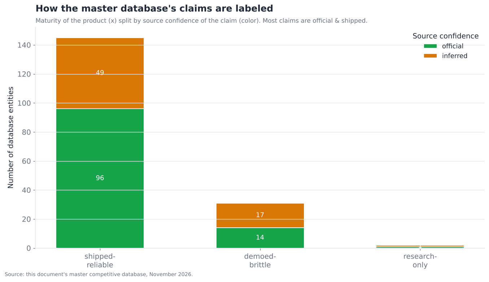
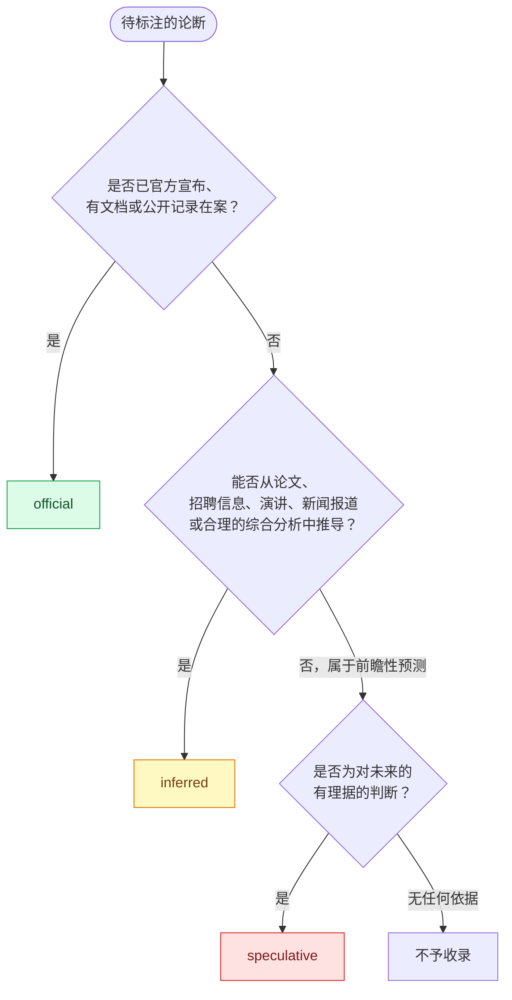

# 17 — 附录：术语表与方法论

> **说明：** 本文为英文原文 [`sections/17-appendix-glossary-methodology.md`](../../sections/17-appendix-glossary-methodology.md) 的简体中文参考译文，仅供参考；如有出入，以英文原文为准。

*本文通篇使用的专业术语，以及约束本文档中每一项论断的置信度/成熟度方法论。目标篇幅：3,000 词。更新于 2026 年 11 月。*

---

## 如何解读本文档中的论断

本文档针对一个快速变化的领域提出了数百项论断。每一项都带有标签，以便读者恰当地衡量其分量。标签采用两套相互正交的标注体系，值得准确理解。

### 成熟度标签（交付状态）

每一项技术或产品论断都带有三种**成熟度**标签之一，用于描述其*交付状态*——即该事物在今天实际运行的可靠程度：

| 标签 | 含义 | 如何权衡 |
|---|---|---|
| **shipped-reliable**（已发布且可靠） | 已正式发布（GA）、有文档，并被第三方用于生产环境；在声明的适用范围内表现可预测。 | 可信任其在声明的边界内如所描述般工作。 |
| **demoed-brittle**（已演示但脆弱） | 已公开展示，或处于预览/测试（beta）阶段；在精心设定的条件下可用，但在这些条件之外存在已知的可靠性缺口。 | 令人印象深刻，但未经测试不要在生产环境中依赖它。 |
| **research-only**（仅限研究） | 论文、原型或内部演示；并非受支持的产品。 | 代表未来走向的方向性信号，而非可在其上构建的东西。 |

§16 中强调的一个关键细微之处是：**产品成熟度不等同于层级成熟度。** 一个产品可以是 shipped-reliable 的（可靠地完成其有界的工作），而它所处的*能力层*却是一个尚未解决的瓶颈（这项有界的工作并未解决该层的核心开放难题）。Mem0 是处于瓶颈记忆层（§03）中的一个 shipped-reliable 产品；Anthropic Computer Use 是处于瓶颈计算机使用层（§08）中的一个 demoed-brittle 产品。应将成熟度标签理解为"在其适用范围内，我能在多大程度上信任*这个产品*"，而将各章节的层级评估理解为"*这个问题*总体上被解决到了什么程度"。

### 置信度标签（证据基础）

每一项路线图、能力或竞争格局相关的论断还额外带有一个**置信度**标签，用于描述其*证据基础*——即该论断的来源有多可靠：

| 标签 | 依据 | 示例 |
|---|---|---|
| **official**（官方） | 厂商公告、文档或公开记录在案的表态。 | "MCP 已捐赠给 Linux 基金会"——已公告。 |
| **inferred**（推断） | 从论文、招聘信息、会议演讲、新闻报道或合理的综合分析中推导得出——未经官方确认。 | 根据新闻报道得出的某初创公司融资阶段；根据案例研究得出的采用方说法。 |
| **speculative**（推测） | 分析师预测或前瞻性判断；对未来的有理据的猜测。 | "支付层将在 2026–2027 年间走向整合。" |

这两套体系相互正交：一项论断可以是关于某个 *demoed-brittle* 事物的 *official* 论断（"厂商宣布了 [official] 这项预览功能 [demoed-brittle]"），也可以是关于某个 *shipped-reliable* 事物的 *inferred* 论断（"我们推断 [inferred] 这款已正式发布的产品 [shipped-reliable] 拥有这些采用方"）。下图展示了主数据库各条目在这两个维度上的分布情况：

大多数数据库条目属于 *official* 且 *shipped-reliable*（即文档完善、已正式发布的产品），而 *inferred* 条目集中在融资/投资方细节以及较新、较小、文档较少的参与者上。**speculative** 层级只出现在各章节的路线图小节中（前瞻性预测），从不出现在参考数据库中——后者旨在成为一份事实快照。

### 置信度分配流程

用于分配置信度标签的流程，明确如下：

这一流程所强制执行的纪律是：**无法至少以推断为依据溯源的论断一律删除，而不是凭猜测写入文档。** 置信度标签并非装饰——它们是读者判断每项论断能承受多大分量的指南。在一个充斥着听起来很笃定的错误信息的领域中，这些标签至关重要（像本文档这样的文档，其大量原始素材都是可靠性参差不齐的 SEO 内容和厂商营销材料）。

---

## 方法论说明

关于本文档是如何构建的若干说明，供读者校准判断：

- **来源。** 本分析参考了官方厂商文档与公告、已发表的研究、行业媒体以及实时网络搜索（该领域每月都在变化，因此 2026 年 7 月的数据是在整个撰写过程中持续收集的，而非依赖某个静态快照）。
- **2026 年 11 月更新。** 2026 年 7 月 22 日的快照已于 2026 年 11 月更新。§02–§15 每一章都新增了一份注明日期的"2026 年 7 月以来的变化"日志，以及一份结尾的"参考来源（2026 年 11 月更新）"URL 列表；过时的论断已就地修订，路线图条目已注明其最终结果，主数据库也已重建（149 → 178 个实体）。更新期间，许多厂商和标准机构的网站无法直接抓取，因此更大比例的新论断依赖于搜索结果摘要和二手媒体报道；按照上述流程，这些论断被标注为 `inferred`（或 `speculative`），而非 `official`。在看待 2026 年 11 月的数据时——尤其是融资、收购价格以及厂商自报的基准测试分数——请牢记这一点。当来源之间存在冲突时（这在基准测试数字和融资数据中很常见），本文档会注明其不确定性，而不是挑选一个虚假的精确值。
- **定量数据仅具方向性。** 基准测试分数、融资金额、采用数量和市场规模均为近似值，且往往由厂商自报或仅有单一来源；它们用于传达*量级与趋势*，而非精确的事实。当底层数据存在不确定性时，图表会明确将其数据标注为推断/示意性质。读者应将具体数字理解为"大致如此"，而非精确值。
- **图表可再生成。** 每张图表都由 `scripts/` 中的脚本基于 `assets/data/` 中的数据生成，因此可视化结果可复现、与底层数据保持一致，并可随领域发展而更新。
- **竞争数据库是一张地图，而非排名。** §16 的数据库记录的是谁在做什么，而不是谁最好；质量判断体现在各章节的正文中，而不在表格里。
- **中立性。** 本文档力求技术上的精确，不使用营销语言，并以相同的循证标准评估所有参与者——包括本分析所运行模型背后的厂商。当某一层尚未解决时，本文档会直言不讳；当某个厂商处于领先时，同样会直言不讳。

---

## 智能体架构术语表

本文通篇使用的专业术语，简明定义如下。大致按其所属的层级组织。

### 核心智能体概念

| 术语 | 定义 |
|---|---|
| **Agent（智能体）** | 一种基于 LLM 的系统，能够在循环中（通过工具）对外部世界采取行动，而不只是生成文本——以迭代方式感知、决策、行动并观察结果，以趋近某个目标。 |
| **Agentic loop（智能体循环）** | 核心控制循环：调用模型，执行其请求的任何工具，将结果反馈回去，重复直至完成。这是每个智能体不可再简化的核心。 |
| **Tool / function calling（工具使用 / 函数调用）** | 模型请求运行外部代码（一个函数、API 或 MCP 服务器）并接收返回结果的机制。正是这一能力将文本生成器变成了智能体。 |
| **ReAct（推理 + 行动）** | "Reason + Act"（推理 + 行动）——将显式推理（"思考"）与行动和观察交替进行的模式，一步一步摸索前进。这是最常用的主力智能体模式。 |
| **Workflow vs. agent（工作流与智能体）** | *工作流*的控制流由开发者编写（模型负责填充各个步骤）；*智能体*的控制流由模型决定（模型选择每一个下一步）。2026 年的指导原则：优先选用足以解决问题的最低自主程度。 |
| **Human-in-the-loop, HITL（人在回路）** | 智能体执行过程中的人工审批/干预节点，尤其是在采取重大后果的行动之前。*结构性地*（在控制流中）强制执行，优于*行为性地*（在提示词中）强制执行。 |
| **Autonomy gradient（自主程度梯度）** | 从人工驱动（智能体提出建议）到完全自主（智能体在无监督下行动）的谱系。由于可靠性和安全性的限制，2026 年大多数生产环境中的智能体都是*半自主*的——在有重大后果的行动上接受人工监督。 |

### 编排与状态

| 术语 | 定义 |
|---|---|
| **Orchestration framework（编排框架）** | 运行智能体循环、保存状态、连接工具并组合智能体的软件（例如 LangGraph、CrewAI、MS Agent Framework、各厂商 SDK）。 |
| **Graph-based execution（基于图的执行）** | 将智能体控制流表示为由节点和边构成的显式有向图（允许存在环），从而支持检查点、重放和中断。这是生产环境中的主导范式。 |
| **Checkpointing（检查点）** | 在每一步之后将智能体状态序列化到持久化存储中，从而支持崩溃恢复、人在回路暂停以及"时间旅行"式调试。这是关键的生产特性。 |
| **Supervisor / orchestrator-worker（监督者 / 编排者-工作者）** | 一种模式：由一个协调智能体分解任务、将子任务委派给工作者，然后综合结果。这是最可靠的多智能体模式。 |
| **CodeAct（代码即行动）** | 智能体通过*编写并运行调用工具的代码*来行动，而不是逐个输出工具调用 JSON——组合性更强，可缓解工具过多的问题，代价是需要沙箱化执行。 |

### 记忆与上下文

| 术语 | 定义 |
|---|---|
| **Context window / working memory（上下文窗口 / 工作记忆）** | 当前处于模型上下文中的内容——进行中的对话、计划和近期结果。容量有限，是最宝贵的"地盘"。 |
| **Long-term memory（长期记忆）** | 持久化保存在上下文窗口之外、并在相关时被检索回来的信息——包括语义记忆（事实）、情景记忆（事件）或程序性记忆（习得的操作方法）。 |
| **Context engineering（上下文工程）** | 精心管理上下文窗口中所放内容的学科（通过压缩、上下文编辑、结构化草稿区等手段）——是"提示词工程"的后继术语。 |
| **Context rot（上下文腐化）** | 随着上下文被更多内容（包括过时/无关的材料）填满，模型可靠利用其中任一特定内容的能力随之下降的现象。这解释了为何更大的窗口无法消除对记忆的需求。 |
| **Consolidation（记忆巩固）** | 将原始经历转化为持久记忆——提取、调和矛盾并存储。这是记忆中困难且设计不足的"写入路径"。 |
| **Memory poisoning（记忆投毒）** | 一种将虚假/恶意"事实"写入长期记忆、从而破坏未来会话的攻击（或错误）——一种持久性的入侵。 |

### 检索与事实依据

| 术语 | 定义 |
|---|---|
| **RAG (Retrieval-Augmented Generation)（检索增强生成）** | 在生成之前将相关外部文档检索到上下文中，使模型的输出以其未经训练的数据为依据。 |
| **Agentic RAG（智能体式 RAG）** | 将检索作为一个自适应的推理循环——由智能体决定何时检索、评估信息是否充分并重新构造查询——而不是固定的预先抓取。这是现代模式。 |
| **Hybrid retrieval（混合检索）** | 结合稀疏检索（关键词/BM25）与稠密检索（向量/语义），以同时捕获精确匹配和语义匹配；通常与重排序搭配使用。这是生产环境的标准流水线。 |
| **Reranking（重排序）** | 第二阶段模型，针对查询对检索到的候选项进行更精确的重新打分，把真正相关的少数结果提升上来（例如 top-50 → top-5）。 |
| **Grounding（事实依据/接地）** | 约束模型输出以检索到的来源为依据，而非依赖参数化知识——这是缓解幻觉的主要（部分有效）手段；可通过引用使其可验证。 |
| **Chunking（分块）** | 在嵌入之前将文档切分为可检索的单元；无论采用何种算法，糟糕的分块都会限制检索质量的上限。 |

### 推理与规划

| 术语 | 定义 |
|---|---|
| **Test-time compute / inference-time scaling（测试时计算 / 推理时扩展）** | 让模型在回答之前"思考"（生成较长的推理过程），以推理算力换取准确率——这是推理模型背后的范式。 |
| **Reasoning model（推理模型）** | 一种经过训练（通常是基于可验证奖励的强化学习）、在回答前产生扩展内部推理的模型，可显著提升数学/代码/逻辑任务上的表现。 |
| **Chain-of-thought, CoT（思维链）** | 模型逐步推理的轨迹；如今已在很大程度上内化于推理模型之中。它是一种有价值但并不完全忠实的可观测性信号。 |
| **Reflection / self-correction（反思 / 自我纠正）** | 智能体检查并纠正自身的输出/轨迹——在以外部反馈（测试、工具）为依据时效果显著，而在纯粹自我批评时效果微弱甚至为负。 |
| **Long-horizon task（长程任务）** | 需要数十到数百个相互依赖步骤的任务；由于误差累积、目标漂移和上下文管理问题而不可靠。这是该领域标志性的未解难题。 |
| **Compounding error（误差累积）** | 单步误差在长链条上的连乘效应——单步可靠性为 95% 时，到约 15 步时整体可靠性就只剩抛硬币的水平。这解释了为何单步表现良好、长任务却依然失败。 |
| **Verifier thesis（验证器论点）** | 这样一种观察：一项能力的成熟度取决于验证其成功的成本有多低——编码（有测试）成熟得很快；记忆/安全（没有廉价的验证器）则相对滞后。这是本文档的核心解释线索。 |

### 多智能体与标准

| 术语 | 定义 |
|---|---|
| **MCP (Model Context Protocol)（模型上下文协议）** | 已胜出的标准，用于将智能体连接到工具、数据资源和提示词（客户端-服务器架构，基于 JSON-RPC）。由 Linux 基金会旗下的 Agentic AI Foundation 治理；规范修订版 `2026-07-28` 使核心变为无状态，并将长时间运行的 Tasks 移入一个扩展中。 |
| **A2A (Agent2Agent)（智能体间协议）** | 智能体间通信的领先标准——能力发现（Agent Card）、任务委派、结果交换。自 2026 年 3 月起为 v1.0；自 2026 年 8 月起成为 Agentic AI Foundation 托管的项目。 |
| **ACP (Agent Communication Protocol)（智能体通信协议）** | 由 IBM 发起的 REST 风格智能体消息协议，**已于 2025 年 8 月并入 A2A**（2026 年 7 月的快照曾错误地将其描述为一个仍在运作的 AGNTCY 替代方案）。它与 OpenAI+Stripe 的"Agentic Commerce Protocol"不同——两者只是名称撞车。 |
| **AGNTCY / OASF** | 由 Cisco 发起的 Linux 基金会项目，提供一种智能体模式定义（OASF）和安全消息传输（SLIM），与 A2A 是互补而非竞争关系。 |
| **Agentic AI Foundation, AAIF（智能体 AI 基金会）** | Linux 基金会的定向基金（2025 年 12 月成立），托管 MCP、A2A、AGENTS.md、goose、Agent Skills、Open Responses 以及其他智能体互操作性项目；截至 2026 年 10 月已有 300 多个成员。 |
| **AGENTS.md / Agent Skills（智能体技能）** | 面向编码智能体的仓库级指令文件（AGENTS.md），以及按需加载的、由指令和脚本组成的可移植包（Agent Skills，`SKILL.md`）；两者均为 AAIF 项目。 |
| **Agent Card（智能体卡片）** | 一种机器可读文档，A2A 智能体借此公布其能力、端点和认证要求——是发现机制的基本原语。 |
| **Coordination failure modes（协调失效模式）** | 分布式系统中的失效在智能体身上的重现——任务丢失/重复、错误级联、死锁、"传话游戏"式漂移、上下文碎片化。 |

### 安全、安保与身份

| 术语 | 定义 |
|---|---|
| **Prompt injection（提示注入）** | 根本性且尚未解决的智能体漏洞——模型无法稳健地区分指令与数据，因此被摄入内容中的文本可以劫持智能体。 |
| **Indirect prompt injection（间接提示注入）** | 其中危险的形式——恶意指令被嵌入在智能体代表合法用户*处理的外部内容*中（网页、电子邮件、文档、工具结果）。 |
| **Lethal trifecta（致命三要素）** | 灾难性的组合——敏感数据访问 + 暴露于不可信内容 + 数据外泄能力——这一组合会让注入攻击造成全面的数据泄露。打破其中任意一环即可使其失效。 |
| **Defense-in-depth（纵深防御）** | 分层的安全控制，每一层捕获其他层遗漏的问题；对智能体而言，起关键承重作用的是架构层面的控制（最小权限范围限定、结构性关卡、出站流量控制），它们*即使在模型被劫持时*也依然有效。 |
| **Least privilege / scoping（最小权限 / 范围限定）** | 仅授予智能体其任务所需的确切权限，不多给——这是起关键承重作用的安全防线，因为它限制了被劫持智能体的爆炸半径。 |
| **On-behalf-of, OBO（代表用户行事）** | 一种委托模式：智能体以某个特定人类用户的（受限）权限为某项任务行事——这是 copilot 类产品的默认模式。与之相对的是*自主*模式（常驻的智能体身份）。 |
| **Delegated / scoped credentials（委托 / 受限凭证）** | 短期有效、范围最小化、可撤销的授权（通过 OAuth 2.1），使智能体无需持有完整凭证即可代表用户行事。 |
| **Agentic payments protocols（智能体支付协议）** | AP2（签名的支出授权；FIDO Alliance）、ACP（Agentic Commerce Protocol；OpenAI+Stripe）、UCP（Google 的 Universal Commerce Protocol）以及 x402（HTTP-402 稳定币微支付；x402 Foundation）——截至 2026 年 11 月，它们是在分层叠加而非走向整合。 |
| **Sandboxing（沙箱化）** | 在隔离的、可丢弃的环境中运行智能体（尤其是代码执行或计算机使用类智能体），使入侵或错误被限制在局部。 |

### 垂直领域与应用术语

| 术语 | 定义 |
|---|---|
| **Tool search / programmatic tool calling（工具搜索 / 程序化工具调用）** | 2026 年正式发布的两种针对工具过多问题的补救方案：模型在大型工具目录中搜索并仅加载相关定义，或者编写在沙箱中调用工具的代码，而不是每一步发出一次 JSON 调用。 |
| **Full-duplex speech-to-speech（全双工语音到语音）** | 能够同时听和说的语音模型（原生处理打断和反馈性应答），而非轮流发言；已于 2026 年 9 月进入公开 API。 |
| **Benchmark saturation（基准测试饱和）** | 顶尖系统都聚集在某个基准测试的上限附近（例如 2026 年 SWE-bench Verified 达到约 95–97%），使其不再能区分各系统；随后该领域会转向更难的测试套件（Terminal-Bench 4.0、OSWorld long-horizon）。 |
| **Computer-use agent（计算机使用智能体）** | 像人一样通过屏幕（截图）和鼠标/键盘操作计算机的智能体——通用但脆弱，在长程任务上尤甚。 |
| **Grounding (computer-use)（定位接地，计算机使用场景）** | 将描述性的意图（"点击提交"）对应到精确的屏幕目标（坐标/元素）——这是一个困难的子问题，可通过 set-of-marks、屏幕解析或 DOM 定位等方法解决。 |
| **Coding agent（编码智能体）** | 能够自主编写、测试并迭代代码的智能体——最成熟的垂直领域，因为测试是一种廉价的验证器。 |
| **SWE-bench Verified** | 标准的编码基准测试——解决真实的 GitHub issue，使现有测试全部通过。成绩从约 4%（2023 年）攀升至约 90%（2026 年）。 |
| **Cascade vs. speech-to-speech（级联式与语音到语音）** | 语音智能体的两种架构——级联式（STT→LLM→TTS：可控性强，延迟较高）与语音到语音（单一模型：延迟更低，韵律更丰富）。 |
| **Barge-in / interruption handling（插话 / 打断处理）** | 语音智能体在说话过程中被打断的能力——实时停止并处理用户的插话。这是自然度方面的关键差异化因素。 |

### 基础设施、经济与企业术语

| 术语 | 定义 |
|---|---|
| **Sandbox infrastructure（沙箱基础设施）** | 为智能体提供隔离、可丢弃执行环境的供应商（E2B、Modal、Daytona、Browserbase）——"卖铲子"式的角色，无论哪些智能体胜出，都在服务计算机使用和编码场景。 |
| **Vector database（向量数据库）** | 支撑记忆与检索的存储/相似度搜索底层（Pinecone、Weaviate、Qdrant、Chroma、pgvector）——已商品化的基础设施，与其上层的记忆*策略*是两回事。 |
| **Prompt caching（提示缓存）** | 在多次调用之间复用已处理过的稳定上下文，以降低成本/延迟——这是与检索互补的、用于管理上下文预算的手段。 |
| **Consumption / outcome pricing（按用量 / 按结果计费）** | "为完成的工作付费"的定价方式（例如 Agentforce Flex Credits），而非按席位计费——这是新兴的企业智能体经济模式；起步成本低，随用量扩展。 |
| **System of record vs. system of action（记录系统与行动系统）** | 现有巨头掌握着作为事实来源的数据库（记录系统——CRM、ERP）；战略争夺的焦点在于谁将拥有新的*行动系统*（跨越这些系统采取行动的智能体层）。 |
| **Build vs. buy（自建与采购）** | 企业的核心决策——基于框架自建定制智能体（可控性/可移植性），还是采购平台（速度/治理）；随着规模扩大、按用量计费的成本显现，答案往往会发生变化。 |
| **Agent washing（智能体漂绿）** | 将现有的自动化或简单聊天机器人重新包装为"AI 智能体"——泛滥的营销噪音，使真正的智能体能力难以辨别。 |
| **Non-human identity, NHI（非人类身份）** | 机器/智能体身份（与人类身份相对）；智能体使这类身份数量急剧增加，带来了大规模治理的挑战（开通、范围限定、注销、归属）。2026 年的收购潮（CyberArk→Palo Alto、SGNL→CrowdStrike、Entro→SailPoint、Oasis→Cyera、Permiso→Okta）将 NHI 安全并入了智能体身份领域。 |

### 评估术语

| 术语 | 定义 |
|---|---|
| **Offline eval（离线评估）** | 在部署之前于测试集上衡量智能体质量，以判断某项变更是否带来了改进。 |
| **Online observability（在线可观测性）** | 通过追踪、监控和异常检测来了解智能体在生产环境中的行为。 |
| **LLM-as-judge（LLM 作为评判者）** | 使用模型依据既定标准评估输出——可扩展的主力评估手段，需要以人工标注进行校准并加以偏差控制。 |
| **Trajectory evaluation（轨迹评估）** | 评估智能体行动的*序列*（而不仅仅是最终输出）——这一点至关重要，因为通过错误路径得到的正确答案无法泛化。 |
| **Regression detection（回归检测）** | 检测某项变更何时让智能体变得更差——这是评估层解决得最不好的难题。 |
| **OpenTelemetry (GenAI)** | 面向智能体可观测性的厂商中立追踪标准——"可观测性领域的 MCP"，可减少厂商锁定。 |

---

## 反复出现的跨领域论点

以下五条主线在各章节中反复出现，汇集于此以供参考：

1. **瓶颈已从模型身上转移。** 前沿模型单独来看已足够强大，因此智能体的失败绝大多数可归因于脚手架——记忆、工具执行、规划、安全——而非模型无法推理。
2. **验证器论点。** 一项能力的商品化程度，大致与验证其成功的成本之低成正比。编码（有测试）领先；记忆与安全（没有廉价的验证器）滞后。构造验证器，正是将智能体可靠性扩展到新领域的途径。
3. **安全是制约自主性的关键因素，且尚未解决。** 提示注入没有稳健的修复方案；每一次部署都只是在限制爆炸半径，而非防止入侵，这使得高风险智能体仍停留在半自主状态。
4. **评估是无声的瓶颈。** 该领域无法可靠地判断一个智能体是否出现了退化，这拖慢了其他每一层的迭代。
5. **标准迅速且开放地完成了整合。** MCP 和 A2A 各自在约 1 年内转入中立的 Linux 基金会治理——这是少有的在结构上积极向好的一层，使整个生态走上了开放、可互操作的发展轨道。

---

## 文档元数据

- **生成日期：** 2026-07-22（原始快照）
- **最后更新：** 2026-11-04（覆盖所有章节的 2026 年 11 月更新）
- **范围：** 15 个技术类别 + 执行摘要 + 主数据库 + 本附录（共 17 个文件）
- **总篇幅：** 所有章节文件合计约 130,000 词（英文）
- **主数据库：** 15 个类别中经去重的 178 个实体（已导出为 CSV）
- **图表：** 基于 `assets/data/` 中的数据通过 matplotlib 生成，可通过 `scripts/` 重新生成
- **示意图：** Mermaid，由 GitHub 原生渲染
- **翻译：** 简体中文参考译文位于 `zh-CN/`（仅供参考；以英文原文为准）
- **注意事项：** 本文是对一个按月变化的领域所做的 2026 年 11 月快照；竞争格局的具体细节（融资、所有权、基准测试数字）过时最快，而类别结构过时最慢。

*字数目标：3,000 词。本章节：约 3,500 词（经 `wc` 核实，指英文原文）。*
